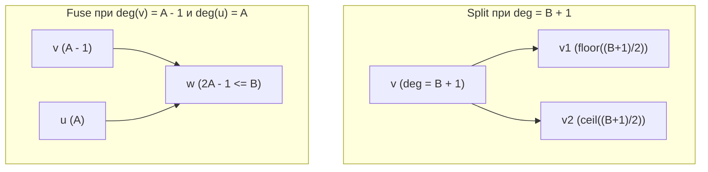

==Опр.== **(A,B)-дерево** - сбалансированное многопутевое [[Дерево поиска|дерево поиска]] с параметрами $A, B \in \mathbb{N}$ ($A \ge 2,\ B \ge 2A - 1$), в котором все листья *(носители элементов)* находятся на одной глубине $h$, а степени узлов *(количество детей $\deg(v)$)* удовлетворяют следующим инвариантам *(при непустом дереве с $n \ge 2$ листьями)*:
1. Для каждого внутреннего узла $v \neq \text{root}$: $A \le \deg(v) \le B$.
2. Для корня: $2 \le \deg(\text{root}) \le B$.
3. Внутренний узел $v$ степени $k = \deg(v)$ содержит упорядоченный массив из $k - 1$ ключей-разделителей $x_1 < x_2 < \dots < x_{k-1}$ и $k$ указателей на поддеревья $T_0, T_1, \dots, T_{k-1}$ т.ч. все элементы в $T_0$ меньше $x_1$, в $T_i$ лежат в $[x_i;\ x_{i+1})$ *(для $1 \le i \le k - 2$)*, а в $T_{k-1}$ не меньше $x_{k-1}$.

> [!IMPORTANT] Условие $B \ge 2A - 1$
> При переполнении узла его степень достигает $B + 1$, и операция расщепления делит его на два узла степеней $\lfloor \frac{B + 1}{2} \rfloor$ и $\lceil \frac{B + 1}{2} \rceil$. Чтобы оба новых узла удовлетворяли нижней границе $\ge A$, необходимо $\lfloor \frac{B + 1}{2} \rfloor \ge A \iff B \ge 2A - 1$. Для достижения амортизированно $O(1)$ ребалансировок на практике обычно берут $B \ge 2A$.

### Теорема о высоте (A,B)-дерева

Высота $h$ нетривиального $(A,B)$-дерева с $n \ge 2$ листьями удовлетворяет двусторонней оценке:$$\log_B n \le h \le 1 + \log_A \frac{n}{2}$$

#### Доказательство

1. **Нижняя граница**: у каждого узла не более $B$ детей, поэтому на глубине $h$ располагается не более $B^h$ листьев:$$n \le B^h \implies h \ge \log_B n$$
2. **Верхняя граница**: на глубине $1$ не менее $2$ узлов *(дети корня)*, а на каждом следующем уровне до глубины $h$ число узлов умножается минимум в $A$ раз, т.ч. на уровне $h$ не менее $2 A^{h-1}$ листьев:$$n \ge 2 A^{h-1} \implies A^{h-1} \le \frac{n}{2} \implies h \le 1 + \log_A \frac{n}{2}$$

## Основные операции

1. **Поиск**: в текущем узле $v$ ищем интервал между разделителями $[x_i;\ x_{i+1})$, содержащий искомый ключ $x$ *(бинарным поиском внутри узла)*, и переходим в поддерево $T_i$ до достижения уровня листьев.
2. **Вставка и `Split` *(расщепление)***:
   - Добавляем новый лист в родительский узел $v$ на глубине $h - 1$ и вставляем соответствующий разделитель.
   - Пока $\deg(v) = B + 1$: разрезаем $v$ на два узла степеней $\lfloor \frac{B+1}{2} \rfloor$ и $\lceil \frac{B+1}{2} \rceil$, а средний разделитель поднимаем в родителя $p = v.p$ *(степень $p$ растёт на $1$)*.
   - Если переполняется корень ($\deg(\text{root}) = B + 1$), создаём над двумя полученными узлами новый корень степени $2$ *(высота $h$ увеличивается на $1$)*.
3. **Удаление, `Borrow` *(заимствование)* и `Fuse` *(слияние)***:
   - Удаляем лист из родителя $v$ на глубине $h - 1$.
   - Пока $v \neq \text{root}$ и $\deg(v) = A - 1$:
     - **`Borrow`**: если у соседнего брата $u$ степень $\deg(u) \ge A + 1$, переносим крайнего ребёнка из $u$ в $v$ *(обновляя разделитель в родителе)* $\implies$ $\deg(v) = A,\ \deg(u) \ge A$, баланс восстановлен.
     - **`Fuse`**: иначе $\deg(u) = A$; сливаем $v$ и $u$ в один узел $w$ степени $(A - 1) + A = 2A - 1 \le B$ *(степень родителя $p$ уменьшается на $1$, переходим $v \leftarrow p$)*.
   - Если в итоге $\deg(\text{root}) = 1$, удаляем старый корень и объявляем его единственного ребёнка новым корнем *(высота $h$ уменьшается на $1$)*.

### Теорема об амортизированной ребалансировке при B >= 2A

В $(A, B)$-дереве с параметрами $B \ge 2A$ *(и $A \ge 2$)* амортизированное число операций `Split` и `Fuse` на одну вставку или удаление равно $O(1)$.

#### Доказательство

Применим [[Амортизационный анализ#Метод потенциалов|метод потенциалов]]. Определим потенциал внутреннего узла $v \neq \text{root}$ в зависимости от его степени $\deg(v)$:$$\varphi(v) = \begin{cases} 2, & \deg(v) = A - 1 \\ 1, & \deg(v) = A \\ 0, & A + 1 \le \deg(v) \le B - 1 \\ 2, & \deg(v) = B \\ 4, & \deg(v) = B + 1 \end{cases}$$а для корня положим $\varphi(\text{root}) = 0$ при $2 \le \deg(\text{root}) \le B - 1$, $\varphi(\text{root}) = 2$ при $\deg(\text{root}) \in \{1, B\}$ и $\varphi(\text{root}) = 4$ при $\deg(\text{root}) = B + 1$. Пусть $\Phi(T) = \sum\limits_{v \in T} \varphi(v) \ge 0$. Т.к. $B \ge 2A \ge 4$, интервал $[A + 1;\ B - 1]$ непуст и корректно отделён от $A$ и $B$.

1. **Начальное изменение листа и `Borrow`**:
   - При добавлении/удалении листа степень одного узла меняется на $\pm 1$, что увеличивает $\Phi(T)$ не более чем на $2$.
   - При `Borrow` степень $v$ растёт $A - 1 \to A$ ($\Delta\varphi(v) = -1$), а степень соседа-донора $u$ падает $d \to d - 1$ (где $d \ge A + 1 \implies \Delta\varphi(u) \le 1$). Суммарно $\Delta\Phi \le 0$, и операция `Borrow` выполняется не более 1 раза за удаление.
2. **Операция `Split`** *(реальная стоимость $1$, $\deg(v) = B + 1 \to d_1 = \lfloor \frac{B+1}{2} \rfloor,\ d_2 = \lceil \frac{B+1}{2} \rceil$)*:
   - Т.к. $B \ge 2A$ и $B \ge 4$, имеем $d_1 \ge A$ и $d_2 \le B - 1$. Если $B = 2A$, то $d_1 = A,\ d_2 = A + 1$, откуда $\varphi(v_1) + \varphi(v_2) = 1 + 0 = 1$; во всех прочих случаях $d_1, d_2 \in [A + 1;\ B - 1]$ и сумма равна $0$. Следовательно, всегда $\varphi(v_1) + \varphi(v_2) \le 1$.
   - Если $v \neq \text{root}$, то степень родителя $p$ увеличивается на $1$, давая прирост $\Delta\varphi(p) \le 2$ *(переходы $B - 1 \to B$ или $B \to B + 1$)*. Тогда:$$\Delta\Phi = \varphi(v_1) + \varphi(v_2) - \varphi(v) + \Delta\varphi(p) \le 1 - 4 + 2 = -1 \implies T^*_{\text{split}} = 1 + \Delta\Phi \le 0$$
   - Если $v = \text{root}$, создаётся новый корень степени $2 \in [2;\ B - 1]$ с потенциалом $0$, т.ч. $\Delta\Phi \le 0 + 1 - 4 = -3 \implies T^*_{\text{split}} \le -2 < 0$.
3. **Операция `Fuse`** *(реальная стоимость $1$, слияние $\deg(v) = A - 1$ и $\deg(u) = A$ в узел $w$ степени $2A - 1$)*:
   - В силу $A \ge 2$ и $B \ge 2A$ имеем $A + 1 \le 2A - 1 \le B - 1$, поэтому $\varphi(w) = 0$.
   - Если родитель $p \neq \text{root}$ *(или $p = \text{root}$ со степенью $\ge 3$)*, уменьшение степени $p$ на $1$ увеличивает $\varphi(p)$ не более чем на $1$ *(переходы $A + 1 \to A$ или $A \to A - 1$)*:$$\Delta\Phi = \varphi(w) - \varphi(v) - \varphi(u) + \Delta\varphi(p) \le 0 - 2 - 1 + 1 = -2 \implies T^*_{\text{fuse}} = 1 + \Delta\Phi \le -1 < 0$$
   - Если $p = \text{root}$ имел степень $2$, то после `Fuse` корень $p$ удаляется, а $w$ становится новым корнем степени $2A - 1 \le B - 1$ ($\varphi(w) = 0$):$$\Delta\Phi = 0 - (0 + 2 + 1) = -3 \implies T^*_{\text{fuse}} \le -2 < 0$$
4. **Итог**: т.к. каждая операция `Split` и `Fuse` имеет неположительную амортизированную стоимость, а начальное изменение листа и `Borrow` увеличивают потенциал не более чем на $O(1)$, амортизированное число ребалансировок на один запрос равно $O(1)$.

### Асимптотика

1. Сложность по времени: число переходов по высоте дерева на поиск, вставку и удаление равно $O(\log_A n)$ в худшем случае *(следует из Т. о высоте $(A,B)$-дерева)*; с учётом бинарного поиска внутри узлов суммарное число сравнений равно $O(\log B \cdot \log_A n) = O(\log n)$, а при $B \ge 2A$ амортизированное число операций `Split`/`Fuse` составляет $O(1)$ *(Т. об амортизированной ребалансировке при $B \ge 2A$)*.
2. Сложность по памяти: $O(n)$ - общее число внутренних узлов не превосходит $\frac{n}{A - 1} = O(n)$.

---
