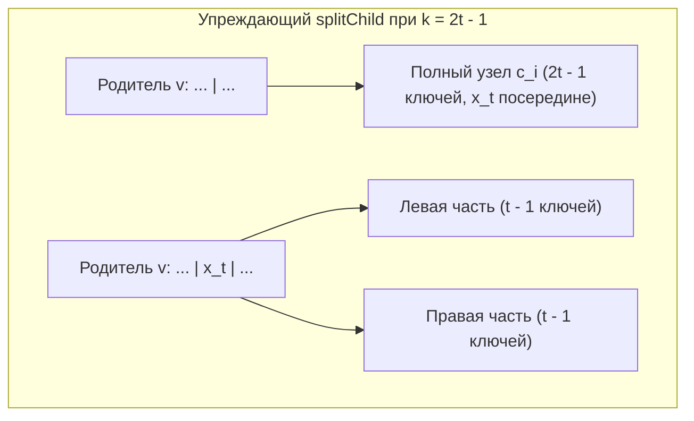

==Опр.== **B-дерево** *(B-tree)* минимальной степени $t \ge 2$ *(параметр ветвления)* - сбалансированное многопутевое дерево поиска, являющееся частным случаем [[(A,B)-дерево|(A,B)-дерева]] при $A = t,\ B = 2t$, оптимизированное для работы во внешней блочной памяти *(SSD, HDD, страницы виртуальной памяти ОС)*.

## Инварианты и аппаратная модель (I/O-модель)

В классическом B-дереве каждый узел $v$ представляет собой страницу фиксированного размера и хранит упорядоченный массив ключей $x_1 < x_2 < \dots < x_k$ *(где $k = k(v)$ - число ключей)*, а если $v$ не лист - ещё и $k + 1$ указатель на дочерние узлы $c_0, c_1, \dots, c_k$, разделяющие диапазоны ключей. При непустом дереве выполняются инварианты:
1. Для каждого узла $v \neq \text{root}$: $t - 1 \le k(v) \le 2t - 1$ *(что соответствует $t \le \deg(v) \le 2t$ детям для внутренних узлов)*.
2. Для корня: $1 \le k(\text{root}) \le 2t - 1$ *(при $2 \le \deg(\text{root}) \le 2t$, если корень не является листом)*.
3. Все листья расположены на одной глубине $h$ *(считая глубину корня равной $0$)*.

Параметр $t$ выбирается максимально возможным т.ч. $2t - 1$ ключей, $2t$ указателей и служебный заголовок помещаются ровно в одну страницу диска *(обычно 4-16 КБ)*. Это минимизирует количество медленных операций ввода-вывода *(I/O)*, а верхние уровни дерева при работе часто целиком кэшируются в RAM.

### Теорема о высоте B-дерева

Высота $h$ B-дерева минимальной степени $t \ge 2$, содержащего $n \ge 1$ ключей, ограничена сверху:$$h \le \log_t \frac{n + 1}{2}$$

#### Доказательство

1. В непустом B-дереве высоты $h \ge 0$ в корне находится минимум $1$ ключ *(а при $h \ge 1$ корень имеет не менее $2$ детей)*.
2. На глубине $1$ располагается не менее $2$ узлов, на глубине $2$ - не менее $2t$, и в общем случае на глубине $i \in \{1, \dots, h\}$ - не менее $2t^{i-1}$ узлов, каждый из которых хранит минимум $t - 1$ ключей.
3. Суммируя минимальное число ключей по всем уровням от $0$ до $h$:$$n \ge 1 + (t - 1)\sum\limits_{i=1}^h 2 t^{i-1} = 1 + 2(t - 1)\frac{t^h - 1}{t - 1} = 2t^h - 1$$
4. Отсюда $2t^h \le n + 1 \implies t^h \le \frac{n + 1}{2} \implies h \le \log_t \frac{n + 1}{2}$.

## Однопроходные операции (Top-Down)

Классические алгоритмы B-дерева спроектированы так, чтобы модификация выполнялась **за один проход сверху вниз** без обратного подъёма по дереву. Это снижает число I/O-операций и упрощает межузловые блокировки *(latch crabbing)* при параллельном доступе в СУБД.

1. **Поиск**: в узле $v$ бинарным поиском ищем наименьший индекс $i$ т.ч. $x \le x_i$. При $x = x_i$ ключ найден; если $v$ - лист, ключа в дереве нет; иначе подгружаем страницу $c_i$ и продолжаем спуск.
2. **Вставка с упреждающим расщеплением (`splitChild`)**:
   - Перед спуском в дочерний узел $c_i$ поддерживается инвариант $k(c_i) < 2t - 1$ *(узел не заполнен до отказа)*.
   - Если корень полон ($k(\text{root}) = 2t - 1$), создаём новый пустой корень, подвешиваем старый корень как его единственного ребёнка и сразу выполняем `splitChild(newRoot, 0)` *(высота дерева увеличивается на $1$)*.
   - Если в процессе спуска выбранный ребёнок $c_i$ заполнен ($k(c_i) = 2t - 1$), разрезаем $c_i$ на два узла по $t - 1$ ключей, поднимаем медианный ключ $x_t$ в родителя $v$ *(у которого гарантированно есть свободное место)* и спускаемся в нужную из двух половин.
   - Дойдя до неполного листа, вставляем новый ключ в отсортированный массив.
3. **Однопроходное удаление**:
   - Перед спуском в дочерний узел $c_i$ поддерживается инвариант $k(c_i) \ge t$, т.ч. удаление ключа не нарушит минимум $t - 1$. Если $k(c_i) = t - 1$:
     - Если у смежного брата $c_{i-1}$ или $c_{i+1}$ не менее $t$ ключей, выполняем **заимствование** *(опускаем разделитель из $v$ в $c_i$, а крайний ключ брата и его крайнего ребёнка переносим вверх в $v$)*.
     - Иначе у доступных соседей по $t - 1$ ключей $\implies$ **сливаем** $c_i$, соседа и разделитель из $v$ в один узел с $(t - 1) + 1 + (t - 1) = 2t - 1$ ключами *(если $v = \text{root}$ и стал пуст, объединённый узел становится новым корнем, уменьшая высоту на $1$)*.
   - При обнаружении удаляемого ключа $x$ в узле $v$:
     - Если $v$ - лист, удаляем $x$ из массива ключей.
     - Если $v$ - внутренний узел и $x = x_i$: если $k(c_i) \ge t$, заменяем $x$ на предшественника $x'$ *(максимум в $c_i$)* и рекурсивно удаляем $x'$ в $c_i$; аналогично при $k(c_{i+1}) \ge t$ заменяем на преемника $x''$ в $c_{i+1}$; если оба ребёнка содержат по $t - 1$ ключей, сливаем $c_i, x, c_{i+1}$ в один узел размера $2t - 1$ и рекурсивно удаляем $x$ в нём.

## Модификации: B+-дерево и B*-дерево

1. **B+-дерево**:
   - Полезные данные *(значения или указатели на строки таблицы)* хранятся **только в листьях**; внутренние узлы содержат исключительно ключи-маршрутизаторы и указатели на детей *(за счёт меньшего размера записи коэффициент ветвления $t$ значительно выше)*.
   - Все листья связаны между собой двусвязным списком, что позволяет выполнять диапазонные запросы `[a; b]` за один спуск к `a` и последовательное сканирование листьев за $O(\log_t n + m)$ I/O *(где $m$ - число найденных страниц ответа)*.
   - Является основным индексом современных реляционных СУБД *(PostgreSQL, MySQL InnoDB, SQLite)* и файловых систем *(NTFS, ext4, Btrfs, XFS)*.
2. **B*-дерево**:
   - Повышает минимальную заполненность узла с $\frac{1}{2}$ до $\frac{2}{3}$: при переполнении узла ключи сначала пытаются перераспределиться с соседним неполным братом.
   - Когда оба соседа полностью заполнены, выполняется расщепление **2 узлов в 3** с примерно $\frac{2}{3}$ ключей в каждом, что экономит дисковое пространство и снижает частоту расщеплений.

> [!IMPORTANT] B-дерево vs B+-дерево в СУБД
> На практике под термином «B-tree индекс» в документации баз данных почти всегда подразумевается именно **B+-дерево**. Хранение строк *(payload)* в листах резко увеличивает число ключей на одну страницу во внутренних узлах *(повышая $t$)*, сохраняет верхние уровни индекса в кэше буферного пула и делает диапазонное сканирование последовательным чтением без возвратов вверх по дереву.

### Асимптотика

1. **Сложность по I/O *(блочный обмен)***: $O(\log_t n)$ операций чтения/записи страниц на поиск, вставку и удаление *(следует из Т. о высоте B-дерева и однопроходного алгоритма)*. Для диапазонного запроса в B+-дереве - $O(\log_t n + m)$, где $m$ - количество страниц результата.
2. **Сложность по CPU *(внутри узлов)***: $O(\log t \cdot \log_t n) = O(\log n)$ для поиска *(бинарный поиск внутри страницы)*; $O(t \log_t n)$ в худшем случае для вставки и удаления из-за сдвигов элементов в массивах узлов. Т.к. B-дерево задаётся параметрами $B = 2t = 2A$, по [[(A,B)-дерево#Теорема об амортизированной ребалансировке при B >= 2A|Т. об амортизированной ребалансировке]] в [[(A,B)-дерево|(A,B)-дереве]] число расщеплений и слияний равно $O(1)$ амортизированно.
3. **Сложность по памяти**: $O(n)$ - коэффициент заполнения каждого не-корневого узла составляет не менее $50\%$ *(для B*-дерева - не менее $67\%$)*.

---
