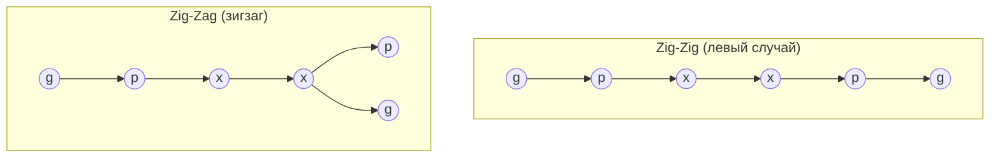

==Опр.== **Splay-дерево** *(Splay tree)* - самобалансирующееся [[Дерево поиска|бинарное дерево поиска]], не хранящее в вершинах дополнительных метаданных о балансе и поднимающее последнюю посещённую вершину в корень при помощи операции `splay`.

## Операция Splay

Пусть требуется поднять вершину $x$ в корень дерева. Обозначим $p = parent(x)$ - родитель вершины $x$, $g = parent(p)$ - предок $x$ на два уровня выше *(дед)*. На каждом шаге, пока $x$ не станет корнем, в зависимости от взаимного расположения $x, p, g$ выполняется один из трёх видов шагов *(и их зеркальные аналоги)*:

1. **Zig** ($g = \text{null}$, т.е. $p$ - корень) - одиночный поворот ребра $(x, p)$, после которого $x$ становится корнем.
2. **Zig-Zig** ($x$ и $p$ - однонаправленные сыновья: оба левые или оба правые) - сначала поворот ребра $(p, g)$, затем поворот ребра $(x, p)$.
3. **Zig-Zag** ($x$ и $p$ - разнонаправленные сыновья: левый у правого или правый у левого) - сначала поворот ребра $(x, p)$, затем поворот ребра $(x, g)$.



> [!warning] Порядок поворотов в Zig-Zig
> При наивном подъёме вершины $x$ к корню серией одиночных поворотов ребра $(x, p)$ дерево не уплощается и на последовательности запросов к крайним элементам вырождается в «бамбук» со сложностью $\Theta(n)$ на запрос. Именно предварительный поворот ребра $(p, g)$ в шаге Zig-Zig уменьшает глубину поддеревьев вдоль пути вдвое и гарантирует логарифмическую амортизированную оценку.

## Основные операции

1. **`find(x)`**: стандартный спуск по [[Дерево поиска#Свойство дерева поиска|свойству дерева поиска]]. Если вершина $v$ с ключом $x$ найдена - вызываем `splay(v)`. Иначе вызываем `splay(last)` от последней посещённой вершины перед пустым указателем *(если дерево непусто)*.
2. **`merge(T_1, T_2)`**: применимо при условии $\forall u \in T_1,\ \forall v \in T_2\ :\ key(u) < key(v)$. Если $T_1$ пусто - возвращаем $T_2$. Находим в $T_1$ вершину $m$ с максимальным ключом *(спуск по правым детям до конца)*, выполняем `splay(m)` в $T_1$ *(правый ребёнок у $m$ становится $\text{null}$)* и подвешиваем $T_2$ правым ребёнком к $m$.
3. **`split(T, x)`**: спускаемся от корня по ключу $x$ к ближайшему узлу $v$ *(содержащему $x$ или последнему посещённому)* и выполняем `splay(v)`.
   - Если $key(v) < x$, то отрезаем правое поддерево: $L = v$ (с $v_r = \text{null}$), $R = v_r$.
   - Если $key(v) \ge x$, то отрезаем левое поддерево: $L = v_l$, $R = v$ (с $v_l = \text{null}$).
4. **`insert(x)`**: выполняем `split(T, x)` на пару $(L, R)$. Если минимальный элемент в $R$ равен $x$, восстанавливаем дерево через `merge(L, R)`; иначе создаём новую вершину $v$ с ключом $x$, полагая $v_l = L,\ v_r = R$. *(Альтернативно: спуск BST с вставкой листа $v$ и вызовом `splay(v)`.)*
5. **`erase(x)`**: вызываем `find(x)`. Если в корне оказался ключ $x$, удаляем корень и возвращаем `merge(root->l, root->r)`.

## Амортизационный анализ

Припишем каждой вершине $v \in T$ произвольный положительный вес $w(v) > 0$. Определим вес поддерева с корнем $v$ как $s(v) = \sum\limits_{u \in T_v} w(u)$ и ранг $r(v) = \log_2 s(v)$. В качестве функции потенциала для [[Амортизационный анализ#Метод потенциалов|метода потенциалов]] зададим сумму рангов всех вершин дерева:$$\Phi(T) = \sum\limits_{v \in T} r(v)$$

### Лемма о доступе

Амортизированная стоимость операции `splay(x)` в дереве $T$ с корнем $t$ ограничена сверху величиной:$$T^*(\text{splay}(x)) \le 3(r(t) - r(x)) + 1$$

#### Доказательство

Обозначим через $s, r$ значения до шага `splay`, а через $s', r'$ - после одного шага. За реальную стоимость шага примем число выполненных поворотов ($1$ для Zig, $2$ для Zig-Zig и Zig-Zag).

1. **Шаг Zig** *(при $p = t$ меняются ранги только у $x$ и $p$, причём $r'(x) = r(p) \ge r(x)$ и $r'(p) \le r'(x)$)*:$$T^*_{\text{zig}} = 1 + r'(x) + r'(p) - r(x) - r(p) = 1 + r'(p) - r(x) \le 1 + r'(x) - r(x) \le 3(r'(x) - r(x)) + 1$$
2. **Шаг Zig-Zig** *(меняются ранги $x, p, g$, где $r'(x) = r(g),\ r'(p) \le r'(x),\ r(p) \ge r(x)$)*: поддеревья $T_x$ до шага и $T'_g$ после шага не пересекаются и целиком содержатся в $T'_x$, следовательно $s(x) + s'(g) \le s'(x)$. В силу вогнутости $\log_2$ (неравенство Йенсена):$$\frac{r(x) + r'(g)}{2} = \frac{\log_2 s(x) + \log_2 s'(g)}{2} \le \log_2 \frac{s(x) + s'(g)}{2} \le \log_2 \frac{s'(x)}{2} = r'(x) - 1$$Отсюда $2 + r'(g) \le 2r'(x) - r(x)$. Подставляя в $T^*_{\text{zig-zig}} = 2 + r'(x) + r'(p) + r'(g) - r(x) - r(p) - r(g)$:$$T^*_{\text{zig-zig}} = 2 + r'(p) + r'(g) - r(x) - r(p) \le (2r'(x) - r(x)) + r'(x) - r(x) - r(x) = 3(r'(x) - r(x))$$
3. **Шаг Zig-Zag** *(поддеревья $T'_p$ и $T'_g$ не пересекаются и лежат в $T'_x \implies s'(p) + s'(g) \le s'(x)$)*: аналогично по вогнутости $\log_2$ имеем $2 + r'(p) + r'(g) \le 2r'(x)$, а т.к. $r'(x) = r(g)$ и $r(p) \ge r(x)$:$$T^*_{\text{zig-zag}} = 2 + r'(p) + r'(g) - r(x) - r(p) \le 2r'(x) - 2r(x) = 2(r'(x) - r(x)) \le 3(r'(x) - r(x))$$
4. **Суммирование по пути**: на каждом полном шаге *(кроме, возможно, последнего Zig)* амортизированная стоимость не превосходит $3(r'(x) - r(x))$. Просуммировав телескопически по всем шагам от $x$ до корня $t$ и учтя максимум один завершающий Zig *(или $1$ операцию, если $x = t$)*, получаем:$$T^*(\text{splay}(x)) \le 3(r(t) - r(x)) + 1$$

## Ключевые теоремы о свойствах Splay-дерева

Выбор различных весовых функций $w(v)$ в [[#Лемма о доступе|Л. о доступе]] мгновенно даёт несколько фундаментальных оценок *(приведены б/д)*:

1. **Теорема о балансе (Balance Theorem)**: при $w(v) = 1\ \forall v \in T$ имеем $r(t) = \log_2 n$ и $r(x) \ge 0$, т.ч. суммарная стоимость $m$ операций на дереве из $n$ вершин равна $O((m + n)\log n)$, т.е. $O(\log n)$ амортизированно на операцию.
2. **Теорема о статической оптимальности (Static Optimality Theorem)**: при частотах обращения $q_i \ge 1$ к элементам ($m = \sum\limits_{i=1}^n q_i$) суммарное время всех обращений составляет $O\left(n \log n + \sum\limits_{i=1}^n q_i \log \frac{m}{q_i}\right)$, что с точностью до константы совпадает с энтропией Шеннона и не хуже любого фиксированного оптимального статического дерева поиска.
3. **Теорема о рабочем множестве (Working Set Theorem)**: если с момента предыдущего обращения к $x$ было запрошено $t(x)$ различных элементов, то амортизированная стоимость обращения к $x$ равна $O(\log(t(x) + 1))$.
4. **Теорема о статическом пальце (Static Finger Theorem)**: для любого фиксированного элемента $f$ амортизированная стоимость обращения к $x$ равна $O(\log(|rank(x) - rank(f)| + 1))$.

> [!tip] Локальность и гипотеза о динамической оптимальности
> Splay-дерево автоматически адаптируется к неравномерному и локальному распределению запросов без явной перестройки и хранения счётчиков. Также существует открытая **гипотеза о динамической оптимальности** *(Sleator-Tarjan, 1985)*: на любой последовательности запросов Splay-дерево работает не более чем в $O(1)$ раз дольше любого оффлайн-дерева поиска на поворотах.

## Реализация (C++)

```cpp
struct Node {
    int key;
    Node *l = nullptr, *r = nullptr, *p = nullptr;
    explicit Node(int k) : key(k) {}
};

void setChild(Node* parent, Node* child, bool isLeft) {
    if (child) child->p = parent;
    if (parent) {
        if (isLeft) parent->l = child;
        else parent->r = child;
    }
}

void rotate(Node* x) {
    Node* p = x->p;
    Node* g = p->p;
    bool isLeft = (p->l == x);
    setChild(p, isLeft ? x->r : x->l, isLeft);
    setChild(x, p, !isLeft);
    if (g) setChild(g, x, g->l == p);
    else x->p = nullptr;
}

Node* splay(Node* x) {
    while (x->p) {
        Node* p = x->p;
        Node* g = p->p;
        if (!g) {
            rotate(x); // Zig
        } else if ((g->l == p) == (p->l == x)) {
            rotate(p); // Zig-Zig
            rotate(x);
        } else {
            rotate(x); // Zig-Zag
            rotate(x);
        }
    }
    return x;
}
```

### Асимптотика

1. Сложность по времени: $O(\log n)$ амортизированно на `find`, `insert`, `erase`, `split`, `merge` - следует из Т. о балансе при $w(v) = 1$. В худшем случае одиночная операция может выполняться за $O(n)$.
2. Сложность по памяти: $O(n)$ - в каждом узле хранятся только ключ и три указателя (`l`, `r`, `p`), без полей баланса.

> [!warning] Ограничения применения
> Из-за худшего случая $O(n)$ на один запрос и мутации дерева при обычном чтении `find(x)`, Splay-дерево не подходит для жёстких real-time систем и плохо сочетается с  многопоточным доступом на чтение.

---
