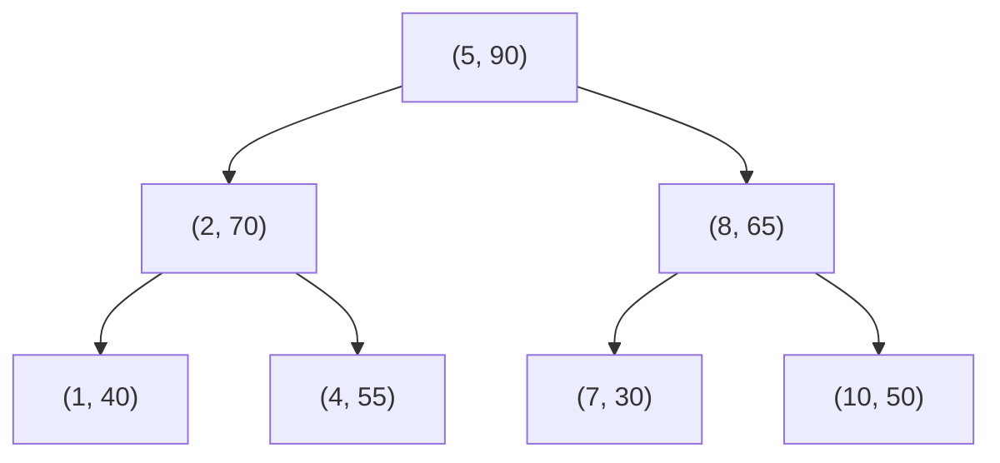

==Опр.== **Декартово дерево** *(Treap = Tree + Heap, курево)* - [[Дерево поиска|бинарное дерево]] с парами $(x, y)$ в узлах, где $x$ - ключ, $y$ - приоритет, удовлетворяющее одновременно двум инвариантам:
1. По ключу $x$ выполнено [[Дерево поиска#Свойство дерева поиска|свойство дерева поиска]]: для любого узла $v$ все ключи в левом поддереве меньше $x_v$, а в правом - больше $x_v$.
2. По приоритету $y$ выполнено [[Куча|свойство кучи]] *(зафиксируем max-heap)*: для любого узла $v$ и любого его ребёнка $u$ выполнено $y_u < y_v$.



### Теорема о единственности декартова дерева

При попарно различных ключах $x_1, \dots, x_n$ и попарно различных приоритетах $y_1, \dots, y_n$ структура декартова дерева однозначно определяется множеством пар $S = \{(x_i, y_i)\}_{i=1}^n$ и не зависит от порядка добавления элементов.

#### Доказательство

Применим математическую индукцию по количеству узлов $n$:
1. **База**: при $n = 0$ дерево пусто; при $n = 1$ единственная вершина является корнем.
2. **Шаг**: пусть утверждение верно для всех множеств мощности $< n$. Рассмотрим множество $S$ размера $n$. По свойству кучи корнем $T(S)$ может быть только элемент $(x_{\text{root}}, y_{\text{root}}) \in S$ с максимальным приоритетом $y_{\text{root}} = \max\limits_{(x, y) \in S} y$.
3. По свойству дерева поиска остальные элементы однозначно делятся на $S_L = \{(x, y) \in S \mid x < x_{\text{root}}\}$ (левое поддерево) и $S_R = \{(x, y) \in S \mid x > x_{\text{root}}\}$ (правое поддерево). Т.к. $|S_L| < n$ и $|S_R| < n$, по предположению индукции деревья $T(S_L)$ и $T(S_R)$ единственны $\implies$ всё дерево $T(S)$ определено однозначно.

> [!info] Эквивалентность последовательности вставок
> Из единственности следует, что декартово дерево изоморфно наивному [[Дерево поиска|бинарному дереву поиска]], в которое элементы $(x_i, y_i)$ добавлялись последовательно в порядке убывания их приоритетов $y_i$.

## Базовые операции Split и Merge

### Split *(разделение)*

Операция `split(T, x)` разрезает дерево $T$ на два корректных декартовых дерева $(L, R)$ т.ч. $\forall u \in L\ :\ u.x < x$ и $\forall v \in R\ :\ v.x \ge x$.

1. Если $T = \text{null}$ $\implies$ возвращаем $(\text{null}, \text{null})$.
2. Если $T.x < x$, то узел $T$ и всё его левое поддерево $T_l$ целиком попадают в $L$. Рекурсивно вызываем `(T.r, R) = split(T.r, x)` и возвращаем `(T, R)`.
3. Если $T.x \ge x$, то узел $T$ и всё его правое поддерево $T_r$ целиком попадают в $R$. Рекурсивно вызываем `(L, T.l) = split(T.l, x)` и возвращаем `(L, T)`.

### Merge *(слияние)*

Операция `merge(L, R)` объединяет два дерева $L$ и $R$ в одно, предполагая выполненным инвариант $\max\limits_{u \in L} u.x < \min\limits_{v \in R} v.x$.

1. Если $L = \text{null}$ $\implies$ возвращаем $R$; если $R = \text{null}$ $\implies$ возвращаем $L$.
2. Если $L.y > R.y$, то корнем результата по свойству кучи становится $L$. По инварианту все ключи $R$ больше $L.x$, поэтому рекурсивно присваиваем `L.r = merge(L.r, R)` и возвращаем $L$.
3. Иначе ($L.y \le R.y$) корнем становится $R$: присваиваем `R.l = merge(L, R.l)` и возвращаем $R$.

## Основные операции

1. **`find(x)`**: стандартный поиск в [[Дерево поиска|бинарном дереве поиска]] без изменения структуры дерева.
2. **`insert(x, y)`**:
   - *Через `split`/`merge`*: выполняем `(L, R) = split(T, x)` и возвращаем `merge(merge(L, new Node(x, y)), R)` *(при уникальности предварительно проверяем отсутствие $x$)*.
   - *Оптимизированный вариант (один спуск)*: спускаемся от корня по ключу $x$, пока $v \neq \text{null}$ и $v.y > y$. В найденном узле $v$ делаем `split(v, x) -> (newNode.l, newNode.r)` и заменяем указатель на $v$ у родителя на `newNode`.
3. **`erase(x)`**:
   - Спускаемся по ключу $x$ до узла $v$ и заменяем ссылку на $v$ результатом `merge(v.l, v.r)` *(либо делаем два `split`: отрезаем $< x$, затем $\ge x + 1$, и склеиваем края)*.

### Построение за O(n) по отсортированным ключам

Пусть массив пар $\{(x_i, y_i)\}_{i=1}^n$ отсортирован по возрастанию ключей $x_1 < x_2 < \dots < x_n$. Тогда декартово дерево строится за линейное время при помощи стека, хранящего вершины текущей самой правой ветки дерева *(от корня вниз; приоритеты в стеке убывают)*:

1. Последовательно перебираем пары $(x_i, y_i)$ слева направо.
2. Пока вершина на вершине стека имеет приоритет меньше $y_i$, извлекаем её из стека, запоминаем последнюю извлечённую вершину `last`.
3. Для новой вершины $v_i$ левым ребёнком становится `last` *(если хотя бы одна вершина была извлечена)*.
4. Если стек непуст, то у текущей вершины стека правым ребёнком становится $v_i$. Помещаем $v_i$ в стек.

Т.к. каждая вершина попадает в стек ровно один раз и извлекается не более одного раза, суммарная сложность построения составляет $O(n)$.

## Вероятностный анализ

Чтобы исключить вырождение в бамбук, приоритет $y_i$ при создании узла выбирается независимо и случайно из равномерного распределения.

### Теорема об ожидаемой глубине узла

Пусть в декартовом дереве $n$ вершин с отсортированными ключами $x_1 < x_2 < \dots < x_n$ и независимыми случайными приоритетами $y_1, \dots, y_n$. Тогда математическое ожидание глубины $k$-го по величине узла $v_k$ равно $O(\log n)$:$$\mathbb{E}[\text{depth}(v_k)] \le 2 H_n - 2 = O(\log n)$$где $H_n = \sum\limits_{m=1}^n \frac{1}{m}$ - $n$-е гармоническое число.

#### Доказательство

1. Введём индикаторную СВ $A_{i, j} = [v_i \text{ является строгим предком } v_j]$ для $i \neq j$. Глубина вершины $v_k$ равна числу её строгих предков:$$\text{depth}(v_k) = \sum\limits_{i \neq k} A_{i, k}$$
2. Покажем, что $v_i$ является предком $v_j$ ($i \neq j$) тогда и только тогда, когда $y_i = \max\limits_{t \in [\min(i, j),\ \max(i, j)]} y_t$. Действительно, если на отрезке между $i$ и $j$ нашёлся индекс $t$ с $y_t > y_i$, то в эквивалентной вставке по убыванию $y$ вершина $v_t$ вставляется раньше $v_i$ и разводит $v_i$ и $v_j$ в разные поддеревья. Обратно, если $y_i$ максимален на отрезке, ни один элемент между $i$ и $j$ не был вставлен раньше $v_i$, т.ч. $v_j$ попадает в поддерево $v_i$.
3. В силу независимости и равновероятности всех перестановок приоритетов на отрезке длины $|i - j| + 1$:$$\mathbb{P}(A_{i, j} = 1) = \frac{1}{|i - j| + 1}$$
4. По линейности математического ожидания:$$\mathbb{E}[\text{depth}(v_k)] = \sum\limits_{i=1}^{k-1} \frac{1}{k - i + 1} + \sum\limits_{i=k+1}^n \frac{1}{i - k + 1} = (H_k - 1) + (H_{n - k + 1} - 1) \le 2 H_n - 2 = O(\log n)$$

*(Аналогично доказывается *(б/д)*, что полная высота случайного декартова дерева удовлетворяет $\mathbb{E}[h] = O(\log n)$, причём $h = O(\log n)$ выполнено с высокой вероятностью.)*

## Реализация (C++)

```cpp
#include <random>
#include <utility>

std::mt19937 rng(42);

struct Node {
    int x;
    uint32_t y;
    Node *l = nullptr, *r = nullptr;
    explicit Node(int key) : x(key), y(rng()) {}
};

std::pair<Node*, Node*> split(Node* t, int x) {
    if (!t) return {nullptr, nullptr};
    if (t->x < x) {
        auto [l, r] = split(t->r, x);
        t->r = l;
        return {t, r};
    } else {
        auto [l, r] = split(t->l, x);
        t->l = r;
        return {l, t};
    }
}

Node* merge(Node* l, Node* r) {
    if (!l || !r) return l ? l : r;
    if (l->y > r->y) {
        l->r = merge(l->r, r);
        return l;
    } else {
        r->l = merge(l, r->l);
        return r;
    }
}
```

### Асимптотика

1. Сложность по времени: $O(\log n)$ в ожидании на `find`, `split`, `merge`, `insert`, `erase` *(следует из Т. об ожидаемой глубине узла; в худшем случае при неудачных приоритетах - $O(n)$)*. Построение по отсортированным ключам - $O(n)$.
2. Сложность по памяти: $O(n)$ - хранение ключа, приоритета и двух указателей на детей в каждой вершине.

> [!tip] Изоморфизм с быстрой сортировкой и персистентность
> Рандомизированное декартово дерево имеет ту же вероятностную структуру, что и дерево рекурсивных вызовов быстрой сортировки со случайным опорным элементом. Кроме того, т.к. `split` и `merge` не требуют указателей на родителей и модифицируют лишь один путь длины $O(\log n)$, на базе декартова дерева элементарно реализуется персистентность путём копирования узлов вдоль пути.

---
