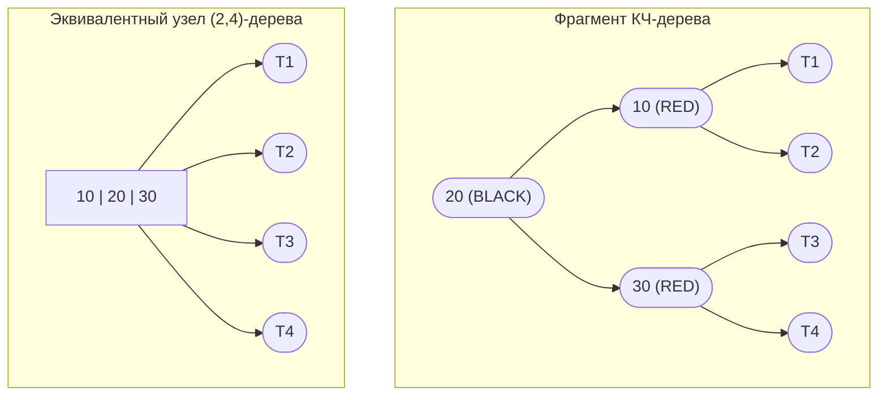

==Опр.== **Красно-чёрное дерево** *(КЧ-дерево, Red-Black Tree, RBT)* - сбалансированное бинарное дерево поиска, в котором каждому узлу $v$ приписан цвет $color(v) \in \{\text{RED}, \text{BLACK}\}$, пустые потомки представлены фиктивными листьями `NIL` без ключей, и выполняются 5 инвариантов:
1. Каждый узел либо красный, либо чёрный.
2. Корень дерева - чёрный.
3. Все фиктивные листья `NIL` - чёрные.
4. У каждого красного узла оба ребёнка - чёрные *(на любом пути от корня к листу нет двух красных узлов подряд)*.
5. Для любого узла $v$ все простые пути от $v$ до достижимых `NIL`-листьев содержат одинаковое число чёрных узлов *(не считая самого $v$)*. Это число называется **чёрной высотой** узла $bh(v)$.

## Оценка высоты

### Лемма о числе вершин в поддереве КЧ-дерева

Поддерево $T_v$ с корнем в произвольном узле $v$ содержит не менее $2^{bh(v)} - 1$ внутренних *(не `NIL`)* вершин.

#### Доказательство

Применим математическую индукцию по высоте $h(v)$ поддерева $T_v$ *(полагая $h(\text{NIL}) = 0$ и $h(v) = 1 + \max(h(v_l), h(v_r))$)*:
1. **База**: при $v = \text{NIL}$ имеем $h(v) = 0,\ bh(v) = 0$, число внутренних вершин равно $0 = 2^0 - 1$.
2. **Шаг**: пусть $v$ - внутренний узел с детьми $v_l, v_r$ *(имеющими меньшую высоту)*. По инварианту 5 каждый ребёнок $u \in \{v_l, v_r\}$ имеет чёрную высоту $bh(u) = bh(v) - 1$, если $u$ чёрный, и $bh(u) = bh(v)$, если $u$ красный $\implies$ в обоих случаях $bh(u) \ge bh(v) - 1$.
3. По предположению индукции для детей число внутренних узлов в $T_v$:$$|T_v| = 1 + |T_{v_l}| + |T_{v_r}| \ge 1 + (2^{bh(v) - 1} - 1) + (2^{bh(v) - 1} - 1) = 2^{bh(v)} - 1$$

### Теорема о высоте красно-чёрного дерева

Высота $h$ красно-чёрного дерева с $n$ внутренними узлами удовлетворяет оценке:$$h \le 2\log_2(n + 1)$$

#### Доказательство

1. Рассмотрим путь от корня $v_1$ до самого глубокого `NIL`-листа $v_{h+1}$ длины $h$ *(содержащий $h - 1$ внутренних узлов $v_2, \dots, v_h$ ниже корня и сам `NIL`-лист)*.
2. В силу инварианта 4 среди $v_2, \dots, v_h$ не бывает двух красных узлов подряд, т.ч. чёрных узлов среди них не менее $\lfloor \frac{h - 1}{2} \rfloor$. Учитывая чёрный лист $v_{h+1} = \text{NIL}$:$$bh(\text{root}) \ge 1 + \left\lfloor \frac{h - 1}{2} \right\rfloor = \left\lceil \frac{h}{2} \right\rceil \ge \frac{h}{2}$$
3. По [[#Лемма о числе вершин в поддереве КЧ-дерева|Л. о числе вершин в поддереве КЧ-дерева]]:$$n \ge 2^{bh(\text{root})} - 1 \ge 2^{h / 2} - 1 \implies 2^{h / 2} \le n + 1 \implies h \le 2\log_2(n + 1)$$

## Изометрия с (2,4)-деревом

Если каждый красный узел «стянуть» в его чёрного родителя, то любой чёрный узел с его $(0, 1$ или $2)$ красными детьми образует узел с $1, 2$ или $3$ ключами *(степенью $2, 3$ или $4$)*. По инварианту 5 все `NIL`-листья в преобразованном дереве оказываются на одной глубине $bh(\text{root})$, т.е. КЧ-дерево изоморфно [[(A,B)-дерево|(2,4)-дереву]] *(причём 3-узел имеет два представления в КЧ-дереве в зависимости от выбора левого или правого красного ребёнка)*.

## Вставка и восстановление баланса (insertFixup)

Новый узел $z$ вставляется на место `NIL`-листа по правилам дерева поиска и окрашивается в **красный** цвет, чтобы сохранить инвариант 5. Нарушиться может только инвариант 2 *(если $z$ стал корнем)* или инвариант 4 *(если $p = z.p$ красный; при этом $g = p.p$ существует и чёрный)*.

Пока $z \neq \text{root}$ и $color(p) = \text{RED}$, рассмотрим случай, когда $p$ - левый ребёнок $g$, а $u = g.r$ *(дядя; случай правого $p$ симметричен)*:

1. **Случай 1 ($color(u) = \text{RED}$)**: перекрашиваем $p$ и $u$ в чёрный, $g$ - в красный, сдвигаем указатель вверх: $z \leftarrow g$ *(0 поворотов; цикл продолжается вверх)*.
2. **Случай 2 ($color(u) = \text{BLACK}$, «зигзаг» $z = p.r$)**: выполняем левый поворот вокруг $p$ и переобозначаем $z \leftarrow p$, сводя конфигурацию к Случаю 3 *(1 поворот)*.
3. **Случай 3 ($color(u) = \text{BLACK}$, «линия» $z = p.l$)**: перекрашиваем $p$ в чёрный, $g$ - в красный и выполняем правый поворот вокруг $g$ *(1 поворот)*. Инвариант 4 восстановлен, цикл завершается.

После цикла принудительно устанавливаем $color(\text{root}) = \text{BLACK}$. Суммарно при вставке выполняется **не более 2 поворотов**.

## Удаление и восстановление баланса (deleteFixup)

Удаление узла с двумя не-`NIL` детьми сводится к обмену ключом с минимальным элементом правого поддерева и его последующему удалению. Пусть физически удаляемый узел $y$ имеет не более одного не-`NIL` ребёнка $x$, а исходный цвет $y$ равен $origColor$. Если $origColor = \text{RED}$, чёрные высоты не меняются. Если $origColor = \text{BLACK}$, на узел $x$ *(занявший место $y$)* переносится дефицит чёрной высоты *(«дополнительный чёрный вес»)*.

Пока $x \neq \text{root}$ и $color(x) = \text{BLACK}$, пусть $x$ - левый ребёнок $p = x.p$, а $w = p.r$ *(брат $x$; до удаления путь через $w$ содержал минимум один чёрный внутренний узел $\implies w \neq \text{NIL}$; правый случай симметричен)*:

1. **Случай 1 ($color(w) = \text{RED}$)**: перекрашиваем $w$ в чёрный, $p$ - в красный, выполняем левый поворот вокруг $p$ и обновляем $w = p.r$. Новый брат $w$ чёрный $\implies$ переходим к Случаям 2-4 *(1 поворот)*.
2. **Случай 2 ($color(w) = \text{BLACK},\ color(w.l) = color(w.r) = \text{BLACK}$)**: перекрашиваем $w$ в красный и переносим дефицит чёрного веса на родителя: $x \leftarrow p$ *(0 поворотов; цикл продолжается вверх)*.
3. **Случай 3 ($color(w) = \text{BLACK},\ color(w.l) = \text{RED},\ color(w.r) = \text{BLACK}$)**: перекрашиваем $w.l$ в чёрный, $w$ - в красный, выполняем правый поворот вокруг $w$ и обновляем $w = p.r$, сводя к Случаю 4 *(1 поворот)*.
4. **Случай 4 ($color(w) = \text{BLACK},\ color(w.r) = \text{RED}$)**: перекрашиваем $w$ в $color(p)$, $p$ - в чёрный, $w.r$ - в чёрный и выполняем левый поворот вокруг $p$. Дефицит устранён, полагаем $x = \text{root}$ *(1 поворот, выход из цикла)*.

В конце устанавливаем $color(x) = \text{BLACK}$ *(если $x$ был красным с «дополнительным чёрным весом» или корнем, инвариант 5 полностью восстанавливается)*. Суммарно при удалении выполняется **не более 3 поворотов** *(цепочка Случай 1 $\to$ Случай 3 $\to$ Случай 4)*.

## Сравнение с AVL-деревом

|          Критерий          |      Красно-чёрное дерево       |               AVL-дерево                |
| :------------------------: | :-----------------------------: | :-------------------------------------: |
|  **Максимальная высота**   |      $\le 2\log_2(n + 1)$       |         $\approx 1.44\log_2 n$          |
| **Поворотов при вставке**  |             $\le 2$             |   $\le 2$ *(один малый или большой)*    |
| **Поворотов при удалении** |             $\le 3$             | $O(\log n)$ *(может доходить до корня)* |
|   **Метаданные в узле**    |         $1$ бит (цвет)          |   Высота или разница высот ($2$ бита)   |
|    **Профиль нагрузки**    | Быстрые частые вставки/удаления |      Преобладание операций поиска       |

> [!IMPORTANT] Применение в стандартных библиотеках и ОС
> Гарантированная граница $O(1)$ структурных перестроек ($\le 2$ при вставке, $\le 3$ при удалении) делает красно-чёрное дерево стандартом для системного кода и стандартных библиотек: `std::map` / `std::set` в C++ STL, `TreeMap` / `TreeSet` в Java, подсистема `rbtree` в ядре Linux *(планировщик CFS, `epoll`, области виртуальной памяти VMA)*.

### Асимптотика

1. Сложность по времени: $O(\log n)$ в худшем случае для `find`, `insert`, `erase` *(следует из Т. о высоте красно-чёрного дерева)*. Число поворотов на модификацию равно $O(1)$ ($\le 2$ для вставки, $\le 3$ для удаления); в силу изоморфизма с $(2,4)$-деревом при $B = 4 = 2A$ амортизированное число перекрасок также равно $O(1)$ *(в худшем случае $O(\log n)$)*.
2. Сложность по памяти: $O(n)$ - один бит цвета, ключ и указатели `l`, `r`, `p` *(плюс общий глобальный узел `NIL`)* на каждую из $n$ вершин.

---
