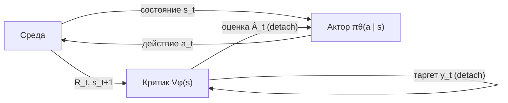

Даже после введения [[Baseline-инвариантность в Policy Gradient|baseline-инвариантности]] в REINFORCE остаются две проблемы:
1. **Неизвестная $V^\pi(s_t)$**: истинную функцию ценности среды приходится приближать отдельной моделью.
2. **Монте-Карло возвраты $G_t$**: расчёт $G_t$ требует доигрывать эпизод до конца, что на длинных траекториях сохраняет высокую дисперсию, а в непрерывных задачах без терминального состояния неприменимо.

Решение - оценивание функции преимущества *(Advantage)* и переход к схеме **Actor-Critic** *(параметрическому аналогу [[Policy Iteration#Generalized Policy Iteration (GPI)|GPI]])*, где политика обучается совместно с моделью ценности, позволяющей обновлять веса по коротким фрагментам траектории *(bootstrapping)*.

==Опр.== **Функция преимущества** *(Advantage function)* - разность между функцией ценности действия и функцией ценности состояния при фиксированной стратегии $\pi$:$$A^\pi(s, a) = Q^\pi(s, a) - V^\pi(s)$$
==Опр.== **Актор** *(Actor)* - параметризованная стратегия $\pi_\theta(a \mid s)$ с весами $\theta$, генерирующая действия и обновляемая по направлению градиента целевого функционала $J(\theta)$.

==Опр.== **Критик** *(Critic)* - параметризованная оценочная модель $V_\phi(s) \approx V^\pi(s)$ *(в некоторых off-policy методах - $Q_\phi(s, a)$)* с весами $\phi$, оценивающая текущую стратегию актора и формирующая обучающий сигнал *(оценку Advantage)*.

==Опр.== **TD-ошибка** *(Temporal Difference error)* - одношаговая невязка уравнения Беллмана на переходе $(s_t, a_t, R_t, s_{t+1})$:$$\delta_t = R_t + \gamma V_\phi(s_{t+1}) - V_\phi(s_t)$$
В терминах дисконтированного распределения посещения состояний $d^{\pi_\theta}(s) = (1 - \gamma) \sum\limits_{t=0}^{\infty} \gamma^t \mathbb{P}(s_t = s \mid \pi_\theta)$ градиент стратегии записывается через Advantage:$$\nabla_\theta J(\theta) = \frac{1}{1 - \gamma} \mathbb{E}_{s \sim d^{\pi_\theta},\, a \sim \pi_\theta(\cdot \mid s)} \left[ \nabla_\theta \log \pi_\theta(a \mid s) \cdot A^{\pi_\theta}(s, a) \right]$$

### Оценки Advantage

На практике истинное $A^\pi(s_t, a_t)$ заменяют оценкой $\hat{A}_t$, выбирая компромисс в [[Bias-Variance-Noise декомпозиция|bias-variance trade-off]]:
* **MC-оценка**: $\hat{A}_t^{\text{MC}} = G_t - V_\phi(s_t)$.
* **TD(0)-оценка**: $\hat{A}_t^{\text{TD}(0)} = \delta_t = R_t + \gamma V_\phi(s_{t+1}) - V_\phi(s_t)$.
* **TD($n$)-оценка**: $\hat{A}_t^{(n)} = \sum\limits_{l=0}^{n-1} \gamma^l R_{t+l} + \gamma^n V_\phi(s_{t+n}) - V_\phi(s_t) = \sum\limits_{l=0}^{n-1} \gamma^l \delta_{t+l}$.
* **GAE** *(Generalized Advantage Estimation)* - экспоненциально взвешенная смесь $n$-шаговых оценок с гиперпараметром $\lambda \in [0; 1]$ *(для конечного эпизода длины $T$ суммирование обрывается на $l = T - 1 - t$)*:$$\hat{A}_t^{\text{GAE}(\gamma, \lambda)} = (1 - \lambda) \sum\limits_{n=1}^{\infty} \lambda^{n-1} \hat{A}_t^{(n)} = \sum\limits_{l=0}^{\infty} (\gamma \lambda)^l \delta_{t+l}$$

> [!INFO] Интерпретация знака Advantage и архитектура
> Advantage - «центрированная» $Q$-функция. Если $A^\pi(s, a) > 0$, действие $a$ лучше среднего поведения текущей стратегии в состоянии $s \implies$ его вероятность растёт; если $A^\pi(s, a) < 0$ - хуже среднего $\implies$ вероятность снижается.
> Архитектурно актора и критика часто объединяют в одну нейросеть с общим **backbone** *(извлекает признаки из $s_t$)* и двумя головами: policy head выдаёт $\pi_\theta(a \mid s_t)$, value head выдаёт скаляр $V_\phi(s_t)$.

> [!TIP] Почему критик учит $V(s)$, а не $Q(s, a)$ или $A(s, a)$ напрямую
> * **Меньше размерность**: $V_\phi(s)$ возвращает один скаляр на состояние, тогда как $Q_\phi(s, a)$ требует оценки для каждого действия *(проблемно при большом или непрерывном $\mathcal{A}$)*.
> * **Меньше зависимость от ошибок критика**: при прямой подстановке неточной $Q_\phi(s, a)$ в градиент стратегия вырождается в жадный $\arg\max\limits_{a \in \mathcal{A}} Q_\phi(s, a)$, полностью наследуя ошибки критика; с $V_\phi$ в MC/GAE актор опирается и на реальные награды.
> * **Нельзя учить $A_\phi(s, a)$ напрямую**: Advantage обязана удовлетворять $\mathbb{E}_{a \sim \pi}A^\pi(s, a) = 0$, а без $V^\pi(s)$ для неё нет замкнутого уравнения Беллмана.

> [!EXAMPLE] Пример: **Игрок и тренер**
> Актор - игрок на поле, принимающий решения. Критик - тренер на бровке, оценивающий по текущей позиции, сколько очков команда обычно набирает из неё ($V_\phi(s_t)$). Если после конкретного паса реальный результат и новая позиция оказались лучше прогноза тренера ($\hat{A}_t > 0$), игрок закрепляет приём; если хуже ($\hat{A}_t < 0$) - отказывается от него.

> [!WARNING] Stop-gradient (detach)
> В функции потерь актора оценка $\hat{A}_t$ должна передаваться как константа без проброса градиента *(в PyTorch - `.detach()`)*, равно как и таргет $y_t$ в лоссе критика. Иначе при общем backbone градиент от актора искажает предсказания критика, искусственно завышая $\hat{A}_t$ вместо улучшения политики.

### Схема взаимодействия актора и критика

Один цикл взаимодействия на переходе $(s_t, a_t, R_t, s_{t+1})$:
1. **Действие**: актор по состоянию $s_t$ сэмплирует $a_t \sim \pi_\theta(\cdot \mid s_t)$, среда возвращает награду $R_t$ и следующее состояние $s_{t+1}$.
2. **Оценка**: критик сравнивает фактический исход со своим прогнозом $V_\phi(s_t)$ и формирует сигнал $\hat{A}_t$: $\hat{A}_t > 0$ - исход лучше ожидаемого, $\hat{A}_t < 0$ - хуже.
3. **Обновление актора**: вероятность действия $a_t$ сдвигается пропорционально сигналу критика:$$\theta \leftarrow \theta + \alpha_\theta \, \hat{A}_t \, \nabla_\theta \log \pi_\theta(a_t \mid s_t)$$
4. **Обновление критика**: прогноз $V_\phi(s_t)$ подтягивается к таргету $y_t = \hat{A}_t + V_\phi(s_t)$:$$\phi \leftarrow \phi - \alpha_\phi \, \nabla_\phi \left( V_\phi(s_t) - y_t \right)^2$$
5. **Повтор**: критик отслеживает ценность $V^{\pi_\theta}$ меняющейся стратегии *(оценивание)*, а актор улучшает стратегию по сигналу критика *(улучшение)* - чередование этих двух процессов и есть параметрическая форма GPI.

### Центрированность Advantage

$\forall \pi\ \forall s \in \mathcal{S}\ :\ \mathbb{E}_{a \sim \pi(\cdot \mid s)} A^\pi(s, a) = 0 \ \wedge\ \sup\limits_{a \in \mathcal{A}} A^\pi(s, a) \ge 0$.

#### Доказательство

1. По определению $A^\pi(s, a) = Q^\pi(s, a) - V^\pi(s)$ и линейности математического ожидания:$$\mathbb{E}_{a \sim \pi(\cdot \mid s)} A^\pi(s, a) = \mathbb{E}_{a \sim \pi(\cdot \mid s)} Q^\pi(s, a) - V^\pi(s)$$
2. Из связи $V^\pi$ и $Q^\pi$ по формуле полного математического ожидания: $$\mathbb{E}_{a \sim \pi(\cdot \mid s)} Q^\pi(s, a) = V^\pi(s) \implies \mathbb{E}_{a \sim \pi(\cdot \mid s)} A^\pi(s, a) = V^\pi(s) - V^\pi(s) = 0$$
3. Т.к. $\forall a \in \mathcal{A}\ :\ A^\pi(s, a) \le \sup\limits_{a' \in \mathcal{A}} A^\pi(s, a')$, усреднение по $a \sim \pi(\cdot \mid s)$ даёт $0 = \mathbb{E}A^\pi(s, a) \le \sup\limits_{a \in \mathcal{A}} A^\pi(s, a)$.

### Несмещённость TD(0)-оценки при точном критике

Если $V_\phi \equiv V^\pi$, то $\forall (s_t, a_t)\ :\ \mathbb{E}_{R_t, s_{t+1} \mid s_t, a_t}[\delta_t] = A^\pi(s_t, a_t)$.

#### Доказательство

1. Подставим определение $\delta_t$ при $V_\phi \equiv V^\pi$:$$\mathbb{E}_{R_t, s_{t+1} \mid s_t, a_t}[\delta_t] = \mathbb{E}\left[ R_t + \gamma V^\pi(s_{t+1}) \mid s_t, a_t \right] - V^\pi(s_t)$$
2. По уравнению Беллмана для $Q$-функции $\mathbb{E}\left[ R_t + \gamma V^\pi(s_{t+1}) \mid s_t, a_t \right] = Q^\pi(s_t, a_t)$, откуда $\mathbb{E}[\delta_t \mid s_t, a_t] = Q^\pi(s_t, a_t) - V^\pi(s_t) = A^\pi(s_t, a_t)$ *(при $V_\phi \neq V^\pi$ равенство нарушается $\implies$ возникает смещение оценки)*.

### Телескопическое разложение TD($n$)

$\forall n \in \mathbb{N}\ :\ \sum\limits_{l=0}^{n-1} \gamma^l \delta_{t+l} = \sum\limits_{l=0}^{n-1} \gamma^l R_{t+l} + \gamma^n V_\phi(s_{t+n}) - V_\phi(s_t)$.

#### Доказательство

1. Раскроем $\delta_{t+l}$ и разнесём слагаемые по отдельным суммам:$$\sum\limits_{l=0}^{n-1} \gamma^l \delta_{t+l} = \sum\limits_{l=0}^{n-1} \gamma^l R_{t+l} + \sum\limits_{l=0}^{n-1} \gamma^{l+1} V_\phi(s_{t+l+1}) - \sum\limits_{l=0}^{n-1} \gamma^l V_\phi(s_{t+l})$$
2. Во второй сумме выполним замену индекса $j = l + 1$:$$\sum\limits_{j=1}^{n} \gamma^j V_\phi(s_{t+j}) - \sum\limits_{l=0}^{n-1} \gamma^l V_\phi(s_{t+l})$$
3. Промежуточные члены с индексами $j \in \overline{1, n-1}$ взаимно уничтожаются, остаётся $\gamma^n V_\phi(s_{t+n}) - V_\phi(s_t)$.

### Алгоритм Advantage Actor-Critic (A2C)

Вход: $M$ параллельных сред, длина роллаута $N$, нейросети актора $\pi_\theta(a \mid s)$ и критика $V_\phi(s)$ *(возможно с общим backbone)*, коэффициенты $c_V > 0$, $c_H \ge 0$, шаг $\alpha > 0$.
1. **Сбор роллаутов (on-policy)**: в каждой из $M$ сред выполнить $N$ шагов по текущей стратегии $\pi_\theta$, сохраняя переходы $(s_t^{(m)}, a_t^{(m)}, R_t^{(m)}, s_{t+1}^{(m)})$.
2. **Оценка Advantage и таргетов критика**:
	1. Вычислить TD-ошибки $\delta_t^{(m)} = R_t^{(m)} + \gamma V_\phi(s_{t+1}^{(m)}) - V_\phi(s_t^{(m)})$ *(для терминального $s_{t+1}$ полагается $V_\phi(s_{t+1}) = 0$)*.
	2. Обратным проходом от $t = N - 1$ к $0$ вычислить GAE *(при терминальном $s_{t+1}^{(m)}$ рекурсия обнуляется)*:$$\hat{A}_t^{(m)} = \delta_t^{(m)} + \gamma \lambda \hat{A}_{t+1}^{(m)}, \quad \hat{A}_N^{(m)} = 0$$
	3. Сформировать таргет критика $y_t^{(m)} = \hat{A}_t^{(m)} + V_\phi(s_t^{(m)})$ и зафиксировать $\hat{A}_t^{(m)}, y_t^{(m)}$ операцией `detach` *(опционально нормировать $\hat{A}_t$ по батчу: $\hat{A} \leftarrow \frac{\hat{A} - \mu_{\hat{A}}}{\sigma_{\hat{A}} + \varepsilon}$)*.
3. **Функции потерь**:
	1. Лосс актора:$$L_{\text{actor}}(\theta) = -\frac{1}{MN} \sum\limits_{m=1}^{M} \sum\limits_{t=0}^{N-1} \log \pi_\theta(a_t^{(m)} \mid s_t^{(m)}) \cdot \hat{A}_t^{(m)}$$
	2. Лосс критика *(MSE)*:$$L_{\text{critic}}(\phi) = \frac{1}{MN} \sum\limits_{m=1}^{M} \sum\limits_{t=0}^{N-1} \left( V_\phi(s_t^{(m)}) - y_t^{(m)} \right)^2$$
	3. Энтропийный бонус для исследования:$$H(\pi_\theta) = -\frac{1}{MN} \sum\limits_{m=1}^{M} \sum\limits_{t=0}^{N-1} \mathbb{E}_{a \sim \pi_\theta} \log \pi_\theta(a \mid s_t^{(m)})$$
4. **Шаг оптимизации**: обновить параметры $(\theta, \phi)$ по общему функционалу потерь:$$L(\theta, \phi) = L_{\text{actor}}(\theta) + c_V L_{\text{critic}}(\phi) - c_H H(\pi_\theta)$$
#### Асимптотика

Для одной итерации алгоритма A2C по $M$ средам с длиной роллаута $N$:
1. Сложность по времени: $O(M N \cdot (C_{\text{bb}} + C_{\text{act}} + C_{\text{crit}}))$, где $C_{\text{bb}}, C_{\text{act}}, C_{\text{crit}}$ - стоимость прохода через backbone, голову актора и голову критика *(расчёт GAE обратным проходом стоит $O(MN)$)*.
2. Сложность по памяти: $O(M N \cdot \dim \mathcal{S} + |\theta_{\text{bb}}| + |\theta_{\text{act}}| + |\phi_{\text{crit}}|)$ - при $N \ll T$ не зависит от полной длины эпизода $T$.

*Узкие места*:
1. В больших моделях критик $V_\phi$ сопоставим по размеру с актором $\pi_\theta$, что радикально увеличивает расход памяти.
2. Нестабильность совместного обучения: критик оценивает движущуюся цель $V^{\pi_\theta}$, а актор опирается на недообученного критика.

### Сравнительный анализ оценок $\hat{A}_t$

|  Метод оценки $\hat{A}_t$  |                           Формула                           |         Смещение (Bias)         |   Дисперсия (Variance)   |    Конец эпизода     |
| :------------------------: | :---------------------------------------------------------: | :-----------------------------: | :----------------------: | :------------------: |
|   **MC ($\lambda = 1$)**   |                     $G_t - V_\phi(s_t)$                     |             Нулевое             |         Высокая          |      Обязателен      |
| **TD(0) ($\lambda = 0$)**  |        $R_t + \gamma V_\phi(s_{t+1}) - V_\phi(s_t)$         | Высокое *(зависит от $V_\phi$)* |       Минимальная        |       Не нужен       |
|        **TD($n$)**         |       $\sum\limits_{l=0}^{n-1} \gamma^l \delta_{t+l}$       |    Среднее *(убывает с $n$)*    | Средняя *(растёт с $n$)* | Не нужен ($N \ge n$) |
| **GAE($\gamma, \lambda$)** | $\sum\limits_{l=0}^{T-1-t} (\gamma \lambda)^l \delta_{t+l}$ |      Управляется $\lambda$      |  Управляется $\lambda$   |       Не нужен       |

### +ы & -ы Actor-Critic

> [!SUCCESS] Преимущества
> * Обучение по коротким роллаутам без ожидания завершения эпизода *(применимо при бесконечном горизонте)*.
> * Существенно ниже дисперсия градиента по сравнению с REINFORCE.
> * Естественная работа с непрерывными и многомерными пространствами действий $\mathcal{A}$ *(в отличие от DQN)* и гибкая настройка bias-variance через GAE.

> [!FAILURE] Недостатки
> * При бутстрэппинге *(TD / GAE с $\lambda < 1$)* вносит смещение, если критик $V_\phi$ обучен плохо.
> * Требует хранения и обучения дополнительной сети критика *(дорого по памяти)*.
> * Базовая схема A2C остаётся on-policy и не защищена от слишком больших шагов по политике.

---
