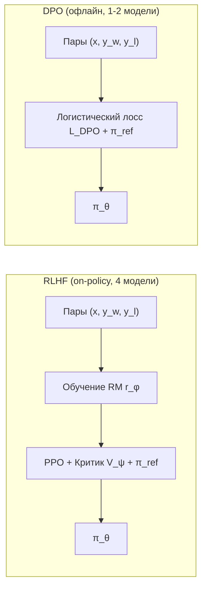

Классический [[RLHF]] с PPO требует обучения отдельной Reward Model $r_\varphi$, хранения 4 моделей в памяти и дорогого on-policy сэмплирования. Метод **DPO** *(Direct Preference Optimization)* показывает, что аналитическое решение KL-регуляризованной задачи RLHF позволяет выразить награду через саму политику $\pi^*$ и свести выравнивание LLM к бинарной классификации на офлайн-парах без RM, критика и RL-цикла.

==Опр.== **Неявная награда** *(implicit reward)* - репараметризация функции награды через отношение вероятностей $\pi_\theta$ и замороженной $\pi_{\text{ref}}$ *(с точностью до аддитивной константы $Z(x)$)*:$$\hat{r}_\theta(x, y) = \beta \log \frac{\pi_\theta(y \mid x)}{\pi_{\text{ref}}(y \mid x)}$$
==Опр.== **Функция потерь DPO** *(Direct Preference Optimization loss)* - отрицательное лог-правдоподобие модели Брэдли-Терри с подставленной неявной наградой $\hat{r}_\theta$:$$\mathcal{L}_{\text{DPO}}(\theta) = -\mathbb{E}_{(x, y_w, y_l) \sim \mathcal{D}} \log \sigma\left( \beta \log \frac{\pi_\theta(y_w \mid x)}{\pi_{\text{ref}}(y_w \mid x)} - \beta \log \frac{\pi_\theta(y_l \mid x)}{\pi_{\text{ref}}(y_l \mid x)} \right) \to \inf\limits_\theta$$
==Опр.== **KTO** *(Kahneman-Tversky Optimization)* - офлайн-вариация DPO для одиночных ответов с бинарной меткой $m \in \{\pm1\}$ *(«лайк / дизлайк»)*, где лог-отношение сравнивается с опорной точкой $z_0 = \mathrm{KL}(\pi_\theta \,\|\, \pi_{\text{ref}})$ при весах классов $\lambda_{+1}, \lambda_{-1} > 0$:$$\mathcal{L}_{\text{KTO}}(\theta) = \mathbb{E}_{(x, y, m) \sim \mathcal{D}} \left[ \lambda_m \Big(1 - \sigma\big( m \, \beta \, (\ell_\theta(x, y) - z_0) \big)\Big) \right], \quad \ell_\theta(x, y) = \log \frac{\pi_\theta(y \mid x)}{\pi_{\text{ref}}(y \mid x)}$$
> [!TIP] Интуиция DPO: языковая модель как неявная RM
> Пара $(\pi_\theta, \pi_{\text{ref}})$ однозначно задаёт неявную награду $\hat{r}_\theta(x, y) = \beta \log \frac{\pi_\theta(y \mid x)}{\pi_{\text{ref}}(y \mid x)}$. DPO напрямую настраивает веса $\pi_\theta$ так, чтобы неявная награда $y_w$ превышала неявную награду $y_l$, делая отдельную RM и RL-цикл избыточными.

> [!INFO] Механика градиента DPO
> В градиенте $\nabla_\theta \mathcal{L}_{\text{DPO}}(\theta) = -\beta\,\mathbb{E}[\sigma(\hat{r}_\theta(x, y_l) - \hat{r}_\theta(x, y_w)) \cdot (\nabla_\theta \log \pi_\theta(y_w \mid x) - \nabla_\theta \log \pi_\theta(y_l \mid x))]$ множитель $\sigma(\hat{r}_\theta(y_l) - \hat{r}_\theta(y_w)) \in (0; 1)$ - вероятность ошибки текущей неявной награды. Если модель уже уверенно ранжирует $y_w \succ y_l$, вес стремится к $0$; если ошибается - близок к $1$, задавая неявную KL-регуляризацию.

> [!WARNING] Слабости и оговорки DPO
> 1. **Likelihood displacement**: лосс зависит только от разности $\hat{r}_\theta(y_w) - \hat{r}_\theta(y_l)$. Если $\pi_\theta(y_l \mid x)$ падает быстрее $\pi_\theta(y_w \mid x)$, лосс снижается, но вероятность правильного ответа $y_w$ тоже может падать.
> 2. **Distribution shift**: DPO работает офлайн и не проверяет собственные свежие генерации; при сборе пар другой моделью качество падает.
> 3. **Выразимость семейства**: максимум при выводе берётся по всем распределениям $\pi(\cdot \mid x)$, а нейросеть $\pi_\theta$ задаёт лишь параметрическое подмножество, поэтому эквивалентность с RLHF приближённа.

### Замкнутый вид оптимальной политики RLHF

Для фиксированного $x$, ограниченной награды $r(x, y)$ и $\beta > 0$ единственное решение задачи $\sup\limits_{\pi(\cdot \mid x)} \left(\mathbb{E}_{y \sim \pi} r(x, y) - \beta\,\mathrm{KL}(\pi \,\|\, \pi_{\text{ref}})\right)$ в классе всех распределений имеет вид:$$\pi^*(y \mid x) = (Z(x))^{-1} \, \pi_{\text{ref}}(y \mid x) \exp\left(\frac{r(x, y)}{\beta}\right), \quad Z(x) = \sum\limits_{y} \pi_{\text{ref}}(y \mid x) \exp\left(\frac{r(x, y)}{\beta}\right)$$
#### Доказательство

1. Вынесем $-\beta$ и объединим слагаемые под одним матожиданием по $y \sim \pi(\cdot \mid x)$:$$\mathbb{E}_{y \sim \pi} \left[ r(x, y) - \beta \log \frac{\pi(y \mid x)}{\pi_{\text{ref}}(y \mid x)} \right] = -\beta \, \mathbb{E}_{y \sim \pi} \log \frac{\pi(y \mid x)}{\pi_{\text{ref}}(y \mid x) \exp\big(r(x, y) / \beta\big)}$$
2. Введём нормированное распределение $\pi^*(y \mid x) = \frac{1}{Z(x)} \pi_{\text{ref}}(y \mid x) \exp\big(\frac{r(x, y)}{\beta}\big)$, где $Z(x) > 0$ зависит только от $x$. Умножая и деля знаменатель под логарифмом на $Z(x)$:$$-\beta \, \mathbb{E}_{y \sim \pi} \log \frac{\pi(y \mid x)}{Z(x) \cdot \pi^*(y \mid x)} = -\beta \, \mathrm{KL}\big(\pi(\cdot \mid x) \,\|\, \pi^*(\cdot \mid x)\big) + \beta \log Z(x)$$
3. Слагаемое $\beta \log Z(x)$ не зависит от $\pi$, а по неравенству Гиббса $\mathrm{KL}(\pi \,\|\, \pi^*) \ge 0$ с единственным минимумом $0 \iff \pi(\cdot \mid x) \equiv \pi^*(\cdot \mid x)$.

### Вывод лосса DPO и сокращение $Z(x)$

При подстановке награды $r(x, y)$, выраженной через $\pi^*$, в модель Брэдли-Терри нормировочная константа $Z(x)$ сокращается, и правдоподобие выражается исключительно через $\pi^*$ и $\pi_{\text{ref}}$.

#### Доказательство

1. Прологарифмируем формулу замкнутого вида $\pi^*(y \mid x)$ и выразим $r(x, y)$:$$\log \frac{\pi^*(y \mid x)}{\pi_{\text{ref}}(y \mid x)} = \frac{r(x, y)}{\beta} - \log Z(x) \iff r(x, y) = \beta \log \frac{\pi^*(y \mid x)}{\pi_{\text{ref}}(y \mid x)} + \beta \log Z(x)$$
2. Вычислим разность наград для пары $(y_w, y_l)$ на один промпт $x$:$$r(x, y_w) - r(x, y_l) = \beta \log \frac{\pi^*(y_w \mid x)}{\pi_{\text{ref}}(y_w \mid x)} - \beta \log \frac{\pi^*(y_l \mid x)}{\pi_{\text{ref}}(y_l \mid x)}$$Статистическая сумма $Z(x)$ точно сократилась.
3. Заменяя $\pi^*$ на $\pi_\theta$ и подставляя разность в отрицательное лог-правдоподобие модели Брэдли-Терри, получаем $\mathcal{L}_{\text{DPO}}(\theta)$.

### Вид градиента $\nabla_\theta \mathcal{L}_{\text{DPO}}(\theta)$
$$\nabla_\theta \mathcal{L}_{\text{DPO}}(\theta) = -\beta \, \mathbb{E}_{(x, y_w, y_l) \sim \mathcal{D}} \Big[ \sigma\big(\hat{r}_\theta(x, y_l) - \hat{r}_\theta(x, y_w)\big) \cdot \big( \nabla_\theta \log \pi_\theta(y_w \mid x) - \nabla_\theta \log \pi_\theta(y_l \mid x) \big) \Big]$$
#### Доказательство

1. Обозначим $u = \hat{r}_\theta(x, y_w) - \hat{r}_\theta(x, y_l)$. Используя $\sigma'(u) = \sigma(u)(1 - \sigma(u))$ и $1 - \sigma(u) = \sigma(-u)$:$$\frac{d}{du}\big(-\log \sigma(u)\big) = -\frac{\sigma'(u)}{\sigma(u)} = -(1 - \sigma(u)) = -\sigma(-u) = -\sigma\big(\hat{r}_\theta(x, y_l) - \hat{r}_\theta(x, y_w)\big)$$
2. Т.к. $\pi_{\text{ref}}$ не зависит от $\theta$, имеем $\nabla_\theta u = \beta\big(\nabla_\theta \log \pi_\theta(y_w \mid x) - \nabla_\theta \log \pi_\theta(y_l \mid x)\big)$. Применение цепного правила завершает вывод.

### Алгоритм офлайн-обучения DPO

Вход: SFT-модель $\pi_{\text{ref}}$, датасет пар $\mathcal{D} = \{(x, y_w, y_l)\}$, коэффициент $\beta > 0$, шаг $\alpha > 0$.
1. Инициализировать $\theta \leftarrow \theta_{\text{ref}}$, заморозить $\pi_{\text{ref}}$ *(лог-вероятности $\log \pi_{\text{ref}}(y_w \mid x)$ и $\log \pi_{\text{ref}}(y_l \mid x)$ можно предпросчитать один раз и выгрузить $\pi_{\text{ref}}$ из памяти)*.
2. Для каждого мини-батча $\mathcal{B} \subset \mathcal{D}$:
	1. Вычислить лог-вероятности обоих ответов через $\pi_\theta$ *(маскируя промпт $x$)*:$$\log \pi_\theta(y_w \mid x) = \sum\limits_{t=1}^{|y_w|} \log \pi_\theta(y_{w, t} \mid x, y_{w, <t}), \qquad \log \pi_\theta(y_l \mid x) = \sum\limits_{t=1}^{|y_l|} \log \pi_\theta(y_{l, t} \mid x, y_{l, <t})$$
	2. Вычислить логит предпочтения $u_\theta(x, y_w, y_l) = \beta \left( \log \frac{\pi_\theta(y_w \mid x)}{\pi_{\text{ref}}(y_w \mid x)} - \log \frac{\pi_\theta(y_l \mid x)}{\pi_{\text{ref}}(y_l \mid x)} \right)$ и лосс:$$\hat{\mathcal{L}}_{\text{DPO}}(\theta) = -\frac{1}{|\mathcal{B}|} \sum\limits_{(x, y_w, y_l) \in \mathcal{B}} \log \sigma\big(u_\theta(x, y_w, y_l)\big)$$
	3. Выполнить шаг оптимизатора Adam по $\nabla_\theta \hat{\mathcal{L}}_{\text{DPO}}(\theta)$.

#### Асимптотика

Для LLM с $P$ параметрами, $N_{\text{pairs}} = |\mathcal{D}|$ парами и средней длиной ответа $L$:
1. Сложность по времени *(1 эпоха)*: $O(2 \cdot N_{\text{pairs}} \cdot L \cdot C_{\text{train}})$ - без авторегрессионной генерации, только параллельные проходы.
2. Сложность по памяти *(GPU VRAM)*: $O(2P + c_{\text{opt}} P)$ в базовой схеме *(или $O(P + c_{\text{opt}} P)$ при предпросчёте $\log \pi_{\text{ref}}$ на диске)* - в $3$-$4$ раза меньше, чем в RLHF-PPO.

### Сравнительный анализ RLHF-PPO, DPO и KTO

| Характеристика | RLHF-PPO | DPO | KTO |
| :---: | :---: | :---: | :---: |
| **Тип данных** | Пары $(x, y_w, y_l) \to$ RM | Пары $(x, y_w, y_l)$ | Одиночные $(x, y, \pm 1)$ |
| **Режим обучения** | On-policy *(генерация)* | Офлайн *(классификация)* | Офлайн *(классификация)* |
| **Моделей в GPU** | $4$ ($\pi_\theta, \pi_{\text{ref}}, r_\varphi, V_\psi$) | $1$-$2$ ($\pi_\theta$, опц. $\pi_{\text{ref}}$) | $1$-$2$ ($\pi_\theta$, опц. $\pi_{\text{ref}}$) |
| **RM и критик** | Оба явные | Нет *(RM неявная)* | Нет *(RM неявная)* |
| **Главный риск** | Reward hacking, нестабильность | Likelihood displacement, distribution shift | Приближение $z_0$ по батчу, distribution shift |

### +ы & -ы DPO

> [!SUCCESS] Преимущества
> * Радикальное упрощение пайплайна: без RM, критика, RL-цикла и авторегрессионного сэмплирования.
> * Экономия видеопамяти в $3$-$4$ раза относительно RLHF-PPO и стабильность сходимости на уровне SFT.
> * Строгий аналитический вывод из той же KL-регуляризованной задачи RLHF.

> [!FAILURE] Недостатки
> * Офлайн-ограничение: модель не исследует новые траектории и уступает on-policy методам в задачах сложного рассуждения.
> * Эффект likelihood displacement и склонность к переобучению при большом числе эпох.
> * Неприменим напрямую к программным проверяторам без предварительной генерации и отбора пар.

---
