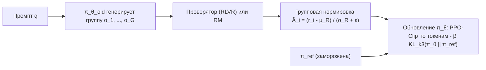

В задачах рассуждения *(reasoning)* у классических подходов к выравниванию есть два ограничения: в RLHF-PPO сеть критика $V_\psi$ сопоставима по размеру с самой LLM и плохо учится по редкой финальной награде, а нейросетевая RM уязвима к reward hacking; офлайн-методы *([[DPO и KTO|DPO и KTO]])* не позволяют модели исследовать новые цепочки рассуждений *(on-policy exploration)*.

**GRPO** *(Group Relative Policy Optimization)* отказывается от критика за счёт групповой оценки Advantage, а **RLVR** *(Reinforcement Learning with Verifiable Rewards)* заменяет нейросетевую RM детерминированным программным проверятором *(verifier)*.

Для каждого промпта $q \sim \mathcal{D}$ старая политика $\pi_{\theta_{\text{old}}}$ независимо сэмплирует группу из $G$ ответов $\{o_i\}_{i=1}^G$, каждому из которых назначается награда $r_i = r(q, o_i) \in \mathbb{R}$.

==Опр.== **RLOO** *(REINFORCE Leave-One-Out)* - безкритиковый on-policy метод, использующий для ответа $o_i$ несмещённый baseline в виде среднего наград остальных $G - 1$ ответов группы:$$\hat{A}_i^{\text{RLOO}} = r_i - \frac{1}{G - 1} \sum\limits_{j \neq i} r_j, \qquad \hat{g}_{\text{RLOO}} = \frac{1}{G} \sum\limits_{i=1}^{G} \hat{A}_i^{\text{RLOO}} \, \nabla_\theta \log \pi_\theta(o_i \mid q)$$
==Опр.== **Групповое относительное преимущество** *(Group Relative Advantage)* - $z$-нормировка награды $r_i$ внутри группы из $G$ ответов, назначаемая одинаковой всем токенам $t \in \overline{1, |o_i|}$:$$\hat{A}_{i, t} = \hat{A}_i = \frac{r_i - \mu_{\mathcal{R}}}{\sigma_{\mathcal{R}} + \epsilon}, \qquad \mu_{\mathcal{R}} = \frac{1}{G} \sum\limits_{j=1}^{G} r_j, \qquad \sigma_{\mathcal{R}} = \sqrt{\frac{1}{G} \sum\limits_{j=1}^{G} (r_j - \mu_{\mathcal{R}})^2}$$
==Опр.== **Целевой функционал GRPO** - клиппированный суррогат PPO по токенам с групповым $\hat{A}_{i, t}$ и явным штрафом KL к $\pi_{\text{ref}}$ через оценку $k_3$ Шульмана:$$\mathcal{J}_{\text{GRPO}}(\theta) = \mathbb{E}_{q \sim \mathcal{D},\, \{o_i\}_{i=1}^{G} \sim \pi_{\theta_{\text{old}}}(\cdot \mid q)} \left[ \frac{1}{G} \sum\limits_{i=1}^{G} \frac{1}{|o_i|} \sum\limits_{t=1}^{|o_i|} \left( \min\Big(\rho_{i, t}(\theta) \hat{A}_{i, t},\; \operatorname{clip}\big(\rho_{i, t}(\theta), 1 - \varepsilon, 1 + \varepsilon\big) \hat{A}_{i, t}\Big) - \beta \, \widehat{\mathrm{KL}}_{k_3}(o_{i, t}) \right) \right]$$где $\rho_{i, t}(\theta) = \frac{\pi_\theta(o_{i, t} \mid q, o_{i, <t})}{\pi_{\theta_{\text{old}}}(o_{i, t} \mid q, o_{i, <t})}$, а оценка $k_3$ имеет вид:$$\widehat{\mathrm{KL}}_{k_3}(o_{i, t}) = \frac{\pi_{\text{ref}}(o_{i, t} \mid q, o_{i, <t})}{\pi_\theta(o_{i, t} \mid q, o_{i, <t})} - \log \frac{\pi_{\text{ref}}(o_{i, t} \mid q, o_{i, <t})}{\pi_\theta(o_{i, t} \mid q, o_{i, <t})} - 1$$
==Опр.== **RLVR** *(Reinforcement Learning with Verifiable Rewards)* - парадигма обучения LLM, в которой нейросетевая RM заменяется детерминированным программным проверятором *(verifier)*:$$r_{\text{math}}(q, o) = \mathbb{1}\{\text{answer}(o) = a^*(q)\}, \qquad r_{\text{code}}(q, o) = \frac{\#\text{tests passed}}{\#\text{total tests}}$$

> [!TIP] Интуиция GRPO: группа вместо критика
> Вместо огромной сети-критика $V_\psi$ модель генерирует $G$ независимых ответов на один промпт и сравнивает их между собой: ответы выше среднего по группе получают $\hat{A}_i > 0$, ниже среднего - $\hat{A}_i < 0$. Это экономит около половины памяти на обучаемые модели при сохранении клиппинга и on-policy исследования.

> [!INFO] Две опорные политики и оценка $k_3$
> В $\rho_{i, t} = \pi_\theta / \pi_{\theta_{\text{old}}}$ стоит $\pi_{\theta_{\text{old}}}$ *(локальный клиппинг шага)*, в $-\beta\,\widehat{\mathrm{KL}}_{k_3}$ стоит $\pi_{\text{ref}}$ *(защита от деградации)*. В отличие от наивной оценки $\log \frac{\pi_\theta}{\pi_{\text{ref}}}$, которая на отдельном токене бывает отрицательной и даёт высокую дисперсию, оценка $k_3$ поточечно неотрицательна и несмещена при сэмплировании из $\pi_\theta$.

> [!EXAMPLE] Пример: **DeepSeek-R1-Zero (феномен RLVR)**
> Применение GRPO + RLVR *(только бинарная награда за правильный ответ + формат тегов, без SFT и без RM)* напрямую к базовой LLM привело к самостоятельному возникновению длинных цепочек рассуждений *(CoT)*, самопроверки и откатов при ошибках *(«aha moment»)*.

> [!WARNING] Подводные камни GRPO и модификации (Dr. GRPO, DAPO)
> 1. **Advantage Collapse**: если все $G$ ответов верны ($r_i \equiv 1$) или все неверны ($r_i \equiv 0$), то $\hat{A}_i \equiv 0$ и группа даёт нулевой градиент суррогата.
> 2. **Смещение по длине и сложности**: множитель $\frac{1}{|o_i|}$ слабее штрафует длинные неверные ответы, а деление на $\sigma_{\mathcal{R}}$ завышает вес задач с малой дисперсией наград.
> 3. **Поправки**: *Dr. GRPO* убирает деление на $\sigma_{\mathcal{R}}$ и $\frac{1}{|o_i|}$; *DAPO* поднимает верхний порог клиппинга *(clip-higher)* и отбрасывает группы с $\sigma_{\mathcal{R}} = 0$.

### Свойства $k_3$-оценки KL Шульмана

Пусть $u(y) = \frac{\pi_{\text{ref}}(y)}{\pi_\theta(y)} > 0$ и $k_3(y) = u(y) - \log u(y) - 1$. Тогда:
1. $\forall y\ :\ k_3(y) \ge 0$ *(поточечная неотрицательность)*.
2. При $y \sim \pi_\theta$ *(и совпадении носителей)*: $\mathbb{E}_{y \sim \pi_\theta} k_3(y) = \mathrm{KL}(\pi_\theta \,\|\, \pi_{\text{ref}})$ *(несмещённость)*.

#### Доказательство

1. Для $f(u) = u - \log u - 1$ при $u > 0$ имеем $f'(u) = 1 - \frac{1}{u}$ и $f''(u) = \frac{1}{u^2} > 0$. Точка $u^* = 1$ - строгий глобальный минимум, $f(1) = 0 \implies \forall u > 0\ :\ f(u) \ge 0 \implies \forall y\ :\ k_3(y) \ge 0$.
2. Вычислим матожидание по $y \sim \pi_\theta$:$$\mathbb{E}_{y \sim \pi_\theta} \left[ \frac{\pi_{\text{ref}}(y)}{\pi_\theta(y)} - \log \frac{\pi_{\text{ref}}(y)}{\pi_\theta(y)} - 1 \right] = \sum\limits_{y} \pi_\theta(y) \frac{\pi_{\text{ref}}(y)}{\pi_\theta(y)} + \mathbb{E}_{y \sim \pi_\theta} \log \frac{\pi_\theta(y)}{\pi_{\text{ref}}(y)} - 1$$
3. Первая сумма равна $\sum\limits_{y} \pi_{\text{ref}}(y) = 1$ и сокращается с $-1$, оставляя $\mathrm{KL}(\pi_\theta \,\|\, \pi_{\text{ref}})$ *(при многошаговом обновлении на батче от $\pi_{\theta_{\text{old}}}$ равенство становится приближённым)*.

### Несмещённость RLOO и связь с центрированием в GRPO

Пусть $o_1, \dots, o_G \stackrel{\text{i.i.d.}}{\sim} \pi_\theta(\cdot \mid q)$ для фиксированного $q$. Тогда:
1. $\mathbb{E} \left[ \hat{A}_i^{\text{RLOO}} \nabla_\theta \log \pi_\theta(o_i \mid q) \right] = \nabla_\theta \mathbb{E}_{o \sim \pi_\theta} r(q, o)$.
2. $\forall i \in \overline{1, G}\ :\ r_i - \mu_{\mathcal{R}} = \frac{G - 1}{G} \, \hat{A}_i^{\text{RLOO}}$.

#### Доказательство

1. В $\hat{A}_i^{\text{RLOO}} = r_i - b_{-i}$ величина $b_{-i} = \frac{1}{G - 1} \sum\limits_{j \neq i} r_j$ независима от $o_i$. По Т. о baseline-инвариантности:$$\mathbb{E} \left[ b_{-i} \, \nabla_\theta \log \pi_\theta(o_i \mid q) \right] = \mathbb{E}[b_{-i}] \cdot \mathbb{E}_{o_i \sim \pi_\theta} \nabla_\theta \log \pi_\theta(o_i \mid q) = 0$$Откуда $\hat{g}_{\text{RLOO}}$ - несмещённая оценка градиента стратегии.
2. Представляя $\mu_{\mathcal{R}} = \frac{1}{G} r_i + \frac{G - 1}{G} b_{-i}$, получаем:$$r_i - \mu_{\mathcal{R}} = \frac{G - 1}{G} (r_i - b_{-i}) = \frac{G - 1}{G} \, \hat{A}_i^{\text{RLOO}}$$Следовательно, вычитание $\mu_{\mathcal{R}}$ без деления на $\sigma_{\mathcal{R}}$ *(Dr. GRPO)* сохраняет несмещённость направления градиента.

### Зануление сигнала при вырожденной группе (Advantage Collapse)

Если $\forall i, j \in \overline{1, G}\ :\ r_i = r_j = c$, то градиент суррогатной части GRPO по этой группе тождественно равен $0$.

#### Доказательство

1. При $r_1 = \dots = r_G = c$ имеем $\mu_{\mathcal{R}} = c \implies \forall i\ :\ r_i - \mu_{\mathcal{R}} = 0 \implies \hat{A}_i = \frac{0}{0 + \epsilon} = 0$.
2. Подстановка $\hat{A}_{i, t} = 0$ зануляет $\min(\rho_{i, t} \cdot 0, \operatorname{clip}(\rho_{i, t}) \cdot 0) = 0$, т.ч. вклад суррогата в $\nabla_\theta \mathcal{J}_{\text{GRPO}}$ равен $0$ *(действует лишь KL-штраф к $\pi_{\text{ref}}$)*.

### Алгоритм итеративного GRPO

Вход: начальная политика $\pi_{\theta_{\text{init}}}$, награда $r(q, o)$ *(verifier в RLVR или RM)*, датасет $\mathcal{D}$, размер группы $G$, порог $\varepsilon$, коэффициент $\beta$, число эпох $\mu$.
1. Инициализировать $\pi_\theta \leftarrow \pi_{\theta_{\text{init}}}$, заморозить $\pi_{\text{ref}} \leftarrow \pi_{\theta_{\text{init}}}$.
2. Для каждого шага $m \in \overline{1, M}$:
	1. Выбрать мини-батч $\mathcal{D}_b \subset \mathcal{D}$ и зафиксировать $\pi_{\theta_{\text{old}}} \leftarrow \pi_\theta$.
	2. **Групповое сэмплирование**: $\forall q \in \mathcal{D}_b$ сгенерировать $G$ ответов $\{o_i\}_{i=1}^G \sim \pi_{\theta_{\text{old}}}(\cdot \mid q)$, сохранив лог-вероятности под $\pi_{\theta_{\text{old}}}$ и $\pi_{\text{ref}}$.
	3. **Оценка наград и Advantage**: вычислить $\{r_i\}_{i=1}^G$, найти $\mu_{\mathcal{R}}, \sigma_{\mathcal{R}}$ и $\forall i \in \overline{1, G}\ \forall t \in \overline{1, |o_i|}$ положить $\hat{A}_{i, t} = \frac{r_i - \mu_{\mathcal{R}}}{\sigma_{\mathcal{R}} + \epsilon}$.
	4. **Обновление**: выполнить $\mu$ шагов Adam на максимизацию $\mathcal{J}_{\text{GRPO}}(\theta)$.

#### Асимптотика

Для LLM с $P$ параметрами, батчем $B$ промптов, группой $G$, длиной ответа $L$ и $\mu$ эпохами:
1. Сложность по времени: $O(B \cdot G \cdot L \cdot C_{\text{gen}} + B \cdot G \cdot C_{\text{ver}} + \mu \cdot B \cdot G \cdot L \cdot C_{\text{train}})$, где $C_{\text{ver}}$ - время проверятора *(в RLVR доминирует авторегрессионная генерация длинных цепочек рассуждений)*.
2. Сложность по памяти *(GPU VRAM)*: $O(2P + c_{\text{opt}} P)$ для весов ($\pi_\theta, \pi_{\text{ref}}$) и состояний Adam одной модели *(при $\beta = 0$ - $O(P + c_{\text{opt}} P)$)*; критик $V_\psi$ и RM отсутствуют.

### Общая карта методов выравнивания LLM

| Метод | Источник сигнала | Reward Model | Критик $V_\psi$ | Сэмплирование | Ключевая особенность |
| :---: | :---: | :---: | :---: | :---: | :---: |
| **RLHF-PPO** | Пары $\to$ RM | Явная | Да | On-policy *(1 ответ)* | 4 модели в памяти |
| **DPO** | Пары $(y_w, y_l)$ | Неявная | Нет | Офлайн | Бинарная классификация, $Z(x)$ сократилось |
| **KTO** | Одиночные $(y, \pm 1)$ | Неявная | Нет | Офлайн | Без пар; теория перспектив + $z_0 = \mathrm{KL}$ |
| **RLOO** | Награда за ответ | RM / verifier | Нет | On-policy *($G$ ответов)* | Несмещённый leave-one-out baseline |
| **GRPO** | Награда за ответ | RM / verifier | Нет | On-policy *(группа $G$)* | PPO-Clip + групповой Advantage + $k_3$ KL |
| **GRPO + RLVR** | Программный verifier | Нет *(тесты/правила)* | Нет | On-policy *(группа $G$)* | Самообучение рассуждениям без RM |

### +ы & -ы GRPO и RLVR

> [!SUCCESS] Преимущества
> * Отказ от критика резко снижает требования к VRAM при сохранении on-policy исследования и стабильности клиппинга.
> * В RLVR программный проверятор даёт объективный сигнал без reward hacking, позволяя масштабировать RL-вычисления для задач рассуждения.
> * GRPO не привязан к виду награды и сочетается с проверяторами, RM и пошаговыми Process Reward Models *(PRM)*.

> [!FAILURE] Недостатки
> * RLVR применим только к формализуемым задачам *(математика, код, логика)*; для диалога, стиля и безопасности по-прежнему нужны предпочтения людей.
> * Стимулирование длинных цепочек рассуждений удорожает генерацию при обучении и инференс.
> * Огрублённый credit assignment: один скаляр $\hat{A}_i$ приписывается всем токенам ответа $o_i$ *(включая ошибочные промежуточные шаги в верном ответе)*.

---
