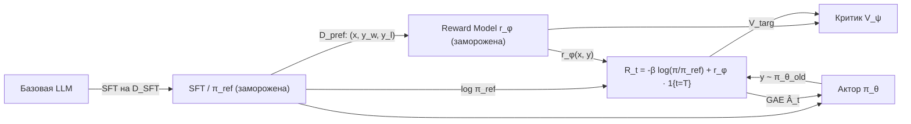

Этапов претрейна и SFT *(Supervised Fine-Tuning)* недостаточно для выравнивания LLM по трём причинам:
1. **Неформализуемость эталона**: полезность, честность и безопасность нельзя задать единственным правильным ответом и кросс-энтропией по токенам.
2. **Асимметрия оценки и генерации**: асессору проще сравнить два готовых ответа, чем написать идеальный ответ с нуля.
3. **Недифференцируемость генерации**: дискретный выбор токенов из словаря разрывает путь градиента от глобальной оценки ответа к весам нейросети.

**RLHF** *(Reinforcement Learning from Human Feedback)* формализует генерацию текста как MDP и преобразует парные предпочтения людей в градиент весов LLM с помощью [[PPO]].

Пусть $\mathcal{V}$ - конечный словарь токенов *(включая токен конца $\langle\text{eos}\rangle$)*, $x \in \mathcal{V}^*$ - промпт, $y = (y_1, \dots, y_T) \in \mathcal{V}^T$ - ответ длины $T = |y|$.

==Опр.== **Текстовый MDP** - марковский процесс принятия решений $(\mathcal{S}, \mathcal{A}, P, R, \gamma)$ с конечным горизонтом $T$ и детерминированными переходами:
* $s_t = (x, y_{<t}) \in \mathcal{S}$ - промпт и сгенерированный префикс $y_{<t} = (y_1, \dots, y_{t-1})$;
* $a_t = y_t \in \mathcal{A} = \mathcal{V}$ - выбор следующего токена;
* $P(s' \mid s_t, a_t) = \mathbb{1}_{\{s' = (x, y_{\le t})\}}$ - детерминированная конкатенация токена $y_t$;
* $\pi_\theta(a_t \mid s_t) = \pi_\theta(y_t \mid x, y_{<t})$ - стратегия, задаваемая LLM;
* $R_t$ - пошаговая награда *(оценка ответа при $t = T$ и пошаговый KL-штраф)*, обычно $\gamma = 1$.

В силу детерминированности переходов вероятность ответа выражается по цепному правилу:$$\pi_\theta(y \mid x) = \prod\limits_{t=1}^{|y|} \pi_\theta(y_t \mid x, y_{<t}), \qquad \log \pi_\theta(y \mid x) = \sum\limits_{t=1}^{|y|} \log \pi_\theta(y_t \mid x, y_{<t})$$
==Опр.== **Модель Брэдли-Терри** *(Bradley-Terry model)* - вероятностная модель парных сравнений, задающая вероятность предпочтения ответа $y_w$ над $y_l$ через разность латентных оценок $r(x, y) \in \mathbb{R}$:$$p(y_w \succ y_l \mid x) = \sigma\big(r(x, y_w) - r(x, y_l)\big) = \big(1 + \exp(-(r(x, y_w) - r(x, y_l)))\big)^{-1}$$
==Опр.== **Модель награды** *(Reward Model, RM)* - нейросеть $r_\varphi(x, y) \in \mathbb{R}$ *(копия SFT-модели со скалярной головой)*, обучаемая на датасете парных предпочтений $\mathcal{D} = \{(x^{(i)}, y_w^{(i)}, y_l^{(i)})\}$ минимизацией логистического лосса:$$\mathcal{L}_{\text{RM}}(\varphi) = -\mathbb{E}_{(x, y_w, y_l) \sim \mathcal{D}} \log \sigma\big(r_\varphi(x, y_w) - r_\varphi(x, y_l)\big) \to \inf\limits_\varphi$$
==Опр.== **Целевая задача RLHF** - максимизация ожидаемой награды $r_\varphi$ со штрафом за отклонение от замороженной SFT-стратегии $\pi_{\text{ref}}$ через [[Дивергенция Кульбака-Лейблера|обратную KL-дивергенцию]] при $\beta > 0$:$$J_{\text{RLHF}}(\theta) = \mathbb{E}_{x \sim \mathcal{D},\, y \sim \pi_\theta(\cdot \mid x)} r_\varphi(x, y) - \beta \, \mathbb{E}_{x \sim \mathcal{D}} \mathrm{KL}\big(\pi_\theta(\cdot \mid x) \,\|\, \pi_{\text{ref}}(\cdot \mid x)\big) \to \sup\limits_\theta$$
> [!INFO] Почему в RLHF используется именно Reverse KL: $\mathrm{KL}(\pi_\theta \,\|\, \pi_{\text{ref}})$
> 1. **Вычислимость**: KL-дивергенция берёт матожидание по первому аргументу. В on-policy цикле мы и так сэмплируем $y \sim \pi_\theta(\cdot \mid x)$, т.ч. $\mathrm{KL}(\pi_\theta \,\|\, \pi_{\text{ref}})$ оценивается без лишних генераций из $\pi_{\text{ref}}$.
> 2. **Защита от reward hacking *(mode-seeking)***: обратная KL жёстко штрафует массу $\pi_\theta$ в областях, где $\pi_{\text{ref}} \approx 0$ *(бессвязный текст, мусор, галлюцинации)*, удерживая модель внутри грамотных мод референса.

> [!EXAMPLE] Пример: **Reward hacking и якорь $\pi_{\text{ref}}$**
> При максимизации одной лишь прокси-оценки $r_\varphi$ без KL-штрафа модель находит лазейки *(reward hacking)*: искусственно удлиняет ответы, льстит пользователю *(sycophancy)* или ломает язык. Штраф $-\beta\,\mathrm{KL}(\pi_\theta \,\|\, \pi_{\text{ref}})$ удерживает генерацию в рамках грамотного распределения SFT.

> [!WARNING] Подводные камни RLHF
> * **Mode collapse**: побочный эффект mode-seeking свойства Reverse KL - сужение энтропии и потеря разнообразия ответов.
> * **Две разные опорные политики**: в RLHF-PPO одновременно участвуют $\pi_{\theta_{\text{old}}}$ *(в знаменателе клиппированного отношения $\rho_t = \pi_\theta / \pi_{\theta_{\text{old}}}$, обновляется на каждом батче)* и $\pi_{\text{ref}}$ *(замороженная SFT-модель в KL-штрафе)*.
> * **Закон Гудхарта**: RM - лишь шумный прокси предпочтений асессоров; чрезмерная оптимизация по $r_\varphi$ ухудшает истинное качество.

### Схема и алгоритм 3-этапного конвейера RLHF (PPO-Clip)

1. **Этап 1 - SFT**: дообучить базовую LLM кросс-энтропией на демонстрациях $\mathcal{D}_{\text{SFT}}$; сохранить веса как замороженную $\pi_{\text{ref}}$.
2. **Этап 2 - Обучение RM**: инициализировать $r_\varphi$ весами $\pi_{\text{ref}}$ со скалярной головой, обучить минимизацией $\mathcal{L}_{\text{RM}}(\varphi)$ на $\mathcal{D}_{\text{pref}}$ и заморозить $\varphi$.
3. **Этап 3 - RL-дообучение (PPO-Clip)**: инициализировать $\pi_\theta \leftarrow \pi_{\text{ref}}$, критика $V_\psi \leftarrow r_\varphi$. На каждой итерации:
	1. Зафиксировать $\theta_{\text{old}} \leftarrow \theta$, для батча $x \sim \mathcal{D}_{\text{RL}}$ сгенерировать $y \sim \pi_{\theta_{\text{old}}}(\cdot \mid x)$, сохраняя $\log \pi_{\theta_{\text{old}}}(y_t \mid s_t)$.
	2. Прогнать $(x, y)$ через замороженные $\pi_{\text{ref}}, r_\varphi$ и критика $V_\psi$, вычислив пошаговые награды:$$R_t = -\beta \left(\log \pi_{\theta_{\text{old}}}(y_t \mid s_t) - \log \pi_{\text{ref}}(y_t \mid s_t)\right) + r_\varphi(x, y) \cdot \mathbb{1}\{t = |y|\}$$
	3. Вычислить GAE-оценки $\hat{A}_t$ *(при $\gamma = 1$)* и таргеты $V_t^{\text{targ}} = \hat{A}_t + V_\psi(s_t)$ с фиксацией `detach`.
	4. За $K$ эпох по мини-батчам обновить $\theta$ *(PPO-Clip с $\rho_t = \pi_\theta / \pi_{\theta_{\text{old}}}$)* и $\psi$ *(MSE критика)*.

### Эквивалентность пошаговой награды $R_t$ и целевого функционала RLHF

При $\gamma = 1$ и $R_t = -\beta \log \frac{\pi_\theta(y_t \mid x, y_{<t})}{\pi_{\text{ref}}(y_t \mid x, y_{<t})} + r_\varphi(x, y) \cdot \mathbb{1}_{\{t = |y|\}}$ выполняется:$$\mathbb{E}_{y \sim \pi_\theta(\cdot \mid x)} \left[ \sum\limits_{t=1}^{|y|} R_t \right] = \mathbb{E}_{y \sim \pi_\theta(\cdot \mid x)} r_\varphi(x, y) - \beta \, \mathrm{KL}\big(\pi_\theta(\cdot \mid x) \,\|\, \pi_{\text{ref}}(\cdot \mid x)\big)$$
#### Доказательство

1. Просуммируем $R_t$ вдоль эпизода $y = (y_1, \dots, y_{|y|})$:$$\sum\limits_{t=1}^{|y|} R_t = r_\varphi(x, y) - \beta \sum\limits_{t=1}^{|y|} \log \frac{\pi_\theta(y_t \mid x, y_{<t})}{\pi_{\text{ref}}(y_t \mid x, y_{<t})}$$
2. По свойствам логарифма и цепному правилу для авторегрессионной модели:$$\sum\limits_{t=1}^{|y|} \log \frac{\pi_\theta(y_t \mid x, y_{<t})}{\pi_{\text{ref}}(y_t \mid x, y_{<t})} = \log \frac{\prod\limits_{t=1}^{|y|} \pi_\theta(y_t \mid x, y_{<t})}{\prod\limits_{t=1}^{|y|} \pi_{\text{ref}}(y_t \mid x, y_{<t})} = \log \frac{\pi_\theta(y \mid x)}{\pi_{\text{ref}}(y \mid x)}$$
3. Беря математическое ожидание по $y \sim \pi_\theta(\cdot \mid x)$, по определению KL-дивергенции получаем искомое равенство.

### Градиент стратегии в детерминированном текстовом MDP

Для $\forall$ награды $R(x, y)$:$$\nabla_\theta \mathbb{E}_{y \sim \pi_\theta(\cdot \mid x)} R(x, y) = \mathbb{E}_{y \sim \pi_\theta(\cdot \mid x)} \left[ R(x, y) \sum\limits_{t=1}^{|y|} \nabla_\theta \log \pi_\theta(y_t \mid x, y_{<t}) \right]$$
#### Доказательство

1. Т.к. $\mathcal{V}$ конечно и длина ограничена, матожидание - конечная сумма, т.ч. дифференцирование под знаком суммы законно:$$\nabla_\theta \sum\limits_{y} \pi_\theta(y \mid x) R(x, y) = \sum\limits_{y} R(x, y) \, \nabla_\theta \pi_\theta(y \mid x)$$
2. Применяя $\nabla_\theta \pi_\theta = \pi_\theta \nabla_\theta \log \pi_\theta$ и цепное правило $\log \pi_\theta(y \mid x) = \sum\limits_{t=1}^{|y|} \log \pi_\theta(y_t \mid x, y_{<t})$, получаем:$$\sum\limits_{y} \pi_\theta(y \mid x) R(x, y) \, \nabla_\theta \log \pi_\theta(y \mid x) = \mathbb{E}_{y \sim \pi_\theta(\cdot \mid x)} \left[ R(x, y) \sum\limits_{t=1}^{|y|} \nabla_\theta \log \pi_\theta(y_t \mid x, y_{<t}) \right]$$

#### Асимптотика

Для LLM с $P$ параметрами, батчем $B$ промптов, средней длиной ответа $L$ и $K$ эпохами PPO:
1. Сложность по времени: $O(B \cdot L \cdot C_{\text{gen}} + K \cdot B \cdot L \cdot C_{\text{train}})$, где $C_{\text{gen}}$ - последовательная авторегрессионная генерация *(доминирует по времени)*, $C_{\text{train}}$ - параллельный forward/backward проход.
2. Сложность по памяти *(GPU VRAM)*: $O(4P + 2 c_{\text{opt}} P + B \cdot L \cdot d_{\text{model}} \cdot n_{\text{layers}})$ - веса 4 моделей ($\pi_\theta, \pi_{\text{ref}}, r_\varphi, V_\psi$), состояния оптимизатора для 2 обучаемых моделей ($\pi_\theta, V_\psi$) и KV-кэш.

### +ы & -ы RLHF (PPO)

> [!SUCCESS] Преимущества
> * Оптимизирует произвольные неформализуемые и субъективные критерии *(стиль, безопасность, полезность)*.
> * On-policy исследование: модель оценивает и исправляет собственные свежие генерации.
> * Обратная KL к $\pi_{\text{ref}}$ удерживает модель в пространстве грамотного языка и сдерживает reward hacking.

> [!FAILURE] Недостатки
> * Дорогой и сложный пайплайн: 4 модели в памяти, тонкая настройка гиперпараметров PPO и медленная авторегрессионная генерация.
> * Отдельная RM накапливает ошибки асессоров и аппроксимации $\implies$ риск reward hacking.
> * Mode-seeking регуляризация снижает разнообразие генераций.

---
