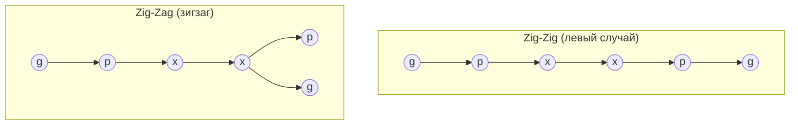
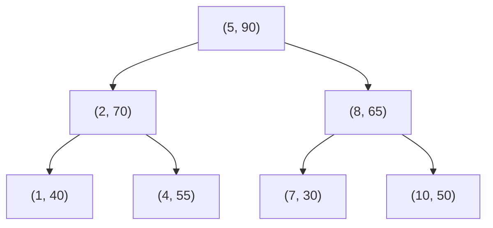
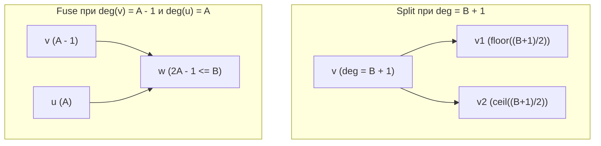
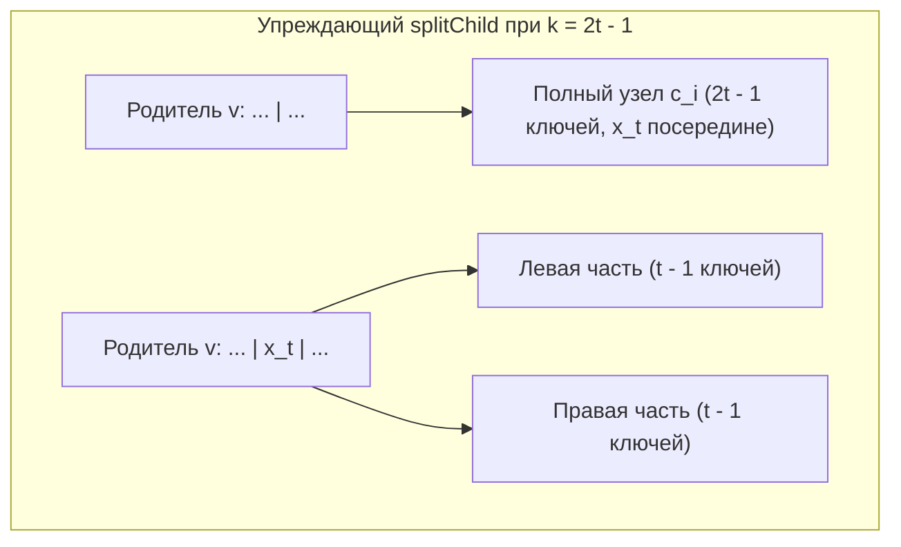
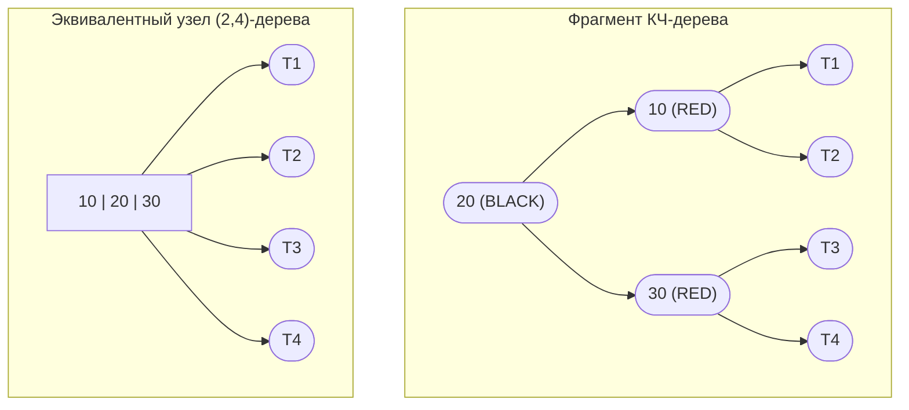

<h1><center>Алгоритмы и Структуры Данных</center></h1>
<div style="height: 35%;"></div>
<h3><center>Автор: Ряжских Дмитрий</center></h3>
<h4><center>Лектор: Кулапин Артур Евгеньевич</center></h4>
<div style="height: 41%;"></div>
<h6><center>Физтех, 2025</center></h6>
<div style="page-break-after: always;"></div>
<h2><center>Содержание</center></h2>
[[_TOC_]]
<a href="#p1">1) Основные понятия</a>
<div  style="margin-left: 20px;"><a href="#p1p1">1.1) Асимптотический анализ алгоритма</a></div>
<div  style="margin-left: 40px;"><a href="#p1p1p1">1.1.1) Амортизационный анализ</a></div>
<div  style="margin-left: 20px;"><a href="#p1p2">1.2) Модульная арифметика</a></div>
<div  style="margin-left: 20px;"><a href="#p1p3">1.3) Задачи RMQ и RSQ</a></div>
<a href="#p2">2) Линейные структуры данных</a>
<div  style="margin-left: 20px;"><a href="#p2p1">2.1) Стек</a></div>
<div  style="margin-left: 20px;"><a href="#p2p2">2.2) Динамический массив</a></div>
<div  style="margin-left: 20px;"><a href="#p2p3">2.3) Кольцевой буфер</a></div>
<div  style="margin-left: 20px;"><a href="#p2p4">2.4) Связный список</a></div>
<div  style="margin-left: 20px;"><a href="#p2p5">2.5) Очередь</a></div>
<div  style="margin-left: 20px;"><a href="#p2p6">2.6) Дек</a></div>
<div  style="margin-left: 20px;"><a href="#p2p7">2.7) Скользящее окно и сканирующая прямая</a></div>
<a href="#p3">3) Древовидные структуры данных</a>
<div  style="margin-left: 20px;"><a href="#p3p1">3.1) Куча</a></div>
<div  style="margin-left: 40px;"><a href="#p3p1p1">3.1.1) Биномиальная куча</a></div>
<div  style="margin-left: 40px;"><a href="#p3p1p2">3.1.2) Фибоначчиева куча</a></div>
<div  style="margin-left: 20px;"><a href="#p3p2">3.2) Дерево отрезков</a></div>
<div  style="margin-left: 40px;"><a href="#p3p2p1">3.2.1) Персистентные структуры данных</a></div>
<div  style="margin-left: 20px;"><a href="#p3p3">3.3) Дерево поиска</a></div>
<div  style="margin-left: 40px;"><a href="#p3p3p1">3.3.1) AVL-дерево</a></div>
<div  style="margin-left: 40px;"><a href="#p3p3p2">3.3.2) Splay-дерево</a></div>
<div  style="margin-left: 40px;"><a href="#p3p3p3">3.3.3) Декартово дерево</a></div>
<div  style="margin-left: 60px;"><a href="#p3p3p3p1">3.3.3.1) ДДНК</a></div>
<div  style="margin-left: 40px;"><a href="#p3p3p4">3.3.4) (A,B)-дерево</a></div>
<div  style="margin-left: 60px;"><a href="#p3p3p4p1">3.3.4.1) B-дерево</a></div>
<div  style="margin-left: 40px;"><a href="#p3p3p5">3.3.5) Красно-чёрное дерево</a></div>
<a href="#p4">4) Сортировки</a>
<div  style="margin-left: 20px;"><a href="#p4p1">4.1) Понятие сортировки</a></div>
<div  style="margin-left: 20px;"><a href="#p4p2">4.2) Бинарный поиск</a></div>
<div  style="margin-left: 20px;"><a href="#p4p3">4.3) Бессмысленные сортировки</a></div>
<div  style="margin-left: 20px;"><a href="#p4p4">4.4) Простые сортировки</a></div>
<div  style="margin-left: 20px;"><a href="#p4p5">4.5) Сортировка подсчётом</a></div>
<div  style="margin-left: 20px;"><a href="#p4p6">4.6) Radix сортировка (LSD)</a></div>
<div  style="margin-left: 20px;"><a href="#p4p7">4.7) Сортировка слиянием</a></div>
<div  style="margin-left: 20px;"><a href="#p4p8">4.8) Поиск числа инверсий</a></div>
<div  style="margin-left: 20px;"><a href="#p4p9">4.9) Быстрая сортировка</a></div>
<div  style="margin-left: 40px;"><a href="#p4p9p1">4.9.1) Порядковая статистика</a></div>
<div  style="margin-left: 40px;"><a href="#p4p9p2">4.9.2) Алгоритм медианы медиан</a></div>
<div  style="margin-left: 20px;"><a href="#p4p10">4.10) Heap sort</a></div>
<div  style="margin-left: 20px;"><a href="#p4p11">4.11) Интроспективная сортировка</a></div>
<a href="#p5">5) Динамическое программирование</a>
<div  style="margin-left: 20px;"><a href="#p5p1">5.1) Разреженная таблица</a></div>
<div  style="margin-left: 20px;"><a href="#p5p2">5.2) Алгоритм Фараха-Колтона-Бендера</a></div>
<a href="#p6">6) Алгоритмы на графах</a>
<div  style="margin-left: 20px;"><a href="#p6p1">6.1) Понятие графа</a></div>
<div  style="margin-left: 40px;"><a href="#p6p1p1">6.1.1) Способы хранения графа</a></div>
<div  style="margin-left: 20px;"><a href="#p6p1_2">6.2) Обходы графов</a></div>
<div  style="margin-left: 40px;"><a href="#p6p1p1_2">6.2.1) DFS</a></div>
<div  style="margin-left: 40px;"><a href="#p6p1p2">6.2.2) Лемма о белых путях</a></div>
<div  style="margin-left: 40px;"><a href="#p6p1p3">6.2.3) Топологическая сортировка графа</a></div>
<div  style="margin-left: 40px;"><a href="#p6p1p4">6.2.4) Мосты и точки сочленения в графе</a></div>
<div  style="margin-left: 40px;"><a href="#p6p1p5">6.2.5) Конденсация графа</a></div>
<div  style="margin-left: 40px;"><a href="#p6p1p50">6.2.6) Алгоритм Косарайю</a></div>
<div  style="margin-left: 40px;"><a href="#p6p1p6">6.2.7) Проверка графа на связность</a></div>
<div  style="margin-left: 40px;"><a href="#p6p1p7">6.2.8) Проверка графа на ацикличность</a></div>
<div  style="margin-left: 40px;"><a href="#p6p1p8">6.2.9) BFS</a></div>
<div  style="margin-left: 40px;"><a href="#p6p1p9">6.2.10) 0-k BFS</a></div>
<div  style="margin-left: 20px;"><a href="#p6p2">6.3) Поиск путей в графах</a></div>
<div  style="margin-left: 40px;"><a href="#p6p2p1">6.3.1) Алгоритм Дейкстры</a></div>
<div  style="margin-left: 40px;"><a href="#p6p2p2">6.3.2) Эвристики</a></div>
<div  style="margin-left: 60px;"><a href="#p6p2p2p1">6.3.2.1) Алгоритм A*</a></div>
<div  style="margin-left: 60px;"><a href="#p6p2p2p2">6.3.2.2) Алгоритм IDA*</a></div>
<div  style="margin-left: 40px;"><a href="#p6p2p3">6.3.3) Алгоритм Форда-Беллмана</a></div>
<div  style="margin-left: 40px;"><a href="#p6p2p4">6.3.4) SPFA</a></div>
<div  style="margin-left: 40px;"><a href="#p6p2p5">6.3.5) Алгоритм Флойда-Уоршелла</a></div>
<div  style="margin-left: 40px;"><a href="#p6p2p6">6.3.6) Циклы отрицательного веса</a></div>
<div  style="margin-left: 40px;"><a href="#p6p2p7">6.3.7) Алгоритм Джонсона</a></div>
<div  style="margin-left: 40px;"><a href="#p6p2p8">6.3.8) Двусторонние алгоритмы</a></div>
<div  style="margin-left: 20px;"><a href="#p6p3">6.4) СНМ и LCA</a></div>
<div  style="margin-left: 40px;"><a href="#p6p4p1">6.4.1) Функция Аккермана</a></div>
<div  style="margin-left: 40px;"><a href="#p6p4p2">6.4.2) Система непересекающихся множеств (СНМ, DSU)</a></div>
<div  style="margin-left: 40px;"><a href="#p6p4p3">6.4.3) Наименьший общий предок (LCA)</a></div>
<div  style="margin-left: 20px;"><a href="#p6p4">6.5) Минимальное остовное дерево</a></div>
<div  style="margin-left: 40px;"><a href="#p6p5p1">6.5.1) Алгоритм Крускала</a></div>
<div  style="margin-left: 40px;"><a href="#p6p5p2">6.5.2) Лемма о безопасном ребре</a></div>
<div  style="margin-left: 40px;"><a href="#p6p5p3">6.5.3) Алгоритм Прима</a></div>
<div  style="margin-left: 40px;"><a href="#p6p5p4">6.5.4) Алгоритм Борувки</a></div>
<div  style="margin-left: 20px;"><a href="#p6p5">6.6) Алгоритмы в двудольных графах</a></div>
<div  style="margin-left: 40px;"><a href="#p6p6p1">6.6.1) Теорема Берджа</a></div>
<div  style="margin-left: 40px;"><a href="#p6p6p2">6.6.2) Алгоритм Куна</a></div>
<div  style="margin-left: 40px;"><a href="#p6p6p3">6.6.3) Алгоритм Хопкрофта-Карпа</a></div>
<div  style="margin-left: 40px;"><a href="#p6p6p4">6.6.4) Независимое множество и вершинное покрытие</a></div>
<div  style="margin-left: 20px;"><a href="#p6p7">6.7) Центроидная декомпозиция</a></div>
<div  style="margin-left: 20px;"><a href="#p6p6">6.8) Сети в графах</a></div>
<div  style="margin-left: 40px;"><a href="#p6p8p1">6.8.1) Понятия сети и потока</a></div>
<div  style="margin-left: 40px;"><a href="#p6p8p2">6.8.2) Поток минимальной стоимости</a></div>
<div  style="margin-left: 40px;"><a href="#p6p8p3">6.8.3) Допустимые сети и разгрузка сети</a></div>
<div  style="margin-left: 40px;"><a href="#p6p8p4">6.8.4) Слоистая сеть и блокирующий поток</a></div>
<div  style="margin-left: 40px;"><a href="#p6p8p5">6.8.5) Теорема Форда-Фалкерсона</a></div>
<div  style="margin-left: 40px;"><a href="#p6p8p6">6.8.6) Предпоток</a></div>
<div  style="margin-left: 40px;"><a href="#p6p8p7">6.8.7) Алгоритм Диница</a></div>
<div  style="margin-left: 40px;"><a href="#p6p8p8">6.8.8) 1-я теорема Карзанова</a></div>
<div  style="margin-left: 40px;"><a href="#p6p8p9">6.8.9) Алгоритм Форда-Фалкерсона</a></div>
<div  style="margin-left: 40px;"><a href="#p6p8p10">6.8.10) Алгоритм Эдмондса-Карпа</a></div>
<a href="#p7">7) Геометрическое программирование</a>

<div style="height: 120px;"></div>

<h4><center>Базовый минимум пройденных курсов</center></h4>

<p align="justify">Прежде чем начать читать этот конспект, настоятельно рекомендуется пройти следующие курсы:</p>

1) Введение в программирование (любой ЯП)
2) Дискретная математика
3) Математическая логика
<div style="page-break-after: always;"></div>


# <h1 id="p1"><center>Основные понятия</center></h1>

# <h1 id="p1p1"><center>Асимптотический анализ алгоритма</center></h1>

## Введение в алгоритмизацию

**Алгоритм** — это строго детерминированная, конечная последовательность чётко определённых инструкций или правил, предназначенная для решения конкретной задачи или класса задач за конечное число шагов.

На практике нас интересуют более оптимальные алгоритмы: если два алгоритма выполняют одну и ту же задачу, но один из них всегда это делает быстрее и при этом потребляет меньше памяти устройства, на котором производятся вычисления, то очевидно предпочтение при использовании будет отдано ему.

Время, за которое алгоритм выполнит свою задачу, зависит от нескольких факторов:
- Реализация алгоритма
- Объём входных данных
- Вычислительные мощности устройства
- ЯП, на котором написан алгоритм
- и др.

То есть один и тот же алгоритм может тратить разное время в разных обстоятельствах. Поэтому при анализе алгоритма на эффективность используют *асимптотический анализ* (см. матан). При этом смотрят зависимость времени/памяти от ***объёма входных данных*** на бесконечности. В чём измерять память понятно: в минимальной единице одновременной обработки компьютером - в байтах. Про время сложнее - различия в частоте тактов процессоров и прочие различия не позволяют измерять алгоритмическое время в стандартных единицах. Поэтому принято измерять время в ***элементарных операциях*** - операциях, на выполнение которых устройство тратит значительно меньше реального времени по сравнению с другими (условно - один такт). При одинаковом коде количество элементарных операций, выполненное данным алгоритмом, является инвариантом для фиксированных входных данных.

К элементарным операциям относятся:
1) Выделение/удаление области памяти для новой переменной
2) Копирование байта из одной ячейки памяти в другую
3) Запись в ячейку памяти
4) Сложение/умножение/вычитание/деление/сравнение чисел
5) Выполнение условных конструкций при посчитанном условии (`if-else`)

## Асимптотический анализ
- *Будем рассматривать асимптотический анализ по времени. По памяти - аналогично.*

Пусть $f : \mathbb{N} \to \mathbb{N}$ - зависимость количества элементарных операций от объёма входных данных алгоритма, а $g : \mathbb{N} \to \mathbb{N}$ - некоторая функция, тогда...

==Опр.== $f = O(g)$ $\Longleftrightarrow$ $\exists C > 0\ \forall n \in \mathbb{N}\ :\ f(n) \leq C \cdot g(n)$ - **оценка сверху на алгоритм** (алгоритм $f$ выполняет не более $O(g)$ элементарных операций) 

Заметим, что данное $O$-большое - это то же $O$-большое что и в математическом асимптотическом анализе, но для удобство в алгоритмах всегда рассматривается $n \to +\infty$ и в качестве определений берётся одно из следствий исходного определения.

==Опр.== $f = \Omega(g)$ $\Longleftrightarrow$ $\exists C > 0\ \exists N \in \mathbb{N}\ \forall n \geq N\ :\ f(n) \geq C \cdot g(n)$ - **оценка снизу на алгоритм**

==Опр.== $f = \Theta(g)$ $\Longleftrightarrow$ $\exists C_1, C_2 > 0\ \exists N \in \mathbb{N}\ \forall n \geq N\ :\ C_1 \cdot g(n) \leq f(n) \leq C_2 \cdot g(n)$ - **точная оценка алгоритма**

==Опр.== $f = o(g)$ $\Longleftrightarrow$ $\forall C > 0\ \exists N \in \mathbb{N}\ \forall n \geq N\ :\ f(n) < C \cdot g(n)$ - *($f$ асимптотически строго лучше $g$)*

==Опр.== $f = \omega(g)$ $\Longleftrightarrow$ $\forall C > 0\ \exists N \in \mathbb{N}\ \forall n \geq N\ :\ f(n) > C \cdot g(n)$ - *($f$ асимптотически строго хуже $g$)*

==Опр.== $f = \theta(g)$ $\Longleftrightarrow$ $\forall C_1 > 0\ \forall C_2 > 0\ \exists N \in \mathbb{N}\ \forall n \geq N\ :\ C_1 \cdot g(n) < f(n) < C_2 \cdot g(n)$ - *(относительная погрешность между $f$ и $g$ стремится к 0)*

Заметим, что в силу арифметических свойств алгоритма $$\forall a, b = const\ :\ \log_an = \frac{\log_bn}{\log_ba} = C \cdot \log_bn\ \ \ (C = const)$$То есть в асимптотическом анализе основание логарифма не имеет значения, поэтому далее логарифм будем писать без основания (часто подразумевая основание 2, но, опять же, это не играет роли).

##### Эквивалентные определения нотаций через предел

| Нотация         | Определение через предел                                      |
| --------------- | ------------------------------------------------------------- |
| $f = O(g)$      | $\lim\limits_{n \to \infty} \frac{f(n)}{g(n)} < \infty$       |
| $f = \Theta(g)$ | $\lim\limits_{n \to \infty} \frac{f(n)}{g(n)} \in \mathbb{R}$ |
| $f = \Omega(g)$ | $\lim\limits_{n \to \infty} \frac{f(n)}{g(n)} > 0$            |
| $f = o(g)$      | $\lim\limits_{n \to \infty} \frac{f(n)}{g(n)} = 0$            |
| $f = \theta(g)$ | $\lim\limits_{n \to \infty} \frac{f(n)}{g(n)} = 1$            |
| $f = \omega(g)$ | $\lim\limits_{n \to \infty} \frac{f(n)}{g(n)} = \infty$       |

### Инструменты асимптотического анализа

#### Мастер-Теорема

Пусть $T(n)$ - функция времени работы рекурсивного алгоритма от объёма входных данных, $a \in \mathbb{N}\ \ (a \geq 1)$ - количество рекурсивных вызовов алгоритма, $b \in \mathbb{N}\ \ (b > 1)$ - коэффициент деления входных данных при рекурсии, $c \in \mathbb{R}^+$ - некоторая константа, а $f : \mathbb{N} \to \mathbb{N}$ (т.ч. $f(n) = \Theta(n^c)$) - функция времени работы для разбиения задачи и комбинирования результатов (нерекурсивная часть алгоритма), тогда если $T(1) = O(1)$ и если
$$T(n) = a \cdot T(\frac{n}{b}) + f(n)$$
то при $c > \log_ba$:
$$T(n) = \Theta(n^c)$$
при $c = \log_ba$:
$$T(n) = \Theta(n^c \log n)$$
при $c < \log_ba$:
$$T(n) = \Theta(n^{\log_ba})$$

##### Доказательство.

Рассмотрим $k$-й шаг рекурсии, на нём:
- $a^k$ имеющихся подзадач
- Размер каждой подзадачи равен $\frac{n}{b^k}$
- Время на разбиение и комбинирование уровня равно $a^k \cdot f(\frac{n}{b^k})$

Просуммируем все уровни рекурсии и получим суммарное время:
$$T(n) = \sum\limits_{k=0}^{\log_bn}{a^k \Theta((\frac{n}{b^k})^c)} = \Theta(n^c \sum\limits_{k=0}^{\log_bn}{(\frac{a}{b^c})^k})$$

1) Если $c > \log_ba$, то та сумма - убывающая геометрическая прогрессия и она сходится к константе, следовательно $T(n) = \Theta(n^c)$
2) Если $c = \log_ba$, то каждый член суммы равен $1$ и вся сумма равна $\Theta(\log n)$, то есть $T(n) = \Theta(n^c)$
3) Если $c < \log_ba$, то так как $(\frac{a}{b^c})^{\log_bn} \leq \sum\limits_{k=0}^{\log_bn}{(\frac{a}{b^c})^k} \leq \log_bn \cdot (\frac{a}{b^c})^{\log_bn}$, получается $\sum\limits_{k=0}^{log_bn}{(\frac{a}{b^c})^k} = \Theta((\frac{a}{b^c})^{\log_bn})$ и в итоге $T(n) = \Theta(n^{\log_ba})$.

---

# <h1 id="p1p1p1"><center>Амортизационный анализ</center></h1>

==Опр.== **Амортизационный анализ** - метод <a href="#p1p1">анализа алгоритмов</a>, который оценивает среднюю стоимость выполнения одной операции в наихудшем случае за последовательность операций.

==Опр.== **Амортизационная сложность ($O^*(f)$ или $O(f^*)$)** - суммарное время обработки запросов $f$ из некоторого бесконечно большого набора запросов (время работы $f$ может зависеть от порядка и входных данных других запросов) в худшем случае.

## Методы Амортизационного анализа
### Метод усреднения (групповой анализ)

- **Суть метода**: *берём среднее значение по времени выполнения операций*.

1) Берём последовательность операций $\{x_i\}_{i=1}^n$.
2) Вычисляем суммарную стоимость всех операций в элементарных операциях: $T(n) = \sum\limits_{i=1}^n T(x_i)$
3) В качестве амортизационной стоимости последовательности операций берём среднее арифметическое стоимости по времени всех операций: $T^*(n) = \frac{T(n)}{n}$.
4) Для математической справедливости амортизационной стоимости устремляем $n \to \infty$ (смысл такой же, как физ. смысл мат. ожидания).
5) **ИТОГ**: $T^*(x) = \lim\limits_{n \to \infty}(\frac{1}{n}\sum\limits_{i=1}^n T(x_i))$ - амортизационная сложность составной операции $x$.

### Метод монеток (метод бухгалтерского учёта)

- **Суть метода**: *не уйти в долги перед банком*.

1) Виртуально представляем, что каждая элементарная операция стоит одну монету и что у существует банк, в который мы можем класть монеты и из которого мы можем брать монеты в любой момент времени.
2) На каждый исследуемый подобъект (например, элемент в структуре данных) мы выдаём фиксированное число монет при его возникновении и кладём эти монеты в банк.
3) За каждую совершённую операцию мы взимаем плату за неё как сумму всех входящих элементарных операций (можно опустить константное число операций).
4) Если в любой момент времени нет долга перед банком, то это значит, что каждая сложная операция вписывается в некоторую стоимость, определённую начальным капиталом. А так как начальный капитал зависит от количества элементов, то стоимость и есть амортизационная сложность по его определению.

### Метод потенциалов

- **Суть метода**: *связать реальную стоимость операций с изменением "потенциальной энергии" структуры данных так, чтобы можно было построить верхнюю оценку на суммарное количество операций.

==Опр.== **Потенциал ($\varphi$)** - функция, которая в соответствии состоянию СД ставит действительное число и при этом отвечает следующим свойствам:
1) *Неотрицательность*: $\forall D\ :\ \varphi(D) \geq 0$
2) *Начальное состояние*: Если $D_0$ - пустая СД, то $\varphi(D_0) = 0$

Сам метод:
1) Придумываем потенциал для рассматриваемой СД. Пусть мы хотим доказать, что амортизационная сложность составной операции $x$ равна $T^*(n)$
2) Рассматриваем выполнение очередной операции: пусть выполнена операция $x_i$, которая выполнялась $t_i$ элементарных операций и перевела рассматриваемую СД из состояния $D_{i-1}$ в $D_i$, тогда изменение потенциала $\Delta \varphi_i = \varphi(D_i) - \varphi(D_{i-1})$.
3) После выполнения $n$ операций "работа", совершённая над СД будет равна $\sum\limits_{i=1}^n \Delta\varphi_i =$ $\sum\limits_{i=1}^n (\varphi(D_i) - \varphi(D_{i-1})) =$ \[в силу свойств телескопической суммы\] $= \varphi(D_n) - \varphi(D_0)$ $= \varphi(D_n)$. Нам нужно доказать, что $\sum\limits_{i=1}^n t_i =$ $T(n)$ $\leq \sum\limits_{i=1}^n (t_i^* - \Delta\varphi_i)$ $= T^*(n) - \varphi(D_n)$ $\leq T^*(n)$ - верхняя оценка на общее количество совершённых операций. ($t_i^*$ - амортизированное время $i$-й операции)
4) То есть, при правильно выбранном потенциале, если удалось построить оценку на общее суммарное время работы $T(n)$ как показано выше, то мы доказали, что амортизационная сложность составной операции $x$ равна $O(T^*)$.

---

# <h1 id="p1p2"><center>Модульная арифметика</center></h1>

- ***В данном разделе работаем только с целыми числами.***

## Теорема о кратности
$$\begin{cases} a\ \vdots\ b \\ b\ \vdots\ c \end{cases}\ \ \ \ \Longrightarrow\ \ \ a\ \vdots\ c$$
### Доказательство.

$a\ \vdots\ b$ $\Rightarrow$ $\exists x_1 \in \mathbb{Z}\ :\ a = x_1 \cdot b$
$b\ \vdots\ c$ $\Rightarrow$ $\exists x_2 \in \mathbb{Z}\ :\ b = x_2 \cdot c$ 
То есть $a = (x_1 \cdot x_2) c$, а так как $(x_1 \cdot x_2) \in \mathbb{Z}$, то $a\ \vdots\ c$

## Теорема о делимости линейной комбинации

Пусть 
1) $n \in \mathbb{N}$ 
2) $b \in \mathbb{N}$
3) $\forall k \in \overline{0,n}\ :\ a_k \in \mathbb{Z}$
4) $\forall k \in \overline{1,n}\ :\ a_k\ \vdots\ b$
5) $(\sum\limits_{k=0}^{n} a_k)\ \vdots\ b$
Тогда
6) $a_0\ \vdots\ b$

### Доказательство.
$\forall k \in \overline{1,n}\ \exists x_k \in \mathbb{Z}\ :\ a_k = x_k \cdot b$
$\exists x \in \mathbb{Z}\ :\ \sum\limits_{k=0}^{n} a_k = x \cdot b$ $\Rightarrow$ $a_0 = x \cdot b - \sum\limits_{k=1}^{n} a_k =$ $b \cdot (x - \sum\limits_{k=1}^{n} x_k) = b \cdot y$, где $y \in \mathbb{Z}$ $\Rightarrow$ $a_0\ \vdots\ b$

## Теорема о делении с остатком
$$\forall a \in \mathbb{Z}\ \forall b \in \mathbb{N}\ \exists! q \in \mathbb{Z}\ \exists! r \in \overline{0, b - 1}\ :\ a = b \cdot q + r$$
### Доказательство.

Докажем существование.
1) Предположим, $a  \geq 0$, тогда по **аксиоме Архимеда** $\exists k \in \mathbb{N}_{0}$ такое, что $k \cdot b \leq a < (k+1) \cdot b$. Тогда пусть - $q = k$, $r = a - k \cdot b$. Получаем:
	- $a = bq + r$ по построению
	- $0 \leq r = a - kb < (k+1)b - kb = b$
2) Если $a < 0$, тогда для $a' = -a$ по п. 1 уже доказано, что $\exists q' \in \mathbb{Z}\ \exists r' \in \overline{0, b - 1}\ :\ a' = b \cdot q' + r'$. Если $r' = 0$, то:
	- $a = b(-q') + 0$
	- $q = -q',\ r = 0$ — удовлетворяет условию
	Если $r' > 0$, то:
- $a = -bq' - r' = b(-q' - 1) + (b - r')$
- $q = -q' - 1,\ r = b - r'$
- $0 < r = b - r' < b$ (т.к. $0 < r' < b$)

Докажем единственность. 
Предположим противное (существует два представления:  
$a = b \cdot q_1 + r_1 = b \cdot q_2 + r_2$, где $0 \leq r_1, r_2 < b$). Тогда $b \cdot (q_1 - q_2) + (r_1 - r_2) = 0$ $\Rightarrow$ $|b \cdot (q_1 - q_2)| = |r_2 - r_1|$
Если $q_1 \neq q_2$, то $|q_1 - q_2| \geq 1$, следовательно $|b \cdot (q_1 - q_2)| \geq b$, при этом $-b < r_2 - r_1 < b$ $\Rightarrow$ $|r_2 - r_1| < b$. Получили противоречие: $b \leq |b \cdot (q_1 - q_2)| = |r_2 - r_1| < b$ т.е. $(b < b)$, следовательно $q_1 = q_2$, откуда $r_1 = r_2$ и представление единственное.

---

# <h1 id="p1p3"><center>Задачи RMQ и RSQ</center></h1>

==Опр.== **RMQ (Range Minimum Query)** - задача по нахождению результата применения бинарной операции $\circ$ редуцированно ко всем элементам на любом подотрезке отрезка, причём операция $\circ$ обязана иметь следующие свойства:
1) Ассоциативность
2) Идемпотентность
3) Коммутативность (не всегда)

- ***Решение любой задачи RMQ эквивалентно нахождению минимума на отрезке.***

==Опр.== **RSQ (Range Sum Query)** - задача по нахождению результата применения бинарной операции $\circ$ редуцированно ко всем элементам на любом подотрезке отрезка, причём операция $\circ$ обязана иметь следующие свойства:
1) Ассоциативность
2) Коммутативность
3) Обратимость
4) Дистрибутивность (не всегда)
5) Существование нейтрального (не всегда, но почти всегда)

- ***Решение любой задачи RSQ эквивалентно нахождению суммы на отрезке.***


**У данных задач могут быть конкретизирующие модификации:**

==Опр.== **static RMQ\RSQ** - отрезок не будет изменяться.

==Опр.== **dynamic RMQ\RSQ** - отрезок может изменяться (ответ придётся давать с учётом изменений).

- *Умея решать dynamic-версию задачи, можно решить static-версию.*


==Опр.== **offline RMQ\RSQ** - все запросы заранее известны.

==Опр.== **online RMQ\RSQ** - ответ на запрос необходимо давать сразу после его получения (более новые запросы не известны).

- *Умея решать online-версию задачи, можно решить offline-версию.*

---

<div style="page-break-after: always;"></div>

# <h1 id="p2"><center>Линейные структуры данных</center></h1>

# <h1 id="p2p1"><center>Стек</center></h1>

==Опр.== **Стек** - структура данных, в которой элементы хранятся последовательно и которая отвечает свойству FILO.

==Опр.== **FILO (First In - Last Out)** - свойство, которое подразумевает, что любой элемент структуры данных не может быть удалён из этой структуры раньше, чем будут удалены все элементы, добавленные после него.

Все операции стека <a href="#p1p1">работают за</a> $O(1)$.

![[Pasted image 20250727181748.png]]

---

# <h1 id="p2p2"><center>Динамический массив</center></h1>

==Опр.== Под понятием **"массив"** (*статический массив*) мы понимаем структуру данных, представляющую собой кусок памяти неизменного размера, состоящий из ячеек памяти, доступных для записи, чтения и изменения данных. Такой массив не имеет никаких методов и атрибутов, простой, быстрый, НО не безопасный и не гибкий.

==Опр.== **Динамический массив** - это такая структура данных, которая помимо записи, чтения и изменения данных в ячейках памяти поддерживает операции добавления и удаления **последнего** элемента. В отличие от обычного, статического, массива в динамическом массиве если элемент не был записан в ячейку, то данная ячейка считается пустой (несуществующей) для доступа.

- ***Далее под понятием массива будем понимать именно динамический массив, поскольку он более гибок, при этом асимптотически равен статическому.***

## Реализация
#### Создание

1) Изначально массив создаётся фиксированной ненулевой чётной длины. Но пустые ячейки недоступны для изменения и чтения.
2) У массива появляется два сопряжённых массива: один из них вдвое большего размера, а второй - вдвое меньшего.

#### Изменение ячейки массива

3) При изменении ячейки массива, она меняется (если доступна) и в сопряжённых массивах тоже.

#### Добавление нового элемента и аллокация

4) При добавлении нового элемента в массив, он записывается в самую левую пустую ячейку и она перестаёт быть пустой (становится доступной). При этом не более двух ячеек из основного массива записываются в больший массив (порядок записи последовательный слева на право по доступным ещё не записанным в больший массив ячейкам). И не более одной по аналогии в меньший массив.
5) Если последняя пустая ячейка становится доступной, то происходит *операция аллокации*: основным массивом становится массив большего размера, место меньшего массива занимает бывший основной (старый меньший удаляется), выделяется память под новый больший массив (вдвое большего размера, чем текущий основной).

#### Удаление элемента и деаллокация

6) При удалении элемента, он удаляется из сопряжённых массивов тоже.
7) Доля занятых ячеек памяти становится критически малой (например, менее 25%), то происходит *операция деаллокации*: меньший массив становится основным, бывший основной - большим, бывший больший - удаляется, выделятся память по новый меньший массив (вдвое меньшего размера, чем текущий основной). При этом деаллокация может происходить только в том случае, если меньший массив будет натурального размера.

## Асимптотика

Все операции работают за $O(1)$, а занимается памяти $O(n)$.

### Амортизированная реализация

Можно реализовать динамический массив, не используя сопряжённые массивы: когда наступает момент аллокации или деаллокации выделять вдвое большую/меньшую память и копировать туда все элементы по одному. Такая операция занимает $O(n)$ времени, но при этом происходит нечасто. Можно доказать <a href="#p1p1p1">методом монеток</a>, что для такого массива все операции работают за $O(1^*)$:
1) На каждый элемент выдаём три монеты
2) При изменении элемента не взимается плата
3) При добавлении элемента тратится одна монета
4) При удалении элемента тратится одна монета
5) При копировании монеты в новую область тратится одна монета
6) Таким образом, при копировании новые элементы платят за себя и за элементы без монет. Аналогично с удалением.

---

# <h1 id="p2p3"><center>Кольцевой буфер</center></h1>

==Опр.== **(Кольцевой) Циклический буфер** - это структура данных, использующая <a href="#p2p2">статический массив</a> фиксированного размера, в котором логически первый элемент следует за последним, образуя кольцо.

- В массиве мы храним два указателя $head$ и $tail$ на первый и последний элемент буфера соответственно.
- Изначально $head$ и $tail$ оба указывают на первый элемент статического массива.
- Когда размер буфера не максимальный и поступает запрос на вставку, мы записываем новый элемент в ячейку массива $(tail + 1)$ и сдвигаем $tail$ вправо.
- Иначе записываем новый элемент вместо $head$ и сдвигаем и $head$, и $tail$ вправо.
- Каждый раз, когда один из указателей выходит за границы массива, мы используем <a href="#p1p2">арифметику в кольце по модулю</a> размера буфера для возвращения его в правильный диапазон значений.


**✅ Преимущества кольцевого буфера:**

- Эффективное использование памяти (не потратим больше выделенной)
- Быстрые операции добавления/удаления (за $O(1)$)
- Предсказуемое потребление памяти
- Кэш-дружественность (последовательный доступ)

---

# <h1 id="p2p4"><center>Связный список</center></h1>

==Опр.== **Связный список** - структура данных, в которой элементы хранятся последовательно и каждый элемент не имеет никакой информации о других элементах, кроме соседей.

==Опр.== **Односвязный список** - связный список, в котором элемент имеет информацию только об одном соседе, который идёт после него.
==Опр.== **Двусвязный список** - связный список, в котором элемент имеет информацию об обоих соседях.

==Опр.== **Голова связного списка** - первый элемент в нём.

==Опр.== **Хвост связного списка** - последний элемент в нём.

## Асимптотика операций

| Операция                                 | Односвязный список | Двусвязный список | Динамический массив |
| ---------------------------------------- | ------------------ | ----------------- | -------------------------------------------- |
| Добавление элемента в начало             | $O(1)$             | $O(1)$            | $\Omega(n)$                                  |
| Добавление элемента в конец              | $\Theta(n)$        | $O(1)$            | $O(1)$                                       |
| Добавление элемента в произвольное место | $O(n)$             | $O(n)$            | $O(n)$                                       |
| Удаление первого элемента                | $O(1)$             | $O(1)$            | $\Omega(n)$                                  |
| Удаление последнего элемента             | $\Theta(n)$        | $O(1)$            | $O(1)$                                       |
| Удаление произвольного элемента          | $O(n)$             | $O(n)$            | $O(n)$                                       |
| Значение первого элемента                | $O(1)$             | $O(1)$            | $O(1)$                                       |
| Значение последнего элемента             | $\Theta(n)$        | $O(1)$            | $O(1)$                                       |
| Значение произвольного элемента          | $O(n)$             | $O(n)$            | $O(1)$                                       |
| Изменить значение произвольно элемента   | $O(n)$             | $O(n)$            | $O(1)$                                       |
| Слияние двух объектов                    | $O(n)$             | $O(1)$            | $\Theta(n)$                                  |

---

# <h1 id="p2p5"><center>Очередь</center></h1>

==Опр.== **Очередь** - структура данных, в которой элементы хранятся последовательно и которая отвечает свойству FIFO.

==Опр.== **FIFO (First In - First Out)** - свойство, которое подразумевает, что любой элемент структуры данных не может быть удалён из этой структуры позже, чем будет удалён какой-то элемент, добавленный позже него.

![[Pasted image 20250727181834.png]]

## Реализация 

Проще всего реализовать очередь на двух <a href="#p2p1">стеках</a>: "левом" и "правом". При добавлении нового элемента, он помещается в левый стек. Если поступает запрос на удаление или получение ведущего элемента и при этом правый стек пуст, то все элементы из левого стека перекладываются в правый.

При такой реализации сложность операции добавления равна $O(1)$, а операций удаления и получения - $O(1^*)$. Доказать можно методом монеток: каждый элемент получает 4 монеты, а каждая операция удаления и добавления в стек стоит 1 монету.

Также очередь можно реализовать на <a href="#p2p4">односвязном списке</a> с модификацией для первого элемента, в таком случае асимптотика всех операций будет $O(1)$.

---

# <h1 id="p2p6"><center>Дек</center></h1>

==Опр.== **Дек** *(двусторонняя <a href="#p2p5">очередь</a>)* - структура данных, в которой элементы хранятся последовательно, но при этом изменять, получать, добавлять и удалять можно только первый или последний элементы.

Самая простая реализация дека - **двусвязный список**. При такой реализации все операции будут работать за $O(1)$.

![[Pasted image 20250727181924.png]]

---

# <h1 id="p2p7"><center>Скользящее окно и сканирующая прямая</center></h1>

## Скользящее окно

Алгоритма скользящего окна используют когда нужно обработать подотрезки массива. Причём, если каждый следующий подотрезок имеет начало и конец не меньше предыдущего, то для алгоритма используют очередь, иначе - <a href="#p2p6">дек</a>.

#### Пример задачи

- *Задача*: требуется найти результат применения некоторой ассоциативной идемпотентной операции (например, операция взятия минимума) на всех подотрезках длины $k$ массива длины $n$ ($n \geq k$.)

##### Решение

Заведём очередь пар, реализованную на двух стеках: первый элемент пары - это само значение элемента, а второй элемент - минимум из текущего элемента, и предыдущего минимума (Если предыдущего минимума нет, то считать его равным $+\infty$). При перекладывании из одного стека в другой мы перекладываем только сам первый элемент пары, а второй элемент пересчитываем. Таким образом, минимум в очереди - это минимум из минимумов верхних элементов двух её стеков.

## Сканирующая прямая

Данный алгоритм исследует линейную структуру данных последовательно в одном направлении, имея при этом возможность сохранять какие-нибудь вспомогательные данные.

---

<div style="page-break-after: always;"></div>

# <h1 id="p3"><center>Древовидные структуры данных</center></h1>

# <h1 id="p3p1"><center>Куча</center></h1>

==Опр.== **Куча** - неупорядоченная структура данных, способная добавлять новые элементы и находить или удалять элементы, отвечающие определённым свойствам.

- ***Свойство кучи***: любой ребёнок узла в дереве не больше родителя.
- **Следствия из свойства кучи**: в корне лежит наименьший элемент и все потомки узла не больше него самого.

## Двоичная (бинарная) куча

- Данная структура данных основана на <a href="#p6p1">бинарном дереве</a>, сохранят *свойство кучи* и способна:
	1) Добавлять элемент
	2) Находить минимальный элемент
	3) Удалять минимальный элемент

### Просеивание вверх

- Пусть для узла $v$ нарушается свойство кучи так, что он меньше своих предков. Тогда операция "просеивание вверх" должна вернуть свойство кучи.

#### Алгоритм

1) Пока $v$ меньше родителя $p$, меняем $v$ и $p$ местами. (если $v$ является корнем, то просеивание вверх не выполняется)

#### Корректность

Мы предполагаем, что свойство кучи нарушает только узел $v$. То есть все его предки меньше друг друга, а все его дети меньше его предков. Так как просеивание вверх не меняет относительный порядок детей и родителей $v$, то между ними свойство кучи не нарушается, а между $v$ и другими детьми предка $v$ свойство кучи нарушиться не может, так как предок заменяется на ещё более маленький элемент.

### Просеивание вниз

- Пусть для узла $v$ нарушается свойство кучи так, что он больше хотя бы одного своего ребёнка. Тогда операция "просеивание вниз" должна вернуть свойство кучи.

#### Алгоритм

1) Пока $v$ больше хотя бы одного ребёнка, то выбираем меньшего из детей $u$ и меняем $v$ и $u$ местами.

#### Корректность

Мы предполагаем, что свойство кучи нарушает только узел $v$. То есть все его предки меньше друг друга, а все его дети меньше его предков. Так как просеивание вверх не меняет относительный порядок $v$ и родителей $v$, то между ними свойство кучи не нарушается, а между детьми $v$ свойство кучи нарушиться не может, так как предок заменяется на ещё более маленький элемент.

### Методы кучи

1) Просеиванием узла $v$ назовём метод, который определят как $v$ нарушает свойство кучи и применят соответствующее просеивание (вверх или вниз). Если $v$ не нарушает свойство кучи, то просеивание ничего не делает.
2) Благодаря свойству кучи найти минимальный элемент легко - он всегда будет в корне.
3) Добавление нового элемента происходит следующим образом: 
	1) Добавляем новый лист на минимальный слой, который ещё не заполнен
	2) В значение этого листа записываем соответствующий элемент
	3) Просеиваем этот лист (вверх)
4) Удаление минимального элемента происходит следующим образом: 
	1) Выбираем произвольный лист с нижнего слоя дерева и меняем его с корнем местами (значениями)
	2) Удаляем этот лист
	3) Просеиваем корень (вниз)

Так как просеивание затрагивает каждый слой дерева не более одного раза, то оно занимает $O(h)$ времени, где $h$ - высота дерева. Так как удаление и добавление элементов происходит по слоям, то все слои, кроме быть может последнего, полностью заполнены. Так как на $k$-м слое максимум $2^{k-1}$ элементов, то $h = O(\log n)$.

**Итоговая асимптотика по памяти**: $O(n)$

**Итоговая асимптотика по времени**:
	1) Добавление элемента за $O(\log n)$
	2) Удаление минимального элемента за $O(\log n)$
	3) Нахождение минимального элемента за $O(1)$

### Построение кучи по массиву
#### Алгоритм

Массив - одна из реализаций кучи. Представим, что элемент под индексом 0 - это корень дерева, а для элемента с индексом $k$ детьми будут элементы под индексами $2k$ и $2k+1$, тогда от всех индексов, которые не являются листьями кучи, по убыванию индекса запускаем просеивание вниз. В итоге получим корректную кучу.

#### Корректность

Докажем индукцией по убыванию индекса просеивания:

**База**: (тривиальный случай, который алгоритм условно пропускает) любой лист сам по себе является корректной кучей из одно элемента.

**Предположение**: оба поддерева текущего узла являются корректными кучами.

**Шаг**: рассматривая дерево из текущего узла и его поддеревьев, мы получаем кучу, в которой только один узел нарушает её свойство и этот узел - корень. Операция просеивания восстанавливает свойство и всё это дерево становится корректной кучей.

#### Асимптотика

Так как мы идём снизу вверх, то высота просеивания так же увеличивается от $2$ до $\log n$, а на каждом уровне вдвое меньше узлов, чем на ранее рассмотренном, то суммарное время $T(n) = \sum\limits_{h=2}^{\log_2 n}\frac{n}{2^h} \cdot O(h) = O(n)$.

По доп. памяти асимптотика $O(1)$ так как работаем над исходным массивом и только над ним.

### Модификации кучи

1) Куча, которая поддерживает удаление произвольного элемента

- Создаём вторую кучу, в которую будем добавлять элементы, которые нужно удалить.
- Если в исходной куче и куче из удалённых элементов в какой-то момент корень совпадает, то удаляем минимум из обоих.

2) Куча на нескольких операциях (например, минимум и максимум)

- Для каждой операции храним свою версию кучи с модификацией произвольного удаления.
- Запрос на удаление максимума/минимума обрабатываем как запрос на произвольное удаление.
- Запрос на взятие максимума/минимума обрабатываем из той кучи, которая поддерживает эту операцию.
- Каждую операцию применяем одновременно ко всем версиям кучи.

---

# <h1 id="p3p1p1"><center>Биномиальная куча</center></h1>

==Опр.== **Биномиальное дерево** - ранговое дерево с рекурсивным определением:
1) Любое дерево из одной вершины является биномиальным деревом нулевого ранга
2) Биномиальное дерево ранга $k+1$ получается подвешиванием биномиального дерева ранга $k$ к корню другого биномиального дерева ранга $k$

Свойства биномиального дерева (ранга $k$):
1) Имеет $2^k$ вершин
2) Имеет высоту $k$
3) На $i$-м уровне имеет $C_k^i$ вершин

==Опр.== **Биномиальная куча** - лес биномиальных деревьев попарно различных рангов, каждое из которых сохраняет <a href="#p3p1">свойство кучи</a>.

![[Pasted image 20250724203057.png]]

Свойства биномиальной кучи (размера $n$):
1) Состоит из $O(\log_2n)$ биномиальных деревьев.
2) Ранг биномиального дерева соответствует его высоте, не считая корня. (Легко доказать индукцией по рангу)
3) Хранит указатель на корень того дерева, который содержит минимальный элемент.

## Операции

1) **Слияние деревьев** (за $O(\log n)$)
	Если деревья имеют одинаковый ранг, то дерево с большим корнем подвешиваем к корню дерева с меньшим корнем. Если в куче есть дерево с рангом таким же, что и полученное дерево, то применяем операцию слияния и к нему.

2) **Слияние куч** (за $O(\log n)$)
	Обновляем указатель на минимум. Для каждого дерева из меньшей кучи (перебираем по возрастанию ранга) сливаем его с деревом того же ранга второй кучи (если оно есть, иначе просто добавляем во вторую кучу). Такое слияние похоже на сложение чисел в двоичной СС, поэтому потребуется не более $\log n$ операций. ($n$ - суммарное количество элементов в обеих кучах)

3) **Получение минимума** (за $O(1)$)
	Выводим элемент под сохранённым указателем на минимум.

4) **Добавление элемента** (за $O(\log n)$)
	1) Создаём дерево из одной вершины - добавляемого элемента.
	2) Обновляем указатель на минимум.
	3) Если есть ещё одно дерево ранга 0, то сливаем их.

5) **Удаление минимума** (за $O(\log n)$)
	Заметим, что после удаления корня биномиального дерева, все полученные деревья тоже являются биномиальными, причём попарно различных рангов. То есть мы можем применить операцию слияния куч для детей узла с минимальным значением и всей остальной кучи без этого дерева. Проходом за $\log n$ обновляем указатель на минимум.

---

# <h1 id="p3p1p2"><center>Фибоначчиева куча</center></h1>

==Опр.== **Фибоначчиева куча** - двусвязный список деревьев, каждое из которых сохраняет <a href="#p3p1">свойство кучи</a>, и при этом каждый узел дерева хранит детей в двусвязном списке с пометкой изменялся ли фактический и количественный состав детей.

![[extract-min-1.png]]

## Операции

#### 1. Взять минимум

**Асимптотика**: $O(1)$

**Реализация**: Всегда хранить указатель на минимальный элемент и при добавлении новых элементов или удалении старых обновлять его.

#### 2. Слияние двух фибоначчиевых куч

**Асимптотика**: $O(1)$

**Реализация**: Слить два двусвязных списков деревьев и обновить минимум.

#### 3. Добавление элемента

**Асимптотика**: $O(1)$

**Реализация**: Добавить новый элемент как дерево из одной вершины в список деревьев.

#### 4. Удаление минимального элемента

**Асимптотика**: $O^*(\log n)$

**Реализация**: 
1) Слить текущую кучу с двусвязным списком детей удаляемого элемента. 
2) Пусть $D$ - максимальная степень среди корней всех деревьев (Можно поддерживать за $O(1)$).
3) Заведём массив размера $D + 1$ (назовём его $C$).
4) Для каждого дерева в списке:
	1) Обновить информацию в корне дерева (указать, что это корень, если ещё не указано).
	2) Пусть $d$ - степень корня текущей вершины.
	3) *Если* `C[d] is null`:
		Запишем в созданный ранее массив под индексом, равным степени корня текущего дерева, ссылку на текущее дерево.
	4) *Иначе*:
		1) Рассматриваем два дерева: текущее и то, которое указано в $C[d]$. 
		2) То, у которого значение корня больше, подвешиваем к корню второго. 
		3) При этом в двусвязном списке деревьев вырезаем переподвешенное дерево, "склеивая" его соседей. (так как знаем ссылку на это дерево, то можем сделать это за $O(1)$). 
		4) Удаляем значение $C[d]$. 
		5) Теперь степень вершины равна $d + 1$ и мы рассматриваем значение в $C[d+1]$, повторяя пункты 4.3 и 4.4.$*$, пока не выйдем из рекурсии.

#### 5. Изменение элемента (уменьшение)

**Асимптотика**: $O(1^*)$

**Реализация**: Если изменился корень - обновляем указатель на минимум. Иначе, вырезаем изменённый элемент с его поддеревом и добавляем в двусвязный список как новое дерево. У бывшего родителя вырезанного элемента помечаем, что состав его детей поменялся. При этом, если этот родитель не корень и уже имеет пометку об изменении детей, то вырезаем и его вместе с поддеревом и добавляем как новое дерево, помечая уже его родителя.

#### Доказательство асимптотики

Воспользуемся *методом монеток* для обоснования асимптотики:
1) На каждый элемент выдаём 3 монеты.
2) Взятие минимума стоит 0 монет.
3) Добавление стоит 0 монет.
4) Слияние куч стоит 0 монет.
5) Вырезать элемент и сделать его корнем стоит 1 монету. (следовательно уменьшение элемента тратит $O(1^*)$ времени)
6) Переподвесить дерево стоит 1 монету.

Тогда удаление минимального элемента стоит $O^*(D(n))$, где $D(n)$ - максимальная степень корня в куче из $n$ элементов.

Пусть $S(k)$ - минимальное количество вершин в дереве фибоначчиевой кучи, степень корня которого равна $k$, тогда 
1) $S(0) = 1$, $S(1) = 2$.
2) Пусть $v$ - корень дерева, а $u_i$ - его дети, тогда $S(\deg v) \geq \sum\limits_{i=1}^k S(\deg u_i)$. При этом $\deg u_i \geq i - 1$, поскольку мы могли вырезать у ребёнка не более одного ребёнка (иначе бы вырезали $u_i$ тоже). То есть для $k > 1$ верно $S(k) \geq 2 + \sum\limits_{i=0}^{k-2} S(i) = F_{k+2}$, где $F_n$ - $n$-е число фибоначчи. А так как по формуле Бине $F_n = \frac{\varphi^n - (-\varphi)^{-n}}{\sqrt{5}}$, где $\varphi$ - золотое сечение, то $S(k) = \Omega(\varphi^{k+2})$.
3) Если в дереве $m$ вершин, то $\deg v \leq \log_{\varphi} m$ $\Rightarrow$ $D(n) = \max\limits_{\deg v} \deg v = O(\log n)$.
4) *Замечание*: сложность удаления равна $O^*(\log n)$ поскольку нижняя оценка на $\deg u_i$ основана на амортизированной операции.

---

# <h1 id="p3p2"><center>Дерево отрезков</center></h1>

==Опр.== **Дерево отрезков (ДО)** - <a href="#p6p1">древовидная</a> структура данных, применяющая ассоциативную операцию на любом подотрезке отрезка (решает задачи <a href="#p1p3">dynamic RMQ</a> и <a href="#p1p3">dynamic RSQ</a>).

![[Pasted image 20250727195935.png]]

## Структура

- *Для определённости будем говорить про дерево отрезков на сумму.*

В идеале сделать дерево двоичным (у каждого узла, кроме листьев, ровно два ребёнка). Для этого следует поставить во все недостающие узлы нейтральный элемент (для суммы это 0).

Каждый узел дерева содержит в себе информацию о сумме на отрезке длины $2^k\ (k \in \mathbb{Z})$. Корень дерева считает сумму на всём отрезке. Левый ребёнок каждого узла считает сумму на первой половине отрезка родителя, правый ребёнок - на второй.

Для удобства реализации узлы занумерованы (для быстрого обращения по индексу): корень имеет номер $0$, у узла с номером $k$ номерами его левого и правого ребёнка являются $2k+1$ и $2k+2$ соответственно.

***Заметим, что высота дерева при такой структуре равна $\Theta(\log n)$.***

## Инициализация

Создаётся динамический массив узлов размера $4n$, где $n$ - начальное количество элементов на отрезке. С помощью рекурсии начинается заполнение дерева:

Пусть $l = 0,\ r = n + 1,\ x = 0$ - входные данные рекурсии ($l$ и $r$ обозначают границы подотрезка, за который ответственен текущий узел), $t$ - динамический массив ДО, а $a$ - изначальный массив (отрезок из задачи), тогда
1) Если $r - l = 1$, то $t_x = a_l$ (если $l < n$, иначе $t_x = e$ (в нашем случае $e = 0$)) и мы выходим из рекурсии
2) $m = \lfloor \frac{l + r}{2} \rfloor$
3) Запускаем рекурсию с $l = l,\ r = m,\ x = 2x + 1$
4) Запускаем рекурсию с $l = m,\ r = r,\ x = 2x + 2$
5) $t_x = t_{2x + 1} \circ t_{2x+2}$ (в нашем случае $\circ\ =\ +$)

## Ответ на запрос

Сумму на подотрезке тоже будем искать рекуррентно, запускаясь от корня. Рассмотрим текущий узел на некотором шаге рекурсии. Если узел помечен как отложенный, то выполняем *проталкивание* в нём (см. ниже). Далее рассмотрим подотрезок, за который отвечает данный узел:
1) Если подотрезок полностью входит в запрос, то возвращаем значение узла (выходим из рекурсии).
2) Если подотрезок полностью не входит в запрос, то возвращаем 0 (нейтральный элемент) (и выходим из рекурсии).
3) Если же отрезок не полностью входит в запрос, то рекурсивно запускаемся от его детей, после чего складываем полученные от них значения.

#### Асимптотика и её доказательство

Пусть запрос на сумму на отрезке $[L;\ R]$. Рассмотрим некоторый узел $u$ в дереве рекурсии. Пусть расстояние от корня до $u$ равно $h$ и $u$ единственный узел в дереве рекурсии на расстоянии $h$ от корня, на котором рекурсия не заканчивается. Пусть этот узел покрывает отрезок $[l;\ r]$. Рассмотрим случаи:

1) $L \leq l$
	В этом случае либо левый сын $u$ полностью входит в запрос (если $\frac{l+r}{2} \geq R$), либо правый сын $u$ полностью не входит в запрос (если $\frac{l+r}{2} < R$). То есть в любом случае не более чем один сын остаётся в рекурсии. А так как все остальные узлы на расстоянии $h$ от корня выходят из рекурсии, то на расстоянии $h+1$ будет ровно два узла и при этом не более одного узла, на котором рекурсия не заканчивается.
2) $r \leq R$
	Данный случай эквивалентен предыдущему с точностью до замены границ. Повторяя прошлые рассуждения получаем, что на расстоянии $h+1$ будет ровно два узла и при этом не более одного узла, на котором рекурсия не заканчивается.
3) $l < L \leq R < r$
	Пусть левый сын $u$ покрывает отрезок $[l_l;\ r_l]$, а правый - $[l_r;\ r_r]$, тогда либо один из детей полностью не входит в запрос и этот случай будет эквивалентен одному из случаев выше, либо $l = l_l < L \leq r_l < r_l + 1 = l_r \leq R < r_r = r$ и в таком случае левый сын соответствует случаю 2, а правый - случаю 1. Таким образом, на расстоянии $h+1$ будет ровно два узла, и при этом на расстоянии $h+2$ будет 4 узла, но только два из них будут продолжать рекурсию и случай 3 уже повториться не сможет, поскольку отрезок был разделён.

Теперь применим метод мат. индукции, чтобы доказать, что на любом расстоянии от корня не более 4-х узлов будут задействованы в рекурсии.

База: $h = 0$ - очевидно что на таком расстоянии находится только корень и более 1-го узла не может быть задействовано.

**Предположение**: На расстоянии $h$ от корня задействовано не более 4-х узлов и не более 2-х из них продолжают рекурсию.

**Шаг**: Рассмотрим расстояние $h + 1$. 
1) Если на предыдущем шаге 0 узлов продолжают рекурсию, то на этом расстоянии нет ни одного узла в рекурсии, следовательно шаг выполнен ($0 \leq 4$)
2) Если на предыдущем шаге 1 узел продолжает рекурсию, то на этом расстоянии ровно два узла задействованы в рекурсии, а следовательно, не больше 2-х узлов её продолжают - шаг выполнен.
3) Если на предыдущем шаге 2 узла продолжают рекурсию, то значит на $h-1$ расстоянии произошёл случай 3, следовательно он больше произойти не может, следовательно каждый из этих двух узлов имеет только одного сына, который продолжает рекурсию. Итого 4 узла задействованы на этом уровне и 3 узла продолжают рекурсию - шаг выполнен.

По индукции мы доказали, что в рекурсии участвуют не более 4-х узлов на каждом уровне, следовательно, максимум действий рекурсии равно $4H$, где $H$ - высота дерева, то есть данная операция требует $O(H) = O(\log n)$ времени.

## Отложенные операции и проталкивание
### Прибавить (вычесть) на отрезке

Данную операцию будем вычислять *отложенно*: мы будем помечать что её нужно сделать, а фактически выполнять только тогда, когда потребуются обновлённые данные.

1) Так же как в ответе на запрос, мы рекурсивно спускаемся до тех ближайших вершин, которые соответствуют отрезкам, которые полностью входят в запрос (за $O(\log n)$).

2) Если одна из таких вершин - лист, то мы фактически меняем её значение на новое. 
3) Если нет, то мы помечаем вершину как отложенную и вычисляем новое значение вершины используя дистрибутивность: если старое значение вершины $x$, она покрывает отрезок $[l;\ r]$ и пришёл запрос на прибавление $y$, то отложенное значение будет равняться $x + y\cdot(r - l + 1)$. (с другими операциями аналогично).

4) При выходе из рекурсии на уровень выше, мы обновляем значение в текущей вершине, суммируя значения детей.

5) Если приходит запрос на проталкивание, то мы рекурсивно применяем 2-3 пункты для детей вершины, которую проталкиваем. После выхода из рекурсивного проталкивания применяем 4 пункт для текущей вершины.

Заметим, что одно проталкивание работает за $O(1)$, а так как проталкиваний на операцию не может быть больше чем вершин, посещённых в рекурсии, то оно просто увеличивает константу ответа на остальные запросы, не влияя на асимптотику.

- *Подобным образом можно применить любую операцию, что обладает теми же свойствами, что и исходная и обладает дистрибутивностью по отношению к ней.*
- *Подобным образом можно сделать присваивание на отрезке.*

### Заменить значение в конкретном месте

Переходим в узел, отвечающий за изменяемое место и меняем значение в нём, после последовательно от листа к корню пересчитываем значения всех его предков, складывая детей этого предка. Такая операция работает за $\Theta(\log n)$.

### Добавить новый элемент

ДО крайне медленно выполняет операцию добавления и удаления нового элемента и причём может удалять и добавлять только в конец. Не рекомендуется использовать ДО в задачах, где размер массива меняется.


1) **Аллокация**

Пока есть незадействованные листы, мы можем записывать новые значения в них, используя операцию замены значения выше. Когда же места заканчиваются мы делаем аллокацию нашего динамического массива, причём нумерация вершин изменится, поэтому за $O(n)$ придётся скопировать старые вершины на новые места и создать новый корень, а потом за $O(n)$ посчитать значения для новых узлов как при инициализации.

2) **Деаллокация**

Для ускорения структуры данных рекомендуется не делать деаллокацию или поставить критически низкую долю для деаллокации менее 10%. Выполняется так же как аллокация с копированием узлов, но так как новых не появляется, то инициализация не требуется.

## Асимптотика

**По памяти**: $O(n)$

**По времени**:
1) **Предподсчёт**: $O(n)$
2) **Обновление**: $O(\log n)$
3) **Ответ на запрос**: $O(\log n)$
4) **Аллокация**: $O(n)$

## Модификации
### Фрактальный каскад

- Теперь мы хотим добавить в наше ДО возможность ***фильтрации***. Например, сумма всех элементов, меньших $s$, или максимум среди элементов, больших $y$. Поскольку фильтрация под разные цели может занимать разное время, но при этом в основе имеет один и тот же принцип, то для удобства разберём этот принцип на задаче "найти количество элементов на отрезке  $[L;\ R]$, больших чем $m$".

В каждой вершине помимо всего прочего будем хранить отсортированную версию того подотрезка, который покрывает данная вершина. Благодаря этому, когда придёт запрос с фильтрацией, можно найти позицию элемента, значение которого равно $m$ и работать только с одной (в нашем случае правой от $m$) частью отсортированного отрезка. Найти эту позицию можно за $O(\log n)$ с помощью бинпоиска (тогда все операции с фильтрацией будут стоить $O(\log^2 n)$) или за $O(1)$, используя хитрость ниже, и в таком случае асимптотика всех операций в ДО сохранится как до модификации (не считая аллокацию).

Итак, нам нужно научиться при инициализации сортировать каждый уровень быстро и вне зависимости от других его частей. Для этого воспользуемся знакомым ранее методом - сортировкой слиянием. Если приглядеться, можно заметить, что ДО - это дерево схемы слияний, получается что при каждой операции слияния достаточно сохранять его результат в вершину дерева и будет получено корректное ДО с фрактальным каскадом.

Вспомним как происходит операция слияния: в двух частях массива слева направо двигаются указатели, сравнивая элементы под собой. Если в хеш-таблицу записать положение указателя со значением под ним в каждый момент времени, то можно будет в итоговом массиве за $O(1)$ находить место, куда вставлялся элемент с нужным значением. Только хеш-таблица в каждой вершине может стоить значительных накладных расходов, хоть и является константой. Поэтому, при сравнительно небольших входных данных пренебрегать этой константой нельзя.

#### Асимптотика в такой постановке

**По памяти**: $O(n \log n + const)$

**По времени**:
1) **Предподсчёт**: $O(n \log n)$
2) **Обновление**: $O(\log n)$
3) **Ответ на запрос**: $O(\log n)$
4) **Аллокация**: $O(n \log n)$

### Неявное (динамическое) ДО

- Теперь у нас $n \to +\infty$, но при этом изначально массив пустой (заполнен нейтральными элементами). Мы будем строить ДО не сразу, а по мере необходимости.

1) Изначально ДО состоит только из корня, который покрывает отрезок $[0;\ 0]$. И внутренняя константа $size = 0$. При такой модификации ДО строится не с помощью массива, а на ссылочных узлах.
2) При поступлении запросе на отрезке (запрос в точке рассматривается как запрос на отрезке длины 1) $[L;\ R]$:
	1) Если $R > size$, то начинается достройка дерева:
		1) $size$ увеличивается вдвое
		2) Добавляется новая вершина, которая становится новым корнем и покрывает отрезок $[0;\ size]$
		3) Бывший корень переподвешивается как левый сосед нового корня
		4) Выполняется пересчёт значения корня
		5) Заново выполняется проверка пункта 2.1
	2) Далее начинает выполнятся сам запрос:
		1) Если запрос типа GET, то по существующим вершинам он идёт как в обычном ДО, а при попытке зайти в несуществующую вершину, возвращает нейтральный элемент.
		2) Если запрос на изменение (добавление, проталкивание), то по существующим вершинам он идёт как в обычном ДО, а при попытке зайти в несуществующую вершину, создаёт её и вычисляет значение в ней.

#### Асимптотика в такой постановке

**По памяти**: $O(size)$

**По времени**:
1) **Предподсчёт**: $O(1)$
2) **Обновление**: $O(\log (R \cdot size))$
3) **Ответ на запрос**: $O(\log (R \cdot size))$

### Сжатие координат

Если задача является <a href="#p1p3">offline RMQ/RSQ</a>, то можно использовать **сжатие координат**: занумеровать только использованные позиции и построить обычное ДО на них, отдельно обрабатывая только границы запросов. Эта модификация значительно сжимает ДО, уменьшая требуемые время и память.

---

# <h1 id="p3p2p1"><center>Персистентные структуры данных</center></h1>

==Опр.== **Персистентная СД (ПСД)** - СД, хранящая информацию об истории всех своих изменений.

==Опр.== **Версия СД** - состояние СД на определённый момент времени.

## Персистентный массив

У массива принципиально два основных метода:
- записать значение в ячейку
- узнать значение в ячейке (теперь с учётом версии)

Для достижения свойства персистентности, поставим каждой ячейке массива в соответствие свой массив пар вида $(ver,\ val)$, в которой каждая запись соответствует изменению значения в этой ячейки. То есть, если на версиях $v$ и $v + 2$ значения в данной ячейки были равны $x$ и $z$ соответственно, то в соответствующем массиве будут подряд идущие пары $(v,\ x)$ и $(v + 2,\ z)$. 

Поиск значения в ячейке в конкретной версии будет осуществляться через бинпоиск по соответствующему ей массиву. Заметим, что при такой реализации не меняется асимптотика основных операций массива, поэтому рассмотрим только асимптотику восстановления версий.

#### Асимптотика

Пусть $q$ - количество версий массива, а $n$ - максимальный размер массива, тогда:
Асимптотика по памяти: $O(q + n)$
Асимптотика по времени:
- Восстановление значения ячейки: $O(\log q)$
- Восстановление версии массива: $O(n \log q)$

## Персистентный стек

1) Каждый элемент мы будем хранить в узле, который имеет ровно одного родителя. Родитель данного элемента это тот элемент, который лежит до него в стеке.
2) Пустой стек считается 0-й версией СД и состоит из фиктивного узла (назовём его "дно"). По определению данный курс получился корнем дерева узлов.
3) Будем хранить указатель на верхний элемент в текущей версии стека (назовём его head)
4) Версии стека будем хранить в массиве, причём нам достаточно хранить указатель на head данной версии.
5) При добавлении элемента мы его родителем ставим текущий head, после чего за head обозначим новый элемент. При удалении, фактически мы не удаляем верхний элемент, а смещаем указатель head на его родителя.

Заметим, что при такой реализации не меняется асимптотика основных операций стека, поэтому рассмотрим только асимптотику восстановления версий.

#### Асимптотика

Пусть $q$ - количество версий стека, тогда:
Асимптотика по памяти: $O(q)$
Асимптотика по времени:
- Восстановление верхнего значения в конкретной версии: $O(1)$
- Восстановление версии стека: $O(1)$

## Персистентное <a href="#p3p2">ДО</a> (ПДО)

1) Заметим, что все операции с ДО начинаются с его корня. Поэтому в качестве версии ДО будем хранить указатель на корень ДО данной версии. Корни будем хранить в массиве.
2) Операции, которые не изменяют ДО не создают новые версии.
3) Пусть появилась новая версия ДО в результате некоторой операции. Для него сразу создадим корень и добавим его в массив (изначально дети у корня те же, что и у прошлой версии). Для корня запустим рекурсивный алгоритм:
	1) Если в левом сыне (или его потомках) текущей вершины происходили изменения, то 
		1) создадим новую версию левого сына и заменим у текущий вершины левого сына на его новую версию. 
		2) Запустим рекурсивно текущий алгоритм от левого сына.
	2) Аналогично первому пункту проделаем и для правой вершины.
	3) Обновим значение в текущей вершине по её детям.

Проанализировав данный алгоритм можно понять, что он работает по тому же пути, по которому работала операция, вызвавшая появление новой версии ДО. То есть
1) Создание новой версии можно делать "параллельно" выполнению основной операции
2) Данный алгоритм не влияет на асимптотику основных операций ДО.

#### Асимптотика

Рассмотрим асимптотику восстановления версий. Пусть $q$ - количество версий ДО, а $n$ - максимальный его размер, тогда:
Асимптотика по памяти: $O(q \log n + n)$
Асимптотика по времени:
- Выполнение стандартной операции над произвольной версией ДО: $O(\log n)$
- Восстановление версии ДО: $O(n)$

---

# <h1 id="p3p3"><center>Дерево поиска</center></h1>

==Опр.== **(Бинарное) Дерево поиска** - <a href="#p6p1">древовидная</a> структура данных, поддерживающая операции добавления и удаления элементов, сохраняющая *свойство дерева поиска* и созданная для быстрого нахождения элемента в нём.

## Свойство дерева поиска

- ***Для любого узла верно, что у него не больше двух детей (левый и правый), причём все значения потомков этого узла в левом поддереве меньше значения этого узла, а в правом поддереве - больше.*** *(Если в дереве поиска нет свойства уникальности, то по договорённости элементы с равным значением располагаются в одном из поддеревьев).*

![[Pasted image 20250728163550.png]]

## Операции дерева поиска
- *Все операции будем реализовывать подразумевая, что все элементы в дереве поиска уникальны. Другие случаи реализовываются аналогично.*
### Поиск элемента

Поиск элемента будет работать рекурсивно и запускаться от корня:
1) Пусть значение в текущей вершине равно $y$, а мы ищем $x$.
2) Если $y > x$ - то рекурсивно ищем в левом сыне.
3) Если $y < x$ - то рекурсивно ищем в правом сыне.
4) Если $y = x$ - то мы нашли и можно выйти из рекурсии.
5) Если какого-то из детей, в которого мы пытаемся пойти нет, то значит $x$ нет в дереве и можно выйти из рекурсии.

### Найти минимум/максимум

1) Чтобы найти минимум, нужно от корня по левым детям спуститься до листа - он будет минимумом.
2) Чтобы найти максимум, нужно от корня по правым детям спуститься до листа - он будет максимумом.

### Добавление и удаление элемента

Рекурсивно так же как при поиске идём вдоль дерева и
1) При добавлении если элемент найден - ничего не делаем, иначе вставляем вершину с ним в то место, где пытались найти его.
2) При удалении если не нашли элемент, то ничего не делаем, иначе удаляем найденный элемент, причём:
	1) Если удаляемый узел - лист, то можно сразу его удалить и прекратить рекурсию
	2) Если у удаляемого узла ровно один ребёнок, то его нужно переподвесить на место родителя
	3) Если у удаляемого узла два ребёнка, то в правом поддереве нужно найти минимальный элемент (или в левом поддереве максимальный), и поменять его с удаляемым узлом местами, после чего удалить узел

## Асимптотика

**По памяти**: $O(n)$

**По времени**: ($h$ - высота дерева, $h \leq n$)
1) **Добавление**: $O(h)$
2) **Удаление**: $O(h)$
3) **Поиск**: $O(h)$

---

# <h1 id="p3p3p1"><center>AVL-дерево</center></h1>

==Опр.== **AVL-дерево** - <a href="#p3p3">бинарное дерево поиска</a>, в котором $\forall$ вершины $v\ :\ |h(v_l) - h(v_r)| \leq 1$, где $v_l$ и $v_r$ - левый и правый ребёнок $v$ соотв., $h(x)$ - высота (глубина) поддерева, корень которого в вершине $x$.

## Оценка высоты: высота AVL-дерева на $n$ вершинах равна $O(\log n)$

Пусть $S(h)$ - минимальное число вершин в AVL-дереве высоты $h$, тогда
1) $S(1) = 1$ 
2) $S(2) = 2$
3) $S(h) = 1 + S(h - 1) + S(h - 2)$ ($h-1$ и $h-2$ - минимальные высоты поддеревьев)

Из чего следует, что $S(h) = F_{h+2}-1$, где $F_n$ - $n$-е число фибоначчи $\Rightarrow$ так как $n \geq S(h)$, то $h = O(\log n)$. *(подробные рассуждения см. в фибоначчиевой куче)*

## Балансировка

Балансировка - процесс изменения структуры дерева с целью сохранения его основного свойства. В AVL-дереве балансировка происходит за счёт поворота рёбер, которых есть 4 типа:
- Малый левый поворот
- Малый правый поворот
- Большой левый поворот
- Большой правый поворот

![[Pasted image 20250728174148.png]]

Каждый из малых поворотов будем считать за элементарную операцию в дереве поиска, поскольку выполняются они за $O(1)$. Пусть $\Delta(v) = h(v_l) - h(v_r)$.

---

# <h1 id="p3p3p2"><center>Splay-дерево</center></h1>

==Опр.== **Splay-дерево** *(Splay tree)* - самобалансирующееся <a href="#p3p3">бинарное дерево поиска</a>, не хранящее в вершинах дополнительных метаданных о балансе и поднимающее последнюю посещённую вершину в корень при помощи операции `splay`.

## Операция Splay

Пусть требуется поднять вершину $x$ в корень дерева. Обозначим $p = parent(x)$ - родитель вершины $x$, $g = parent(p)$ - предок $x$ на два уровня выше *(дед)*. На каждом шаге, пока $x$ не станет корнем, в зависимости от взаимного расположения $x, p, g$ выполняется один из трёх видов шагов *(и их зеркальные аналоги)*:

1. **Zig** ($g = \text{null}$, т.е. $p$ - корень) - одиночный поворот ребра $(x, p)$, после которого $x$ становится корнем.
2. **Zig-Zig** ($x$ и $p$ - однонаправленные сыновья: оба левые или оба правые) - сначала поворот ребра $(p, g)$, затем поворот ребра $(x, p)$.
3. **Zig-Zag** ($x$ и $p$ - разнонаправленные сыновья: левый у правого или правый у левого) - сначала поворот ребра $(x, p)$, затем поворот ребра $(x, g)$.



> [!warning] Порядок поворотов в Zig-Zig
> При наивном подъёме вершины $x$ к корню серией одиночных поворотов ребра $(x, p)$ дерево не уплощается и на последовательности запросов к крайним элементам вырождается в «бамбук» со сложностью $\Theta(n)$ на запрос. Именно предварительный поворот ребра $(p, g)$ в шаге Zig-Zig уменьшает глубину поддеревьев вдоль пути вдвое и гарантирует логарифмическую амортизированную оценку.

## Основные операции

1. **`find(x)`**: стандартный спуск по <a href="#p3p3">свойству дерева поиска</a>. Если вершина $v$ с ключом $x$ найдена - вызываем `splay(v)`. Иначе вызываем `splay(last)` от последней посещённой вершины перед пустым указателем *(если дерево непусто)*.
2. **`merge(T_1, T_2)`**: применимо при условии $\forall u \in T_1,\ \forall v \in T_2\ :\ key(u) < key(v)$. Если $T_1$ пусто - возвращаем $T_2$. Находим в $T_1$ вершину $m$ с максимальным ключом *(спуск по правым детям до конца)*, выполняем `splay(m)` в $T_1$ *(правый ребёнок у $m$ становится $\text{null}$)* и подвешиваем $T_2$ правым ребёнком к $m$.
3. **`split(T, x)`**: спускаемся от корня по ключу $x$ к ближайшему узлу $v$ *(содержащему $x$ или последнему посещённому)* и выполняем `splay(v)`.
   - Если $key(v) < x$, то отрезаем правое поддерево: $L = v$ (с $v_r = \text{null}$), $R = v_r$.
   - Если $key(v) \ge x$, то отрезаем левое поддерево: $L = v_l$, $R = v$ (с $v_l = \text{null}$).
4. **`insert(x)`**: выполняем `split(T, x)` на пару $(L, R)$. Если минимальный элемент в $R$ равен $x$, восстанавливаем дерево через `merge(L, R)`; иначе создаём новую вершину $v$ с ключом $x$, полагая $v_l = L,\ v_r = R$. *(Альтернативно: спуск BST с вставкой листа $v$ и вызовом `splay(v)`.)*
5. **`erase(x)`**: вызываем `find(x)`. Если в корне оказался ключ $x$, удаляем корень и возвращаем `merge(root->l, root->r)`.

## Амортизационный анализ

Припишем каждой вершине $v \in T$ произвольный положительный вес $w(v) > 0$. Определим вес поддерева с корнем $v$ как $s(v) = \sum\limits_{u \in T_v} w(u)$ и ранг $r(v) = \log_2 s(v)$. В качестве функции потенциала для <a href="#p1p1p1">метода потенциалов</a> зададим сумму рангов всех вершин дерева:$$\Phi(T) = \sum\limits_{v \in T} r(v)$$

### Лемма о доступе

Амортизированная стоимость операции `splay(x)` в дереве $T$ с корнем $t$ ограничена сверху величиной:$$T^*(\text{splay}(x)) \le 3(r(t) - r(x)) + 1$$

#### Доказательство

Обозначим через $s, r$ значения до шага `splay`, а через $s', r'$ - после одного шага. За реальную стоимость шага примем число выполненных поворотов ($1$ для Zig, $2$ для Zig-Zig и Zig-Zag).

1. **Шаг Zig** *(при $p = t$ меняются ранги только у $x$ и $p$, причём $r'(x) = r(p) \ge r(x)$ и $r'(p) \le r'(x)$)*:$$T^*_{\text{zig}} = 1 + r'(x) + r'(p) - r(x) - r(p) = 1 + r'(p) - r(x) \le 1 + r'(x) - r(x) \le 3(r'(x) - r(x)) + 1$$
2. **Шаг Zig-Zig** *(меняются ранги $x, p, g$, где $r'(x) = r(g),\ r'(p) \le r'(x),\ r(p) \ge r(x)$)*: поддеревья $T_x$ до шага и $T'_g$ после шага не пересекаются и целиком содержатся в $T'_x$, следовательно $s(x) + s'(g) \le s'(x)$. В силу вогнутости $\log_2$ (неравенство Йенсена):$$\frac{r(x) + r'(g)}{2} = \frac{\log_2 s(x) + \log_2 s'(g)}{2} \le \log_2 \frac{s(x) + s'(g)}{2} \le \log_2 \frac{s'(x)}{2} = r'(x) - 1$$Отсюда $2 + r'(g) \le 2r'(x) - r(x)$. Подставляя в $T^*_{\text{zig-zig}} = 2 + r'(x) + r'(p) + r'(g) - r(x) - r(p) - r(g)$:$$T^*_{\text{zig-zig}} = 2 + r'(p) + r'(g) - r(x) - r(p) \le (2r'(x) - r(x)) + r'(x) - r(x) - r(x) = 3(r'(x) - r(x))$$
3. **Шаг Zig-Zag** *(поддеревья $T'_p$ и $T'_g$ не пересекаются и лежат в $T'_x \implies s'(p) + s'(g) \le s'(x)$)*: аналогично по вогнутости $\log_2$ имеем $2 + r'(p) + r'(g) \le 2r'(x)$, а т.к. $r'(x) = r(g)$ и $r(p) \ge r(x)$:$$T^*_{\text{zig-zag}} = 2 + r'(p) + r'(g) - r(x) - r(p) \le 2r'(x) - 2r(x) = 2(r'(x) - r(x)) \le 3(r'(x) - r(x))$$
4. **Суммирование по пути**: на каждом полном шаге *(кроме, возможно, последнего Zig)* амортизированная стоимость не превосходит $3(r'(x) - r(x))$. Просуммировав телескопически по всем шагам от $x$ до корня $t$ и учтя максимум один завершающий Zig *(или $1$ операцию, если $x = t$)*, получаем:$$T^*(\text{splay}(x)) \le 3(r(t) - r(x)) + 1$$

## Ключевые теоремы о свойствах Splay-дерева

Выбор различных весовых функций $w(v)$ в <a href="#p3p3p2">Л. о доступе</a> мгновенно даёт несколько фундаментальных оценок *(приведены б/д)*:

1. **Теорема о балансе (Balance Theorem)**: при $w(v) = 1\ \forall v \in T$ имеем $r(t) = \log_2 n$ и $r(x) \ge 0$, т.ч. суммарная стоимость $m$ операций на дереве из $n$ вершин равна $O((m + n)\log n)$, т.е. $O(\log n)$ амортизированно на операцию.
2. **Теорема о статической оптимальности (Static Optimality Theorem)**: при частотах обращения $q_i \ge 1$ к элементам ($m = \sum\limits_{i=1}^n q_i$) суммарное время всех обращений составляет $O\left(n \log n + \sum\limits_{i=1}^n q_i \log \frac{m}{q_i}\right)$, что с точностью до константы совпадает с энтропией Шеннона и не хуже любого фиксированного оптимального статического дерева поиска.
3. **Теорема о рабочем множестве (Working Set Theorem)**: если с момента предыдущего обращения к $x$ было запрошено $t(x)$ различных элементов, то амортизированная стоимость обращения к $x$ равна $O(\log(t(x) + 1))$.
4. **Теорема о статическом пальце (Static Finger Theorem)**: для любого фиксированного элемента $f$ амортизированная стоимость обращения к $x$ равна $O(\log(|rank(x) - rank(f)| + 1))$.

> [!tip] Локальность и гипотеза о динамической оптимальности
> Splay-дерево автоматически адаптируется к неравномерному и локальному распределению запросов без явной перестройки и хранения счётчиков. Также существует открытая **гипотеза о динамической оптимальности** *(Sleator-Tarjan, 1985)*: на любой последовательности запросов Splay-дерево работает не более чем в $O(1)$ раз дольше любого оффлайн-дерева поиска на поворотах.

## Реализация (C++)

```cpp
struct Node {
    int key;
    Node *l = nullptr, *r = nullptr, *p = nullptr;
    explicit Node(int k) : key(k) {}
};

void setChild(Node* parent, Node* child, bool isLeft) {
    if (child) child->p = parent;
    if (parent) {
        if (isLeft) parent->l = child;
        else parent->r = child;
    }
}

void rotate(Node* x) {
    Node* p = x->p;
    Node* g = p->p;
    bool isLeft = (p->l == x);
    setChild(p, isLeft ? x->r : x->l, isLeft);
    setChild(x, p, !isLeft);
    if (g) setChild(g, x, g->l == p);
    else x->p = nullptr;
}

Node* splay(Node* x) {
    while (x->p) {
        Node* p = x->p;
        Node* g = p->p;
        if (!g) {
            rotate(x); // Zig
        } else if ((g->l == p) == (p->l == x)) {
            rotate(p); // Zig-Zig
            rotate(x);
        } else {
            rotate(x); // Zig-Zag
            rotate(x);
        }
    }
    return x;
}
```

### Асимптотика

1. Сложность по времени: $O(\log n)$ амортизированно на `find`, `insert`, `erase`, `split`, `merge` - следует из Т. о балансе при $w(v) = 1$. В худшем случае одиночная операция может выполняться за $O(n)$.
2. Сложность по памяти: $O(n)$ - в каждом узле хранятся только ключ и три указателя (`l`, `r`, `p`), без полей баланса.

> [!warning] Ограничения применения
> Из-за худшего случая $O(n)$ на один запрос и мутации дерева при обычном чтении `find(x)`, Splay-дерево не подходит для жёстких real-time систем и плохо сочетается с  многопоточным доступом на чтение.

---

# <h1 id="p3p3p3"><center>Декартово дерево</center></h1>

==Опр.== **Декартово дерево** *(Treap = Tree + Heap, курево)* - <a href="#p3p3">бинарное дерево</a> с парами $(x, y)$ в узлах, где $x$ - ключ, $y$ - приоритет, удовлетворяющее одновременно двум инвариантам:
1. По ключу $x$ выполнено <a href="#p3p3">свойство дерева поиска</a>: для любого узла $v$ все ключи в левом поддереве меньше $x_v$, а в правом - больше $x_v$.
2. По приоритету $y$ выполнено <a href="#p3p1">свойство кучи</a> *(зафиксируем max-heap)*: для любого узла $v$ и любого его ребёнка $u$ выполнено $y_u < y_v$.



### Теорема о единственности декартова дерева

При попарно различных ключах $x_1, \dots, x_n$ и попарно различных приоритетах $y_1, \dots, y_n$ структура декартова дерева однозначно определяется множеством пар $S = \{(x_i, y_i)\}_{i=1}^n$ и не зависит от порядка добавления элементов.

#### Доказательство

Применим математическую индукцию по количеству узлов $n$:
1. **База**: при $n = 0$ дерево пусто; при $n = 1$ единственная вершина является корнем.
2. **Шаг**: пусть утверждение верно для всех множеств мощности $< n$. Рассмотрим множество $S$ размера $n$. По свойству кучи корнем $T(S)$ может быть только элемент $(x_{\text{root}}, y_{\text{root}}) \in S$ с максимальным приоритетом $y_{\text{root}} = \max\limits_{(x, y) \in S} y$.
3. По свойству дерева поиска остальные элементы однозначно делятся на $S_L = \{(x, y) \in S \mid x < x_{\text{root}}\}$ (левое поддерево) и $S_R = \{(x, y) \in S \mid x > x_{\text{root}}\}$ (правое поддерево). Т.к. $|S_L| < n$ и $|S_R| < n$, по предположению индукции деревья $T(S_L)$ и $T(S_R)$ единственны $\implies$ всё дерево $T(S)$ определено однозначно.

> [!info] Эквивалентность последовательности вставок
> Из единственности следует, что декартово дерево изоморфно наивному <a href="#p3p3">бинарному дереву поиска</a>, в которое элементы $(x_i, y_i)$ добавлялись последовательно в порядке убывания их приоритетов $y_i$.

## Базовые операции Split и Merge

### Split *(разделение)*

Операция `split(T, x)` разрезает дерево $T$ на два корректных декартовых дерева $(L, R)$ т.ч. $\forall u \in L\ :\ u.x < x$ и $\forall v \in R\ :\ v.x \ge x$.

1. Если $T = \text{null}$ $\implies$ возвращаем $(\text{null}, \text{null})$.
2. Если $T.x < x$, то узел $T$ и всё его левое поддерево $T_l$ целиком попадают в $L$. Рекурсивно вызываем `(T.r, R) = split(T.r, x)` и возвращаем `(T, R)`.
3. Если $T.x \ge x$, то узел $T$ и всё его правое поддерево $T_r$ целиком попадают в $R$. Рекурсивно вызываем `(L, T.l) = split(T.l, x)` и возвращаем `(L, T)`.

### Merge *(слияние)*

Операция `merge(L, R)` объединяет два дерева $L$ и $R$ в одно, предполагая выполненным инвариант $\max\limits_{u \in L} u.x < \min\limits_{v \in R} v.x$.

1. Если $L = \text{null}$ $\implies$ возвращаем $R$; если $R = \text{null}$ $\implies$ возвращаем $L$.
2. Если $L.y > R.y$, то корнем результата по свойству кучи становится $L$. По инварианту все ключи $R$ больше $L.x$, поэтому рекурсивно присваиваем `L.r = merge(L.r, R)` и возвращаем $L$.
3. Иначе ($L.y \le R.y$) корнем становится $R$: присваиваем `R.l = merge(L, R.l)` и возвращаем $R$.

## Основные операции

1. **`find(x)`**: стандартный поиск в <a href="#p3p3">бинарном дереве поиска</a> без изменения структуры дерева.
2. **`insert(x, y)`**:
   - *Через `split`/`merge`*: выполняем `(L, R) = split(T, x)` и возвращаем `merge(merge(L, new Node(x, y)), R)` *(при уникальности предварительно проверяем отсутствие $x$)*.
   - *Оптимизированный вариант (один спуск)*: спускаемся от корня по ключу $x$, пока $v \neq \text{null}$ и $v.y > y$. В найденном узле $v$ делаем `split(v, x) -> (newNode.l, newNode.r)` и заменяем указатель на $v$ у родителя на `newNode`.
3. **`erase(x)`**:
   - Спускаемся по ключу $x$ до узла $v$ и заменяем ссылку на $v$ результатом `merge(v.l, v.r)` *(либо делаем два `split`: отрезаем $< x$, затем $\ge x + 1$, и склеиваем края)*.

### Построение за O(n) по отсортированным ключам

Пусть массив пар $\{(x_i, y_i)\}_{i=1}^n$ отсортирован по возрастанию ключей $x_1 < x_2 < \dots < x_n$. Тогда декартово дерево строится за линейное время при помощи стека, хранящего вершины текущей самой правой ветки дерева *(от корня вниз; приоритеты в стеке убывают)*:

1. Последовательно перебираем пары $(x_i, y_i)$ слева направо.
2. Пока вершина на вершине стека имеет приоритет меньше $y_i$, извлекаем её из стека, запоминаем последнюю извлечённую вершину `last`.
3. Для новой вершины $v_i$ левым ребёнком становится `last` *(если хотя бы одна вершина была извлечена)*.
4. Если стек непуст, то у текущей вершины стека правым ребёнком становится $v_i$. Помещаем $v_i$ в стек.

Т.к. каждая вершина попадает в стек ровно один раз и извлекается не более одного раза, суммарная сложность построения составляет $O(n)$.

## Вероятностный анализ

Чтобы исключить вырождение в бамбук, приоритет $y_i$ при создании узла выбирается независимо и случайно из равномерного распределения.

### Теорема об ожидаемой глубине узла

Пусть в декартовом дереве $n$ вершин с отсортированными ключами $x_1 < x_2 < \dots < x_n$ и независимыми случайными приоритетами $y_1, \dots, y_n$. Тогда математическое ожидание глубины $k$-го по величине узла $v_k$ равно $O(\log n)$:$$\mathbb{E}[\text{depth}(v_k)] \le 2 H_n - 2 = O(\log n)$$где $H_n = \sum\limits_{m=1}^n \frac{1}{m}$ - $n$-е гармоническое число.

#### Доказательство

1. Введём индикаторную СВ $A_{i, j} = [v_i \text{ является строгим предком } v_j]$ для $i \neq j$. Глубина вершины $v_k$ равна числу её строгих предков:$$\text{depth}(v_k) = \sum\limits_{i \neq k} A_{i, k}$$
2. Покажем, что $v_i$ является предком $v_j$ ($i \neq j$) тогда и только тогда, когда $y_i = \max\limits_{t \in [\min(i, j),\ \max(i, j)]} y_t$. Действительно, если на отрезке между $i$ и $j$ нашёлся индекс $t$ с $y_t > y_i$, то в эквивалентной вставке по убыванию $y$ вершина $v_t$ вставляется раньше $v_i$ и разводит $v_i$ и $v_j$ в разные поддеревья. Обратно, если $y_i$ максимален на отрезке, ни один элемент между $i$ и $j$ не был вставлен раньше $v_i$, т.ч. $v_j$ попадает в поддерево $v_i$.
3. В силу независимости и равновероятности всех перестановок приоритетов на отрезке длины $|i - j| + 1$:$$\mathbb{P}(A_{i, j} = 1) = \frac{1}{|i - j| + 1}$$
4. По линейности математического ожидания:$$\mathbb{E}[\text{depth}(v_k)] = \sum\limits_{i=1}^{k-1} \frac{1}{k - i + 1} + \sum\limits_{i=k+1}^n \frac{1}{i - k + 1} = (H_k - 1) + (H_{n - k + 1} - 1) \le 2 H_n - 2 = O(\log n)$$

*(Аналогично доказывается *(б/д)*, что полная высота случайного декартова дерева удовлетворяет $\mathbb{E}[h] = O(\log n)$, причём $h = O(\log n)$ выполнено с высокой вероятностью.)*

## Реализация (C++)

```cpp
#include <random>
#include <utility>

std::mt19937 rng(42);

struct Node {
    int x;
    uint32_t y;
    Node *l = nullptr, *r = nullptr;
    explicit Node(int key) : x(key), y(rng()) {}
};

std::pair<Node*, Node*> split(Node* t, int x) {
    if (!t) return {nullptr, nullptr};
    if (t->x < x) {
        auto [l, r] = split(t->r, x);
        t->r = l;
        return {t, r};
    } else {
        auto [l, r] = split(t->l, x);
        t->l = r;
        return {l, t};
    }
}

Node* merge(Node* l, Node* r) {
    if (!l || !r) return l ? l : r;
    if (l->y > r->y) {
        l->r = merge(l->r, r);
        return l;
    } else {
        r->l = merge(l, r->l);
        return r;
    }
}
```

### Асимптотика

1. Сложность по времени: $O(\log n)$ в ожидании на `find`, `split`, `merge`, `insert`, `erase` *(следует из Т. об ожидаемой глубине узла; в худшем случае при неудачных приоритетах - $O(n)$)*. Построение по отсортированным ключам - $O(n)$.
2. Сложность по памяти: $O(n)$ - хранение ключа, приоритета и двух указателей на детей в каждой вершине.

> [!tip] Изоморфизм с быстрой сортировкой и персистентность
> Рандомизированное декартово дерево имеет ту же вероятностную структуру, что и дерево рекурсивных вызовов быстрой сортировки со случайным опорным элементом. Кроме того, т.к. `split` и `merge` не требуют указателей на родителей и модифицируют лишь один путь длины $O(\log n)$, на базе декартова дерева элементарно реализуется персистентность путём копирования узлов вдоль пути.

---

# <h1 id="p3p3p3p1"><center>ДДНК</center></h1>

==Опр.== **Декартово дерево по неявному ключу** *(ДДНК, Implicit Treap)* - модификация <a href="#p3p3p3">декартова дерева</a>, в которой явный ключ $x$ не хранится, а в качестве ключа выступает текущая 0-индексированная позиция элемента в последовательности *(при центрированном in-order обходе)*, вычисляемая динамически по размерам поддеревьев.

## Хранение метаданных и вычисление индекса

Каждая вершина $v$ представляет элемент массива и хранит:
1. **`val`** - значение элемента в данной позиции.
2. **`y`** - случайный приоритет, поддерживающий свойство кучи *(max-heap)*.
3. **`sz`** - размер поддерева с корнем $v$:$$sz(v) = 1 + sz(v_l) + sz(v_r)$$где $sz(\text{null}) = 0$.
4. **Агрегаты на поддереве** *(например, `sum`, `min`, `max`)* - для решения задач RMQ/RSQ на подотрезках.
5. **Отложенные модификаторы** *(например, `add`, `rev`)* - для групповых обновлений и структурных преобразований за $O(1)$ в корне подотрезка.

Внутри поддерева с корнем $v$ элементы левого поддерева $v_l$ занимают позиции $[0;\ sz(v_l) - 1]$, сама вершина $v$ находится в позиции $sz(v_l)$, а элементы правого поддерева $v_r$ занимают позиции $[sz(v_l) + 1;\ sz(v) - 1]$.

## Операции Split, Merge, Push и Update

### Update и Push

1. **`update(v)`**: пересчитывает $sz(v)$ и агрегаты поддерева (`sum`, `min`) по актуальным детям $v_l$ и $v_r$ при выходе из рекурсии.
2. **`push(v)`**: выполняет <a href="#p3p2">проталкивание</a> отложенных модификаторов в непосредственных детей $v_l, v_r$ перед любым переходом к ним:
   - Для прибавления $d = v.\text{add} \neq 0$: прибавляем $d$ к `val`, увеличиваем агрегат `sum` на $d \cdot sz$ *(или `min` на $d$)* и накапливаем `add += d` у каждого непустого ребёнка, затем полагаем $v.\text{add} = 0$.
   - Для разворота $v.\text{rev} = \text{true}$: меняем указатели $v_l \leftrightarrow v_r$, инвертируем флаг `rev` у обоих детей *(по модулю 2)* и сбрасываем $v.\text{rev} = \text{false}$.

### Split *(разрезание по длине префикса)*

Операция `split(T, k)` делит массив $T$ на префикс $L$ длины $k$ *(индексы $0 \dots k - 1$)* и суффикс $R$ длины $sz(T) - k$:
1. Если $T = \text{null}$ $\implies$ возвращаем $(\text{null}, \text{null})$.
2. Вызываем `push(T)`.
3. Если $k \le sz(T_l)$: вершина $T$ и всё $T_r$ принадлежат $R$. Вызываем `(L, T.l) = split(T.l, k)`, обновляем `update(T)` и возвращаем `(L, T)`.
4. Иначе ($k > sz(T_l)$): вершина $T$ и всё $T_l$ принадлежат $L$, а от правого поддерева нужно отрезать оставшиеся $k - sz(T_l) - 1$ элементов. Вызываем `(T.r, R) = split(T.r, k - sz(T_l) - 1)`, обновляем `update(T)` и возвращаем `(T, R)`.

### Merge *(конкатенация массивов)*

Операция `merge(L, R)` дописывает массив $R$ в конец массива $L$:
1. Если $L = \text{null}$ $\implies$ возвращаем $R$; если $R = \text{null}$ $\implies$ возвращаем $L$.
2. Если $L.y > R.y$: вызываем `push(L)`, присваиваем `L.r = merge(L.r, R)`, вызываем `update(L)` и возвращаем $L$.
3. Иначе: вызываем `push(R)`, присваиваем `R.l = merge(L, R.l)`, вызываем `update(R)` и возвращаем $R$.

## Операции на массиве и отрезках

Любая операция на 0-индексированном отрезке $[l;\ r]$ *(длины $len = r - l + 1$)* сводится к выделению среднего поддерева $M$:

1. **Выделение подотрезка $[l;\ r]$**:
   - `(L, MR) = split(T, l)` $\implies$ $L$ содержит индексы $[0;\ l - 1]$.
   - `(M, R) = split(MR, r - l + 1)` $\implies$ $M$ соответствует ровно отрезку $[l;\ r]$.
2. **Запрос агрегата / групповое изменение на $[l;\ r]$**: читаем агрегат корня $M$ *(или навешиваем отложенный модификатор на $M$)* и склеиваем обратно: `T = merge(merge(L, M), R)`.
3. **Вставка `insert(pos, val)`**: разрезаем `(L, R) = split(T, pos)` и склеиваем `merge(merge(L, new Node(val)), R)`.
4. **Удаление `erase(pos)`**: вырезаем $M$ длины $1$ на позиции `pos`, удаляем $M$ и возвращаем `merge(L, R)`.
5. **Разворот `reverse(l, r)`**: выделяем $M$, применяем к $M$ флаг `rev ^= true` *(при этом в узле сразу меняем местами $M_l \leftrightarrow M_r$ или откладываем до `push`)*, склеиваем обратно.
6. **Перенос подотрезка *(cut & paste)* и циклический сдвиг**: вырезаем $M$ и склеиваем остаток `T' = merge(L, R)`, после чего делаем `split(T', newPos)` и вклеиваем $M$ между полученными частями. *(Циклический сдвиг отрезка $[l;\ r]$ на $k$ вправо - перестановка двух частей $M$ длины $(len - k)$ и $k$.)*

> [!warning] Инвариант порядка push и update
> В `split`, `merge` и при любом обращении к полям детей необходимо вызывать `push(v)` строго **до** чтения размеров или указателей детей, а `update(v)` - строго **после** завершения рекурсивного переподвешивания детей. При модификации узла отложенным тегом *(например, `apply_add`)* обновление агрегата в самой вершине выполняется сразу, а детям передаётся позже в `push`.

## Реализация (C++)

```cpp
#include <algorithm>
#include <cstdint>
#include <random>
#include <utility>

std::mt19937 rng(42);

struct Node {
    long long val, sum, add = 0;
    uint32_t y;
    int sz = 1;
    bool rev = false;
    Node *l = nullptr, *r = nullptr;

    explicit Node(long long v) : val(v), sum(v), y(rng()) {}
};

int getSz(Node* v) { return v ? v->sz : 0; }
long long getSum(Node* v) { return v ? v->sum : 0; }

void applyAdd(Node* v, long long d) {
    if (!v) return;
    v->val += d;
    v->sum += d * v->sz;
    v->add += d;
}

void applyRev(Node* v) {
    if (!v) return;
    v->rev = !v->rev;
    std::swap(v->l, v->r);
}

void push(Node* v) {
    if (!v) return;
    if (v->rev) {
        applyRev(v->l);
        applyRev(v->r);
        v->rev = false;
    }
    if (v->add != 0) {
        applyAdd(v->l, v->add);
        applyAdd(v->r, v->add);
        v->add = 0;
    }
}

void update(Node* v) {
    if (!v) return;
    v->sz = 1 + getSz(v->l) + getSz(v->r);
    v->sum = v->val + getSum(v->l) + getSum(v->r);
}

std::pair<Node*, Node*> split(Node* t, int k) {
    if (!t) return {nullptr, nullptr};
    push(t);
    if (k <= getSz(t->l)) {
        auto [l, r] = split(t->l, k);
        t->l = r;
        update(t);
        return {l, t};
    } else {
        auto [l, r] = split(t->r, k - getSz(t->l) - 1);
        t->r = l;
        update(t);
        return {t, r};
    }
}

Node* merge(Node* l, Node* r) {
    if (!l || !r) return l ? l : r;
    if (l->y > r->y) {
        push(l);
        l->r = merge(l->r, r);
        update(l);
        return l;
    } else {
        push(r);
        r->l = merge(l, r->l);
        update(r);
        return r;
    }
}
```

## Сравнение ДДНК и ДО

| Критерий | ДДНК | ДО |
| :---: | :---: | :---: |
| **Вставка / удаление в середину** | $O(\log n)$ в ожидании | Не поддерживается *(перестройка $O(n)$)* |
| **Разворот и перенос подотрезков** | $O(\log n)$ в ожидании | Не поддерживается |
| **Поиск / изменение на отрезке** | $O(\log n)$ в ожидании *(выше константа)* | $O(\log n)$ в худшем случае *(ниже константа)* |
| **Память** | $O(n)$ *(указатели на узлы)* | $O(n)$ *(компактный массив $4n$)* |
| **Гарантии времени** | Вероятностные | Детерминированные |

> [!IMPORTANT] Выбор структуры для отрезковых задач
> При фиксированном размере массива и отсутствии структурных изменений (вставки, удаления, разворота, cut & paste) всегда предпочтительнее использовать <a href="#p3p2">ДО</a> - оно детерминированно и имеет существенно меньшую константу времени и памяти за счёт кэш-локальности массива. ДДНК незаменимо именно тогда, когда индексы элементов динамически сдвигаются или изменяется порядок подотрезков.

### Асимптотика

1. Сложность по времени: $O(\log n)$ в ожидании для всех операций (`split`, `merge`, вставка, удаление, запрос на отрезке, массовое обновление, `reverse`, перенос подотрезка) - следует из <a href="#p3p3p3">Т. об ожидаемой глубине узла</a> в декартовом дереве и $O(1)$ стоимости `push` и `update` в каждой посещённой вершине. Построение по массиву длины $n$ - $O(n)$.
2. Сложность по памяти: $O(n)$ - фиксированный набор метаданных и двух указателей в каждом из $n$ узлов.

---

# <h1 id="p3p3p4"><center>(A,B)-дерево</center></h1>

==Опр.== **(A,B)-дерево** - сбалансированное многопутевое <a href="#p3p3">дерево поиска</a> с параметрами $A, B \in \mathbb{N}$ ($A \ge 2,\ B \ge 2A - 1$), в котором все листья *(носители элементов)* находятся на одной глубине $h$, а степени узлов *(количество детей $\deg(v)$)* удовлетворяют следующим инвариантам *(при непустом дереве с $n \ge 2$ листьями)*:
1. Для каждого внутреннего узла $v \neq \text{root}$: $A \le \deg(v) \le B$.
2. Для корня: $2 \le \deg(\text{root}) \le B$.
3. Внутренний узел $v$ степени $k = \deg(v)$ содержит упорядоченный массив из $k - 1$ ключей-разделителей $x_1 < x_2 < \dots < x_{k-1}$ и $k$ указателей на поддеревья $T_0, T_1, \dots, T_{k-1}$ т.ч. все элементы в $T_0$ меньше $x_1$, в $T_i$ лежат в $[x_i;\ x_{i+1})$ *(для $1 \le i \le k - 2$)*, а в $T_{k-1}$ не меньше $x_{k-1}$.

> [!IMPORTANT] Условие $B \ge 2A - 1$
> При переполнении узла его степень достигает $B + 1$, и операция расщепления делит его на два узла степеней $\lfloor \frac{B + 1}{2} \rfloor$ и $\lceil \frac{B + 1}{2} \rceil$. Чтобы оба новых узла удовлетворяли нижней границе $\ge A$, необходимо $\lfloor \frac{B + 1}{2} \rfloor \ge A \iff B \ge 2A - 1$. Для достижения амортизированно $O(1)$ ребалансировок на практике обычно берут $B \ge 2A$.

### Теорема о высоте (A,B)-дерева

Высота $h$ нетривиального $(A,B)$-дерева с $n \ge 2$ листьями удовлетворяет двусторонней оценке:$$\log_B n \le h \le 1 + \log_A \frac{n}{2}$$

#### Доказательство

1. **Нижняя граница**: у каждого узла не более $B$ детей, поэтому на глубине $h$ располагается не более $B^h$ листьев:$$n \le B^h \implies h \ge \log_B n$$
2. **Верхняя граница**: на глубине $1$ не менее $2$ узлов *(дети корня)*, а на каждом следующем уровне до глубины $h$ число узлов умножается минимум в $A$ раз, т.ч. на уровне $h$ не менее $2 A^{h-1}$ листьев:$$n \ge 2 A^{h-1} \implies A^{h-1} \le \frac{n}{2} \implies h \le 1 + \log_A \frac{n}{2}$$

## Основные операции

1. **Поиск**: в текущем узле $v$ ищем интервал между разделителями $[x_i;\ x_{i+1})$, содержащий искомый ключ $x$ *(бинарным поиском внутри узла)*, и переходим в поддерево $T_i$ до достижения уровня листьев.
2. **Вставка и `Split` *(расщепление)***:
   - Добавляем новый лист в родительский узел $v$ на глубине $h - 1$ и вставляем соответствующий разделитель.
   - Пока $\deg(v) = B + 1$: разрезаем $v$ на два узла степеней $\lfloor \frac{B+1}{2} \rfloor$ и $\lceil \frac{B+1}{2} \rceil$, а средний разделитель поднимаем в родителя $p = v.p$ *(степень $p$ растёт на $1$)*.
   - Если переполняется корень ($\deg(\text{root}) = B + 1$), создаём над двумя полученными узлами новый корень степени $2$ *(высота $h$ увеличивается на $1$)*.
3. **Удаление, `Borrow` *(заимствование)* и `Fuse` *(слияние)***:
   - Удаляем лист из родителя $v$ на глубине $h - 1$.
   - Пока $v \neq \text{root}$ и $\deg(v) = A - 1$:
     - **`Borrow`**: если у соседнего брата $u$ степень $\deg(u) \ge A + 1$, переносим крайнего ребёнка из $u$ в $v$ *(обновляя разделитель в родителе)* $\implies$ $\deg(v) = A,\ \deg(u) \ge A$, баланс восстановлен.
     - **`Fuse`**: иначе $\deg(u) = A$; сливаем $v$ и $u$ в один узел $w$ степени $(A - 1) + A = 2A - 1 \le B$ *(степень родителя $p$ уменьшается на $1$, переходим $v \leftarrow p$)*.
   - Если в итоге $\deg(\text{root}) = 1$, удаляем старый корень и объявляем его единственного ребёнка новым корнем *(высота $h$ уменьшается на $1$)*.



### Теорема об амортизированной ребалансировке при B >= 2A

В $(A, B)$-дереве с параметрами $B \ge 2A$ *(и $A \ge 2$)* амортизированное число операций `Split` и `Fuse` на одну вставку или удаление равно $O(1)$.

#### Доказательство

Применим <a href="#p1p1p1">метод потенциалов</a>. Определим потенциал внутреннего узла $v \neq \text{root}$ в зависимости от его степени $\deg(v)$:$$\varphi(v) = \begin{cases} 2, & \deg(v) = A - 1 \\ 1, & \deg(v) = A \\ 0, & A + 1 \le \deg(v) \le B - 1 \\ 2, & \deg(v) = B \\ 4, & \deg(v) = B + 1 \end{cases}$$а для корня положим $\varphi(\text{root}) = 0$ при $2 \le \deg(\text{root}) \le B - 1$, $\varphi(\text{root}) = 2$ при $\deg(\text{root}) \in \{1, B\}$ и $\varphi(\text{root}) = 4$ при $\deg(\text{root}) = B + 1$. Пусть $\Phi(T) = \sum\limits_{v \in T} \varphi(v) \ge 0$. Т.к. $B \ge 2A \ge 4$, интервал $[A + 1;\ B - 1]$ непуст и корректно отделён от $A$ и $B$.

1. **Начальное изменение листа и `Borrow`**:
   - При добавлении/удалении листа степень одного узла меняется на $\pm 1$, что увеличивает $\Phi(T)$ не более чем на $2$.
   - При `Borrow` степень $v$ растёт $A - 1 \to A$ ($\Delta\varphi(v) = -1$), а степень соседа-донора $u$ падает $d \to d - 1$ (где $d \ge A + 1 \implies \Delta\varphi(u) \le 1$). Суммарно $\Delta\Phi \le 0$, и операция `Borrow` выполняется не более 1 раза за удаление.
2. **Операция `Split`** *(реальная стоимость $1$, $\deg(v) = B + 1 \to d_1 = \lfloor \frac{B+1}{2} \rfloor,\ d_2 = \lceil \frac{B+1}{2} \rceil$)*:
   - Т.к. $B \ge 2A$ и $B \ge 4$, имеем $d_1 \ge A$ и $d_2 \le B - 1$. Если $B = 2A$, то $d_1 = A,\ d_2 = A + 1$, откуда $\varphi(v_1) + \varphi(v_2) = 1 + 0 = 1$; во всех прочих случаях $d_1, d_2 \in [A + 1;\ B - 1]$ и сумма равна $0$. Следовательно, всегда $\varphi(v_1) + \varphi(v_2) \le 1$.
   - Если $v \neq \text{root}$, то степень родителя $p$ увеличивается на $1$, давая прирост $\Delta\varphi(p) \le 2$ *(переходы $B - 1 \to B$ или $B \to B + 1$)*. Тогда:$$\Delta\Phi = \varphi(v_1) + \varphi(v_2) - \varphi(v) + \Delta\varphi(p) \le 1 - 4 + 2 = -1 \implies T^*_{\text{split}} = 1 + \Delta\Phi \le 0$$
   - Если $v = \text{root}$, создаётся новый корень степени $2 \in [2;\ B - 1]$ с потенциалом $0$, т.ч. $\Delta\Phi \le 0 + 1 - 4 = -3 \implies T^*_{\text{split}} \le -2 < 0$.
3. **Операция `Fuse`** *(реальная стоимость $1$, слияние $\deg(v) = A - 1$ и $\deg(u) = A$ в узел $w$ степени $2A - 1$)*:
   - В силу $A \ge 2$ и $B \ge 2A$ имеем $A + 1 \le 2A - 1 \le B - 1$, поэтому $\varphi(w) = 0$.
   - Если родитель $p \neq \text{root}$ *(или $p = \text{root}$ со степенью $\ge 3$)*, уменьшение степени $p$ на $1$ увеличивает $\varphi(p)$ не более чем на $1$ *(переходы $A + 1 \to A$ или $A \to A - 1$)*:$$\Delta\Phi = \varphi(w) - \varphi(v) - \varphi(u) + \Delta\varphi(p) \le 0 - 2 - 1 + 1 = -2 \implies T^*_{\text{fuse}} = 1 + \Delta\Phi \le -1 < 0$$
   - Если $p = \text{root}$ имел степень $2$, то после `Fuse` корень $p$ удаляется, а $w$ становится новым корнем степени $2A - 1 \le B - 1$ ($\varphi(w) = 0$):$$\Delta\Phi = 0 - (0 + 2 + 1) = -3 \implies T^*_{\text{fuse}} \le -2 < 0$$
4. **Итог**: т.к. каждая операция `Split` и `Fuse` имеет неположительную амортизированную стоимость, а начальное изменение листа и `Borrow` увеличивают потенциал не более чем на $O(1)$, амортизированное число ребалансировок на один запрос равно $O(1)$.

### Асимптотика

1. Сложность по времени: число переходов по высоте дерева на поиск, вставку и удаление равно $O(\log_A n)$ в худшем случае *(следует из Т. о высоте $(A,B)$-дерева)*; с учётом бинарного поиска внутри узлов суммарное число сравнений равно $O(\log B \cdot \log_A n) = O(\log n)$, а при $B \ge 2A$ амортизированное число операций `Split`/`Fuse` составляет $O(1)$ *(Т. об амортизированной ребалансировке при $B \ge 2A$)*.
2. Сложность по памяти: $O(n)$ - общее число внутренних узлов не превосходит $\frac{n}{A - 1} = O(n)$.

---

# <h1 id="p3p3p4p1"><center>B-дерево</center></h1>

==Опр.== **B-дерево** *(B-tree)* минимальной степени $t \ge 2$ *(параметр ветвления)* - сбалансированное многопутевое дерево поиска, являющееся частным случаем <a href="#p3p3p4">(A,B)-дерева</a> при $A = t,\ B = 2t$, оптимизированное для работы во внешней блочной памяти *(SSD, HDD, страницы виртуальной памяти ОС)*.

## Инварианты и аппаратная модель (I/O-модель)

В классическом B-дереве каждый узел $v$ представляет собой страницу фиксированного размера и хранит упорядоченный массив ключей $x_1 < x_2 < \dots < x_k$ *(где $k = k(v)$ - число ключей)*, а если $v$ не лист - ещё и $k + 1$ указатель на дочерние узлы $c_0, c_1, \dots, c_k$, разделяющие диапазоны ключей. При непустом дереве выполняются инварианты:
1. Для каждого узла $v \neq \text{root}$: $t - 1 \le k(v) \le 2t - 1$ *(что соответствует $t \le \deg(v) \le 2t$ детям для внутренних узлов)*.
2. Для корня: $1 \le k(\text{root}) \le 2t - 1$ *(при $2 \le \deg(\text{root}) \le 2t$, если корень не является листом)*.
3. Все листья расположены на одной глубине $h$ *(считая глубину корня равной $0$)*.

Параметр $t$ выбирается максимально возможным т.ч. $2t - 1$ ключей, $2t$ указателей и служебный заголовок помещаются ровно в одну страницу диска *(обычно 4-16 КБ)*. Это минимизирует количество медленных операций ввода-вывода *(I/O)*, а верхние уровни дерева при работе часто целиком кэшируются в RAM.

### Теорема о высоте B-дерева

Высота $h$ B-дерева минимальной степени $t \ge 2$, содержащего $n \ge 1$ ключей, ограничена сверху:$$h \le \log_t \frac{n + 1}{2}$$

#### Доказательство

1. В непустом B-дереве высоты $h \ge 0$ в корне находится минимум $1$ ключ *(а при $h \ge 1$ корень имеет не менее $2$ детей)*.
2. На глубине $1$ располагается не менее $2$ узлов, на глубине $2$ - не менее $2t$, и в общем случае на глубине $i \in \{1, \dots, h\}$ - не менее $2t^{i-1}$ узлов, каждый из которых хранит минимум $t - 1$ ключей.
3. Суммируя минимальное число ключей по всем уровням от $0$ до $h$:$$n \ge 1 + (t - 1)\sum\limits_{i=1}^h 2 t^{i-1} = 1 + 2(t - 1)\frac{t^h - 1}{t - 1} = 2t^h - 1$$
4. Отсюда $2t^h \le n + 1 \implies t^h \le \frac{n + 1}{2} \implies h \le \log_t \frac{n + 1}{2}$.

## Однопроходные операции (Top-Down)

Классические алгоритмы B-дерева спроектированы так, чтобы модификация выполнялась **за один проход сверху вниз** без обратного подъёма по дереву. Это снижает число I/O-операций и упрощает межузловые блокировки *(latch crabbing)* при параллельном доступе в СУБД.

1. **Поиск**: в узле $v$ бинарным поиском ищем наименьший индекс $i$ т.ч. $x \le x_i$. При $x = x_i$ ключ найден; если $v$ - лист, ключа в дереве нет; иначе подгружаем страницу $c_i$ и продолжаем спуск.
2. **Вставка с упреждающим расщеплением (`splitChild`)**:
   - Перед спуском в дочерний узел $c_i$ поддерживается инвариант $k(c_i) < 2t - 1$ *(узел не заполнен до отказа)*.
   - Если корень полон ($k(\text{root}) = 2t - 1$), создаём новый пустой корень, подвешиваем старый корень как его единственного ребёнка и сразу выполняем `splitChild(newRoot, 0)` *(высота дерева увеличивается на $1$)*.
   - Если в процессе спуска выбранный ребёнок $c_i$ заполнен ($k(c_i) = 2t - 1$), разрезаем $c_i$ на два узла по $t - 1$ ключей, поднимаем медианный ключ $x_t$ в родителя $v$ *(у которого гарантированно есть свободное место)* и спускаемся в нужную из двух половин.
   - Дойдя до неполного листа, вставляем новый ключ в отсортированный массив.
3. **Однопроходное удаление**:
   - Перед спуском в дочерний узел $c_i$ поддерживается инвариант $k(c_i) \ge t$, т.ч. удаление ключа не нарушит минимум $t - 1$. Если $k(c_i) = t - 1$:
     - Если у смежного брата $c_{i-1}$ или $c_{i+1}$ не менее $t$ ключей, выполняем **заимствование** *(опускаем разделитель из $v$ в $c_i$, а крайний ключ брата и его крайнего ребёнка переносим вверх в $v$)*.
     - Иначе у доступных соседей по $t - 1$ ключей $\implies$ **сливаем** $c_i$, соседа и разделитель из $v$ в один узел с $(t - 1) + 1 + (t - 1) = 2t - 1$ ключами *(если $v = \text{root}$ и стал пуст, объединённый узел становится новым корнем, уменьшая высоту на $1$)*.
   - При обнаружении удаляемого ключа $x$ в узле $v$:
     - Если $v$ - лист, удаляем $x$ из массива ключей.
     - Если $v$ - внутренний узел и $x = x_i$: если $k(c_i) \ge t$, заменяем $x$ на предшественника $x'$ *(максимум в $c_i$)* и рекурсивно удаляем $x'$ в $c_i$; аналогично при $k(c_{i+1}) \ge t$ заменяем на преемника $x''$ в $c_{i+1}$; если оба ребёнка содержат по $t - 1$ ключей, сливаем $c_i, x, c_{i+1}$ в один узел размера $2t - 1$ и рекурсивно удаляем $x$ в нём.



## Модификации: B+-дерево и B*-дерево

1. **B+-дерево**:
   - Полезные данные *(значения или указатели на строки таблицы)* хранятся **только в листьях**; внутренние узлы содержат исключительно ключи-маршрутизаторы и указатели на детей *(за счёт меньшего размера записи коэффициент ветвления $t$ значительно выше)*.
   - Все листья связаны между собой двусвязным списком, что позволяет выполнять диапазонные запросы `[a; b]` за один спуск к `a` и последовательное сканирование листьев за $O(\log_t n + m)$ I/O *(где $m$ - число найденных страниц ответа)*.
   - Является основным индексом современных реляционных СУБД *(PostgreSQL, MySQL InnoDB, SQLite)* и файловых систем *(NTFS, ext4, Btrfs, XFS)*.
2. **B*-дерево**:
   - Повышает минимальную заполненность узла с $\frac{1}{2}$ до $\frac{2}{3}$: при переполнении узла ключи сначала пытаются перераспределиться с соседним неполным братом.
   - Когда оба соседа полностью заполнены, выполняется расщепление **2 узлов в 3** с примерно $\frac{2}{3}$ ключей в каждом, что экономит дисковое пространство и снижает частоту расщеплений.

> [!IMPORTANT] B-дерево vs B+-дерево в СУБД
> На практике под термином «B-tree индекс» в документации баз данных почти всегда подразумевается именно **B+-дерево**. Хранение строк *(payload)* в листах резко увеличивает число ключей на одну страницу во внутренних узлах *(повышая $t$)*, сохраняет верхние уровни индекса в кэше буферного пула и делает диапазонное сканирование последовательным чтением без возвратов вверх по дереву.

### Асимптотика

1. **Сложность по I/O *(блочный обмен)***: $O(\log_t n)$ операций чтения/записи страниц на поиск, вставку и удаление *(следует из Т. о высоте B-дерева и однопроходного алгоритма)*. Для диапазонного запроса в B+-дереве - $O(\log_t n + m)$, где $m$ - количество страниц результата.
2. **Сложность по CPU *(внутри узлов)***: $O(\log t \cdot \log_t n) = O(\log n)$ для поиска *(бинарный поиск внутри страницы)*; $O(t \log_t n)$ в худшем случае для вставки и удаления из-за сдвигов элементов в массивах узлов. Т.к. B-дерево задаётся параметрами $B = 2t = 2A$, по <a href="#p3p3p4">Т. об амортизированной ребалансировке</a> в <a href="#p3p3p4">(A,B)-дереве</a> число расщеплений и слияний равно $O(1)$ амортизированно.
3. **Сложность по памяти**: $O(n)$ - коэффициент заполнения каждого не-корневого узла составляет не менее $50\%$ *(для B*-дерева - не менее $67\%$)*.

---

# <h1 id="p3p3p5"><center>Красно-чёрное дерево</center></h1>

==Опр.== **Красно-чёрное дерево** *(КЧ-дерево, Red-Black Tree, RBT)* - сбалансированное бинарное дерево поиска, в котором каждому узлу $v$ приписан цвет $color(v) \in \{\text{RED}, \text{BLACK}\}$, пустые потомки представлены фиктивными листьями `NIL` без ключей, и выполняются 5 инвариантов:
1. Каждый узел либо красный, либо чёрный.
2. Корень дерева - чёрный.
3. Все фиктивные листья `NIL` - чёрные.
4. У каждого красного узла оба ребёнка - чёрные *(на любом пути от корня к листу нет двух красных узлов подряд)*.
5. Для любого узла $v$ все простые пути от $v$ до достижимых `NIL`-листьев содержат одинаковое число чёрных узлов *(не считая самого $v$)*. Это число называется **чёрной высотой** узла $bh(v)$.

## Оценка высоты

### Лемма о числе вершин в поддереве КЧ-дерева

Поддерево $T_v$ с корнем в произвольном узле $v$ содержит не менее $2^{bh(v)} - 1$ внутренних *(не `NIL`)* вершин.

#### Доказательство

Применим математическую индукцию по высоте $h(v)$ поддерева $T_v$ *(полагая $h(\text{NIL}) = 0$ и $h(v) = 1 + \max(h(v_l), h(v_r))$)*:
1. **База**: при $v = \text{NIL}$ имеем $h(v) = 0,\ bh(v) = 0$, число внутренних вершин равно $0 = 2^0 - 1$.
2. **Шаг**: пусть $v$ - внутренний узел с детьми $v_l, v_r$ *(имеющими меньшую высоту)*. По инварианту 5 каждый ребёнок $u \in \{v_l, v_r\}$ имеет чёрную высоту $bh(u) = bh(v) - 1$, если $u$ чёрный, и $bh(u) = bh(v)$, если $u$ красный $\implies$ в обоих случаях $bh(u) \ge bh(v) - 1$.
3. По предположению индукции для детей число внутренних узлов в $T_v$:$$|T_v| = 1 + |T_{v_l}| + |T_{v_r}| \ge 1 + (2^{bh(v) - 1} - 1) + (2^{bh(v) - 1} - 1) = 2^{bh(v)} - 1$$

### Теорема о высоте красно-чёрного дерева

Высота $h$ красно-чёрного дерева с $n$ внутренними узлами удовлетворяет оценке:$$h \le 2\log_2(n + 1)$$

#### Доказательство

1. Рассмотрим путь от корня $v_1$ до самого глубокого `NIL`-листа $v_{h+1}$ длины $h$ *(содержащий $h - 1$ внутренних узлов $v_2, \dots, v_h$ ниже корня и сам `NIL`-лист)*.
2. В силу инварианта 4 среди $v_2, \dots, v_h$ не бывает двух красных узлов подряд, т.ч. чёрных узлов среди них не менее $\lfloor \frac{h - 1}{2} \rfloor$. Учитывая чёрный лист $v_{h+1} = \text{NIL}$:$$bh(\text{root}) \ge 1 + \left\lfloor \frac{h - 1}{2} \right\rfloor = \left\lceil \frac{h}{2} \right\rceil \ge \frac{h}{2}$$
3. По <a href="#p3p3p5">Л. о числе вершин в поддереве КЧ-дерева</a>:$$n \ge 2^{bh(\text{root})} - 1 \ge 2^{h / 2} - 1 \implies 2^{h / 2} \le n + 1 \implies h \le 2\log_2(n + 1)$$

## Изометрия с (2,4)-деревом

Если каждый красный узел «стянуть» в его чёрного родителя, то любой чёрный узел с его $(0, 1$ или $2)$ красными детьми образует узел с $1, 2$ или $3$ ключами *(степенью $2, 3$ или $4$)*. По инварианту 5 все `NIL`-листья в преобразованном дереве оказываются на одной глубине $bh(\text{root})$, т.е. КЧ-дерево изоморфно <a href="#p3p3p4">(2,4)-дереву</a> *(причём 3-узел имеет два представления в КЧ-дереве в зависимости от выбора левого или правого красного ребёнка)*.



## Вставка и восстановление баланса (insertFixup)

Новый узел $z$ вставляется на место `NIL`-листа по правилам дерева поиска и окрашивается в **красный** цвет, чтобы сохранить инвариант 5. Нарушиться может только инвариант 2 *(если $z$ стал корнем)* или инвариант 4 *(если $p = z.p$ красный; при этом $g = p.p$ существует и чёрный)*.

Пока $z \neq \text{root}$ и $color(p) = \text{RED}$, рассмотрим случай, когда $p$ - левый ребёнок $g$, а $u = g.r$ *(дядя; случай правого $p$ симметричен)*:

1. **Случай 1 ($color(u) = \text{RED}$)**: перекрашиваем $p$ и $u$ в чёрный, $g$ - в красный, сдвигаем указатель вверх: $z \leftarrow g$ *(0 поворотов; цикл продолжается вверх)*.
2. **Случай 2 ($color(u) = \text{BLACK}$, «зигзаг» $z = p.r$)**: выполняем левый поворот вокруг $p$ и переобозначаем $z \leftarrow p$, сводя конфигурацию к Случаю 3 *(1 поворот)*.
3. **Случай 3 ($color(u) = \text{BLACK}$, «линия» $z = p.l$)**: перекрашиваем $p$ в чёрный, $g$ - в красный и выполняем правый поворот вокруг $g$ *(1 поворот)*. Инвариант 4 восстановлен, цикл завершается.

После цикла принудительно устанавливаем $color(\text{root}) = \text{BLACK}$. Суммарно при вставке выполняется **не более 2 поворотов**.

## Удаление и восстановление баланса (deleteFixup)

Удаление узла с двумя не-`NIL` детьми сводится к обмену ключом с минимальным элементом правого поддерева и его последующему удалению. Пусть физически удаляемый узел $y$ имеет не более одного не-`NIL` ребёнка $x$, а исходный цвет $y$ равен $origColor$. Если $origColor = \text{RED}$, чёрные высоты не меняются. Если $origColor = \text{BLACK}$, на узел $x$ *(занявший место $y$)* переносится дефицит чёрной высоты *(«дополнительный чёрный вес»)*.

Пока $x \neq \text{root}$ и $color(x) = \text{BLACK}$, пусть $x$ - левый ребёнок $p = x.p$, а $w = p.r$ *(брат $x$; до удаления путь через $w$ содержал минимум один чёрный внутренний узел $\implies w \neq \text{NIL}$; правый случай симметричен)*:

1. **Случай 1 ($color(w) = \text{RED}$)**: перекрашиваем $w$ в чёрный, $p$ - в красный, выполняем левый поворот вокруг $p$ и обновляем $w = p.r$. Новый брат $w$ чёрный $\implies$ переходим к Случаям 2-4 *(1 поворот)*.
2. **Случай 2 ($color(w) = \text{BLACK},\ color(w.l) = color(w.r) = \text{BLACK}$)**: перекрашиваем $w$ в красный и переносим дефицит чёрного веса на родителя: $x \leftarrow p$ *(0 поворотов; цикл продолжается вверх)*.
3. **Случай 3 ($color(w) = \text{BLACK},\ color(w.l) = \text{RED},\ color(w.r) = \text{BLACK}$)**: перекрашиваем $w.l$ в чёрный, $w$ - в красный, выполняем правый поворот вокруг $w$ и обновляем $w = p.r$, сводя к Случаю 4 *(1 поворот)*.
4. **Случай 4 ($color(w) = \text{BLACK},\ color(w.r) = \text{RED}$)**: перекрашиваем $w$ в $color(p)$, $p$ - в чёрный, $w.r$ - в чёрный и выполняем левый поворот вокруг $p$. Дефицит устранён, полагаем $x = \text{root}$ *(1 поворот, выход из цикла)*.

В конце устанавливаем $color(x) = \text{BLACK}$ *(если $x$ был красным с «дополнительным чёрным весом» или корнем, инвариант 5 полностью восстанавливается)*. Суммарно при удалении выполняется **не более 3 поворотов** *(цепочка Случай 1 $\to$ Случай 3 $\to$ Случай 4)*.

## Сравнение с AVL-деревом

|          Критерий          |      Красно-чёрное дерево       |               AVL-дерево                |
| :------------------------: | :-----------------------------: | :-------------------------------------: |
|  **Максимальная высота**   |      $\le 2\log_2(n + 1)$       |         $\approx 1.44\log_2 n$          |
| **Поворотов при вставке**  |             $\le 2$             |   $\le 2$ *(один малый или большой)*    |
| **Поворотов при удалении** |             $\le 3$             | $O(\log n)$ *(может доходить до корня)* |
|   **Метаданные в узле**    |         $1$ бит (цвет)          |   Высота или разница высот ($2$ бита)   |
|    **Профиль нагрузки**    | Быстрые частые вставки/удаления |      Преобладание операций поиска       |

> [!IMPORTANT] Применение в стандартных библиотеках и ОС
> Гарантированная граница $O(1)$ структурных перестроек ($\le 2$ при вставке, $\le 3$ при удалении) делает красно-чёрное дерево стандартом для системного кода и стандартных библиотек: `std::map` / `std::set` в C++ STL, `TreeMap` / `TreeSet` в Java, подсистема `rbtree` в ядре Linux *(планировщик CFS, `epoll`, области виртуальной памяти VMA)*.

### Асимптотика

1. Сложность по времени: $O(\log n)$ в худшем случае для `find`, `insert`, `erase` *(следует из Т. о высоте красно-чёрного дерева)*. Число поворотов на модификацию равно $O(1)$ ($\le 2$ для вставки, $\le 3$ для удаления); в силу изоморфизма с $(2,4)$-деревом при $B = 4 = 2A$ амортизированное число перекрасок также равно $O(1)$ *(в худшем случае $O(\log n)$)*.
2. Сложность по памяти: $O(n)$ - один бит цвета, ключ и указатели `l`, `r`, `p` *(плюс общий глобальный узел `NIL`)* на каждую из $n$ вершин.

---

<div style="page-break-after: always;"></div>

# <h1 id="p4"><center>Сортировки</center></h1>

# <h1 id="p4p1"><center>Понятие сортировки</center></h1>

==Опр.== **Отсортировать массив $a$ (размера $N$)** - означает найти такую перестановку $\sigma \in S_N$, что $\forall i \in \overline{1,N-1}\ :\ a_{\sigma(i) - 1} \leq\ a_{\sigma(i + 1) - 1}$

#### Утв. Для любого массива с определённым на нём отношением порядка по данному отношению существует сортировка

## Сортировка на сравнениях
- *Работает если мы можем сравнить два произвольных объекта массива за $O(1)$*

### Теорема о нижней оценке сортировки на сравнениях

- Любая сортировка, основанная на сравнениях, <a href="#p1p1">работает за</a> $\Omega(n \log n)$

#### Доказательство.

Если сортировка основана на сравнениях, то она не может использовать никакую другую информацию, кроме отношения элементов. Построим дерево сравнений, в котором вершины - пары индексов элементов, которые сравниваются на данном этапе, рёбра - переходы от одного сравнения к другому, а корень - первое сравнение в алгоритме. У каждой вершины не более трёх детей (так как ровно столько результатов сравнения). Пусть высота этого дерева равна $h$.

$|S_n| = n!$ - то есть в дереве сравнений должно быть не менее $n!$ листьев (так как ровно столько перестановок, а каждая перестановка является сортировкой хотя бы для одного массива). Так как построенное дерево тернарное, то (наибольшее количество листьев) $3^h \geq n!$ $\Rightarrow$ $h \geq \log_3(n!)$.

1) $\log_3(n!) \leq \log_3(n^n) = O(n \log n)$
2) $\log_3(n!) \geq \log_3(1^{\frac{n}{2}} \prod\limits_{k=\frac{n}{2} + 1}^{n}{k}) \geq \log_3((\frac{n}{2})^{\frac{n}{2}}) = \Omega(n \log n)$

Получаем, что в "лучшем" случае, когда $h = n! = \Theta(n \log n)$, а в общем случае $h = \Omega(n \log n)$ - ***минимальное максимальное количество сравнений в сортировке*** основанной на сравнениях.

## Стабильные сортировки

==Опр.== **Стабильная сортировка** - сортировка, сохраняющая относительный порядок равных элементов. ($\forall i, j\ (\text{т.ч.}\ i< j\ \text{и}\ a_i = a_j)\ :\ \sigma(i) < \sigma(j)$)

- Сортировка кортежей (и сортировка по нескольким параметрам) всегда требует стабильную сортировку, начиная со второго элемента.

## Некомпаративные сортировки

Данный вид сортировок основан на частных свойствах конкретной задачи и не имеет общего шаблона. Вот несколько известных сортировок данного вида:

- <a href="#p4p6">LSD сортировка</a>
- <a href="#p4p5">Сортировка подсчётом</a>

---

# <h1 id="p4p2"><center>Бинарный поиск</center></h1>

## Алгоритм

Пусть у нас есть <a href="#p4p1">отсортированный</a> массив $a$ (боо чисел, в общем случае - сравнимых объектов) размера $N$. По входному числу $b$ требуется найти его позицию в массиве (если таких несколько, то наименьшую из допустимых) или ответить, что его нет.

Будем рассматривать множество возможных индексов для ответа и рекурсивно сужать его, пока не достигнем тривиального случая (один допустимый индекс или его нет)

**База**: все индексы (нумерация с $0$) от $0$ до $N - 1$ возможны. Самый маленький индекс обозначим за $left$, а самый большой - $right$.

**Переход**: пусть $mid = \lfloor \frac{left + right}{2} \rfloor$, тогда 
если $a_{mid} < b$, то $\forall n \leq mid\ :\ a_n \leq a_{mid} < b$. То есть все такие индексы $n$ можно отбросить. 
В противном случае ($a_{mid} \geq b$) $\forall n > mid\ :$ либо $a_n > a_{mid} \geq b$, либо $a_n = b$, но при этом $a_{mid} = b$ то есть $n$ - не минимальный и его можно отбросить.

Когда среди возможных индексов останется один нужно проверить подходит ли он, если подходит - он минимальный, иначе $b$ нет в $a$.
 
## Корректность

База корректна. Заметим, что каждый раз все допустимые индексы образуют подмассив (неразрывную последовательность возрастающих чисел). Каждый переход мы отсекаем только неподходящие индексы, то есть нужный индекс (если он есть) всегда остаётся в множестве возможных индексов. Таким образом, последняя проверка гарантирует, что если остался один индекс, то он и только он может быть ответом.

## Асимптотика

Так как каждый раз все допустимые индексы образуют подмассив (неразрывную последовательность возрастающих чисел). То есть, $mid$ каждый раз делит все индексы на две (примерно) равные части. Применим <a href="#p1p1">Мастер-Теорему</a>: $a = 1$ - мы всегда выбираем ровно одну часть, $b = 2$ - так как части две, $c = 0$ - сравнение за константу, получаем асимптотику по времени $\Theta(\log n)$.

## Модификации
### Вещественный бинпоиск

Если нам дан не массив, а некоторая функция $f\ :\ [a,\ b] \to \mathbb{R}$, то мы можем использовать бинпоиск для её исследования. Например, если функция монотонная и нам нужно найти $x$, т.ч. $f(x) = y$. Идея остаётся той же: каждый раз делим $[a,\ b]$ пополам, пока не приблизимся к нужному значению. Остаётся оговорка: компьютер способен хранить только рациональные числа, и то с некоторой точностью. Пусть мы работаем (ищем ответ) с точностью $\varepsilon$, тогда асимптотика по времени вещественного бинпоиска равна $\Theta(\log \frac{b - a}{\varepsilon})$.

---

# <h1 id="p4p3"><center>Бессмысленные сортировки</center></h1>

- *Здесь представлены <a href="#p4p1">сортировки</a>, которые никогда не используют на практике и придумали только ради забавы*

---

# <h1 id="p4p4"><center>Простые сортировки</center></h1>

- *см. <a href="#p4p1">сортировка</a>*

## Сортировка пузырьком
- *Основана на сравнениях*

- Тяжёлые (большие) элементы как бы "всплывают" в конец массива:
```python (псевдокод)
def bubble_sort(array):
	for i in range(len(array)):
		for j in range(i + 1, len(array)):
			if array[i] > array[j]:
				array[i], array[j] = array[j], array[i]
```

Время работы: $O(n^2)$

## Сортировка вставками
- *Основана на сравнениях*

- Сортируем массив слева направо и при рассмотрении нового элемента 'вставляем' его в нужное место отсортированной части:
```python (псевдокод)
def insertion_sort(array):
	for i in range(len(array)):
		buf = array[i]
		j = i - 1
		while j >= 0 and array[j] > buf:
			array[j + 1] = array[j]
			array[j] = buf
			j -= 1
```

Время работы: $O(n^2)$

## Сортировка выбором
- *Основана на сравнениях*

- Ищем минимальный элемент в неотсортированной части и добавляем его как максимальный элемент отсортированной:
```python (псевдокод)
def insertion_sort(array):
	for i in range(len(array)):
		k = i
		for j in range(i + 1, len(array)):
			if array[j] < array[k]:
				k = j
		a[i], a[k] = a[k], a[i]
```

Время работы: $O(n^2)$

## Сортировка Шелла
- *Основана на сравнениях*

- Данная сортировка является модификацией сортировки вставками, но вместо переставления соседних элементов, мы будем сравнивать и переставлять элементы согласно некоторому правилу. Данное правило можно записать как последовательность $\{t_k\}$.
- То есть на $k$-м шаге мы сравниваем не соседние элементы, а $t_{k-1}$ и $t_k$.
- Разные последовательности дают разные асимптотики.
- Если $t_k = \frac{n}{2^k}$, то алгоритм работает за $O(n^2)$
- Если $t_0 = 1$, а $t_k = 3t_{k-1}+1$, то алгоритм работает за $O(n \sqrt{n})$

- Алгоритм (для $t_k = 3t_{k-1}+1$):
```python (псевдокод)
def shell_sort(array):
	n = len(array)
	step = 1
	while step <= n:
		step *= 3
		step += 1
	while step > 0:
		for i in range(step, n, step):
			buf = array[i]
			j = i
			while j >= step and array[j - step] > buf:
				array[j] = array[j - step]
				j -= step
			array[j] = buf
		step /= 3
```

---

# <h1 id="p4p5"><center>Сортировка подсчётом</center></h1>

- ***Данная сортировка применима когда мы знаем диапазон разброса значений элементов массива или когда часто встречаются одни и те же значения.***

## Алгоритм

1) Заводим массив (или словарь), где каждому индексу (ключу) соответствует некоторое значение из диапазона. Изначально элемент массива (словаря) равен 0.
2) Для каждого нового вхождения элемента в сортируемый массив прибавляем 1 к соответствующему значению из заведённого ранее массива (словаря).
3) Перебирая ключи (индексы) по возрастанию в ответ записываем ровно столько одинаковых соответствующих элементов, сколько указано в значении ключа.

Данная сортировка требует только два прохода по всем элементам исходного массива, поэтому работает за $\Theta(n)$ по времени и можно добиться реализации за $O(n)$ доп. памяти.

---

# <h1 id="p4p6"><center>Radix сортировка (LSD)</center></h1>

- *Least Significant Digit sort*

- **Данная сортировка основана на битовом представлении сортируемых объектов в памяти компьютера**

- С помощью данной сортировки при должной реализации можно сравнивать числа, строки, простые структуры и другие объекты. Сама реализация и асимптотика зависит от того, что мы сравниваем. Часто асимптотика равна $O(n \cdot k)$, где $n$ - количество сравниваемых объектов, а $k$ - размер в байтах одного объекта.

#### Radix-sort для целых чисел 64 бит

- *Использует знание того, что в памяти компьютера целые числа представлены в двоичной СС и сравниваются поразрядно*

1) Заводим массив из 256 очередей. Изначально все числа кладём в 0-ю очередь.
2) Перебираем все очереди с 0-й по 255-ю и, пока старый набор чисел в очереди не закончится, делаем следующие шаги: Для каждого байта числа (начиная с младшего):
	1) Переводим его в десятичный вид
	2) Используем его как индекс для той очереди, куда положим это число
3) В конце таким же обходом возвращаем все числа в массив. Они будут отсортированы.

**Асимптотика по времени и памяти равна** $O(n)$.

## MSD
- *Most Significant Digit Sort*

В LSD-сортировке мы сначала рассматривали младшие разряды, а потом старшие. В этой сортировке наоборот: идём от значимых разрядов к младшим.

#### MSD для целых чисел 64 бит

1) Заводим массив из 256 списков.
2) Перебираем все числа в массиве:
	1) Для старшего байта каждого числа:
		1) Переводим его в десятичный вид
		2) Используем его как индекс для того списка, куда положим это число
3) Рекурсивно сортируем каждый из 256 списков
4) Склеиваем списки подряд (от младших индексов к старшим). Полученный список отсортирован.

**Асимптотика по времени и памяти равна** $O(n)$.

---

# <h1 id="p4p7"><center>Сортировка слиянием</center></h1>

- ***Данная сортировка <a href="#p4p1">основана на сравнениях</a>.***
## Алгоритм

1) Если длина массива один, то он отсортирован (тривиальный случай)
2) Иначе разбиваем массив на две равные части
3) Каждую часть рекурсивно сортируем слиянием
4) Применяем операцию слияния двух частей: 
	1) Ставим указатели $l$ и $r$ на первые элементы обоих частей
	2) Пока оба указателя не вышли за свои части:
		1) Если $r$ вышел за границы или элемент под $l$ меньше элемента под $r$, то в $(l + r)$-ю ячейку исходного массива записываем элемент, который под $l$
		2) Иначе в $(l + r)$-ю ячейку исходного массива записываем элемент, который под $r$

## Корректность

1) Тривиальный случай корректен.
2) Предположим (по индукции) что предыдущий шаг сортировки корректен (обе части отсортированы).
3) В силу предположения $\forall k\ :$ $a_l \leq a_{l+k}$ и $a_r \leq a_{r+k}$. В ходу слияния мы выбрали наименьший элемент (боо под $l$). То есть $a_l \leq a_r \leq a_{r+k}$ - то есть мы выбрали самый маленький элемент из всех оставшихся и поставили в начало. Данная операция корректна и сохраняет свойство отсортированности (так как рассматриваются только начальные элементы частей), следовательно слияние корректно.
4) Корректность доказана по индукции.

## Асимптотика

Применим <a href="#p1p1">Мастер-Теорему</a>: $a = 2$, $b = 2$, $c = 1$ (каждый элемент в слиянии участвует ровно один раз) $\Longrightarrow$ асимптотика по времени равна $\Theta(n \log n)$.

По памяти можно достичь асимптотику $O(n)$ если хранить только текущий уровень рекурсии в дополнительной памяти.

---

# <h1 id="p4p8"><center>Поиск числа инверсий</center></h1>

- Дан массив $a$ с определённым на нём отношением порядка. Требуется найти количество пар $(a_i,\ a_j)$ таких элементов, что $a_i > a_j$, но $i < j$.

## Алгоритм

Воспользуемся <a href="#p4p7">сортировкой слиянием</a> для решения данной задачи. Во время операции слияния, если мы выбираем элемент под $l$, то прибавляем к общему числу инверсий индекс (относительно его части) элемента под $r$.

## Корректность

Тривиальный случай корректен (в массиве из одного элемента 0 инверсий).

Рассмотрим шаг рекурсии: предположим, что мы корректно посчитали количество инверсий в каждой из частей, тогда остались неподсчитанными те и только те инверсии, которые пересекают разрез между частями. Эти инверсии корректно подсчитываются добавленным действием: если $a_l < a_r$, то он меньше всех ещё нерассмотренных элементов, а так как все эти элементы правее него, то $a_l$ не образует с ними инверсию. Все рассмотренные элементы первой части меньше него, но и левее него, то есть они тоже не образуют инверсию, но а рассмотренные элементы второй части меньше него, но (так как вторая часть правее первой) правее, то есть все они образуют инверсию, а их количество равно $|r|$ (при индексации с 0). 
Если же $a_r < a_l$, то инверсии с $a_r$ могут образовывать только элементы первой части, а это мы учтём уже при дальнейших итерациях слияния.

## Асимптотика

Точно такая же, как у <a href="#p4p7">сортировки слиянием</a> (добавлена только одна операция за $O(1)$ в операции слияния).

**По времени**: $O(n \log n)$.
**По памяти**: $O(n)$.

---

# <h1 id="p4p9"><center>Быстрая сортировка</center></h1>

- *Второе название - сортировка Хоара.*
- Вероятностная сортировка, <a href="#p4p1">основанная на сравнениях</a>.

## Алгоритм

Алгоритм рекурсивный, на каждом шаге рекурсии:
1) Тривиальный случай - массив из одного элемента или нуля элементов уже отсортирован
2) Выбираем некоторый элемент из массива (назовём его $pivot$)
3) Одним проходом делим массив на три части: элементы меньше, равные и больше $pivot$
4) Для первой и третьей части рекурсивно запускаем быструю сортировку

## Корректность

Тривиальный случай корректен. 
Предположим, что предыдущий шаг корректен. Тогда первая и третья части отсортированы. Вторая часть тоже отсортирована, так как содержит только одинаковые элементы, при этом максимальный элемент первой части $< pivot$, а минимальный элемент третьей части $> pivot$, то есть все три части тоже расположены по возрастанию, следовательно массив отсортирован.

## Асимптотика

Асимптотика по времени зависит от выбора $pivot$. Если выбирать его случайно, то в среднем (мат. ожидание) алгоритм будет работать за $O(n \log n)$ (б/д), но в худшем случае может вырождаться до $O(n^2)$. Примерно такой же результат будет если каждый раз выбирать элемент с фиксированным индексом (например, средний).

## Модификации (вариации)
### Разбиение Хоара (классическое)

- В качестве $pivot$ выберем средний (по индексу) элемент массива. Деление массива будем выполнять двумя указателями:
- Заведём два указателя на начало и конец массива (назовём массив $a$) - $l$ и $r$ соотв. Пока они не встретились:
	1) Пока $a_l \leq pivot$, двигаем $l$ вправо
	2) Пока $a_r > pivot$, двигаем $r$ влево
	3) Меняем $a_l$ и $a_r$ местами и сдвигаем $l$ и $r$ навстречу друг другу
- Данное разбиение хорошо работает на практике.

### Разбиение Ломуто

- В качестве $pivot$ выбираем последний (или первый) элемент массива. Деление массива будем выполнять двумя указателями:
- Заведём два указателя, изначально оба указывают на начало массива (назовём массив $a$) - $l$ и $r$. Пока $r < |a|$:
	1) Если $a_r < pivot$, то меняем $a_l$ и $a_r$ местами, сдвигаем $l$ вправо.
	2) Сдвигаем $r$ вправо.

### Толстое разбиение

- Данное разбиение является классической модификацией быстрой сортировки. Оно подразумевает, что мы делим массив на три части: элементы меньше, равные и больше $pivot$. *(В обычной быстрой сортировке допускается делить массив на две части, а элементы равные $pivot$ оставлять в одной из частей)*
- Данное разбиение значительно ускоряет сортировку, если в массиве большое количество повторяющихся элементов.

### Рандомизированный $pivot$

- Будем выбирать $pivot$ как случайный элемент данного массива.
- Так как быстрая сортировка делает не более $n$ разбиений массива на части для рекурсивного вызова, а каждый такой вызов совершает некоторое количество итераций цикла, в каждой из которых происходит сравнение элементов с $pivot$, то время работы быстрой сортировки равно $O(n + C)$, где $C$ - суммарное число выполненных алгоритмом сравнений.

Докажем, что $$\mathbb{E}C = O(n \log n)$$
#### Доказательство.

Пусть $\{a_i\}_{i=1}^n$ - элементы массива $a$ в **уже отсортированном порядке** (то есть $\forall i \in \overline{2,n}\ :\ a_{i-1} \leq a_i$). 

Заметим, что в стандартных разбиениях $a_i$​ и $a_j$ сравниваются тогда и только тогда, когда выбранным $pivot$ оказывается один из них​. Это происходит потому что:
- Если выбран $pivot = a_k$​ с $i<k<j$, то $a_i$​ и $a_j$​ попадают в разные части массива и не будут сравниваться в рекурсии.
- Если выбран $pivot =$ $a_i$​ или $a_j$​, то на этом шаге они сравниваются (так как все элементы между ними ещё не разделены).
- Если выбирается $pivot = a_k$ ($k \not\in \overline{i+1,j-1}$), то $a_i$ и $a_j$ остаются в одном блоке, и вопрос об их сравнении откладывается до выбора следующего $pivot$.
Таким образом, **любая пара элементов массива сравнивается не более одного раза**.

Введём СВ, которая будет индикатором того, что элементы сравнивались в процессе сортировки. $$\xi_{ij} = \begin{cases} 1,\ \ a_i\ \text{и}\ a_j\ \text{сравнивались в процессе быстрой сортировки}  \\ 0,\ \ else \end{cases}$$
Рассмотрим множество $S_{ij} = \{a_k|k \in \overline{i,j},\ i \leq j\}$, тогда $|S_{ij}| = j - i + 1$, и в модели равновероятностного выбора $pivot$ из элементов данного множества вероятность, что $pivot = a_i$ или $a_j$ равна $P(pivot \in \{a_i,\ a_j\}) =$ \[Так как по обоснованию выше элементы сравниваются $\Leftrightarrow$ один из них - $pivot$\] $= P(\xi_{ij} = 1) = \frac{2}{j - i + 1}$ (классическая дискретная модель). 

Тогда получаем: $C = \sum\limits_{1 \leq i < j \leq n} \xi_{ij}$ и из линейности МО: 
$$\begin{aligned}
\mathbb{E}C = \sum\limits_{1 \leq i < j \leq n} \mathbb{E}\xi_{ij} = \sum\limits_{1 \leq i < j \leq n} P(\xi_{ij} = 1) = \sum\limits_{i=1}^n\sum\limits_{j=i}^n \frac{2}{j - i + 1} = \sum\limits_{i=1}^{n-1}\sum\limits_{k=1}^{n-i} \frac{2}{k + 1} =\\ \sum\limits_{k=1}^{n-1} (n-k) \cdot \frac{2}{k + 1} = 2\sum\limits_{k=1}^{n-1} (\frac{n + 1}{k + 1} - 1) = 2((n + 1)\sum\limits_{k=1}^{n-1} \frac{1}{k + 1} - \sum\limits_{k=1}^{n-1}1) =\\ 2(n+1)(\sum\limits_{k=2}^{n} \frac{1}{k}) - 2(n-1) \leq 2(n+1)\ln n - 2(n-1) = O(n \log n)
\end{aligned}$$

Последнее неравенство докажем по индукции:
**База**: ($n=2$) $\frac{1}{2} \leq \ln 2$ - выполнена
**Предположение**: $\sum\limits_{k=2}^{n} \frac{1}{k} \leq \ln n$
**Шаг**: Покажем, что $\frac{1}{n+1} \leq \ln (n + 1) - \ln n = \ln \frac{n + 1}{n} = \ln (1 + \frac{1}{n})$
$\ln (1 + \frac{1}{n}) = \frac{1}{n} - \frac{1}{2n^2} + o(\frac{1}{n^3})$, при $n \to \infty$, то есть $\forall \varepsilon > 0\ \exists \delta > 0\  \forall n > \delta\ :\ \ln(n + 1) \leq $


- Таким образом, мат. ожидание времени работы быстрой сортировки при случайном выборe $pivot$ равно $O(n \log n)$

---

# <h1 id="p4p9p1"><center>Порядковая статистика</center></h1>

==Опр.== **k-я порядковая статистика массива** - элемент, который стоял бы на k-й позиции (нумерация с 1) после сортировки этого массива.

## Алгоритм поиска k-й порядковой статистики

Воспользуемся алгоритмом <a href="#p4p9">быстрой сортировки</a>, но рекурсивно будем сортировать только ту часть, в которую попадает элемент с индексом k. Ответ будет лежать под индексом k.

- *корректность данного алгоритма базируется на свойстве возрастания частей в быстрой сортировке*

## Асимптотика

Асимптотика по времени зависит от выбора $pivot$. Если выбирать его случайно, то в среднем (мат. ожидание) алгоритм будет работать за $O(n)$ (доказательство аналогично как для быстрой сортировки), но в худшем случае может вырождаться до $O(n^2)$.

По дополнительной памяти можно достичь асимптотику $O(1)$.

---

# <h1 id="p4p9p2"><center>Алгоритм медианы медиан</center></h1>

==Опр.== **Медиана в массиве (размера $n$)** - это его $\frac{n}{2}$-я <a href="#p4p9p1">порядковая статистика</a>.

- ***Алгоритм медианы медиан ищет почти оптимальный $pivot$ для стабильной быстрой сортировки. Такой $pivot$ называется медиана медиан.***

## Алгоритм

Алгоритм рекурсивный:
1) Если размер массива меньше либо равен 5, то ищем в нём медиану "вручную" (перебором) и возвращаем её - *тривиальный случай*
2) Делим массив на блоки по 5 элементов (последний блок может иметь размер меньше)
3) Для каждого блока применяем алгоритм медианы медиан рекурсивно. Получаем $\frac{n}{5}$ чисел
4) На массиве из полученных чисел запускаем алгоритм поиска $\frac{n}{2}$-й порядковой статистики, но в качестве $pivot$ используем не случайное число, а медиану медиан, применяя данный алгоритм на том массиве
5) Результат поиска $\frac{n}{2}$-й порядковой статистики и будет ответом

![[Pasted image 20250724150711.png]]

- *Не имеет смысла рассматривать корректность, так как это лишь один из нескольких способов выбрать опорный элемент. Сразу рассмотрим почему с таким опорным элементом асимптотика становится лучше.*

## Асимптотика

Условно отсортируем созданные нами блоки из 5-ти элементов по их медиане (как на рисунке). Тогда около $\frac{n}{10}$ блоков будут стоять левее блока с медианой медиан. И в каждом таком блоке гарантированно 3 элемента будут меньше медианы медиан (медиана этого блока + 2 элемента с 1-й и 2-й порядковыми статистиками). То есть гарантированно 30% элементов исходного массива будут меньше медианы медиан.

Повторяя данные рассуждения для элементов правее и больше медианы медиан, можно получить, что гарантированно 30% элементов исходного массива будут больше медианы медиан.

Таким образом, медиана медиан делит исходный массив в отношении, которое попадает в отрезок $[\frac{3}{7};\ \frac{1}{2}]$ (с точностью до перестановки частей).

![[Pasted image 20250724150727.png]]
*На рисунке красным показана медиана медиан, серым - элементы меньше неё, белым - элементы больше.*

Пусть $T(n)$ - время работы алгоритма медианы медиан. 
Тривиальный случай считается за $O(1)$ (можно просто сделать конструкцию `if-else`).
Разбиение на блоки и нахождение в каждом блоке медианы суммарно работает за $O(n)$.
Далее на блоках из пяти элементов происходят глобально две операции: выбор $pivot$ за $T(\frac{n}{5})$ и расчёт порядковой статистики на одном из блоков. А так как размер большего из блоков не превосходит 70% от $n$, то дальнейший поиск статистики не дольше чем $T(\frac{7n}{10}) + O(\frac{7n}{10})$.

**Итого**: $T(n) \leq$ $O(n) + T(\frac{n}{5}) + T(\frac{7n}{10})$ $\leq C_1 \cdot n + T(\frac{n}{5}) + T(\frac{7n}{10})$ ($C_1$ из определения $O$-большого).

Докажем по индукции, что $T(n)$ ограничена $O(n)$:

**База**: при $n \leq 5$ очевидно выполняется (этот случай вообще обрабатывается за $O(1)$)

**Предположение**: $\exists C_2 > 0\ \forall k < n\ :\ T(k) \leq C_2 \cdot k$

**Шаг**: $T(n) \leq C_1 \cdot n + T(\frac{n}{5}) + T(\frac{7n}{10})$ $\leq C_1 \cdot n + C_2 \cdot \frac{n}{5} +  C_2 \cdot \frac{7n}{10}$ $\leq C_3 \cdot \frac{19n}{10} \leq C \cdot n$ - для рассматриваемого $n$ такая константа тоже существует. То есть $T(n) = O(n)$.

**Итоговая асимптотика по времени**: $O(n)$.

### Замечания

1) Возможно появится вопрос почему блоки именно по 5 элементов: вам предлагается проверить оптимальность этого разбиения эмпирическим путём.
2) Возможно будет ещё один вопрос: зачем такие сложные махинации, если мы уже умеем выбирать случайный $pivot$ за $O(1)$, в чём тут выгода?
	- Во-первых, заметим что ни в быстрой сортировке, ни в поиске порядковой статистике такой выбор $pivot$ не влияет на итоговую асимптотику, так как всё равно на каждой итерации алгоритма требуется $O(n)$ времени на разбиение по блокам. То есть, теоретически на бесконечности с $pivot$ медианой медиан и случайным $pivot$ алгоритм будет работать одинаково.
	- Во-вторых, до этого из-за "отсутствия везения" в выборе опорного элемента алгоритмы могли вырождаться до $O(n^2)$, сейчас же если запускать быстрою сортировку с $pivot$, выбранным как медиана, то согласно Мастер-Теореме, так как каждый раз части будут примерно равные, $T(n) \leq 2T(n) + O(n) = O(n \log n)$, то есть быстрая сортировка будет гарантированно работать с лучшей асимптотикой.
	- И в-третьих, **самое основное**, что данный алгоритм выбора $pivot$ позволяет нам сделать быструю сортировку **стабильной**.

---

# <h1 id="p4p10"><center>Heap sort</center></h1>

- ***Данная сортировка <a href="#p4p1">основана на сравнениях</a>.***
- Второе название - ***пирамидальная сортировка***

## Алгоритм

1) Строим <a href="#p3p1">двоичную кучу</a> на массиве
2) Извлекаем минимальный элемент и добавляем его в начало ответа, пока можем это сделать

## Корректность

Следует из корректности кучи.

## Асимптотика

**По доп. памяти**: существует реализация за $O(1)$
**По времени**: $O(n) + n \cdot O(\log n) = O(n \log n)$

---

# <h1 id="p4p11"><center>Интроспективная сортировка</center></h1>

Разные сортировки имеют свои различные плюсы и минусы. Современные алгоритмы сортировки используют гибридные подходы, совмещая плюсы одних, нивелируя минусы другими.

Одной из таких гибридных сортировок является интроспективная сортировка. Она совмещает <a href="#p4p9">быструю сортировку</a>, <a href="#p4p10">пирамидальную сортировку</a> и <a href="#p4p4">сортировку Шелла</a>.

## Алгоритм

1) Изначально запускаем быструю сортировку.
2) Когда глубина рекурсии сортировки становится $> \log n$, то запускаем пирамидальную сортировку на неотсортированных частях массива.
3) Когда размер сортируемого массива $\leq C\ (= const$, лучше константу подбирать на практике, обычно $C$~$64$), то запускаем на нём сортировку Шелла.

## Асимптотика

Поскольку при достижении лимита рекурсии $O(\log n)$ мы переходим на сортировку кучей, алгоритм гарантированно работает за $O(n \log n)$, но на практике отмечается, что в среднем он работает быстрее всех входящих в него сортировок.

---

<div style="page-break-after: always;"></div>

# <h1 id="p5"><center>Динамическое программирование</center></h1>

---

# <h1 id="p5p1"><center>Разреженная таблица</center></h1>

- ***Структура данных, решающая задачу <a href="#p1p3">static RMQ</a>.***

## Структура

Разреженная таблица (Sparce Table), как ни странно, имеет табличный вид (является двумерным массивом). Свойство разреженности подразумевает, что она инициализирована не полностью (строчки таблицы имеют разную длину).

![[Pasted image 20250727191414.png]]

Разреженная таблица строится над массивом длины $n$ для решения задачи static RMQ на этом массиве. При этом таблица имеет ширину $n$ и высоту $\lceil \log n \rceil$.

## Инициализация

Элемент $st_{ij}$ ищет минимум на подотрезке из $2^i$ элементов, который начинается с $j$-й позиции отрезка (нумерация с нуля). То есть первая строка - сам массив, вторая строка - минимум на всех подотрезках длины 2 и так далее. Если подотрезок имеет меньше $j$ элементов, то $st_{ij}$ не определен или не существует.

Построение таблицы происходит за счёт <a href="#p5">ДП</a>:

**База**: $st_{0j} = a_j$, где $a$ - исходный массив
**Порядок пересчёта**: внутренний цикл по позиции в строке ($j$), внешний - по строкам.
**Формула пересчёта**: $st_{ij} = \min\{st_{i-1,\ j};\ st_{i-1,\ j + 2^{i-1}}\}$

## Ответ на запрос

Пусть запрос найти минимум с позиции $l$ до позиции $r$ (включительно, нумерация с нуля), тогда ответ будет путём пересечения двух отрезков длины $2^k$, где $k$ максимальное целое число такое, что $2^k \leq r - l + 1$. ($k = \lfloor \log_2(r-l+1) \rfloor$)

**Ответ равен**: $\min\{st_{k,\ l},\ st_{k,\ r - 2^k + 1}\}$.

## Асимптотика

**По памяти**: $O(n \log n)$

**По времени**:
1) **Предподсчёт**: $O(n \log n)$
2) **Ответ на запрос**: $O(1)$

## Модификации

1) С помощью n-мерной разряженной таблицы можно решать $(n-1)$-мерную задачу.

---

# <h1 id="p5p2"><center>Алгоритм Фараха-Колтона-Бендера</center></h1>

- Решает задачу static RMQ на массиве, где разница значений между соседними элементами по модулю не больше 1

## Алгоритм
### Предподсчёт

1) Разделим массив на блоки длины $k$. Задача разбивается на 4 части:
	- Найти RMQ на суффиксе блока
	- Найти RMQ на префиксе блока
	- Найти RMQ на всём блоке
	- Найти RMQ на подотрезке из блоков

	1) RMQ между блоками решаем <a href="#p5p1">разряженной таблицей</a> по минимальному значению в каждом из блоков
	2) Для каждого из блоков:
		1) Нормализуем блок (вычтем значение первого элемента из всех остальных)
		2) Запомним значение первого элемента (потом будем прибавлять его к ответам)
		3) Для каждого *уникального* блока посчитаем ответ RMQ на каждом подотрезке

### Ответ на запрос

1) Определяем какие блоки входят полностью и считаем RMQ по ним (используя разряженную таблицу)
2) Определяем суффикс и префикс не полностью вошедших блоков и отвечаем RMQ для них
3) Если в запрос попал только один блок и то, не полностью, то решаем RMQ внутри его по подотрезкам
4) Ищем RMQ по найденным частичным ответам

## Корректность
## Асимптотика

1) По времени

	1) Предподсчёт
		- Разбиение на блоки за $O(n)$
		- Разряженная таблица по блокам строится за $O(\frac{n}{k} \log \frac{n}{k})$
		- Нормализация каждого блока за $O(k)$
		- Количество различных нормализованных блоков не превосходит $3^{k-1}$ (у всех таких блоков первый элемент 0, а остальные считаются рекурсивно от него с операциями +1, -1 или 0)
		- Подсчёт RMQ внутри блока в худшем случае (перебором) за $O(k^2)$ или за $O(k \log k)$ в случае разряженной таблицы каждого из блоков

	Итого: $O(n + \frac{n}{k} \log \frac{n}{k} + k \frac{n}{k} + 3^{k-1} k \log k) =$ пусть $k = \frac{1}{2}\log n$, тогда $= O(n + \frac{2n}{\log n} \log \frac{2n}{\log n} + \frac{1}{2} \frac{2n}{\log n} \log n + k^2 \log k) =$ $O(n + 2n + 2n + (\log n)^2 \log \log n) = O(n)$

	2) Ответ на запрос
		- Поиск границ блоков за константу
		- Ответ на каждый из RMQ за константу

ИТОГ:
1) Сложность **предподсчёта** по времени: $O(n)$
2) Сложность **ответа на запрос** по времени: $O(1)$

---

<div style="page-break-after: always;"></div>

# <h2 id="p6"><center>Алгоритмы на графах</center></h2>

# <h1 id="p6p1"><center>Понятие графа</center></h1>

==Опр.== **Граф** — это математическая структура, состоящая из множества **вершин** (узлов) и множества **рёбер** (связей), соединяющих пары вершин.

==Опр.== **Вершина графа (узел)** — это основной элемент графа, который может представлять объект, точку или состояние.

**Ребро графа** — это линия, соединяющая две вершины.

---

# <h1 id="p6p1p1"><center>Способы хранения графа</center></h1>

## Способы хранения мат. структуры <a href="#p6p1">графа</a>

### Матрица смежности

==Опр.== **Матрица смежности** - $G : V^2 \to \mathbb{N}_0$ - показывает количество рёбер из $v$ в $u$ (например, если их 2, то $G[v][u] = 2$)

- Если в графе нет кратных рёбер, в качестве значений матрицы смежности лучше использовать логический тип (есть ребро/нет ребра) ($G : V^2 \to B$).

### Список смежности

==Опр.== **Список смежности** - $G : V \to 2^E$ - каждой вершине в соответствие ставит все выходящие из неё рёбра.

- Если рёбра не взвешенные, то можно хранить массив соседних вершин ($G : V \to 2^V$).

### Сравнение способов хранения


| Операция                       | Список смежности   | Матрица смежности |
| ------------------------------ | ------------------ | ----------------- |
| $e \in E?$                     | $O(deg\ e_{from})$ | $O(1)$            |
| $remove\ e\ from\ E$           | $O(deg\ e_{from})$ | $O(1)$            |
| Получить соседей вершины       | $O(1)$             | $O(\|V\|)$        |
| Потребляемая память (суммарно) | $O(\|V\| + \|E\|)$ | $O(\|V\|^2)$      |

---

# <h3 id="p6p1_2"><center>Обходы графов</center></h3>

## <h3 id="p6p1p1_2"><center>DFS</center></h3>

==Опр.== **Depth First Search** _(DFS, обход в глубину)_ - обход <a href="#p6p1">графа</a>, в ходе которого вершины посещаются сразу при их обнаружении.

#### Псевдокод
```python
def dfs(G):
    for v in G.V:
        color[v] = "white"
        
    time = 0
    for v in G.V:
        if color[v] == "white":
            dfs_visit(G, v)

def dfs_visit(G, u):
    global time
        
    time += 1
    t_in[u] = time
    color[u] = "gray"
        
    for v in G.adj[u]:
        if color[v] == "white":
            dfs_visit(G, v)
        
    color[u] = "black"
    time += 1
    t_out[u] = time
```

#### Раскраска DFS

Состояние $\forall v \in V$ описывается парой $(c, t)$, где $c$ - её фактический цвет, $t$ - значение таймера вершины.

Выделяются три цвета раскраски:
- ***Белый*** - вершина ещё не посещена обходом.
- ***Серый*** - вершина посещена, но рекурсия ещё не вышла из неё.
- ***Чёрный*** - рекурсия вышла из вершины.

> [!INFO] Неорграф
> В неориентированном графе серый цвет не является обязательным.

Таймер фиксирует время входа и выхода из вершины:
- Время входа $t_{in}(v)$ - такт, когда вершина $v$ окрашивается в серый цвет.
- Время выхода $t_{out}(v)$ - такт, когда вершина $v$ окрашивается в чёрный цвет.

#### Дерево обхода

==Опр.== **Древесное ребро** - ориентированное ребро, по которому _DFS_ переходит напрямую (переход из серой вершины в белую).

==Опр.== **Обратное ребро** - ориентированное ребро, которое _DFS_ просматривает, но не идёт по нему (переход в серую вершину).

==Опр.== **Дерево обхода DFS** - граф, состоящий из вершин, посещаемых в ходе обхода _DFS_, а также соответствующих древесных и обратных рёбер.

==Опр.== **Белый путь** - путь в дереве обхода DFS, все вершины в котором *(быть может кроме первой)* имеют белый цвет.

![[Pasted image 20250612122710.png]]

На рисунке слева представлен исходный граф, справа - дерево обхода. Древесные рёбра показаны сплошной линией, обратные - пунктирной.

#### Асимптотика

Для сильно связного графа справедливы следующие свойства:
1. Сложность по времени: $O(|V| + |E|)$, поскольку $\forall v \in V$ посещается ровно один раз, при этом просматриваются все её смежные рёбра.
2. Сложность по памяти: $O(|V|)$, поскольку максимальный объём памяти ограничен глубиной стека рекурсии $\Rightarrow$ в стеке одновременно находится не более $|V|$ элементов.

---

## <h3 id="p6p1p2"><center>Лемма о белых путях</center></h3>

Пусть $v \in V$, тогда $\forall u \in V$ достижимой по <a href="#p6p1p1_2">белым путям</a> из $v$ в момент $t_{in}(v)\ :$ к моменту $t_{out}(v)$ цвет вершины $u$ станет чёрным.

#### Доказательство

Докажем по индукции по убыванию значений $t_{in}$.

**База**:  Пусть $u \in V$ имеет максимальное значение $t_{in}(u) \Rightarrow$ из $u$ отсутствуют белые пути. (иначе $\exists w \in V \ : \ t_{in}(w) > t_{in}(u)$, что противоречит максимальности).

**Шаг**: Предположим противное. Пусть $u$ - первая в порядке обхода вершина, цвет которой $\neq$ чёрный в момент $t_{out}(v)$.

1. Предок вершины $u$ на белом пути является чёрным по предположению $\Rightarrow$ все её дочерние вершины уже полностью обошли $\Rightarrow$ $u$ не может быть белой.

2. Предположим $u$ - серая, тогда $t_{in}(v) < t_{in}(u) <$ \[т.к. $u$ ещё не обработана\] $< t_{out}(v) < t_{out}(u)$. Полученная цепочка неравенств напрямую противоречит структуре стека рекурсии _DFS_ (правило LIFO) $\Rightarrow$ предположение неверно.

---

## <h3 id="p6p1p3"><center>Топологическая сортировка графа</center></h3>

Пусть $G$ - ориентированный граф, $\sigma : V \to \mathbb{N}$ - нумерованная перестановка вершин.

==Опр.== **Топологическая сортировка** _(topsort)_ - перестановка $\sigma$, т.ч. $\forall (u, v) \in E$ : $\sigma(u) < \sigma(v)$.

#### Критерий существования топологической сортировки

- $\exists$ топологическая сортировка в $G$ $\iff$ граф $G$ ацикличен.

##### Доказательство

Корректность задания порядка $\sigma$ напрямую следует из линейности отношения порядка сравнения и конечности множества $V$.


#### Построение topsort

Алгоритм построения:
1. Запуск <a href="#p6p1p1_2">DFS</a> на каждом компоненте связности графа $G$.
2. В момент $t_{out}(v)$ - добавление вершины $v$ в нелокальный массив $arr$.
3. Инвертирование полученного массива $\Rightarrow$ $arr$ - искомый topsort.

##### Корректность

В _DFS_ : если $u$ достижима из $v$, то $t_{out}(v) > t_{out}(u)$. Таким образом, искомая топологическая сортировка - это сортировка в порядке убывания времён выхода.

#### Асимптотика

1. Сложность по времени: $O(|V| + |E|)$ - эквивалентно обходу в глубину.
2. Сложность по памяти: $O(|V|)$ - стек _DFS_ + хранение массива результатов.

---

## <h3 id="p6p1p4"><center>Мосты и точки сочленения в графе</center></h3>

==Опр.== **$t_{up}(v)$** - функция вида:$$t_{up}(v) = \min \{ t_{in}(v), \ \min\limits_{u} \ t_{in}(u) \}$$где $u$ - предок вершины $v$, достижимый из <a href="#p6p1p1_2">поддерева обхода</a> $v$. Функция задаёт минимальное время входа среди всех таких вершин.

#### Подсчёт $t_{up}$

![[Pasted image 20250612124258.png]]

#### Критерий моста

- Ребро $(t, v)$ является мостом $\iff$ $t_{up}(v) = t_{in}(v)$.

##### Доказательство

1. По определению: $t_{up}(v) \le t_{in}(v)$.
2. Равенство $t_{up}(v) = t_{in}(v)$ достигается $\iff$ $\not\exists u \in V$ : из поддерева $v$ ведёт ребро в предка вершины $v$ в дереве обхода. Данное условие эквивалентно определению моста.

#### Критерий точки сочленения

1. Если $v$ - корень дерева обхода, то $v$ - точка сочленения $\iff$ у неё количество дочерних вершин $> 1$.
2. Если $v$ - не корень дерева обхода, то $v$ - точка сочленения $\iff$ $t_{up}(v) = t_{in}(v)$.

##### Доказательство

1. $v$ - корень дерева обхода.

	**Необходимость**: Если у $v$ ровно 1 дочерняя вершина $\Rightarrow$ её удаление не нарушает связность оставшегося поддерева.
	
	**Достаточность**: При полном обходе одного поддерева остальные поддеревья остаются белыми $\Rightarrow$ единственный путь между ними лежит через корень $\Rightarrow$ удаление $v$ разбивает граф.

2. $v$ - не корень дерева обхода.

	**Необходимость**: Предположим противное: $t_{up}(v) < t_{in}(v) \Rightarrow \exists$ путь в предка $v$ в обход самой $v$ $\Rightarrow$ $v$ не является точкой сочленения, противоречие.
	
	**Достаточность**: $t_{up}(v) = t_{in}(v) \Rightarrow \not\exists$ пути выше $v$ из её поддеревьев $\Rightarrow$ при удалении $v$ её потомки изолируются от предков.

---

## <h3 id="p6p1p5"><center>Конденсация графа</center></h3>

==Опр.== **Граф конденсации** _(графа $G$)_ - <a href="#p6p1">граф</a>, в котором вершинами являются классы эквивалентности вершин исходного графа, а рёбра задают отношения между ними.

Примеры отношений эквивалентности:
- Сильная связность между вершинами (рёбра конденсации - рёбра между компонентами сильной связности).
- Двусвязность между вершинами (рёбра конденсации - мосты).

#### Ацикличность графа конденсации сильной связности

![[Pasted image 20250612112041.png]]

- Граф конденсации по КСС является ациклическим.

##### Доказательство

Предположим противное: $\exists$ цикл из компонент $C_1 \to C_2 \to \dots \to C_k \to C_1$. По определению конденсации : $\forall i \in \overline{1, k-1} \ \ \exists$ путь из $C_i$ в $C_{i+1}$, а также $\exists$ путь из $C_k$ в $C_1$ $\Rightarrow \forall u_i \in C_i$ и $\forall v_j \in C_j$ выполняются условия взаимной достижимости $\Rightarrow$ Все вершины $\bigcup\limits_{i=1}^{k} C_i$ принадлежат одной КСС, а не разным.

---

## <h3 id="p6p1p50"><center>Алгоритм Косарайю</center></h3>

#### Алгоритм

1) Запуск DFS на графе $G$ для вычисления времён выхода $t_{out}(v)$.
2) Построение транспонированного графа $G^T$.
3) Запуск DFS на графе $G^T$ в порядке убывания значений $t_{out}$.
4) Каждая найденная компонента связности формирует отдельную КСС исходного графа.

#### Псевдокод

![[Pasted image 20250612114746.png]]

#### Корректность
##### Лемма о временах выхода

Пусть $C, C'$ - различные вершины графа конденсации, т.ч. $\exists (C, C') \in E_{конд}$, тогда $t_{out}(C) > t_{out}(C')$, где:$$t_{out}(C) = \max\limits_{v \in C} \ t_{out}(v)$$$$t_{in}(C) = \min\limits_{v \in C} \ t_{in}(v)$$
##### Доказательство

1. Если $t_{in}(C) < t_{in}(C')$, то DFS зайдёт в $C$ раньше. По <a href="#p6p1p2">лемме о белых путях</a> все вершины $C'$ будут полностью посещены до момента $t_{out}(C) \Rightarrow t_{out}(C) > t_{out}(C')$.

2. Если $t_{in}(C) > t_{in}(C')$, то DFS зайдёт в $C'$ раньше. Из $C'$ нет путей в $C$ по свойствам графа конденсации $\Rightarrow C'$ полностью обработается до перехода в $C \Rightarrow t_{out}(C) > t_{out}(C')$.

#### Корректность Косарайю

Достаточно доказать, что на шаге 3 алгоритма Косарайю каждый запуск DFS на $G^T$ посещает ровно одну КСС.

##### Доказательство

Докажем по индукции по убыванию значений $t_{out}(C)$.

**База**: Для компоненты с $\max\limits_C t_{out}(C)$ отсутствуют входящие рёбра в $G$. В $G^T$ из неё отсутствуют исходящие рёбра $\Rightarrow$ _DFS_ посетит исключительно вершины этой _КСС_.

**Шаг**:  Те КСС, которые уже рассмотрены, имеют время выхода раньше, поэтому посещены DFS и все их вершины покрашены в чёрный цвет, а значит в обходе $G^T$ в данном запуске мы их посетить не можем и текущая КСС максимальная по времени выхода из оставшихся (сработала база индукции).

> [!tip] Свойство Косарайю
> Получили, что алгоритм генерирует КСС, причём в порядке <a href="#p6p1p3">топологической сортировки</a>, так как он работает по убыванию времени выхода.

#### Асимптотика


1) По времени:
	DFS по двум равноразмерным графам ($G$ и $G^T$) = $2 \cdot O(|V| + |E|)$
	Постройка транспонированного графа: $O(|V| + |E|)$
	**Итоговая асимптотика**: $O(|V| + |E|)$

2) По памяти:
	Требуется хранение транспонированного графа + стек dfs.
	**Итог**: $O(|V| + ||G||)$

---

## <h3 id="p6p1p6"><center>Проверка графа на связность</center></h3>

#### Критерий слабой связности

- Орграф $G$ слабо связен $\iff$ его сопряжённый неорграф сильно связен
Это эквивалентно:
- $G = (V, E)$ - слабо связен  $\iff$ $\forall u, v \in G^* = (V, E \cup E^T)\ :$ $\exists p$ (в $G^*$) $= \{ u \to \dots \to v\}$

#####  Алгоритм проверки:

1) Запуск DFS от произвольной вершины $s$ на сопряжённом неориентированном графе.
2) По <a href="#p6p1p2">лемме о белых путях</a>: все вершины должны окраситься в чёрный цвет.
3) Проверка равенства числа посещённых вершин значению $|V|$.

---

## <h3 id="p6p1p7"><center>Проверка графа на ацикличность</center></h3>

#### Критерий ацикличности

- $\exists$ ориентированный цикл, достижимый из $s$ $\iff$ DFS из $s$ обнаруживает ребро в серую вершину.

##### Доказательство
###### Необходимость:
Пусть $C$ - цикл, достижимый из $s$. Пусть $v \in C$ - первая посещённая вершина цикла, $(u, v) \in C$. В момент $t_{in}(v)$ весь цикл белый $\Rightarrow$ по <a href="#p6p1p2">лемме о белых путях</a> к моменту $t_{out}(v)$ весь цикл станет чёрным. При обработке вершины $u$ цвет вершины $v$ является серым $\Rightarrow$ обнаружено ребро в серую вершину.

###### Достаточность:
Стек рекурсии представляет собой путь, состоящий исключительно из серых вершин. Нахождение ребра в серую вершину означает замыкание пути на элемент выше по стеку $\Rightarrow \exists$ ориентированный цикл.

---

## <h3 id="p6p1p8"><center>BFS</center></h3>

==Опр.== **Breadth-First Search** _(BFS, обход в ширину)_ - обход <a href="#p6p1">графа</a>, в ходе которого вершины посещаются по уровням.

#### Псевдокод

![[Pasted image 20250612134048.png]]

> [!info] Вид обхода
> Обход "волнообразный": если все рёбра невзвешенные, то сначала посещаются все вершины на расстоянии $1$ от стартовой, затем на расстоянии $2$ и т.д. по возрастанию. Такой обход обеспечивается свойствами очереди.

---

## <h3 id="p6p1p9"><center>0-k BFS</center></h3>

#### 0-1 <a href="#p6p1p8">BFS</a>

Пусть $G$ - взвешенный граф, в котором рёбра имеют вес только $0$ или $1$. Требуется найти кратчайшие расстояния от заданной стартовой вершины $s$ до всех остальных вершин графа.

##### Алгоритм

Модификация обхода в ширину, где вместо очереди используется дек:
- Если вес рассматриваемого ребра равен $0$ $\Rightarrow$ добавление вершины в начало дека.
- Иначе $\Rightarrow$ в конец дека.

Данный алгоритм строит уровни эквивалентности при нулевых переходах (если $v$ и $u$ связаны путём нулевого веса, следовательно они находятся в одном классе эквивалентности).

##### Корректность

> [!TIP] **Инвариант**
> В деке всегда хранятся вершины, упорядоченные по неубыванию расстояний от стартовой вершины $s$.

###### Доказательство

1. На каждом шаге извлекается вершина с минимальным текущим расстоянием из начала дека.
2. При переходе по рёбрам: нулевые рёбра не увеличивают расстояние $\Rightarrow$ вершины добавляются в начало дека, сохраняя порядок.
3. Рёбра веса $1$ увеличивают расстояние на $1$ $\Rightarrow$ вершины добавляются в конец дека, что сохраняет упорядоченность по неубыванию.

**Следствие**: первое посещение вершины гарантированно даёт кратчайшее расстояние.

##### Асимптотика

- **Сложность по времени**: $O(|V| + |E|)$, т.к. $\forall v \in V$ и $\forall e \in E$ обрабатываются ровно один раз, а операции с деком выполняются за $O(1)$.
- **Сложность по памяти**: $O(|V|)$, т.к. дек может содержать до $|V|$ вершин.

#### 1-k <a href="#p6p1p8">BFS</a>

Пусть $G$ - взвешенный граф, где веса рёбер принимают целочисленные значения от $1$ до $k$. Требуется найти кратчайшие расстояния от заданной стартовой вершины $s$ до всех остальных вершин графа.

##### Алгоритм

Модификация BFS с $k + 1$ очередями:
1) При обработке рёбер текущее расстояние складывается с весом ребра (суммарный вес $x$).
2) Вершина добавляется в $(x \bmod (k + 1))$-ю очередь.
3) На каждом шаге обрабатываются вершины из очереди, соответствующей текущему расстоянию по модулю $k + 1$.

##### Корректность

> [!TIP] **Инвариант**
> Вершины в очередях упорядочены по неубыванию расстояний.

###### Доказательство

1. Очередь $i$ содержит вершины с расстоянием $d$ $\equiv$ $i \pmod{k + 1}$.
2. Т.к. максимальный вес ребра равен $k$ $\Rightarrow$ разница между соседними расстояниями не превышает $k$.
3. Циклический обход очередей гарантирует, что вершина будет обработана при минимально возможном расстоянии.

**Следствие**: каждая вершина обрабатывается ровно один раз с минимальным расстоянием.

##### Асимптотика

- **Сложность по времени**: $O(k|V| + |E|)$, т.к. каждая вершина может быть обработана до $k$ раз (по разным очередям), а каждое ребро обрабатывается один раз. Операции с очередями выполняются за $O(1)$.
- **Сложность по памяти**: $O(k|V|)$ для хранения $k + 1$ очередей и массива расстояний.

#### 0-k <a href="#p6p1p8">BFS</a>

Пусть $G$ - взвешенный граф, где веса рёбер принимают целочисленные значения от $0$ до $k$. Требуется найти кратчайшие расстояния от заданной стартовой вершины $s$ до всех остальных вершин графа.

##### Алгоритм

Комбинация подходов 0-1 BFS и 1-k BFS:
- Создаётся $k + 1$ деков, т.ч. при встрече ребра нулевого веса вершина добавляется в начало соответствующей очереди.

---

# <h3 id="p6p2"><center>Поиск путей в графах</center></h3>

## <h3 id="p6p2p1"><center>Алгоритм Дейкстры</center></h3>

> [!NOTE] Цель
> Алгоритм находит кратчайшее расстояние между двумя вершинами <a href="#p6p1">графа</a> или от одной вершины ко всем при условии неотрицательных весов рёбер.

==Опр.== **Релаксация** - обновление расстояния до вершины, если найден более короткий путь через другую вершину.

#### Алгоритм

Пусть $s$ - начальная вершина, $S$ - множество вершин, для которых кратчайшее расстояние вычислено корректно (изначально $S = \emptyset$). Пусть $d[v]$ - оценка сверху на кратчайшее расстояние между $s$ и $v$, т.ч. $d[s] = 0$, а для остальных $d[v] = +\infty$.

1) Пока $S \neq V$ :
	1) Выбирается вершина $from \in V / S$, т.ч. $d[from] = \min\limits_{v \notin S} \ d[v]$.
	2) $S = S \cup \{from\}$.
	3) Кратчайшее расстояние до $from$ найдено и равно $d[from]$ *(На этом шаге можно оборвать алгоритм если нужна была только вершина $from$)*
	4) $\forall (from, to, weight) \in E$ : проведём релаксацию:$$d[to] = \min \{d[to], \ d[from] + weight\}$$
2) В массиве $d$ лежат минимальные расстояния.

#### Корректность

Докажем по индукции по $S$.

**База**: На первой итерации $S = \{s\}$ - расстояние нулевое, всё корректно.

**Предположение**: корректно посчитано расстояние до вершины $u$ ($\in S$).

**Шаг**: Пусть до вершины $v$, которую мы добавляем в $S$ (следовательно, $d[v] = \min\limits_{t \notin S} \ d[t]$), была проведена релаксация через вершину $u$, то есть $d[v] = d[u]\ +\ weight_{u \to v}$.
Рассмотрим реальный кратчайший путь от $s$ до $v$.
1) Путь содержит вершину $u$
	1) Путь содержит ребро $(u,v)$ $\Rightarrow$ его длина не меньше $d[v]$ (т.к. $d[u]$ - кратчайшее до $u$) $\Rightarrow$ $d[v]$ - кратчайший путь при таких условиях.
	2) Путь не содержит ребро $(u,v)$ $\Rightarrow$ $\exists t \not\in S\ :\ d[t] \leq d[v]$ и $s \leadsto u \leadsto t \leadsto v$.
		1) Если $d[t] = d[v]$ $\Rightarrow$ путь не короче найденного ($weight_{t \leadsto v} \ge 0$), 
		2) Если $d[t] < d[v]$ $\Rightarrow$ противоречие с минимальностью $v$.
2) Путь не содержит вершину $u$, тогда:
	$\exists m \in S\ \exists t \not\in S\ :\ d[t] = d[m] + weight_{m \to t} \leq d[v]$ - в случае равенства путь получится не короче найденного ($weight_{t \leadsto v} \geq 0$), а в случае знака меньше получим противоречие минимальности $v$.

Таким образом, только в случае 1.1 получился достоверно корректный минимальный путь и он совпадает с $d[v]$.

#### Асимптотика

Сложность по времени складывается из следующих операций:
- Уменьшение оценки $d$ для вершины: каждое ребро участвует в релаксации, значит таких операций $O(|E|)$
- Извлечение вершины с минимальной оценкой из $V \setminus S$ : $\forall v \in V$ извлекается не более одного раза $\Rightarrow$ $O(|V|)$ операций.
- Время выполнения зависит от реализации множества $S$:

| Реализация $S$   | Релаксация      | Извлечение      | Итог                         |
| ---------------- | --------------- | --------------- | ---------------------------- |
| Массив           | $O(1)$          | $O(\|V\|)$      | $O(\|E\|\|V\|^2)$            |
| Дерево поиска    | $O(\log \|V\|)$ | $O(\log \|V\|)$ | $O(\|E\|\log \|V\|)$         |
| Фибоначиева куча | $O(1^*)$        | $O(\log \|V\|)$ | $O(\|E\| + \|V\|\log \|V\|)$ |

---

## <h3 id="p6p2p2"><center>Эвристики</center></h3>

==Опр.== **Эвристика** - идея оценки результата, основанная на свойствах предметной области или отдельной конкретной задачи.

==Опр.== **Эвристический алгоритм** - алгоритм, использующий эвристики.

Рассмотрим эвристические алгоритмы поиска путей в графах. Пусть $h(v)$ - эвристика, $dist(u, v)$ - кратчайшее расстояние от $u$ до $v$, тогда при поиске кратчайшего расстояния от $s$ до любой другой вершины:

==Опр.== **Допустимая эвристика** - эвристика, т.ч. $\forall v \in V$ : $h(v) \le dist(s, v)$.

==Опр.== **Монотонная эвристика** - эвристика, т.ч. $\forall (u, v) \in E$ : $h(v) - h(u) \le weight_{u \to v}$ и $h(s) = 0$.

#### Связь монотонной и допустимой эвристик

- Любая монотонная эвристика допустима.

##### Доказательство

Докажем по индукции.

**База**: $h(s) = 0 \le 0 = dist(s, s)$.

**Предположение**: $\forall u \in V$ _(при $dist(s, u) = k$)_ : $h(u) \le dist(s, u)$.

**Шаг**: Пусть вершина $v$ такая, что $dist(s, v) = \min\{dist(s, t)\ |\ t \in V\ \wedge\ dist(s, t) > k\}$. Пусть $u$ - вершина на кратчайшем пути от $s$ до $v$ и ребро $(u, v)$ - часть этого пути, тогда т.к. $h(v) - h(u) \le weight_{u \to v}$, то выполняется:$$h(v) \le h(u) + weight_{u \to v} \le weight_{u \to v} + dist(s, u) = dist(s, u)$$

---

## <h3 id="p6p2p2p1"><center>Алгоритм A*</center></h3>

> [!NOTE] Цель
> Алгоритм $A^*$ - это эвристический <a href="#p6p2p1">алгоритм Дейкстры</a>.
> В алгоритме $A^*$ вместо минимума по расстоянию берётся минимум по $d[v] + h(v)$, где $h$ - <a href="#p6p2p2">эвристическая функция</a>.

> [!TIP] Свойство
> 
> В случае монотонной эвристики алгоритм $A^*$ работает не хуже алгоритма Дейкстры.

#### Распространённые эвристики

1. Евклидово расстояние
    
    ![[Pasted image 20250612170827.png]]
    
    На рисунке показаны вершины, рассмотренные алгоритмом поиска пути по автомобильным дорогам из Рима в Тирану: слева - алгоритм Дейкстры, справа - $A^*$ с евклидовой эвристикой.

---

## <h3 id="p6p2p2p2"><center>Алгоритм IDA*</center></h3>

- см. <a href="#p6p1p1_2">DFS</a> и <a href="#p6p2p2">Эвристики</a>

---

## <h3 id="p6p2p3"><center>Алгоритм Форда-Беллмана</center></h3>

> [!NOTE] Цель
> Алгоритм находит кратчайшее расстояние в графе от одной вершины ко всем при условии отсутствия циклов отрицательного веса.

#### Алгоритм

В основе работы лежит принцип <a href="#p5">динамического программирования</a>.
Пусть $dp[v][k]$ - минимальный вес пути из $s$ в $v$, состоящего ровно из $k$ рёбер.
1) База: $dp[s][0] = 0$, для остальных вершин выполняется: $dp[v][0] = +\infty$.
2) Переход:$$dp[v][k] = \min\limits_{(u,v) \in E} (dp[u][k-1] + weight_{u \to v})$$
3) Порядок пересчёта: внешний цикл по $k$, внутренний - по рёбрам графа.
4) Ответ: $\forall v \in V$ : $\min\limits_{k} dp[v][k]$.

#### Корректность

Докажем по индукции по параметру $k$.

**База**: $k = 0$. Путь из $s$ в $s$ из $0$ рёбер имеет вес $0$ : $dp[s][0] = 0$. $\forall v \in V / \{s\}$ путей из $0$ рёбер не существует $\Rightarrow$ $dp[v][0] = +\infty$.

**Предположение**: $\forall u \in V$ значение $dp[u][k-1]$ корректно задаёт минимальный вес пути из $s$ в $u$, состоящего ровно из $k-1$ рёбер.

**Шаг**: Любой путь из $s$ в $v$, состоящий ровно из $k$ рёбер, представляет собой путь длины $k-1$ до некоторого предка $u$ и ребро $(u, v) \in E$. По предположению индукции, минимальный вес пути до вершины $u$ равен $dp[u][k-1]$ $\Rightarrow$ минимальный вес пути до $v$ через конкретного предка $u$ равен $dp[u][k-1] + weight_{u \to v}$. Для нахождения глобального минимума необходимо взять минимум по всем возможным предшественникам:$$dp[v][k] = \min\limits_{(u,v) \in E} (dp[u][k-1] + weight_{u \to v})$$Т.к. в графе отсутствуют циклы отрицательного веса, кратчайший простой путь $\forall v \in V$ содержит в себе не более $|V| - 1$ рёбер $\Rightarrow$ итоговое кратчайшее расстояние гарантированно находится как $\min\limits_{k} dp[v][k]$.

#### Асимптотика

* Сложность по времени: $O(|V| \cdot |E|)$. На каждом шаге алгоритма полностью перебираются все рёбра. Максимальная длина простого пути равна $|V|$ $\Rightarrow$ выполняется $\max\limits_{k} k = |V|$, из чего следует общее число шагов равное $|V|$.
* Сложность по памяти: $O(|V|)$. Максимальная длина пути равна $|V|$ $\Rightarrow$ выполняется $\max\limits_{k} k = |V|$. Поскольку текущее состояние пересчёта опирается исключительно на предыдущее, достаточно хранить в памяти только две строчки матрицы $dp$. Общее число обрабатываемых вершин в строке равно $|V|$.

---

## <h3 id="p6p2p4"><center>SPFA</center></h3>

- SPFA - **Shortest Path Faster Algorithm**
- Алгоритм находит кратчайшее расстояние в графе от одной вершины ко всем при отсутствии циклов отрицательного веса. Является статистически улучшенной версией <a href="#p6p2p3">алгоритма Форда-Беллмана</a>.

---

## <h3 id="p6p2p5"><center>Алгоритм Флойда-Уоршелла</center></h3>

==Опр.== **Задача APSP** (*APSP, All Pairs Shortest Paths*) - задача поиска кратчайшего пути между любыми двумя вершинами графа.

> [!NOTE] Цель
> Алгоритм Флойда-Уоршелла предназначен для решения задачи APSP.

#### Алгоритм

В основе работы лежит принцип <a href="#p5">динамического программирования</a>. Занумеруем все вершины и зафиксируем нумерацию.
Пусть $dp[u][v][k]$ - минимальный вес пути из $u$ в $v$, т.ч. все промежуточные вершины имеют номера $\leq k$.
1) База: 
	1) $\forall v \in V$ : $dp[v][v][0] = 0$.
	2) $\forall (u, v) \in E$ : $dp[u][v][0] = weight_{u \to v}$.
	3) Все остальные ячейки инициализируем $+\infty$.
2) Переход:$$dp[u][v][k] = \min\ \{dp[u][v][k-1],\ dp[u][k][k-1] + dp[k][v][k-1]\}$$
3) Порядок пересчёта: внешний цикл по $k$, внутренние циклы - по всем парам вершин $u, v \in V$.
4) Ответ: $\forall u, v \in V$ : $dp[u][v][|V|]$.

#### Корректность

##### Доказательство
Докажем по индукции по параметру $k$.

**База**: $k = 0$. Промежуточные вершины отсутствуют. Значения инициализированы корректно.

**Предположение**: $\forall u, v \in V$ значение $dp[u][v][k-1]$ корректно задаёт минимальный вес пути из $u$ в $v$, все промежуточные вершины которого имеют номера $\le k-1$.

**Шаг**: Рассмотрим кратчайший путь $P$ из $u$ в $v$, промежуточные вершины которого принадлежат множеству $\{1, \dots, k\}$. Возможны два случая.
1) Пусть вершина $k$ не является промежуточной для пути $P$ $\Rightarrow$ все промежуточные вершины имеют номера $\le k-1$. По предположению индукции, вес такого пути равен $dp[u][v][k-1]$.
2) Пусть вершина $k$ является промежуточной для пути $P$. Т.к. $P$ - кратчайший путь и в графе отсутствуют циклы отрицательного веса, вершина $k$ встречается на нём ровно один раз. Тогда путь разбивается на две части: $u \leadsto k$ и $k \leadsto v$, промежуточные вершины которых имеют номера $\le k-1$. По предположению индукции, их минимальные веса равны $dp[u][k][k-1]$ и $dp[k][v][k-1]$ соответственно $\Rightarrow$ полный вес равен $dp[u][k][k-1] + dp[k][v][k-1]$.

#### Асимптотика

* Сложность по времени: $O(|V|^3)$. На каждом из $|V|$ шагов внешнего цикла полностью перебираются все пары вершин $u, v \in V$, количество которых составляет $|V|^2$. Каждая итерация пересчёта выполняется за $O(1)$.
* Сложность по памяти: $O(|V|^2)$. Формула перехода на шаге $k$ опирается исключительно на слои предыдущего состояния $k-1$ $\Rightarrow$ достаточно хранить в памяти две матрицы размера $|V| \times |V|$.

---

## <h3 id="p6p2p6"><center>Циклы отрицательного веса</center></h3>

> [!warning] Проблема
> Если в графе $\exists$ цикл отрицательного веса, то по нему можно перемещаться бесконечно, уменьшая вес пути в меньшую сторону. Найти такой цикл позволяют алгоритмы <a href="#p6p2p3">Форда-Беллмана</a> и <a href="#p6p2p5">Флойда-Уоршелла</a>.

#### Алгоритм Форда-Беллмана для поиска цикла

Модифицируем стандартный алгоритм Форда-Беллмана, т.ч. для $\forall v \in V$ дополнительно хранится её предок $p[v]$, из которого осуществлена последняя релаксация.

Алгоритм поиска и восстановления:
1) Запускается алгоритм Форда-Беллмана на $|V|$ итераций.
2) Если на $|V|$-й итерации произошла релаксация рёбер $\Rightarrow$ $\exists$ путь, содержащий $\ge |V|$ рёбер $\Rightarrow$ в графе есть цикл.
3) Т.к. вес пути строго уменьшился $\Rightarrow$ вес цикла отрицателен.
4) Нахождение вершины цикла: пусть релаксация на $|V|$-й итерации произошла для вершины $v$. Начиная с $v$, пройдём назад по предкам $p[v]$ ровно $|V|$ раз $\Rightarrow$ гарантированно попадём в вершину $x$, лежащую на цикле отрицательного веса.
5) Восстановление цикла: двигаясь от вершины $x$ назад по массиву предков $p$ до повторного возвращения в $x$, получаем вершины цикла в обратном порядке.

#### Алгоритм Флойда-Уоршелла для поиска цикла

Алгоритм Флойда-Уоршелла вычисляет кратчайшие расстояния между всеми парами вершин графа. Наличие цикла отрицательного веса определяется по значениям на главной диагонали результирующей матрицы динамического программирования $dp$.

==Критерий== Цикл отрицательного веса существует $\iff \exists v \in V \ : \ dp[v][v][|V|] < 0$.

##### Доказательство
1) В базе динамического программирования значения на главной диагонали $dp[v][v][0] = 0$, т.к. путь из вершины в саму себя без промежуточных вершин имеет нулевую длину.
2) Промежуточные шаги алгоритма пересчитывают значения по формуле:
$$dp[u][w][k] = \min \{ dp[u][w][k-1], \ dp[u][k][k-1] + dp[k][w][k-1] \}$$
3) Если для некоторой вершины $v$ на шаге $k = |V|$ : $dp[v][v][|V|] < 0 \Rightarrow \exists$ нетривиальный путь из $v$ в $v$ отрицательного веса, что означает существование цикла отрицательного веса, проходящего через $v$.

Для восстановления самого цикла используется стандартная матрица предков $next[u][v]$, хранящая индекс первой промежуточной вершины на кратчайшем пути между $u$ и $v$.

---

## <h3 id="p6p2p7"><center>Алгоритм Джонсона</center></h3>

> [!NOTE] Цель
> Алгоритм Джонсона решает <a href="#p6p2p5">задачу APSP</a> во взвешенном орграфе при условии отсутствия циклов отрицательного веса.

В рамках алгоритма введём понятия:

==Опр.== **Потенциал** - функция вида $\varphi : V \to \mathbb{R}$.

==Опр.== **Потенциальный вес ребра** - изменённый вес ребра, задаваемый как $w_{\varphi}((u, v)) = weight_{u \to v} + \varphi(u) - \varphi(v)$.

==Опр.== **Неотрицательный потенциал** - потенциал $\varphi$, для которого : $\forall e \in E$ : $w_{\varphi}(e) \ge 0$.

#### Лемма о сохранении кратчайших путей

- Если путь $P$ являлся кратчайшим из $s$ в $t$ относительно исходных весов $weight$ $\Rightarrow$ $\forall \varphi$ он остаётся кратчайшим относительно потенциальных весов $w_{\varphi}$.

##### Доказательство

Для произвольного пути $P = (p_1, p_2, \dots, p_n)$, где $p_1 = s$, $p_n = t$, распишем его потенциальный вес: $$w_{\varphi}(P) = \sum\limits_{i=1}^n (weight_{p_i \to p_{i+1}} + \varphi(p_i) - \varphi(p_{i+1})) = \varphi(s) - \varphi(t) + \sum\limits_{i=1}^n weight_{p_i \to p_{i+1}} = \varphi(s) - \varphi(t) + weight_P$$
Поскольку величина $\varphi(s) - \varphi(t)$ константна $\forall$ путей из $s$ в $t$ $\Rightarrow$ веса всех путей изменяются на одну и ту же величину $\Rightarrow$ кратчайший путь остаётся кратчайшим.

#### Критерий существования неотрицательного потенциала

- $\exists$ неотрицательный потенциал $\varphi$ для графа $G$ $\iff$ в $G$ отсутствуют циклы отрицательного веса.

##### Доказательство
**Необходимость**: Рассмотрим произвольный цикл $C$ в графе $G$. Поскольку $\forall e \in C$ : $w_{\varphi}(e) \ge 0$б то $weight_C = w_{\varphi}(C) \ge 0$. Из этого следует неотрицательность любого цикла.

**Достаточность**: Добавим в граф новую фиктивную вершину $s$ и проведём из неё рёбра во все остальные вершины с нулевыми весами. Зададим потенциал как $\varphi(v) = dist(s, v)$ $\forall v \in V$. Тогда потенциальный вес $\forall (u, v) \in E$ равен $w_{\varphi}((u, v)) =$ $\varphi(u) + weight_{u \to v} - \varphi(v) =$ $dist(s, u) + weight_{u \to v} - dist(s, v)$. По определению кратчайшего расстояния : $dist(s, u) + weight_{u \to v} \ge dist(s, v)$ $\Rightarrow$ $w_{\varphi}((u, v)) \ge 0$.

#### Алгоритм Джонсона

1) Добавление фиктивной вершины $s$ и запуск алгоритма Форда-Беллмана из неё для проверки отсутствия циклов отрицательного веса.
2) Вычисление потенциалов $\varphi(v) = dist(s, v)$ $\forall v \in V$ и пересчёт весов всех рёбер по формуле $w_{\varphi}(e)$.
3) Запуск <a href="#p6p2p1">алгоритма Дейкстры</a> (или $A^*$) из каждой вершины $v \in V$ на графе с новыми неотрицательными весами рёбер.

#### Корректность

Корректность следует из леммы о сохранении кратчайших путей и критерия существования неотрицательного потенциала. Т.к. после изменения весов рёбер на $w_{\varphi}(e) \ge 0$ множества кратчайших путей не изменились $\Rightarrow$ запуск алгоритма Дейкстры из каждой вершины корректно найдёт исходные кратчайшие расстояния.

#### Асимптотика

* Сложность по времени: $O(|V| \cdot |E| \log |V|)$. Складывается из запуска алгоритма Форда-Беллмана за $O(|V| \cdot |E|)$, пересчёта потенциалов рёбер за $O(|V| + |E|)$ и $|V|$ запусков алгоритма Дейкстры на двоичной куче, что занимает $|V| \cdot O(|E| \log |V|) = O(|V| |E| \log |V|)$.
* Сложность по памяти: $O(|V| + |E|)$ для хранения скорректированных весов графа и результатов работы алгоритмов.

---

## <h3 id="p6p2p8"><center>Двусторонние алгоритмы</center></h3>

Двусторонние алгоритмы запускаются сразу из двух мест: из начальной вершины и целевой вершины. Главная причина использования двусторонних алгоритмов - **экспоненциальное сокращение поискового пространства** (количества фактически посещённых и раскрытых вершин) на реальных данных. В задачах маршрутизации (например, карты, GPS-навигаторы) графы огромны, и обычные алгоритмы работают слишком медленно.

#### Двусторонний <a href="#p6p1p8">BFS</a>

> [!NOTE] Цель
> Двусторонний обход в ширину (Bidirectional BFS) находит кратчайшее расстояние между заданными вершинами $s$ и $t$ во взвешенном графе при условии, что **все рёбра имеют одинаковый вес**.

##### Алгоритм

Параллельное подведение двух встречных фронтов поиска:
1) Запускается обход *BFS* параллельно из стартовой вершины $s$ по исходному графу $G$ и из целевой вершины $t$ по транспонированному графу $G^T$.
2) Поиск завершается, когда фронт обхода из вершины $s$ добавляет в очередь вершину $u$, уже посещённую фронтом обхода из вершины $t$ *(или наоборот)*.
3) Ответ: если общая встреченная вершина - $u$ $\Rightarrow$ $dist(s, t) = d[u] + d^T[u]$.

#### Двусторонний <a href="#p6p2p1">алгоритм Дейкстры</a>

> [!NOTE] Цель
> Двусторонний алгоритм Дейкстры находит кратчайшее расстояние между вершинами $s$ и $t$ в графе с неотрицательными весами рёбер.

##### Алгоритм

1) Запускается алгоритм Дейкстры параллельно из вершины $s$ по исходному графу $G$ и из вершины $t$ по транспонированному графу $G^T$.
2) Пусть $S$ - множество вершин, для которых кратчайшее расстояние рассчитано прямым алгоритмом Дейкстры, а $S^T$ - множество вершин, обработанных транспонированным алгоритмом.
3) Алгоритм останавливается в момент, когда некоторая вершина $m$ извлекается из очередей обоих обходов одновременно *(т.е. $m \in S \cap S^T$)*.
4) Ответ вычисляется как минимум среди всех путей, проходящих через рёбра между посещёнными множествами:$$dist(s, t) = \min \left\{ dist(s, m) + dist(m, t), \ \min\limits_{u \in S, \ v \in S^T} (dist(s, u) + weight_{u \to v} + dist(v, t)) \right\}$$

#### Двусторонняя <a href="#p6p2p2p1">A*</a>

> [!NOTE] Цель
> Двусторонний алгоритм $A^*$ представляет собой эвристическую модификацию встречного поиска кратчайшего пути от $s$ до $t$ во взвешенном графе с неотрицательными весами рёбер.

> [!warning] Проблема
> Прямой независимый запуск двустороннего алгоритма $A^*$ невозможен, т.к. эвристические оценки для прямого и обратного направлений будут несогласованными. Требуется приведение потенциалов к согласованному виду.

Доработаем эвристические функции. Пусть $h_s(v)$ - эвристика для оценки расстояния $dist(s, v)$, а $h_t(v)$ - эвристика для оценки расстояния $dist(v, t)$.

==Опр.== **Согласованность двусторонних эвристик** - условие, для которого : $\forall u, v \in V$ : $h_s(u) + h_t(u) = h_s(v) + h_t(v) = const$.

Для выполнения условия пересчитаем эвристики по формуле:$$h'_s(v) = \frac{h_s(v) - h_t(v)}{2} = -h'_t(v)$$Модифицируем веса рёбер графа, т.ч. эвристическая функция влияет на вес перехода по ребру:$$weight^h_{u \to v} = weight_{u \to v} - h(u) + h(v)$$Данная модификация применяется к графу $G$ с эвристикой $h := h'_s$ и к транспонированному графу $G^T$ с эвристикой $h := h'_t$.

##### Алгоритм

1) Запускается параллельный эвристический поиск на изменённых графах $G$ и $G^T$.
2) Пусть $S$ - множество вершин, обработанных прямой версией $A^*$, а $S^T$ - множество вершин, обработанных транспонированной версией.
3) При встрече алгоритмов в вершине $m$ ответ вычисляется по формуле:$$dist(s, t) = \min \left\{ dist(s, m) + dist(m, t), \ \min\limits_{u \in S, \ v \in S^T} (dist(s, u) + weight_{u \to v} + dist(v, t)) \right\}$$

---

# <h3 id="p6p3"><center>СНМ и LCA</center></h3>

# <h1 id="p6p4p1"><center>Функция Аккермана</center></h1>

$$A(m,\ n)\ =\ \begin{cases} n + 1, & & m = 0 \\ \\ A(m-1, 1), & & n = 0 \\ \\ A(m - 1, A(m, n - 1)) & & else \end{cases}$$

## Обратная функция Аккермана

$$\alpha(n) = \min \{k\ |\ A(k, k) \geq n\}$$

---

# <h1 id="p6p4p2"><center>Система непересекающихся множеств (СНМ, DSU)</center></h1>

==Опр.== **Система непересекающихся множеств (СНМ, DSU - disjoint set union)** - структура данных, которая хранит набор непересекающихся множеств и поддерживает операции между ними:

1) **Union(a, b)** - дизъюнктивно объединить два множества, в которых хранятся элементы $a$ и $b$
2) **find(a)** - найти множество, в котором содержится элемент $a$
3) **IsInSame(a, b)** - проверить находятся ли $a$ и $b$ в одном множестве или в разных

## Идеи реализации

1) Каждое множество будем представлять в виде <a href="#p6p1">дерева</a>.
2) Для каждого множества будем выбирать "лидера" - элемент, который будет корнем в дереве всех элементов своего множества.
3) При объединении множеств будем подвешивать множество, у которого дерево имеет меньшую глубину или размер, к лидеру другого множества.
4) **Сжатие путей**. При движении по дереву множества будем переподвешивать все элементы дерева к лидеру.

## Асимптотика

1) По памяти $O(n)$
	- Так как каждый элемент хранится ровно один раз

2) По времени (T. Татьяна):
	1) $Union$ - $O(1)$
	2) $find$ - $O(1)$
	3) $IsInSame$ - $O(\alpha(n))$, где $\alpha$ - <a href="#p6p4p1">обратная функция Аккермана</a>

---

# <h1 id="p6p4p3"><center>Наименьший общий предок (LCA)</center></h1>

==Опр.== **Наименьший общий предок (LCA)** - ближайшая общая (для двух данных вершин) вершина дерева, которая лежит на пути к корню.

## Метод двоичных подъёмов
### Алгоритм
#### Предподсчёт

Будем использовать <a href="#p5">динамическое программирование</a>.

1) $dp[v][i]$ - вершина, которая на $2^i$ выше $v$. (Если высота $v$ меньше $2^i$, то эта вершина - корень)
2) База: $dp[v][0]$ - предок $v$
3) Переход: $dp[v][i] = dp[dp[v][i-1]][i-1]$
4) Порядок пересчёта: внешний цикл по $i$ от 1 до $\log_2 |V|$, внутренний цикл по $v$.

#### Ответ на запрос

- Запросы вида $LCA(u, v)$
- Пусть $h$ - массив высот вершин

1) боо $h[u] < h[v]$, пусть $diff = h[v] - h[u]$.
2) Пока $diff > 0$:
	1) Если $diff \equiv 1 \mod 2$, то $u = dp[u][0]$ и $diff = diff - 1$
	2) Иначе $u = dp[u][1]$ и $diff = diff / 2$
3) Пусть $k = \lceil\log_2 |V| \rceil$. Пока $k \neq 0$:
	1) Если $dp[u][k] \neq dp[v][k]$, то $u = dp[u][k]$ и $v = dp[v][k]$
	2) Иначе $k = k - 1$
4) LCA лежит в $dp[u][0]$

### Корректность

### Асимптотика

1) По времени

	1) Предподсчёт
		Расчёт ячейки - $O(1)$, пересчёт - $O(|V|\log |V|)$

	2) Ответ на запрос
		Уравнивание высот за $O(\log_2 |V|)$, прыжков при поиске общего предка тоже $O(\log_2 |V|)$

Итоговая асимптотика по времени: 
1) Предподсчёт за $O(|V|\log |V|)$
2) Ответ на запрос за $O(\log |V|)$

## Сведение LCA к RMQ

1) Запустим DFS от корня, который посчитает массив высот $h$ ($h[i]$ - высота вершины, которая посещена на $i$-м такте) и массив $Order$, в котором $Order[i]$ - номер вершины, которая была посещена в такт $i$
2) $LCA(u, v) = Order[i]$ $\Leftrightarrow$ $h[i] = \min\limits_{t_{in}(u) \leq i \leq t_{in}(v)} h[i]$

#### Обоснование корректности 2-го пункта

боо $t_{in}(u) < t_{out}(v)$. Рассмотрим случаи:

1) $LCA(u, v) = u$
	По <a href="#p6p1p2">лемме о белых путях</a> все вершины, для которых время перового посещения $t_{in}(u) \leq i \leq t_{in}(v)$ лежат в поддереве $u$ $\Rightarrow$ $h[u] = \min\limits_{t_{in}(u) \leq i \leq t_{in}(v)} h[i]$.

2) $LCA(u, v) = w \neq u$
	По <a href="#p6p1p2">лемме о белых путях</a> $t_{in}(w) < t_{in}(u) < t_{out}(u) < t_{in}(v) < t_{out}(v) < t_{out}(w)$ (третье неравенство в силу того что они не могут быть lca друг друга). При этом между $t_{out}(u)$ и $t_{in}(v)$ можно подняться до $w$ (так как $u$ и $v$ в разных поддеревьях), но нельзя подняться выше (так как ещё не вышли из $w$).

## Сведение RMQ к LCA

1) На исследуемом массиве построим ДДНК, в котором приоритетом будет значение элемента

- Каждый подотрезок массива это подотрезок в обходе по порядку ДДНК, а значит он содержит внутри себя LCA.
- ДДНК является кучей по приоритетам

2) $RMQ(l, r) = LCA(l, r).priority$

### Оптимальное решение RMQ

1) Сведём RMQ к LCA (построим ДДНК).
2) Сведём LCA к RMQ на массиве высот.
3) Так как в нём соседние элементы отличаются не более чем на 1, то применим <a href="#p5p2">алгоритм Фараха-Колтона-Бендера</a> к массиву высот.
4) Приоритет найденной таким алгоритмом вершины ДДНК будет ответом.

---

# <h3 id="p6p4"><center>Минимальное остовное дерево</center></h3>

# <h1 id="p6p5p1"><center>Алгоритм Крускала</center></h1>

- Алгоритм построения MST в связном графе

## Алгоритм

1) Отсортируем рёбра по весу.
2) Начнём добавлять рёбра по возрастанию веса, если их добавление не приводят к появлению цикла (иначе пропускаем).
3) Проверять на ацикличность будем с помощью <a href="#p6p4p2">СНМ</a>, храня непересекающиеся компоненты связности.

## Корректность

## Асимптотика

1) По времени
	-  Сортировка рёбер за $O(|E| \log |E|)$
	- Проверка на отсутствие цикла с помощью СНМ за $O(|E| \alpha(|V|))$
	- В худшем случае проверку необходимо сделать $|E|$ раз

Итоговая асимптотика по времени: $O(|E| \log |E|)$

---

# <h1 id="p6p5p2"><center>Лемма о безопасном ребре</center></h1>

==Опр.== **Безопасное ребро** - ребро, при добавлении которого к подграфу некоторого MST, подграф остаётся подграфом некоторого MST.

## Лемма

Пусть $G$ - взвешенный граф, $M$ - некоторый MST $G$, $G' \subseteq M$, $\langle S,\ T \rangle$ - разрез $G$ такой, что ни одно ребро $E'$ не пересекает его, тогда

- Если $e = (u, v)$ имеет минимальный вес и пересекает $\langle S,\ T \rangle$, то оно безопасное.

##### Доказательство.

Достроим $G'$ до некоторого MST (в силу произвольности будем его считать за $M$).

1) $e \in M$. 
Тривиальный случай, из которого лемма доказана.

2) $e \not\in M$

Рассмотрим путь по $M$ из $u$ в $v$. Хотя бы одно ребро этого пути (назовём его $e'$) пересекает $\langle S,\ T \rangle$ (так как $u$ и $v$ в разных частях разреза по условию).

При этом по построению $M$ и определению MST выполняется $weight_e \leq weight_{e'}$ (по условию леммы). Заменим ребро $e$ на $e'$:

1) Связность графа сохранилась
2) Количество рёбер не изменилось (и равно $(|V| - 1)$)

Из чего следует, что после замены граф остался MST, то есть ребро $e$ - безопасное.

---

# <h1 id="p6p5p3"><center>Алгоритм Прима</center></h1>

- Алгоритм построения MST в связном графе

## Алгоритм

Пусть $s$ - произвольная вершина, а $S$ - множество вершин, уже участвующих в MST (изначально $S = \{s\}$). Пусть $T = V / S$ в любой момент времени.

1) Пока $S \neq V$:
	1) Рассмотрим разрез $\langle S,\ T \rangle$ и найдём <a href="#p6p5p2">безопасное</a> относительно него <a href="#p6p5p2">ребро</a> $e = (u, v)$, где $u \in S$
	2) Добавим $e$ в строящийся MST, а $v$ в $S$
	3) Обновим $T$
2) MST построен.

- Алгоритм похож на <a href="#p6p2p1">алгоритм Дейкстры</a> (корректность и асимптотика доказываются аналогично).

---

# <h1 id="p6p5p4"><center>Алгоритм Борувки</center></h1>

см. <a href="#p6p5p3">Алгоритм Прима</a> и <a href="#p6p5p1">Алгоритм Крускала</a>

---

# <h3 id="p6p5"><center>Алгоритмы в двудольных графах</center></h3>

# <h1 id="p6p6p1"><center>Теорема Берджа</center></h1>

==Опр.== **Максимальное паросочетание** - <a href="#p6p1">паросочетание</a>, включающее максимально возможное количество рёбер.

Пусть $M$ - паросочетание двудольного графа $G$, тогда 

==Опр.== **Насыщенная (паросочетанием $M$) вершина** - вершина, которая является концом какого-нибудь ребра из $M$.

==Опр.== **Увеличивающая цепь (относ. $M$)** - путь $p = (p_1, ..., p_n)$ такой, что $\forall i \in \overline{1,n-1}\ :\ \begin{cases} (v_i, v_{i+1}) \in M, & i\ \vdots\ 2 \\ (v_i, v_{i+1}) \not\in M, & else \end{cases}$   и при этом $n\ \vdots\ 2$

## Теорема Берджа

- Паросочетание M в двудольном графе максимально тогда и только тогда, когда относительно него нет увеличивающих цепей.

##### Доказательство.

**Необходимость**: Если бы была увеличивающая цепь, то заменив рёбра вдоль неё (из $M$ удалить, а остальные добавить) и увеличим паросочетание, что противоречит максимальности $M$.

**Достаточность**: Предположи противное: $\exists M'$ - максимальное паросочетание ($|M'| > |M|$). Пусть $Q$ - симметрическая разность $M$ и $M'$. Тогда степень каждой вершины $Q$ не превосходит 2 (иначе бы было два ребра из одного и того же паросочетания, выходящие из одной вершины, что невозможно).

1) Изолированные вершины $Q$ - нас не интересуют, мы их отбрасываем.

Пусть $deg(v_1) = 1$, тогда $\exists e = (v_1, v_2)$, а так как $deg(v_2) \leq 2$, то после удаления $e$ либо $deg(v_2) = 0$ и мы получили изолированный путь, либо $deg(v_2) = 1$ и мы рекурсивно вернулись к этому же случаю, который обязательно построит изолированный путь $p = (v_1, ..., v_k)$.

Пусть $deg(v_1) = 2$ и мы уже удалили все изолированные пути, тогда обязательно формируется изолированный цикл $C = (v_1, ..., v_k, v_1)$

Таким образом, $Q$ состоит из изолированных простых путей
и изолированных циклов.

2) Рассмотрим цикл в $Q$ - по построению в нём не могут идти два ребра подряд из одного и того же паросочетания, то есть в нём поровну рёбер из $M$ и $M'$.

3) Рассмотрим путь $p = (v_1, ..., v_k)$ в $Q$. Заметим, что как и в случае циклов рёбра пути чередуются из $M$ и $M'$
	1) Путь нечётной длины ($k\ \vdots\ 2$)
		1) $(v_1, v_2) \in M$ $\Rightarrow$ для $M'$ этот путь является увеличивающей цепью, что противоречит максимальности $M'$.
		2) $(v_1, v_2) \in M'$ $\Rightarrow$ для $M$ этот путь является увеличивающей цепью, что противоречит условию теоремы.
	2) Получается, все пути чётной длины ($k$ - нечётное), а в силу чередования в них поровну рёбер из $M$ и $M'$.

В итоге получается, что $|Q \cap M| = |Q \cap M'|$.

![[Pasted image 20250613160504.png]]

$\begin{cases} M = (M \cap Q) \sqcup (M \cap Q^C) \\ M \cap Q^C = M \cap M' \end{cases}$   $\Rightarrow$ $M = (M \cap Q) \sqcup (M \cap M')$

$\begin{cases} M' = (M' \cap Q) \sqcup (M' \cap Q^C) \\ M' \cap Q^C = M' \cap M \end{cases}$   $\Rightarrow$ $M' = (M' \cap Q) \sqcup (M' \cap M)$

Из чего следует, что $|M| = |M'|$ - максимально паросочетание только такое.

---

# <h1 id="p6p6p2"><center>Алгоритм Куна</center></h1>

- Ищет максимальное паросочетание в двудольном графе

## Алгоритм

1) Для каждой вершины левой доли, если она ($cur$) ненасыщенная, запускаем DFS:
	1) Рассматриваем всех непосещённых соседей ($to$):
		1) Если $to$ - ненасыщенная, то увеличивающая цепь найдена (Она содержит ребро $(cur, to)$ и все рёбра вдоль дерева DFS, которые той же чётности, что и текущее)
		2) Иначе Если $\exists (to, next) \in M$ (такой что $next$ непосещён) и мы переходим DFS-ом в $next$ для поиска увеличивающей цепи.

## Корректность

- Если из вершины $v$ левой доли не была найдена, то и далее из неё не будет увеличивающей цепи

##### Доказательство.

Обозначим на момент рассмотрения $v$ множество насыщенных вершин за $S$. Заметим, что по построению алгоритма они останутся насыщенными на любой итерации, то есть остаются в $S$.

Все достижимые из $v$ вершины правой доли насыщены, иначе бы удлиняющую цепь можно было бы построить. А так как насыщенность не меняется, то путь и не найдётся.

Так как по итогу ни из одной вершины не будет увеличивающейся цепи, то по <a href="#p6p6p1">Т. Берджа</a> найденное паросочетание максимально.

## Асимптотика

1) По времени
	- Алгоритм $O(|L|)$ раз запускает DFS
	- Каждый DFS работает за $O(|V| + |E|)$
	- В силу двудольности количество рёбер $|E| = O(|L||R|)$

**Итоговая асимптотика по времени**: $O(|L|^2|R|)$

---

# <h1 id="p6p6p3"><center>Алгоритм Хопкрофта-Карпа</center></h1>

- Ищет максимальное <a href="#p6p6p2">паросочетание</a> в двудольном графе.

## Алгоритм

## Корректность

## Асимптотика

---

# <h1 id="p6p6p4"><center>Независимое множество и вершинное покрытие</center></h1>

==Опр.== **Независимое множество ($I \subseteq V$)** - $\forall u, v \in I\ :\ (u, v) \not\in E$

==Опр.== **Вершинное покрытие ($C \subseteq V$)** - $\forall (u, v) \in E\ :\ (u \in C) \vee (v \in C))$

==Опр.== **Максимально независимое множество (IS)** - независимое множество такое, что любое множество большего размера является зависимым.

==Опр.== **Минимальное вершинное покрытие (VC)** - вершинное покрытие такое, что любое множество вершин меньшего размера не может покрыть все рёбра.

- В произвольном графе задачи поиска IS и VC являются NP-полными

## Алгоритм поиска IS и VC в двудольном графе

1) Найдём максимальное паросочетание <a href="#p6p6p2">алгоритмом Куна</a>.
2) Ориентируем рёбра так, что из $R$ в $L$ будут вести те и только те рёбра, которые находятся в максимально паросочетании.
3) Вызовем DFS от каждой ненасыщенной вершины левой доли. Посещённые DFS-ом вершины левой доли обозначим $L^+$, непосещённые - $L^-$. Аналогично введём $R^+$ и $R^-$.
4) $L^- \sqcup R^+$ - VC, а $L^+ \sqcup R^-$ - IS.

### Корректность
#### Теорема о дополнении

- $VC = \overline{IS}$
##### Доказательство.
1) Если $C$ — вершинное покрытие, то $I = \overline{C}$ — независимое множество.
	- Предположим противное: пусть $\overline{C}$ не является независимым, тогда $\exists (u, v) \in E\ :\ u, v \in \overline{C}$.
	- Но тогда ни $u$, ни $v$ не лежат в $C$, значит, ребро $(u,v)$ не покрыто $C$, а это противоречит определению вершинного покрытия.

2) Если $VC$ — минимальное вершинное покрытие, то $\overline{VC} = IS$ — максимальное независимое множество.
	- Минимальность $VC$ означает, что нельзя удалить ни одну вершину из $VC$, не нарушив покрытие.
	- Из 1-го пункта следует, что $\overline{VC}$ - некоторое вершинное покрытие.
	- Предположим, что $\overline{VC}$ не максимально: тогда $\exists v \in VC$, которую можно добавить в $\overline{VC}$, сохранив независимость.
	- Но если $v$ добавить в $\overline{VC}$, то $VC$ уменьшится на $v$, и $(VC/\{v\})$ останется вершинным покрытием (так как $\overline{VC} \cup \{v\}$ остаётся независимым), значит, все рёбра из $v$ уже покрыты другими вершинами $VC$), а это противоречит минимальности $VC$.

3) Обратное утверждение аналогично.

#### Совпадение множеств

1) Нет рёбер из $R^+$ в $L^-$ и из $L^+$ в $R^-$ (по построению)

2) Покажем, что нет рёбер из $R^-$ в $L^+$:
	Предположим противное: $\exists e = (u, v)\ :\ u \in R^-$, а $v \in L^+$. Значит, $e$ лежит в максимальном паросочетании (так как из $R$ в $L$ по построению рёбра только из него). Тогда обход DFS в $v$ мог прийти только из $u$ $\Rightarrow$ $u \in R^+$ (противоречие)

3) Заметим, что $L^- \sqcup R^+$ - вершинное покрытие 
	- В $L^-$ лежат только насыщенные вершины, иначе бы из неё запустился DFS
	- В $R^+$ лежат только насыщенные вершины, иначе сможем построить увеличивающую цепь вдоль дерева DFS до его корня
	- $R^+$ покрывает максимальное паросочетание, а $L^-$ всё что в него не входит

4) Любое паросочетание (в том числе максимальное) по размеру не больше чем $|VC|$ (потому что рёбра паросочетания не пересекаются, то есть каждое ребро покрывает ровно две вершины). Пусть $M$ - размер максимального паросочетания, тогда $M \leq |VC|$

5) Покажем, что $M \geq |VC|$:
	- Так как рёбер из $R^+$ в $L^-$ нет, то нет и рёбер паросочетания, концы которых лежали бы в $R^+$ и $L^-$
	- Следовательно, каждое ребро паросочетания покрывает не более одной вершины из $L^- \sqcup R^+$ ($|L^- \sqcup R^+| \leq M$)

6) Получили: $M \leq |VC| \leq |L^- \sqcup R^+| \leq M$. Только минимальное покрытие может в точности равняться $M$, следовательно, $L^- \sqcup R^+$ - минимально.

---

# <h1 id="p6p7"><center>Центроидная декомпозиция</center></h1>

==Опр.== **Центроид** *(в дереве)* - вершина, после удаления которой дерево разбивается на деревья, размер каждого из которых не больше размера исходного дерева делённого на два.

==Опр.== **Диаметр в дереве** - самый длинный (в рёбрах) простой путь в нём.

#### Теорема о центроидах

- В любом дереве есть центроид и их не более 2-х, причём если ровно два, то они смежны.

##### Доказательство.

 **1. Существование хотя бы одного центроида**

Докажем, что в любом дереве есть хотя бы один центроид.

- **Алгоритм поиска центроида:**
    1. Выберем произвольную вершину $v$.
    2. Если $v$ — центроид (все её поддеревья $\leq \frac{N}{2}$​), завершаем.
    3. Иначе найдём смежную вершину $u$, ведущую в поддерево размера $\geq \frac{N}{2}$, и перейдём в $u$.
    4. Повторяем, пока не найдём центроид.
        
- **Почему алгоритм работает?**
    
    - На каждом шаге мы двигаемся в сторону единственного поддерева размера $> \frac{N}{2}$​ (так как сумма размеров всех поддеревьев $= N−1$, и только одно может быть больше $\frac{N}{2}$​).
        
    - Процесс конечен, так как дерево ациклично, и мы не можем вернуться в уже посещённую вершину.

**2. Не более двух центроидов**

Теперь докажем, что центроидов не может быть больше двух.

- **Предположим, есть два центроида $c_1$​ и $c_2$​:**
    - Удалим ребро между ними (если они смежны).
    - Дерево распадётся на две (возможно не связные) компоненты $T_1$​ и $T_2$​.
    - Так как $c_1$​ — центроид, размер $T_2 \leq \frac{N}{2}$​.
    - Так как $c_2$​ — центроид, размер $T_1 \leq \frac{N}{2}​$.
    - Но $|T_1| + |T_2| = N - 2$ (так как мы удалили $c_1$​ и $c_2$​).
    - Отсюда $N - 2 \leq \frac{N}{2} + \frac{N}{2}$, что верно, но равенство возможно только если $|T_1| = |T_2| = \frac{N}{2}$​.
    
- **Если центроидов три или больше:**
    
    - Для трёх центроидов c1,c2,c3c1​,c2​,c3​ аналогичные рассуждения приведут к противоречию, так как дерево не может быть разбито на три равные части размера n22n​.

#### Алгоритм поиска диаметра

1) DFS-ом ищем самую дальнюю от корня вершину.
2) DFS-ом ищем самую дальнюю вершину от вершины из 1-го пункта.
3) Диаметр найден.

## Центроидная декомпозиция

==Опр.== **Центроидная декомпозиция ($CD$)** - $CD(T)$ - это дерево такое, что:
- Корнем $CD(T)$ является произвольный центроид $c$ дерева $T$
- Детьми $c$ в $CD(T)$ будут деревья $CD(T_1),\ ...,\ CD(T_k)$, где $T_i$ - одно из деревьев, которое получится после удаления $c$ в $T$

---

# <h3 id="p6p6"><center>Сети в графах</center></h3>

# <h1 id="p6p8p1"><center>Понятия сети и потока</center></h1>

==Опр.== **Сеть ($\mathcal{N}$)** - совокупность вида $<G,\ c,\ s,\ d>$, где:
- $G =\ <V,\ E>$ - <a href="#p6p1">орграф</a> без антипараллельных рёбер
- $c : E \to \mathbb{R}^+$ (capacity) - вместимость рёбер
- $s \in V$ (source) - **исток** (место появления *потока*)
- $d \in V$ (drain) - **сток** (место, куда *поток* стремится попасть)

-> Для удобства боо $\forall e \not\in E\ :\ c(e) = 0$

==Опр.== **Поток (в сети $\mathcal{N}$)** - функция $f : V^2 \to \mathbb{R}^+$, для которой выполнены *свойства потока*:
1. **Cвойство ограниченности потока**: $\forall e \in E\ :\ 0 \leq f(e) \leq c(e)$
2. **Cвойство сохранения потока**: $\forall v \in V/\{s,d\}\ :\ \sum\limits_{u \in V} f(u, v) = \sum\limits_{u \in V} f(v, u)$

==Опр.== **Величина потока** $|f| = \sum\limits_{v \in V} f(s, v) - \sum\limits_{v \in V} f(v, s)$

==Опр.== **Остаточная сеть (для сети $\mathcal{N}$ и потока $f$) (обозначается $\mathcal{N}_f$)** - это сеть вида $<G_f,\ c_f,\ s,\ d>$, у которой:

- $G_f =\ <V,\ E_f>$ - орграф
- $V,\ s$ и $d$ совпадают с основной сетью $\mathcal{N}$ 
- $\forall v, u \in V\ :\ c_f(u, v) = \begin{cases} c(u, v) - f(u, v), & (u, v) \in E \\ f(v, u), & (v, u) \in E \\ 0, & else \end{cases}$
- $E_f = \{\ (u, v)\ |\ u, v \in V,\ c_f(u, v) > 0\ \}$

==Опр.== **Дополняющий поток (для сети $\mathcal{N}$ и потока $f$ в ней)** - это поток $f'$ в остаточной сети $\mathcal{N}_f$.

==Опр.== **Сложение потоков**: $$\forall u, v \in V\ :\ (f + f')(u, v) = \begin{cases} f(u, v) + f'(u,v) - f'(v, u), & (u, v) \in E \\ 0, & else \end{cases}$$
### Докажем, что сумма потоков - поток:

Я ЭТО НЕ ПОНЯЛ ПОЭТОМУ Б\Д

### Утв. $|f + f'| = |f| + |f'|$ (б/д)

## Разрезы в сетях

==Опр.== **Разрез (сети $\mathcal{N}$)** - пара множеств вершин $(S,\ D)$ такая, что
- $S,\ D \subseteq V$
- $s \in S,\ d \in D$
- $S \cap D = \emptyset,\ S \cup D = V$

==Опр.== **Поток через разрез** - сумма потоков через рёбра пересекающих разрез.

==Опр.== **Пропускная способность через разрез** - сумма пропускных способностей рёбер пересекающих разрез.

==Опр.== **Минимальный разрез** - разрез с минимальной пропускной способностью.

### Утв. Поток через любой разрез равен потоку сети

$|f| =$ $\sum\limits_{v \in V} f(s, v) - \sum\limits_{v \in V} f(v, s) =$ $\sum\limits_{v \in V} f(s, v) - \sum\limits_{v \in V} f(v, s)\ + \sum\limits_{u \in S/\{s\}}(\sum\limits_{v \in V} f(u, v) - \sum\limits_{v \in V} f(v, u)) =$ $\sum\limits_{v \in V} f(s, v) - \sum\limits_{v \in V} f(v, s)\ + \sum\limits_{u \in S/\{s\}}\sum\limits_{v \in V} f(u, v) - \sum\limits_{u \in S/\{s\}}\sum\limits_{v \in V} f(v, u) =$ $\sum\limits_{v \in V} (f(s, v)\ + \sum\limits_{u \in S/\{s\}}f(u, v)) - \sum\limits_{v \in V} (f(v, s)\ + \sum\limits_{u \in S/\{s\}} f(v, u)) =$ $\sum\limits_{v \in V} \sum\limits_{u \in S}f(u, v) - \sum\limits_{v \in V} \sum\limits_{u \in S}f(v, u) =$ (так как $S \sqcup D = V$) $=(\sum\limits_{v \in S} \sum\limits_{u \in S}f(u, v) + \sum\limits_{v \in D} \sum\limits_{u \in S}f(u, v)) - (\overbrace{\sum\limits_{v \in S} \sum\limits_{u \in S}}\limits^{коммутируют}f(v, u) + \sum\limits_{v \in D} \sum\limits_{u \in S}f(v, u)) =$ $(\sum\limits_{v \in S} \sum\limits_{u \in S}f(u, v) - \sum\limits_{v \in S} \sum\limits_{u \in S}f(u, v)) + \sum\limits_{v \in D} \sum\limits_{u \in S}f(u, v) - \sum\limits_{v \in D} \sum\limits_{u \in S}f(v, u) =$ $0 + f(S, D) =$ $f(S, D)$

### Утв. Величина любого потока через разрез не превосходит пропускной способности этого разреза.

$|f| =$ $f(S, D) =$ $\sum\limits_{u \in S}\sum\limits_{v \in D} f(u, v) - \sum\limits_{u \in S}\sum\limits_{v \in D} f(v, u) \leq$ $\sum\limits_{u \in S}\sum\limits_{v \in D} f(u, v) \leq$ $\sum\limits_{u \in S}\sum\limits_{v \in D} c(u, v) =$ $c(S, D)$

---

# <h1 id="p6p8p2"><center>Поток минимальной стоимости</center></h1>

==Опр.== **Взвешенная сеть** - <a href="#p6p8p1">сеть</a>, для рёбер которой определена их стоимость (вес).

==Опр.== **Циркуляция** - это <a href="#p6p8p1">поток</a> в орграфе без истока и стока.

==Опр.== **Стоимость <a href="#p6p8p1">потока</a>** - $w(f) = \sum\limits_{e \in E} f(e) \cdot w(e)$, где $w(e)$ - стоимость ребра $e$. При этом для стоимости ребра выполняется свойство антисимметричности: $w(u, v) = -w(v, u)$.

- ***Далее будем предполагать, что поток целочисленный.***

#### Теорема о разложении циркуляции на простые циклы.

- Любая циркуляция раскладывается в сумму потоков по простым циклам.

##### Доказательство.

Потом допишу

#### Критерий оптимальности потока

- Для максимального потока $f$ верно, что в $\mathcal{N}_f$ нет циклов отрицательного веса $\Longleftrightarrow$ $f$ имеет минимальную стоимость.

##### Доказательство.

**Необходимость**: Предположим противное. Тогда $\exists f'$ - максимальный поток минимальной стоимости. Поток $f' - f$ является нулевым (так как в силу максимальности $|f'| = |f|$) $\Rightarrow$
 в нём нет пути из истока в сток и он является циркуляцией. По Т. о разложении циркуляции на простые циклы он раскладывается в простые циклы, а в силу того, что $w(f') - w(f) < 0$ в сети есть хотя бы один невырожденный цикл отрицательного веса. ==Я НЕ ПОНИМАЮ ЧТО ДАЛЬШЕ==
 
**Достаточность**: Предположим противное. Тогда пустим вдоль цикла отрицательного веса поток. Величина потока не изменилась (сколько ушло в цикл, столько и вернулось), а стоимость уменьшилась. Противоречие.

**Нестрого**: Просто посмотрим на отрицательный цикл в остаточной сети. Ему соответствует либо (1) положительный цикл исходной сети с ненулевым потоком, либо (2) не до конца заполненный потоком отрицательный цикл исходной сети. Наша задача минимизировать стоимость. В 1-м случае нам незачем пускать поток по дорогому циклу, поэтому мы его упраздняем. Во 2-м случае мы "добиваем" отрицательный цикл, то есть пускаем единицу потока по циклу пока он не исчезнет (это минимизирует стоимость).

## Алгоритмы поиска минимального максимального потока
### Первый алгоритм

1) Построим произвольный максимальный поток.
2) Пока есть цикл отрицательного веса, пускаем вдоль него поток.

Асимптотика по времени: $O(W |V| |E|^2 |f|)$, где $W$ - максимальный вес ребра.

### Метод дополняющих путей Камео Джонсона

1) Запустим алгоритм Форда-Беллмана для поиска кратчайшего пути из истока в сток и отрицательных циклов.
2) Обновляем остаточную сеть и повторяем пока есть путь из истока в сток или отрицательный цикл.

Утверждение
В ходе алгоритмов не будет порождено циклов отрицательного веса.
Изначально их нет. Покажем, что пропускание потока по кратчайшему
пути их не порождает.
Допустим появилось обратное ребро (v, u) в цикле отрицательного
веса. Тогда из u в v был путь весом меньше w(u, v), но тогда
 кратчайший путь шел бы по этому фрагменту, а не по (u, v).

Применим алгоритм Джонсона с потенциалом относительно истока. (Свойства потенциала выполняются если не было циклов отрицательного веса) При этом кратчайшие пути сохраняются.

Асимптотика по времени: $O(|V||E| + |f||E| \log |V|)$

---

# <h1 id="p6p8p3"><center>Допустимые сети и разгрузка сети</center></h1>

см. <a href="#p6p8p1">Понятия сети и потока</a>

---

# <h1 id="p6p8p4"><center>Слоистая сеть и блокирующий поток</center></h1>

==Опр.== **Слоистая сеть ($\mathcal{N}_l$)** - <a href="#p6p8p1">сеть</a>, которую можно разбить на слои, то есть:
- $V = V_0 \sqcup V_1 \sqcup\ ...\ \sqcup V_n$, $E = E_1 \sqcup\ ...\ \sqcup E_n$
- $V_0 = \{s\}$, $V_n = \{d\}$
- $\forall v_i \in V_i\ :\ dist(v_i) = i$, где $dist(v)$ - расстояние от истока до $v$
- $E_i = \{(v_{i-1}, v_i)\ |\ v_{i-1} \in V_{i-1},\ v_i \in V_i\}$

==Опр.== **Блокирующий поток** - это <a href="#p6p8p1">поток</a>, для которого в $\mathcal{N}$ не найдётся пути, вдоль которого можно этот поток увеличить.

## Утв. Максимальный поток - блокирующий
- Заметим, что обратное утверждение неверно.

---

# <h1 id="p6p8p5"><center>Теорема Форда-Фалкерсона</center></h1>

Пусть $\mathcal{N}$ - <a href="#p6p8p1">сеть</a> и в ней задан <a href="#p6p8p1">поток</a> $f$, тогда следующие утверждения эквивалентны:

1) Поток $f$ максимален
2) В $\mathcal{N}_f$ нет пути из истока в сток
3) $\exists$ разрез $(S,\ D)$ такой, что $c(S, D) = |f|$

## Доказательство.

### 1 $\Rightarrow$ 2

Предположим противное: в $\mathcal{N}_f$ есть путь из истока в сток. Тогда пустим вдоль него поток $f'$, так как $|f'| > 0$, то $|f + f'| = |f| + |f'| > |f|$ - противоречие максимальности $f$.

### 2 $\Rightarrow$ 3

Пусть $S = \{ v\ |\ \text{есть путь в}\ \text{из}\ s\ \text{в}\ v\ \mathcal{N}_f\}$, $D = \overline{S}$, рассмотрим разрез $(S,\ D)$: пусть $v \in S$, $u \in D$, тогда
- Если $(v, u) \in E$, то $f(v, u) = c(v, u)$, так как иначе $c_f(v, u) > 0$ и $(v, u) \in E_f$, следовательно $u$ достижима из $s$, то есть $u \not\in D$ - противоречие.
- Если $(u, v) \in E$, то $f(u, v) = 0$ так как иначе $c_f(v, u) = f(u, v) > 0$ и есть ребро $(v, u)$, следовательно $u$ достижима из $s$, то есть $u \not\in D$ - противоречие.

В итоге получаем: $f(S, D) =$ $\sum\limits_{v \in S}\sum\limits_{u \in D} f(v, u) - \sum\limits_{v \in S}\sum\limits_{u \in D} f(u, v) =$ $\sum\limits_{v \in S}\sum\limits_{u \in D} c(v, u) - 0 =$ $c(S, D)$ 

### 3 $\Rightarrow$ 1

<a href="#p6p8p1">Уже доказано</a>, что $\forall f\ :\ |f| \leq c(S, D)$, но по условию поток $|f| = c(S, D)$, значит больше быть не может т.е. он максимальный.

---

# <h1 id="p6p8p6"><center>Предпоток</center></h1>

==Опр.== **Предпоток (в сети $\mathcal{N}$)** - функция вида $f : V^2 \to \mathbb{R}^+$ такая, что:
1. $\forall u, v \in V\ :\ 0 \leq f(u, v) \leq c(u, v)$
2. $\forall u \in V/\{s\}\ :\ \sum\limits_{v \in V} f(u, v) \leq \sum\limits_{v \in V} f(v, u)$

==Опр.== **Избыточный поток** - $e(u) = \sum\limits_{v \in V} f(v, u) - \sum\limits_{v \in V} f(u, v)$

==Опр.== **Переполненная вершина ($u$)** - $e(u) > 0$

==Опр.== **Высота (в сети $\mathcal{N}$)** - функция вида $h : V \to \mathbb{N}_0$ такая, что:
1. $h(s) = |V|$
2. $h(d) = 0$
3. $\forall$ потока $f\ \forall (u, v) \in E_f\ :\ h(u) < h(v)$

### Операция проталкивания предпотока

- Мы хотим протолкнуть предпоток из $u$ в $v$

1) Если $h(u) \neq h(v) + 1$ - протолкнуть нельзя.
2) $\Delta = \min\{e(u),\ c_f(u, v)\}$
3) Если $(u, v) \in E$, то $f(u, v)$ += $\Delta$
4) Иначе $f(v, u)$ -= $\Delta$
5) $e(u)$ -= $\Delta$
6) $e(v)$ += $\Delta$

==Опр.== **Насыщающее проталкивание** - после которого $c_f(u, v) = 0$

- **После НЕ насыщающего проталкивания $u$ перестаёт быть переполненной**. (Если проталкивание ненасыщающее, значит $c_f(u, v) > 0$, а значит $e(u)$ был меньше $c_f(u, v)$ на момент начала проталкивания. А значит $\Delta$ был равен $e(u)$, после вызова $e(u) = 0$)

### Операция подъёма предпотока

- Мы хотим поднять $u$ (подъём применяется только когда протолкнуть нельзя)

1) Если $e(u) = 0$, то предпотока нет и поднимать нечего
2) Если $\exists v$ - сосед $u$ такой, что $c_f(u, v) \neq 0$ и $h(u) > h(v)$, то не надо поднимать, достаточно протолкнуть в $v$.
3) Поднимаем $u$: $h(u) = \min\{h(v)\ |\ c_f(u, v) > 0\} + 1$
4) При необходимости делаем проталкивание из $u$

### Свойство переполненной вершины

- Если $u$ переполнена, то либо $\exists v$ такая, что относительно неё применимо проталкивание, либо $u$ можно поднять

#### Доказательство.

По определению высоты верно, что $\forall (u, v) \in E_f\ :\ h(u) \leq h(v) + 1$, Рассмотрим случаи:

1. $h(u) = h(v) + 1$ $\Rightarrow$ в силу того, что $(u, v)$ - обратное, можно протолкнуть предпоток из $u$ в $v$
2. $h(u) \leq h(v)$ $\Rightarrow$ так как $u$ переполнена, то её можно поднять.

### Лемма об инвариантах высоты

1) $\forall v \in V\ :\ h$ - не убывает.
2) $h$ - во время поднятия вершины строго увеличивается.
3) $h$ всегда остаётся функцией высоты (не теряет свойства).

#### Доказательства.

1-2 пункты верны так как $v$ была не выше всех детей, а стала выше хотя бы одного.

Докажем 3-й пункт:

1) $h(s) = |v|$ и $h(d) = 0$ остаются при любых операциях, так как они не участвуют в поднятии и проталкивании.
2) Остаточная сеть после инициализации содержит только обратные рёбра к рёбрам из истока, то есть рёбра вида $(v, s)$ - корректные.

Теперь рассмотрим операции

1) Проталкивание:
	1) При проталкивании у нас верно, что $h(u) = h(v) + 1$
		1) Проталкивание по прямому ребру $(u, v)$.
			В таком случае у нас добавляется обратное ребро $(v, u)$ в остаточной сети, которое удовлетворяет условию о высоте, так как вершины $u$ и $v$ не меняли свою высоту.
		
		2) Проталкивание по обратному ребру $(v, u)$.
			Тогда добавляем прямое ребро $(u, v)$ в остаточную сеть. Так как до этого в остаточной сети было ребро $(v, u)$, то предположим по индукции, что до этого всё было верно (если начинали с верного состояния - в нём останемся), о есть $h(u) < h(v)$ - отношение высот сохраняется.
	
	Таким образом, проталкивание предпотока не нарушает свойств высоты.

2) Подъём:
	1) Для всех прямых рёбер остаточной сети $(u, v)$:
		Новое $h(u) = 1 + \min\limits_{w} h(w) \leq h(v) + 1$ - свойство высоты сохраняется.
	
	2) Для обратных рёбер $(v, u)$: выполняется по индуктивному предположению (если начинали с верного состояния - в нём останемся): $h(v) \leq h_{old}(u) + 1 \leq h_{new}(u) + 1$.

	Таким образом, операция поднятия не нарушает свойств высоты.

### Лемма о блокирующем предпотоке

- Для любого предпотока выполняется, что в $\mathcal{N}_f$ нет пути из истока в сток.

#### Доказательство.

Пусть $p = (s, p_1, ..., p_{n-1}, d)$ - некоторый (боо - можем обрезать циклы для получения простого) простой (то есть $n < |V|$) путь из истока в сток в остаточной сети. Тогда в силу свойств высоты $\forall k \in \overline{0, n-1}\ :\ h(p_k) \leq h(p_{k+1}) + 1$ (с условным обозначением $p_0 = s$ и $p_n = d$). Сложим все неравенства вдоль пути: $|V| = h(s) \leq h(v_n) + n = h(d) + n = n$ - противоречие простоте пути.

### Лемма об инварианте переполненной вершины

- Если $e(x) > 0$, то есть путь из $x$ в исток по остаточной сети.

#### Доказательство.

Пусть $U = \{u\ |\ \text{в}\ \mathcal{N}_f\ \text{есть путь из}\ x\ \text{в}\ u\}$ ($x$ из условия леммы) Предположим, что $s \not\in U$, то есть $s \in U^C$. Тогда $\sum\limits_{u \in U} e(u) =$ $\sum\limits_{u \in U}(\sum\limits_{v \in V} f(v, u) - \sum\limits_{v \in V} f(u, v)) =$ $\sum\limits_{u \in U}((\sum\limits_{v \in U} f(v, u) + \sum\limits_{v \in U^C} f(v, u)) - (\sum\limits_{v \in U} f(u, v) + \sum\limits_{v \in U^C} f(u, v))) =$ $\sum\limits_{u \in U}\sum\limits_{v \in U} f(v, u) + \sum\limits_{u \in U}\sum\limits_{v \in U^C} f(v, u) - \sum\limits_{u \in U}\sum\limits_{v \in U} f(u, v) - \sum\limits_{u \in U}\sum\limits_{v \in U^C} f(u, v) =$ $\sum\limits_{u \in U}\sum\limits_{v \in U^C} f(v, u) - \sum\limits_{u \in U}\sum\limits_{v \in U^C} f(u, v)$ - эта сумма положительна, так как $e(x) > 0$, то есть $\forall v \in V/\{s\}\ :\ e(v) \geq 0$. Нет рёбер в остаточной сети из $U$ в $U^C$ нет (иначе бы $U^C$ было бы достижимо из $x$ по этому ребру и подпути в $U$), следовательно $f(v, u) = 0$ $\Rightarrow$ Так как $e(x) > 0$ и $x \in U$, то $0 < \sum\limits_{u \in U} e(u) = 0 - \sum\limits_{u \in U}\sum\limits_{v \in U^C} f(u, v) \leq 0$ - невозможно (предположение было неверным и $s$ достижима из $x$).

### Лемма об ограниченности высоты

- $\forall v \in V\ :\ h(v) \leq 2|V| - 1$

#### Доказательство.

Для истока и стока неравенство всегда очевидно верно. Рассмотрим остальные вершины.

Соотношение высот меняет только поднятие. Докажем, что каждое поднятие сохраняет истинности этого неравенства.

Пусть мы подняли вершину $v$. Это значит, что она была переполненной, значит по лемме об инварианте переполненной вершины $\exists$ путь из $v$ в $s$: $p = (v = v_0, v_1, ..., v_n = s)$. (боо путь простой, то есть $n < |V|$) Сложим вдоль этого пути неравенства для высоты: $h(v) = h(v_0) \leq h(v_n) + n = h(s) + n = |V| + n \leq 2|V| - 1$

## Поиск <a href="#p6p8p1">максимального потока</a> по предпотоку

1) $\forall v \in V/\{s\}\ :\ h(v) = 0$
2) $h(s) = |V|,\ e(s) = +\infty$
3) $\forall v \in V/\{s\}\ :\ e(v) = 0$
4) Для каждого соседа ($v$) истока:
	1) $f(s, v) = c(s, v)$
	2) $e(v) = f(s, v)$
	3) $e(s)$ -= $f(s, v)$
5) Пока есть допустимая операция проталкивания или подъёма, выполняем её

### Обоснование корректности

Докажем по индукции по операциям проталкивания и подъёма.

База: Первые 4 пункта алгоритма делают $f$ корректным предпотоком.

Переход: По лемме об инварианте высоты, она сохраняет свои свойства, а следовательно и $f$ остаётся предпотоком.

После завершения алгоритма $\forall v \in V/\{s, d\}\ :\ e(v) = 0$ $\Rightarrow$ $f$ - стал потоком. При этом $h$ осталась высотой, следовательно, по лемме о блокирующем предпотоке в $\mathcal{N}_f$ нет пути из истока в сток, то есть по <a href="#p6p8p5">Т. Форда-Фалкерсона</a> $f$ - максимальный поток.

**Асимптотика по времени**: $O(|V|^2|E|)$

### Обоснование асимптотики

Из леммы об ограниченности высоты: Число операций подъёма не превосходит $(|V| - 2)(2|V| - 1) = O(|V|^2)$.

При этом число насыщенных проталкиваний $< 2|V||E|$ ($= O(|V||E|)$):
	Рассмотрим сколько может быть насыщающих проталкиваний для ребра $(u, v)$ (или обратного ему):
		1) Пусть насыщение было из $u$ в $v$. На момент первого проталкивания соотношение высот было $h(v) = h(u) - 1$, а на момент второго - $h(v) = h(u) + 1$. То есть $v$ поднялась хотя бы на 2
		2) Аналогично и для насыщения из $v$ в $u$. ($u$ поднимается хотя бы на 2)
	По лемме об ограниченности высоты $\forall v \in V\ :\ h(v) \leq 2|V| - 1$ $\Rightarrow$ пар насыщающих проталкиваний не более $2|V|$. Это верно для каждого ребра, то есть всего насыщенных проталкиваний не более $2|V||E|$.

А число ненасыщающих проталкиваний $< 4|V|^2(|V| + |E|)$ ($= O(|V|^2|E|)$):
	1) Введём потенциал $\varphi(\mathcal{N}) = \sum\limits_{e(v) > 0}h(v)$, тогда $\varphi(\mathcal{N}) \geq 0$ всегда.
	2) Подъём не меняет предпоток, значит $\Delta \varphi < 2|V|$. (по лемме об ограниченности высоты)
	3) Насыщающее проталкивание может переполнить $v$, при этом оставив $u$ переполненной, то есть в потенциал добавляется одна вершина и $\Delta \varphi < 2|V|$.
	4) Рассмотрим ненасыщающее проталкивание. До него: $e(u) > 0,\ e(v) \geq 0$, после: $e(u) = 0,\ e(v) \geq 0$, то есть: либо $\Delta \varphi = h(v) - h(u) = -1$, либо $\Delta \varphi = 0 - h(u) = -1 - h(v) \leq -1$ - потенциал строго убывает
	Итог: потенциал суммарно вырастет (по доказанному выше ограничению на число насыщающих проталкиваний и ограничения на высоту, то есть количества подъёмов) не более чем на $2|V|(2|V||E| + 2|V|^2) = O(|V|^2|E|)$, а так как он не может упасть ниже нуля, то это и есть ограничение на максимальное количество ненасыщающих проталкиваний.

Подведём итог: первые 4 шага алгоритма выполняются за $O(|V| + \deg s) = O(|V| + |E|)$. В пятом шаге общее число операций равно $O(|V|^2 + |V||E| + |V|^2|E|) = O(|V|^2|E|)$ - доказано.

---

# <h1 id="p6p8p7"><center>Алгоритм Диница</center></h1>

- Ищет максимальный поток в сети.

## Алгоритм

1) Пустим поток $f = 0$
2) Пока поток меняется:
	1) Строим <a href="#p6p8p4">слоистую сеть</a> $\mathcal{N}_l$ из остаточной сети $\mathcal{N}_f$
	2) Если в $\mathcal{N}_l$ есть путь из истока в сток, то пустим <a href="#p6p8p4">блокирующий поток</a> $f'$ по нему:
		1) Запускаем DFS из истока до тех пока не обработаем все рёбра
		2) Если смогли дойти по поддереву DFS до стока, пускаем поток вдоль него
		3) Если не смогли пройти по поддереву DFS до стока, то удаляем все рёбра поддерева.
	3) $f = f + f'$
	4) Обновляем остаточную сеть

## Корректность

1. Корректность основного алгоритма прямо следует из <a href="#p6p8p5">Т. Форда-Фалкерсона</a>.

2. Корректность поиска блокирующего потока:

ХЗ

## Асимптотика

1) По времени

	- Если обход в глубину достигает стока, насыщается как минимум одно ребро, иначе как минимум одно ребро удаляется. Значит один запуск DFS работает за $O(|V| + K)$, где $K$ — число удалённых рёбер в поддереве. Пусть $P$ — число насыщенных найденным блокирующим потоком рёбер, тогда число запусков равно $O(P)$ (как минимум одно насыщается) и время работы алгоритма поиска блокирующего потока: $O(︂P|V| + \sum\limits_i K_i)︂$
	- $P = O(|E|)$ (сильная оценка)
	- Каждый раз удаляем не более чем все рёбра, поэтому $\sum\limits_i K_i = O(|E|)$
	- То есть суммарное время работы удаляющего обхода составит $O(|V||E|)$
	- Расстояние от истока до стока увеличивается минимум на 1, то есть итераций алгоритма будет $O(|V|)$

**Итоговая асимптотика по времени**: $O(|V|^2|E|)$

---

# <h1 id="p6p8p8"><center>1-я теорема Карзанова</center></h1>

- ***Пусть теперь $\forall e \in E\ :\ c(e) \in \mathbb{N}_0$***

==Опр.== **Потенциал вершины** $\varphi(v) = \min\{\sum\limits_{u \in V} c(u, v),\ \sum\limits_{u \in V} c(v, u)\}$

==Опр.== **Потенциал сети** $\varphi(\mathcal{N}) = \sum\limits_{v \in V/\{s, d\}} \varphi(v)$

### Лемма 1

- Пусть $l = dist(s, d)$ в $\mathcal{N}$, а $F$ - максимальный поток в $\mathcal{N}$, тогда $l \leq \frac{\varphi(\mathcal{N})}{F} + 1$

##### Доказательство.

Пусть $V_i$ - слои в слоистой сети $\mathcal{N}_l$, построенной на сети $\mathcal{N}$, тогда при удалении $V_i$ пропадает путь из истока в сток, то есть $\forall i \in \overline{1, l-1}\ :$ через $V_i$ проходит поток $f$. Но $\forall v \in V\ :$ из вершины выходит не более $\varphi(v)$ потока (по определению). Пусть $\Phi_i = \sum\limits_{v \in V_i} \varphi(v_i)$, тогда $|f| \leq \Phi_i$, из чего следует $\forall i \in \overline{1, l-1}\ :\ (l - 1)|F| \leq \sum\limits_{i=1}^{l-1} \Phi_i = \varphi(\mathcal{N})$ - доказано.

### Лемма 2

$$\varphi(\mathcal{N}) = \varphi(\mathcal{N}_f)$$
##### Доказательство.

$\varphi(\mathcal{N}_f) =$ $\sum\limits_{v \in V/\{s, d\}}\sum\limits_{}$

## 1-я теорема Карзанова

- Число итераций в <a href="#p6p8p7">алгоритме Диница</a> в сети с целочисленными вместимостями равно $O(\sqrt{\varphi(\mathcal{N})})$

##### Доказательство.

---

# <h1 id="p6p8p9"><center>Алгоритм Форда-Фалкерсона</center></h1>

- Строит максимальный поток через сеть.

## Алгоритм

1) Пусть текущий поток $f = 0$.
2) Пока существует путь из истока в сток, пропустим $f'$ вдоль него
3) $f = f + f'$
4) Обновляем остаточную сеть

## Корректность

Следует из <a href="#p6p8p5">Т. Форда-Фалкерсона</a>.

## Асимптотика

1) По времени
	- Поиск пути (DFS-ом) за $O(|V| + |E|)$
	- Обновление остаточной сети за $O(|V| + |E|)$
	- В худшем случае $|f|$ итераций (обновлений)

Итоговая асимптотика по времени: $O(|f||E|)$

---

# <h1 id="p6p8p10"><center>Алгоритм Эдмондса-Карпа</center></h1>

- Строит максимальный поток через сеть. 

## Алгоритм

1) Пусть текущий поток $f = 0$.
2) Пока существует путь из истока в сток, кратчайший по количеству рёбер дополняющий поток $f'$ вдоль него
3) $f = f + f'$
4) Обновляем остаточную сеть

## Корректность

Улучшает <a href="#p6p8p9">алгоритм Форда-Фалкерсона</a>. Полностью следует из него.
## Асимптотика

### Лемма о неубывании расстояний

- Если в сети $\mathcal{N}$ увеличение потока происходит только вдоль кратчайших путей (по количеству рёбер) из истока в сток остаточной сети $\mathcal{N}_f$, то $\forall v \in V/\{s, d\}\ :\ d_f(s, v)$ не убывает, где $d_f(s, v)$ - длина кратчайшего пути из $s$ в $v$ в остаточной сети.

#### Доказательство

Пусть $f$ и $f'$ - потоки в $\mathcal{N}$, между которыми одна итерация алгоритма ($f'$ более поздний поток). 

Предположим противное: $\exists v \in V\ :\ d_{f'}(s, v) < d_{f}(s, v)$. 
Рассмотрим путь $p$ от $s$ до $v$ и предпоследнюю вершину этого пути ($u$): $p = (s, ..., u, v)$, тогда $d_{f'}(s, v) = d_{f'}(s, u) + 1$ и исходя из предположения, получаем: $d_{f'}(s, u) \geq d_f(s, u)$.
Рассмотрим случаи:

1) Ребро $(u, v)$ уже было в остаточной сети.

Тогда $d_f(s, v) \leq d_f(s, u) + 1 \leq d_{f'}(s, u) + 1 = d_{f'}(s, v)$ - противоречие предположению.

2) Ребро $(u, v)$ уже появилось в остаточной сети на последней итерации.

Значит, в исходной сети было ребро $(v,u)$, по которому увеличили поток, тем самым создав обратное ребро $(u,v)$ в остаточной сети. Из этого следует (в силу увеличения потока только вдоль кратчайших путей), что увеличение потока происходило вдоль $p$, значит $d_f(s, u) = d_f(s, v) + 1$, тогда $d_f(s, v) \leq d_{f'}(s, u) - 1 = d_{f'}(s, v) - 2$ - противоречие предположению.

В любом случае получаем противоречие, поэтому лемма доказана.

### Асимптотика

1) **По времени**

Назовём $e \in p$ ($p$ - кратчайший путь из истока в сток) - **критическое**, если в $c_f(e) = \min\limits_{e\ \in\ p} c_f(e)$. 

Заметим, что после увеличения все критические рёбра исчезают из остаточной сети. Рассмотрим $(u, v) \in E$ Увеличение производится вдоль кратчайших путей, поэтому если $(u, v)$ становится критическим в первый раз, то $d_f(s, v) = d_f(s, u) + 1$. Затем оно исчезает из сети и не появится, пока не будет уменьшено по обратному ребру $(v, u)$. Пусть в момент перед увеличением поток в сети составлял $f'$, тогда $d_{f'}(s, u) = d_{f'}(s, v) + 1$ и согласно лемме о неубывании расстояний $d_f(s, v) \leq d_{f'}(s, v)$, откуда $d_{f'}(s, u) = d_{f'}(s, v) + 1 \geq d_f(s, u) + 2$. 

- Получаем, что между итерациями, когда $(u, v)$ становится критическим расстояние от $s$ до $u$ увеличивается на 2, откуда оно могло становиться критическим $O(|V|)$ раз.
- Всего рёбер $O(|E|)$, значит суммарное число итераций составит $O(|V||E|)$.
- Время работы каждой итерации $O(|V| + |E|) = O(|E|)$ в силу связности графа.

**Итоговая асимптотика по времени**: $O(|V||E|^2)$

---

<div style="page-break-after: always;"></div>

# <h1 id="p7"><center>Геометрическое программирование</center></h1>

<div style="page-break-after: always;"></div>
<h2 id="Примечания"><center>Примечания</center></h2>

1) Оригинальный конспект в последней редакции можно найти на моём GitHub: https://github.com/Leg15Coder/Digital-garden
2) По всем найденным ошибкам и опечаткам можно писать в GH issues: https://github.com/Leg15Coder/Digital-garden/issues или мне в ЛС https://t.me/dimka_ryaz
