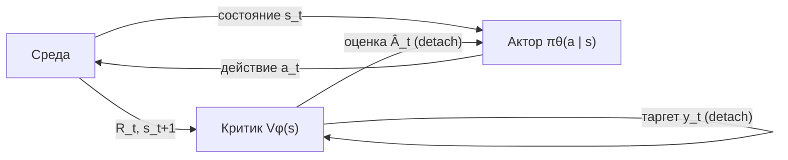

<h1>
Машинное обучение
</h1>

<h3>
Автор: Ряжских Дмитрий
</h3>
<h4>
Лектор: Виктор Кантор
</h4>

<h6>
Физтех, 2026
</h6>

<h2>
Содержание
</h2>
[[_TOC_]]
<a href="#p1_root">1) Общая теория</a>

<a href="#p1">1.1) Формализация понятий AI</a>

<a href="#p2">1.2) Типы задач ML</a>

<a href="#p3">1.3) Основные понятия ML</a>

<a href="#p4">1.4) Функции потерь</a>

<a href="#p05">1.5) Метрики качества</a>

<a href="#p04">1.6) A/B-тестирование</a>

<a href="#p5">1.7) Bias-Variance-Noise декомпозиция</a>

<a href="#p6_root">2) Линейные модели</a>

<a href="#p6">2.1) Линейная модель</a>

<a href="#p7">2.2) Регуляризация</a>

<a href="#p8">2.3) Градиентный спуск</a>

<a href="#p9">2.4) Оптимизации градиентного спуска</a>

<a href="#p10">2.5) Метод опорных векторов (SVM)</a>

<a href="#p11_root">3) Древовидные модели</a>

<a href="#p11">3.1) Решающее дерево</a>

<a href="#p12">3.2) Ансамбли деревьев</a>

<a href="#p13">3.2.1) Случайный лес</a>

<a href="#p14">3.2.2) Градиентный бустинг</a>

<a href="#p15_root">4) Нейронные сети</a>

<a href="#p15">4.1) Математические основы нейронных сетей</a>

<a href="#p16">4.2) Обучение нейронных сетей</a>

<a href="#p500">5) Метрические алгоритмы</a>

<a href="#p5p1">5.1) kNN</a>

<a href="#p5p2">5.2) K-Means</a>

<a href="#p5p3">5.3) K-Means++</a>

<a href="#p5p4">5.4) EM-алгоритм</a>

<a href="#p5p5">5.5) Иерархическая кластеризация</a>

<a href="#p5p6">5.6) DBSCAN</a>

<a href="#p600">6) Преобразование пространства признаков</a>

<a href="#p6p1">6.1) Метод главных компонент</a>

<a href="#p6p2">6.2) Эмбеддинги</a>

<a href="#p700">7) Детекция аномалий</a>
<a href="#p850">8) Обработка данных</a>

<a href="#p851">8.1) Пропуски в данных</a>

<a href="#p852">8.2) Отбор признаков</a>

<a href="#p853">8.3) Выбросы</a>

<a href="#p854">8.4) Нормализация и стандартизация</a>

<a href="#p855">8.5) Feature Engineering</a>

<a href="#p856">8.6) Обработка несбалансированных классов</a>

<a href="#p857">8.7) Выбор гиперпараметров</a>

<a href="#p9_2">9) Обучение с подкреплением</a>

<a href="#p9p1">9.1) Введение в обучение с подкреплением</a>

<a href="#p9p1p1">9.1.1) Уравнение Беллмана</a>

<a href="#p9p2">9.2) Оптимальные стратегии</a>

<a href="#p9p3">9.3) Value Iteration</a>

<a href="#p9p4">9.4) Policy Iteration</a>

<a href="#p9p5">9.5) Q-функция</a>

<a href="#p9p5p1">9.5.1) SARSA и Q-learning</a>

<a href="#p9p6">9.6) Переход в непрерывную модель</a>

<a href="#p9p7">9.7) Policy Gradient (REINFORCE)</a>

<a href="#p9p7p1">9.7.1) Advantage и Actor-Critic</a>

<a href="#p9p8">9.8) TRPO</a>

<a href="#p9p8p1">9.8.1) PPO</a>

<h4>
Базовый минимум пройденных курсов
</h4>

Прежде чем начать читать этот конспект, настоятельно рекомендуется пройти следующие курсы:

1) Теория меры
2) Математическая статистика
3) Линейная алгебра
4) Алгоритмы и структуры данных
5) Введение в Python
6) Методы оптимизации

# <h2 id="p1_root">
Общая теория
</h2>

# <h2 id="p1">
Формализация понятий AI
</h2>

> [!tip] Связь понятий
> Часто понятия **Artificial Intelligence (AI)** , **Machine Learning (ML)** и **Data Science (DS)** смешиваются. Их соотношение можно представить как вложенные множества.
> 
> ![[Pasted image 20260301154106.png]]

==Опр.== **Artificial Intelligence (AI)** - это общая область научных знаний, изучающая методы создания интеллектуальных агентов, способных воспринимать окружение и принимать действия, максимизирующие шансы на успех.

==Опр.== **Data Science (DS)** - это междисциплинарная область на стыке математики, статистики и программирования, целью которой является извлечение знаний и инсайтов из структурированных и неструктурированных данных.

==Опр.== **Machine Learning (ML)** - это подмножество методов AI, в котором способность к обучению не закладывается жесткими правилами, а выводится алгоритмически из данных. Модель $f$ обучается на выборке $D = \{(x_i, y_i)\}_{i=1}^n$:$$f^* = \arg\min_{f \in F} L(f(x), y)$$где $L$ - функция потерь, $F$ - пространство гипотез. ML является инструментом DS.

---

# <h2 id="p2">
Типы задач ML
</h2>

В <a href="#p1">машинном обучении</a> все задачи классифицируются по двум основным признакам: типу выходной переменной (что прогнозируем) и наличию обучающей разметки (наличию целевых значений $y$).

### 1. Базовая классификация по характеру обучения

==Опр.== **Обучение с учителем** - парадигма машинного обучения, в которой модель обучается на <a href="#p3">размеченной выборке</a> $D = \{(x_i, y_i)\}_{i=1}^n$. Для каждого объекта $x_i$ (признаковое описание) известен правильный ответ $y_i$ (целевая переменная). Задача - аппроксимировать функцию $f: X \rightarrow Y$.

==Опр.== **Обучение без учителя** - парадигма машинного обучения, в которой модель обучается на неразмеченной выборке $D = \{x_i\}_{i=1}^n$. Задача - обнаружить скрытые закономерности, структуру или зависимости в данных без использования "правильных ответов".

### 2. Задачи обучения с учителем

В рамках обучения с учителем выделяют два основных типа задач, которые определяются природой целевой переменной $Y$.

#### 2.1. Классификация

==Опр.== **Классификация** - это задача отображения входного объекта $x \in X$ в дискретную целевую переменную $y \in \{C_i\}_{i=1}^k$, где $C_i$ - метки классов.

- Если $k=2$, задача называется **бинарной классификацией**. Частный случай модели для бинарной классификации - **логистическая регрессия**, которая помимо класса выдаёт ещё и вероятность принадлежности к классу 1.

Модель ищет решающую границу (разделяющую поверхность), которая отделяет объекты одного класса от другого в пространстве признаков.

> [!example] Бизнес-примеры задач классификации
> 1.  **Кредитный скоринг:** $y \in \{\text{вернет кредит}, \text{не вернет кредит}\}$.
> 2.  **Сентимент-анализ (тональность текста):** $y \in \{\text{позитивный}, \text{негативный}, \text{нейтральный}\}$.
> 3.  **Прогнозирование оттока:** $y \in \{\text{клиент уйдет}, \text{клиент останется}\}$.
> 4.  **Тематическое моделирование (с учителем):** $y \in \{\text{спорт}, \text{политика}, \text{экономика}, ...\}$, где набор тем задан экспертом заранее.

#### 2.2. Регрессия

==Опр.== **Регрессия** - это задача отображения входного объекта $x \in X$ в непрерывную целевую переменную $y \in \mathbb{R}$.

> [!example] Бизнес-примеры задач регрессии
> 1.  **Прогнозирование финансовых метрик:** размер выплаты по задолженности, цена ценной бумаги.
> 2.  **Производственные задачи:** прогнозирование массы дефекта на производстве.
> 3.  **Физические величины:** прогнозирование температуры воздуха, давления, скорости ветра.

### 3. Задачи обучения без учителя

В рамках обучения без учителя центральное место занимает задача кластеризации.

#### 3.1. Кластеризация

==Опр.== **Кластеризация** - это задача разбиения множества объектов $X = \{x_1, x_2, ..., x_n\}$ на группы (кластеры) таким образом, чтобы объекты внутри одной группы были максимально похожи друг на друга (высокая внутрикластерная гомогенность), а объекты из разных групп - максимально различны (высокая межкластерная гетерогенность).

$$\text{Найти разбиение: } X = \bigcup_{j=1}^{k} C_j, \quad C_i \cap C_{j \neq i} = \emptyset$$

Количество кластеров $k$ может быть задано априори или определено алгоритмом в процессе работы.

---

# <h2 id="p3">
Основные понятия ML
</h2>

В основе любой задачи машинного обучения лежит работа с данными, которые формализуются через объекты, признаки и ответы.

==Опр.== **Объект** *(будем обозначать $x$)* - отдельная сущность из реального мира, для которой мы хотим построить прогноз. *Например: пациент в больнице, клиент в банке, изображение кошки, текст статьи и т.д.*

==Опр.== **Признак объекта** *(занумеруем признаки и $i$-й признак будем обозначать $x_i$)* - характеристики, основанные на измерениях, которые потенциально влияют на результат. *Например: возраст, пол, город проживания, цвет пикселя, склонение 1-го слова и т.д.*

> [!NOTE] Переход в метрическое пространство
> Часто для алгоритма будет требоваться, чтобы признаки были числами. Поэтому с помощью описанных ниже или других преобразований не числовые признаки переводят в числа. В итоге получается, что пространство всевозможных признаков исследуемого объекта (обозначим его $X$) будет подмножеством в $\mathbb{R}^d$

#### Способы кодировки признаков

1. **One-Hot Encoding:**
    - **Суть:** Для признака, принимающего $N$ возможных значений, создается $N$ новых бинарных признаков.
    - **Принцип:** В столбце, соответствующем реальному значению объекта, ставится 1, во всех остальных - 0.
    - **Минус:** Метод неудобен при очень большом количестве уникальных значений (например, тысячи городов), так как сильно раздувает размерность данных.
        
2. **Mean Encoding (Target Encoding):**
    - **Суть:** Категориальный признак заменяется средним значением целевой переменной для данной категории.
    - **Пример:** Если мы кодируем города для задачи кредитного скоринга, Москва может быть заменена на среднюю долю просрочек (default rate) по клиентам из Москвы.
        
3. **Label Encoding:**
    - **Суть:** Каждому уникальному значению категории присваивается определенное целое число (0, 1, 2...).
    
4. **Бинаризация признака:** 
	- **Суть:** Перевод числового признака в бинарный по порогу: для признака со значащим нулём полезно создать отдельный бинарный признак-индикатор $z = \mathbb{1}_{\{x > 0\}}$.
	- **Пример:** "сумма покупки = 0" $\Leftrightarrow$ "не покупал"
	
5. **Датчик времени:** 
	- **Суть:** Из признака-даты извлекаются компоненты: год, месяц, день недели, час, день года, признак праздника/выходного.

6. **Индикаторы редких категорий:** 
	 - **Суть:** Для категориальных признаков с большим числом уникальных значений имеет смысл выделить частые категории в отдельные бинарные признаки, а редкие объединить в одну категорию "other".

> [!warning] Важность нормировки
> 
> После кодировки признаков (особенно для линейных моделей) крайне важна **нормировка**. Если один признак измеряется в километрах, а другой в миллиметрах, веса модели будут несопоставимы, что затруднит интерпретацию и работу регуляризации.

#### Прогнозы

==Опр.== **Целевой параметр** *(будем обозначать $y$)* - признак объекта, значение которого мы хотим определять, зная значения остальных признаков.

==Опр.== **Целевое значение** - истинное значение целевого параметра объекта.

- Пространство всех возможных целевых значений будем обозначать $Y$

==Опр.== **Модель МО (алгоритм МО)** - функция $f: X \to Y$, которая (с некоторой точностью) предсказывает целевые значения.

==Опр.== **Отступ (margin)** (объекта $x_i$) - это величина $M_i = y_i \cdot f(x_i)$
##### Свойства отступа в задаче классификации:
1. $M_i > 0$ - объект классифицирован **верно** (знак $f$ совпадает с $y_i$).
2. $M_i \le 0$ - объект классифицирован **неверно** (знак $f$ не совпадает с $y_i$).
3. Чем больше $|M_i|$, тем "увереннее" классификатор и тем дальше объект находится от разделяющей гиперплоскости.

### Выборки данных

==Опр.== **Выборка** *(тоже будем обозначать $x$, хотя по факту в данном случае $x \in Mat_{l \times d}(X)$)* - (как правило упорядоченный) набор доступных для исследования объектов.

> [!tip] В матричном прдставлении
> Строками выборки являются объекты, а столбцами - признаки.

Чтобы корректно обучать и проверять корректность модели, выборку делят на три части:

1. **Обучающая выборка (Train):** Набор объектов с известными ответами. Модель учится предсказывать целевой параметр по этим данным.
    * *Аналогия:* Учебник с решёнными задачами в конце. Студент видит ответ и пытается понять логику.
2.  **Валидационная выборка (Validation):** Набор объектов, который используется для настройки дополнительных параметров модели (например, выбора сложности модели).
    * *Аналогия:* Пробный тест перед экзаменом. Студент проверяет, насколько хорошо он усвоил материал, и корректирует способ подготовки.
3.  **Тестовая выборка (Test):** Модель не знает целевые значения этих объектов, но мы знаем . Мы оцениваем качество модели по данным ею на этой выборке ответам.
    * *Аналогия:* Настоящий экзамен с новыми вопросами. Если студент просто зазубрил учебник (переобучился), здесь он провалится.

#### Способы валидации
Выбор способа валидации зависит от объёма данных и структуры задачи:

1. **Hold-out (Отложенная выборка):**
    - **Суть:** Данные просто разбиваются на две или три части (Train/Test или Train/Validation/Test) в определённой пропорции (например, 70/30 или 60/20/20).
    - **Применение:** Используется, когда данных достаточно много, чтобы выделенная часть была репрезентативной.
    
2. **K-fold Cross-Validation (Кросс-валидация по K фолдам):**
    - **Суть:** Обучающая выборка делится на K равных частей (фолдов). Модель обучается K раз: каждый раз один из фолдов становится валидационным, а остальные K−1 - обучающими.
    - **Итог:** Результаты (метрики) усредняются по всем K итерациям. Это дает более стабильную оценку качества.
    
3. **Leave-One-Out (LOO):**
    - **Суть:** Крайний случай K-fold, где K равно количеству объектов в выборке (N). На каждой итерации модель обучается на всех объектах, кроме одного, на котором проверяется.
    - **Особенности:** Очень затратно по времени, но полезно на очень маленьких выборках.
    
4. **Валидация на временных рядах:**
    - **Суть:** При работе с данными, имеющими временную структуру, нельзя перемешивать объекты. Валидация всегда должна происходить на «будущих» данных относительно «прошлых» обучающих.
    
5. **Стратифицированное разбиение:**
    - **Суть:** При разбиении на части сохраняется исходное соотношение классов (особенно важно при сильном дисбалансе классов).

#### Утечка данных

==Опр.== **Утечка данных (data leakage)** - просачивание в явном или неявном виде о данных из одной выборки в другую.

> [!example] Например
> - Несколько строк из тестовой выборки попали в обучающую
> - Во время предобработки данных вычиталось среднее выборочное по всей выборке (можно предугадать среднее на тесте)
> - В обучающей выборке оказались данные, которые опираются на данные из теста (например, события, которые случились позже)

> [!warning] Важно
> Утечка данных провоцирует переобучение и не позволяет оценить модель объективно. Это как студент, который узнал вопросы с экзамена заранее и подготовил к ним шпоры - не факт, что в реальной жизни он самостоятельно сможет решить подобные задачи.

### Обучение модели

==Опр.== **Обучение модели** - это процесс минимизации ошибок. Но ошибки бывают разные: критические и не очень, частые и редкие, поэтому требуется математическая (строгая) интерпретация "процесса минимизации ошибок".

==Опр.== **Инференс модели** - это процесс применения уже обученной модели искусственного интеллекта или машинного обучения к новым данным для получения предсказания, ответа или классификации.

==Опр.== **Метрика качества** - числовой показатель, понятный человеку, для оценки работы модели на всей выборке.
- *Пример:* доля правильных ответов или средний чек.

Минусы метрик качества, что они не всегда подсказывают что именно нужно улучшить, чтобы получить более оптимальный результат. Они чаще позволяют сравнить два готовых решения, а не обучать модель без готовых решений.

==Опр.== **Эмпирический риск** - функционал качества, который определяет количественную меру ошибок модели:$$Q(w) = \sum_{i=1}^{\ell} \mathbb{1}_{\{M_i < 0\}}$$
Эмпирический риск является трудно минимизируемой (кусочно-постоянная функция). Поэтому переходят к минимизации его верхней оценки посредством функции потерь и суррогатного эмпирического риска.

==Опр.== **Функция потерь (Loss function)** *(будем обозначать $L(y_i, \hat{y}_i)$)* - функция вида $L : Y^2 \to \mathbb{R}$, которая удовлетворяет следующим свойствам:
1) Чем чаще модель ошибается, тем больше значение функции
2) Чем серьёзнее ошибки модели, тем больше значение функции

Классический пример функции потерь $L(y_i, \hat{y}_i) = (y_i - \hat{y}_i)^2$

==Опр.== **Средний (суррогатный) эмпирический риск ($Q$)** - критерий качества при обучении модели. Стандартное математическое представление: $$Q(f, X_{l \times d}) = \frac{1}{l}\sum\limits_{k=1}^lL(x_k, f(x_k)) \quad \longrightarrow \quad \min\limits_{f}$$
> [!important] математический смысл обучения модели
> Найти глобальный минимум среднего эмпирического риска по доступным данным.

### Параметры и Гиперпараметры

==Опр.== **Параметры (веса модели)** - коэффициенты и настройки, которые модель устанавливает сама в процессе обучения. *Например: коэффициенты в уравнении разделяющей гиперплоскости, веса нейронов и т.д.*

==Опр.== **Гиперпараметры** - настройки модели, которые задаются до начала обучения и в корне влияют на само поведение алгоритма. *Примеры: скорость обучения, глубина решающего дерева, количество слоёв в сети и т.д.*

### Проблемы обобщающей способности

> [!important] Цель ML
> Главная цель ML - **обобщение**: способность модели давать точные прогнозы на объектах, которых она раньше не видела.

==Опр.== **Выбросы** - это объекты, которые значительно отличаются от основной массы данных.

==Опр.== **Робастность** - свойство модели, при котором выбросы оказывают незначительное влияние на её обучение и предсказания.

#### Недообучение

Случай, когда модель слишком проста, чтобы уловить закономерность в данных.
* *Признак:* Высокая ошибка и на обучающей, и на тестовой выборке.
* *Аналогия:* Студент пытается выучить квантовую физику, зная только таблицу умножения.

#### Переобучение

Случай, когда модель «зазубрила» обучающую выборку, включая случайный шум, вместо поиска общих правил.
* *Признак:* Ошибка на обучении почти нулевая, а на тесте - огромная.
* *Аналогия:* Студент выучил ответы на билеты по порядку номеров, но при малейшем изменении формулировки вопроса заходит в тупик.

---

# <h2 id="p4">
Функции потерь
</h2>

#### Сводная таблица самых распространённых <a href="#p3">функций потерь</a>

|  Тип задачи   |  Функция потерь  |          Формула           | Выпуклость | Гладкость |        Производная        | Чувствительность к выбросам |
| :-----------: | :--------------: | :------------------------: | :--------: | :-------: | :-----------------------: | :-------------------------: |
| Классификация |   Индикаторная   | $\mathbb{1}_{\{M \le 0\}}$ |     -      |    Нет    |       Не определена       |           Высокая           |
| Классификация |  Персептронная   |       $\max(0, -M)$        |     +      | Частично  | $-\mathbb{1}_{\{M < 0\}}$ |           Высокая           |
| Классификация |    Шарнирная     |       $\max(0, 1-M)$       |     +      | Частично  | $-\mathbb{1}_{\{M < 0\}}$ |           Средняя           |
| Классификация |  Логистическая   |      $\log(1+e^{-M})$      |     +      |    Да     |   $-\frac{1}{1+e^{M}}$    |           Средняя           |
| Классификация | Экспоненциальная |          $e^{-M}$          |     +      |    Да     |         $-e^{-M}$         |        Очень высокая        |
|   Регрессия   |     MSE (L2)     |           $r^2$            |     +      |    Да     |           $2r$            |        Очень высокая        |
|   Регрессия   |     MAE (L1)     |          \|$r$\|           |     +      | Частично  |     $\text{sign}(r)$      |           Низкая            |
|   Регрессия   |      Huber       |    кусочно-квадратичная    |     +      | Частично  |     кусочно-линейная      |           Средняя           |
|   Регрессия   |   Квантильная    |      кусочно-линейная      |     -      | Частично  |    кусочно-константная    |   Низкая (контролируемая)   |
 Здесь $M$ - это <a href="#p3">отступ</a>, a $r = f(x) - y$ - радиус-вектор от предсказания модели до целевого значения.

### Функции потерь в задачах классификации
#### Логистическая (LogLoss / Binary Cross-Entropy)

$$L(M) = \ln(1 + e^{-M})$$
##### Особенности
1) Используется в логистической регрессии. 
2) Сильно штрафует за уверенные ошибки.

> [!important] Интерпретация
> Выходы модели logloss - вероятности принадлежности к классу 1.

##### Доказательство

1. Рассмотрим константный прогноз вероятности $P(y_i = 1) = p$ для выборки из $n$ объектов:$$Q(p) = -\sum [y_i \ln p + (1-y_i) \ln(1-p)] \to \min_{p}$$
2. Берем производную по $p$ *(ищем глобальный минимум)*:$$Q'(p) = - \left( \frac{\sum y_i}{p} - \frac{\sum(1-y_i)}{1-p} \right) = 0$$
3. Пусть доля единиц в выборке $\alpha = \frac{\sum y_i}{n}$, тогда:$$\frac{\alpha n}{p} - \frac{n - \alpha n}{1 - p} = 0 \implies \frac{\alpha}{p} = \frac{1-\alpha}{1-p}$$$$\alpha(1-p) = p(1-\alpha) \implies \alpha - \alpha p = p - \alpha p \implies p = \alpha$$
Таким образом, оптимальный прогноз для LogLoss - это доля положительного класса в выборке ***(эмпирическая вероятность)***.

#### Кросс-энтропия (Categorical Cross-Entropy)

$$softmax(k, x) = \frac{e^{x_k}}{\sum\limits_{i=1}^{K}e^{x_i}}$$ Softmax - функция, которая переводит выходные значения модели в вероятности пропорционально степени уверенности. Функция кросс-энтропии выглядит так:$$L_f(x, y) = -\sum_{j=1}^{K} y_j \ln(softmax(j, f(x)))$$
##### Особенности
1) Обобщение LogLoss на $K$ классов.
2) Обычно используется в нейронных сетях.

#### Шарнирная (Hinge Loss)

$$L(M) = \max(0, 1 - M)$$
##### Особенности
1) Применяется в методе опорных векторов. 
2) Штрафует даже за верные ответы, если объект находится слишком близко к разделяющей границе ($M < 1$).

#### Экспоненциальная (Exponential Loss)
   $$L(M) = e^{-M}$$
##### Особенности
1) Используется в алгоритме AdaBoost. 
2) Чрезвычайно чувствителен к выбросам.

### Функции потерь в задачах регрессии
#### MSE (Mean Squared Error)
   $$L_f(x, y) = (y - f(x))^2$$
##### Особенности
1) Чувствительна к выбросам из-за возведения ошибки в квадрат.

> [!important] Интерпретация
> MSE оптимально ищет среднее значение целевого параметра.

##### Доказательство
Нужно найти такое $c$, которое минимизирует функционал ошибки:$$Q(c) = \sum_{i=1}^{n} (y_i - c)^2 \to \min_{c}$$
1. Возьмем производную по $c$ *(стационарная точка)*:$$Q'(c) = \sum_{i=1}^{n} 2(y_i - c) \cdot (-1) = -2 \sum_{i=1}^{n} (y_i - c)$$
2. Приравняем производную к нулю:$$\sum_{i=1}^{n} y_i - \sum_{i=1}^{n} c = 0 \implies \sum y_i - n \cdot c = 0$$
3. Разрешим относительно $c$:$$c = \frac{1}{n} \sum_{i=1}^{n} y_i = \bar{y}$$
Таким образом, оптимальный прогноз для MSE - это среднее арифметическое.

#### MAE (Mean Absolute Error)
   $$L_f(x, y) = |y - f(x)|$$
##### Особенности
   1) Устойчива к выбросам (робастна).

> [!important] Интерпретация
> MAE оптимально ищет медиану целевого параметра.

##### Доказательство
Минимизируем сумму абсолютных отклонений:$$Q(c) = \sum_{i=1}^{n} |y_i - c| \to \min_{c}$$Есть проблема: $Q$ дифференцируема в $n$ точках. Воспользуемся методом матожиданий. Пусть $y$ имеет распределение с функцией $F$ и конечным первым моментом.

1) Предположим, что $F$ непрерывна в точке $c$.
	1) Пусть $g(c) = \mathbb{E}|y - c|$ $= \int\limits_{\mathbb{R}}|y - c| dF(y)$ - она выпуклая и дифференцируема всюду. Подынтегральное выражение имеет производную по $c$ почти всюду.
	2) $g'(c) =$ $\int\limits_{\mathbb{R}}sign(y - c) dF(y) =$ $-(\int\limits_{c}^{+\infty}dF(y) - \int\limits_{-\infty}^cdF(y)) =$ $F(c + 0) + F(c - 0) - 1 =$ $2F(c) - 1$
	3) Стационарная точка $c$ имеет свойство: $F(c) = \frac{1}{2}$. Значит ровно половина значений - меньше, и ровна половина - больше $c$, т.е. $c$ - медиана.
2) Рассмотрим случай атомарности распределения в точке $c$.
	1) Пусть $F_n(c) = \frac{1}{n}\sum\limits_{k=1}^n\mathbb{1}_{\{x_k \le c\}}$
	2) $g(c) = \partial F_n(c) = [2F(c-0) - 1; 2F(c+0)-1]$ - субградиент $F_n$ по $c$
	3) Условие стационарности: $F_n(c-0) \le \frac{1}{2} \le F_n(c)$ $\Rightarrow$ $c$ - произвольная точка между центральными порядковыми статистиками, то есть медиана в классическом смысле.

#### MAPE (Mean Absolute Percentage Error)

$$MAPE = \frac{1}{n} \sum \frac{|y_i - f(x_i)|}{|y_i|}$$
##### Особенности
1) Оценивает ошибку в процентах относительно истинного значения.

> [!important] Интерпретация
> MAPE оптимально ищет взвешенную медиану целевого параметра, где вес определяется обратно пропорционально целевому значению.
##### Доказательство

#### SMAPE (Symmetric MAPE)

$$SMAPE = \frac{2}{n} \sum \frac{|y_i - f(x_i)|}{|y_i| + |f(x_i)|}$$
##### Особенности
1) Симметричная версия MAPE, исправляющая проблему деления на ноль.

---

# <h2 id="p05">
Метрики качества
</h2>

В <a href="#p3">задачах бинарной классификации</a> объекты разделяются на два класса: положительный (1) и отрицательный (0). Предсказания модели сравниваются с истинными ответами, на основе чего строится матрица ошибок:

![[Матрица_ошибок_в_машинном_обучении.png]]

Компоненты матрицы ошибок:
- **TP (True Positive)** - истинно положительные ответы.
- **TN (True Negative)** - истинно отрицательные ответы.
- **FP (False Positive)** - ложноположительные ответы (ошибка I рода).
- **FN (False Negative)** - ложноотрицательные ответы (ошибка II рода).

### Метрики качества классификации
#### Accuracy

==Опр.== **Accuracy** - доля объектов, для которых модель верно угадала класс, среди общего числа объектов.$$\text{Accuracy} = \frac{TP + TN}{TP + TN + FP + FN}$$
- **Область значений:** $[0, 1]$
- **Ограничение:** Метрика абсолютно не репрезентативна в задачах с сильным дисбалансом классов. Например, если в выборке 99% объектов относятся к классу 0, то тривиальный константный классификатор, всегда предсказывающий класс 0, получит $Accuracy = 0.99$. При этом модель будет абсолютно бесполезна для поиска целевого класса 1.

#### Precision (Точность)

==Опр.== **Precision (точность)** - доля объектов, действительно являющихся положительными, среди всех объектов, которые алгоритм отнес к положительному классу.$$\text{Precision} = \frac{TP}{TP + FP}$$
- **Смысл:** Показывает, насколько можно доверять модели, когда она утверждает, что объект принадлежит к классу 1. Метрика критична в задачах, где высока стоимость ложного срабатывания.

#### Recall (Полнота)

==Опр.== **Recall (полнота)** - доля объектов положительного класса, которые алгоритм смог найти, среди всех истинно положительных объектов выборки.$$\text{Recall} = \frac{TP}{TP + FN}$$
- **Смысл:** Показывает способность алгоритма обнаруживать объекты целевого класса. Метрика критична в задачах, где нельзя допускать ложные пропуски событий.

#### F1-мера

==Опр.== **F1-мера** - это среднее гармоническое между Precision и Recall, используемое для их агрегации в один сбалансированный критерий.$$F_1 = 2 \cdot \frac{\text{Precision} \cdot \text{Recall}}{\text{Precision} + \text{Recall}}$$
- **Свойства:** 
	* Среднее гармоническое обладает свойством жёстко штрафовать модель за проседание любой из двух метрик *(оно стремится к минимуму из двух величин)*.
    - Максимальное значение $F_1 = 1$ достигается только при идеальных $Precision = 1$ и $Recall = 1$

#### $F_\beta$-мера

==Опр.== **$F_\beta$-мера** - взвешенное среднее гармоническое между Precision и Recall, обобщающее $F_1$:$$F_\beta = (1 + \beta^2) \cdot \frac{\text{Precision} \cdot \text{Recall}}{\beta^2 \cdot \text{Precision} + \text{Recall}}$$Во сколько раз Recall важнее Precision, определяет коэффициент $\beta^2$.

- **Интерпретация параметра $\beta$:**
	* **$\beta = 1$:** Precision и Recall равноценны, формула вырождается в $F_1$.$$F_1 = 2 \cdot \frac{\text{Precision} \cdot \text{Recall}}{\text{Precision} + \text{Recall}}$$
	* **$\beta > 1$:** Recall важнее Precision. *(Например, в задачах поиска редких событий - детекция дефектов, медицинская диагностика - важнее не пропустить целевой объект.)*
	* **$\beta < 1$:** Precision важнее Recall. *(Например, в рекомендациях, где ложные срабатывания дороги и пользователю нельзя показывать вводящий в заблуждение контент.)*
- **Рекомендация:** Параметр $\beta$ выбирается исходя из стоимости ошибок I и II рода в конкретной задаче, а не из формальных соображений.

#### ROC-AUC

==Опр.== **ROC-AUC (Receiver Operating Characteristic - Area Under Curve)** - площадь под ROC-кривой, которая комплексно оценивает качество ранжирования объектов моделью независимо от выбранного порога бинаризации.

![[Pasted image 20260523150525.png]]

#### Геометрический смысл и построение

ROC-кривая строится в осях:
1. **TPR (True Positive Rate / Recall)** на оси Y: доля верно предсказанных положительных объектов среди всех истинно положительных. $$TPR = \frac{TP}{TP + FN}$$
2. **FPR (False Positive Rate)** на оси X: доля ошибочно предсказанных положительных объектов среди всех истинно отрицательных.$$FPR = \frac{FP}{TN + FP}$$
- Кривая получается путём плавного изменения порога бинаризации предсказанных моделью вероятностей от $1$ до $0$.
- Для случайного классификатора кривая совпадает с диагональю, а $ROC\text{-}AUC = 0.5$. Идеальный классификатор безошибочно разделяет классы, его кривая проходит через точку $(0, 1)$, а $ROC\text{-}AUC = 1.0$.

#### Вероятностный смысл

**ROC-AUC** численно равен вероятности того, что случайно выбранный объект из положительного класса получит от модели оценку выше, чем случайно выбранный объект из отрицательного класса:$$ROC\text{-}AUC = P(f(x_0) < f(x_1)|y_0 = 0,\ y_1 = 1)$$
- Метрика инвариантна к балансу классов, поскольку формулы $TPR$ и $FPR$ нормируются независимо на полные объёмы своих классов ($TP+FN$ и $TN+FP$).

### Алгоритм вычисления ROC-AUC

Вычисление ROC-AUC на конечной выборке из $N$ объектов выполняется по следующему алгоритму:

1. **Сортировка:** Отсортировать все объекты выборки по убыванию предсказанных моделью вероятностей $f(x_i) = \hat{y}_i$.
2. **Подсчёт классов:** Найти общее количество истинно положительных объектов $TP$ и истинно отрицательных объектов $TN$ во всей выборке.
3. **Построение графика:**
    1) Начать движение из точки $(0, 0)$ на координатной плоскости $(FPR, TPR)$.
    2) Проходить по обратному вариационному ряду объектов ($\hat{y}_{(N)}, \dots, \hat{y}_{(1)}$). Пусть оригинальный номер (до вариационного ряда) текущего объекта был $k$, тогда:
        1) Если $y_k = 1$, сделать шаг вертикально вверх на величину $\frac{1}{TP}$
        2) Если $y_k = 0$, сделать шаг горизонтально вправо на величину $\frac{1}{TN}$
	    3) Если у нескольких объектов предсказанные значения совпадают, шаг делается по диагонали в точку, соответствующую суммарному смещению за все совпадающие объекты.
4. **Интегрирование:** Рассчитать площадь получившейся фигуры.

#### Аналитическая формула 
$$\text{ROC-AUC}\ =\ \frac{\sum\limits_{i :y_i = 1}\ \sum\limits_{j : y_j=0} I(f(x_i), f(x_j))}{TP \cdot TN}$$

где $I$ - обобщённый индикатор разности:$$I(a, b) = \begin{cases} 1, & a > b \\ 0.5, & a = b \\ 0, & a < b \end{cases}$$

---

# <h2 id="p04">
A/B-тестирование
</h2>

==Опр.== **Офлайн-оценка качества** - оценка качества модели, которая проводится на валидационных и тестовых <a href="#p3">выборках</a>, используя математические метрики.

==Опр.== **Онлайн-оценка качества** - оценка качества модели, которая проводится после или во время внедрения модели в инфраструктуру, используя данные в реальном времени.

> [!NOTE] Важно
> Качество в "бою" обычно ниже офлайнового из-за переобучения, утечек данных или сдвига распределения. Поэтому проводить онлайн-тестирование всегда критически важно, чтобы "не сделать хуже".

### A/B-тестирование

==Опр.== **A/B-тест** - это онлайн-эксперимент, позволяющий сравнить две версии системы (например, текущую модель и новую) на реальных пользователях.

#### Проведение A/B-теста

1) Пользователи случайно делятся на две группы: A (контроль) и B (тест).
2) У группы A оставляют старое решение (уже существующую модель), а в группе B внедряют новое решение (новую модель).
3) В каждой группе вычисляется усреднённое значение целевой метрики.
4) Используя инструменты математической статистики проверяются гипотезы $H_0$: новая модель не лучше старой и $H_1$: новая модель превосходит предыдущую.

### Подготовка к тесту

Чтобы уменьшить шум при тестировании и получить действительные результаты с минимальной ошибкой используются методы подготовки групп:

1) ==Опр.== **MDE (Minimal Detectable Effect)** - минимальное изменение, которое мы хотим заметить между группами. 
	Исходя из выбранного MDE выбирается размер групп и длительность тестирования. Тестирование не должно заканчиваться раньше обозначенного срока, иначе критерии статзначимости будут неприменимы *(исключением являются тесты, которые могут угрожать жизни или здоровью человека, например тестирование препаратов).*

Если выполняются условия ЦПТ, выборка состоит из независимых наблюдений и к ней можно применить z-критерий, то формула для расчёта MDE имеет следующий вид:$$MDE = (z_{1-\alpha/2} + z_{1-\beta})\sqrt{\frac{\sigma^2_A}{N_A} + \frac{\sigma^2_B}{N_B}})$$Где $z$ - квантили нормального распределения, $\alpha$ - уровень значимости, $\beta$ - вероятность ошибки II-го рода, $N_A$ и $N_B$ - размеры групп при A/B-тесте, а $\sigma^2_A$ и $\sigma^2_B$ - дисперсии целевого значения в этих группах. Если группы делать равными количественно и по распределению, то формула примет вид *(где $N$ - размер выборки)*:$$MDE = (z_{1-\alpha/2} + z_{1-\beta})\sqrt{\frac{2\sigma^2}{N}})$$

2) ==Опр.== **Соль (Salt)** - произвольная строка или число, которая прибавляется к ID перед хешированием.
	Обычно равномерное разделение пользователей на группы происходит именно по их ID, и чтобы при проведении нескольких параллельных тестов над одними и теми же пользователями не было корреляции и распределения на группы были независимы, добавляют элемент случайности - соль.

3) ==Опр.== **A/B/C (/D/E...)-тест** - обобщение A/B-теста на большее количество групп, чтобы проверять составные гипотезы.

4) ==Опр.== **A/A-тест** - A/B-тестирование, в котором в группе B применяют не другое решение, а то же самое, что и в группе A.
	Данный тест применяется для проверки системы на корректность (что данные однородные) и для оценки адекватности MDE.

5) ==Опр.== **Бакетное сэмплирование** - разделение объектов на блоки случайным образом, для вычисления усреднённой статистики и применения критериев по блоку.
	Данный метод помогает уменьшить корреляцию между данными, если исходные события были не независимы.

### Статистические критерии проверки гипотез

| Критерий                                    | Тип критерия      | Что проверяет             | Особенности                                                     |
| ------------------------------------------- | ----------------- | ------------------------- | --------------------------------------------------------------- |
| Z-критерий                                  | Параметричекий    | Доли или конверсии        | Работает с большими выборками, обладает большой мощностью       |
| t-критерий Стьюдента                        | Параметрический   | Среднее                   | Работает с неизвестной дисперсией, обладает большой мощностью   |
| Биномиальный критерий                       | Параметрический   | Точное значение чего-либо | Работает с маленькими выборками и с задачами с бинарным исходом |
| Критерий Манна-Уитни                        | Непараметрический | Ранги                     | Робастный, универсальный                                        |
| Критерии однородности (Смирнова, Андерсона) | Непараметрический | Равенство распределений   | Универсальный                                                   |
| Bootstrap                                   | Непараметрический | Оценку распределения      | Работает с разным объёмом данных                                |

---

# <h2 id="p5">
Bias-Variance-Noise декомпозиция
</h2>

==Опр.== **BVN Декомпозиция** - это разложение ошибки на смещение (**Bias**), разброс (**Variance**) и неустранимый шум (**Noise**), то есть теоретический инструмент, позволяющий понять, почему модель ошибается и как изменение её сложности влияет на точность.

Рассматривается <a href="#p2">задача регрессии</a>, где истинная зависимость имеет вид:
$$y = f(x) + \epsilon$$
Где:
*   $f(x)$ - детерминированная (истинная) функция, которую мы хотим предсказать
*   $\epsilon$ - случайный шум с нулевым математическим ожиданием ($E[\epsilon] = 0$) и дисперсией $\sigma^2$
Если $\epsilon \sim \mathcal{N}(0, \sigma^2)$, то такую задачу регрессии называют с **Гауссовой ошибкой**. В общем случае распределение ошибки не известно.

Мы обучаем алгоритм $a(x; X)$ на обучающей выборке $X$. Наша цель - разложить ожидаемую квадратичную ошибку на новом объекте $x$, усредненную по всем возможным выборкам и шуму:
$$E_{x, X, \epsilon} [(y - a(x; X))^2]$$
### Математический вывод разложения

#### Шаг 1: Выделение шума (Noise)

$$(f(x) + \epsilon - a)^2 = (f(x) - a)^2 + \epsilon^2 + 2(f(x) - a)\epsilon$$
При взятии математического ожидания по шуму $\epsilon$ и выборкам $X$, перекрестное слагаемое зануляется (так как шум не зависит от выборки и $E[\epsilon]=0$), а $E[\epsilon^2]$ дает дисперсию шума $\sigma^2$. В итоге:
$$E_{x, X, \epsilon} [(y - a)^2] = E_x [E_X [(f(x) - a(x; X))^2]] + \sigma^2$$
Где $\sigma^2$ - это **неустранимый шум (Noise)**, который невозможно убрать ни одной моделью.

#### Шаг 2: Выделение смещения (Bias) и разброса (Variance)

Введем понятие **среднего прогноза** модели по всем выборкам: $\bar{a}(x) = E_X [a(x; X)]$. Разложим выражение $(f(x) - a)^2$:
$$(f - a)^2 = (f - \bar{a} + \bar{a} - a)^2 = (f - \bar{a})^2 + (\bar{a} - a)^2 + 2(f - \bar{a})(\bar{a} - a)$$

При усреднении по $X$:
1.  $(f - \bar{a})^2$ - **квадрат смещения (Bias²)**. Показывает, насколько средний прогноз модели отклоняется от истины.
2.  $E_X [(\bar{a} - a)^2]$ - **разброс (Variance)**. Показывает чувствительность модели к изменениям в обучающей выборке.
3.  Перекрёстное слагаемое зануляется, т.к. усреднённое $a$ есть $\bar{a}$.

### Итоговая формула

Ожидаемая ошибка на объекте $x$ раскладывается так:
$$Err = \text{Bias}^2 + \text{Variance} + \text{Noise}$$

### Интерпретация компонентов

| Компонент              | Суть                                                     | Связь со сложностью модели        |
| :--------------------- | :------------------------------------------------------- | :-------------------------------- |
| **Bias (Смещение)**    | Систематическая ошибка из-за упрощения реальности        | Высокое смещение = "Недообучение" |
| **Variance (Разброс)** | Ошибка из-за избыточной подстройки под конкретные данные | Высокий разброс = "Переобучение"  |
| **Noise (Шум)**        | Фундаментальное ограничение точности в самих данных      | Не зависит от модели.             |

![[Pasted image 20260503191629.png]]

### Bias-Variance Trade-off

==Опр.== **Bias-Variance Trade-off** - явление уменьшение смещения, но увеличение разброса при усложнении модели *(например, росте глубины дерева)*.

- Ввиду B-V Trade-off постоянно приходится мириться между недостаточным и избыточным прогнозом, то есть выбирать меньшую из двух зол.
- Оптимальная модель находится в точке минимума суммарной ошибки.

![[Pasted image 20260503191755.png]]

==Опр.== **Double Descent (Двойной спуск)** - явление резкого падение суммарной ошибки при очень большом числе параметров модели. *Обнаружено в глубоких нейросетях.*

- Двойной спуск происходит в тот момент, когда модели уже хватает сложности, чтобы не просто "учить" входные данные, а строить более сложные закономерности.

![[Pasted image 20260503191740.png]]

### Влияние ансамблей на ошибку

#### Bagging
* **Bias:** Сохраняется на уровне одной базовой модели (не уменьшает смещение).
* **Variance:** Уменьшается в $M$ раз. *(Дисперсия среднего $M$ независимых величин с дисперсией $\sigma^2$ равна $\frac{\sigma^2}{M}$. Если модели независимы, то усреднение уменьшает дисперсию ровно в $M$ раз, иначе нужно учесть их корреляцию)*
* **Вывод:** bagging эффективен для "сильных" (глубоких), но нестабильных моделей.

##### Изменение Variance для попарно коррелированных моделей

Пусть ансамбль состоит из $M$ базовых моделей $a_1, \dots, a_M$, ответ которых усредняется:$$\bar{a} = \frac{1}{M}\sum_{i=1}^{M} a_i$$Предположим, что модели **попарно коррелированы** с одинаковым коэффициентом корреляции $\rho$ и имеют одну и ту же дисперсию $\sigma_a^2 = D[a_i]$:$$\forall\, i \neq j\ :\ \rho = \rho(a_i, a_j), \ \text{cov}(a_i, a_j) = \rho \sigma_a^2$$Выполним математический вывод дисперсии среднего. Используем свойство дисперсии линейной комбинации:$$\mathbb{D}\bar{a} = \mathbb{D}\left(\frac{1}{M}\sum_{i=1}^{M} a_i\right) = \frac{1}{M^2}\left(\sum_{i=1}^{M} \mathbb{D}a_i + 2\sum_{i<j}\text{cov}(a_i, a_j)\right)$$Подставим дисперсию и ковариацию:$$\mathbb{D}\bar{a} = \frac{1}{M^2}\left(M\sigma_a^2 + 2 \cdot \frac{M(M-1)}{2}\,\rho\sigma_a^2\right) = \frac{\sigma_a^2}{M^2}\Big(M + M(M-1)\rho\Big) = \sigma_a^2\left(\rho + (1-\rho)\cdot\frac{1}{M}\right)$$Итоговая формула:$$\mathbb{D}\bar{a} = \sigma_a^2\left(\rho + \frac{1-\rho}{M}\right)$$
#### Boosting
* **Bias:** Последовательно уменьшается, так как каждая новая модель исправляет ошибки предыдущих.
* **Variance:** Может расти при слишком большом количестве итераций (склонность к переобучению).

#### Bootstrap
- Оценка через bootstrap может быть завышена, так как в выборку попадает только ~63.2% уникальных объектов. Для коррекции используют OOB-оценки или методы типа .632.

---

# <h2 id="p6_root">
Линейные модели
</h2>

# <h2 id="p6">
Линейная модель
</h2>

==Опр.== Линейная модель имеет вид **дискриминантной функции**:$$f(x) = w_0 + \sum\limits_{i=1}^d w_i x_i = w_0 + \langle w, x \rangle$$
- $w = (w_1, \dots, w_d)^T \in \mathbb{R}^d$ - веса линейной модели
- $w_0 \in \mathbb{R}$ - **порог** (свободный, корректирующий, член линейной модели)
- Для упрощения записи часто вводят фиктивный признак $x_0 = 1$, тогда:$$f(x) = \langle w, x \rangle = w^T x$$где $w$ и $x$ - это уже расширенные векторы, включающие $w_0$ и $x_0$.

==Опр.== **Обучение линейной модели** - поиск вектора весов $w$, минимизирующего сумму потерь на обучающей выборке.

### Линейная <a href="#p2">классификация</a>

==Опр.== **Линейный классификатор** - это алгоритм $a(x)$, значение которого определяется знаком функции линейной модели:$$a(x) = \text{sign}(f(x)) = \begin{cases} +1, &\text{если } f(x) > 0 \\ -1, &\text{если } f(x) \le 0 \end{cases}$$
- То есть в линейной классификации $Y = \{\pm 1\} \cong B$

> [!tip] Геометрическая интерпретация
> Уравнение $\langle w, x \rangle + w_0 = 0$ задает **разделяющую гиперплоскость** в $d$-мерном пространстве признаков. Вектор весов $w$ является нормалью к этой гиперплоскости. Скалярное произведение $\langle w, x \rangle$ пропорционально расстоянию от точки $x$ до плоскости со знаком. Свободный член $w_0$ определяет смещение плоскости относительно начала координат.

### Линейная <a href="#p2">регрессия</a>

Линейная регрессия решает задачу восстановления непрерывной зависимости. То есть $Y \subseteq \mathbb{R}$

==Опр.== **Линейная регрессия** - модель вида:
$$a(x) = \langle w, x \rangle + w_0 \quad (\text{или можно записать просто}\ \langle w, x \rangle)$$

#### Аналитическое решение (для квадратичной функции потерь)

Если добавить фиктивный признак $x_0=1$ и использовать квадратичную функцию потерь, можно получить решение в замкнутой форме. Пусть $F$ - матрица "объекты-признаки" размера $\ell \times (d+1)$, $y$ - вектор целевых значений, тогда:$$Q(w) = (Fw - y)^T(Fw - y)$$Найдём стационарные точки:$$\nabla Q(w) = \frac{\partial Q}{\partial w}(w)=2F^T(Fw-y) = 0\ \Longleftrightarrow\ w = (F^TF)^{-1}F^Ty$$Проверим что это точка глобального минимума: $$\frac{\partial}{\partial w}\nabla Q(w) = 2 F^TF \ge 0\ -\ \text{в силу свойств квадратичной формы ЕП}$$Значит $w = (F^TF)^{-1}F^Ty$ - действительно оптимальные веса при квадратичной функции потерь.

### +ы & -ы линейных моделей

> [!success] Преимущества
> *   Простота реализации и применения.
> *   Высокая скорость обучения и работы.
> *   Хорошо работают при большом количестве признаков.
> *   Устойчивы при малом количестве данных (благодаря регуляризации).
> *   Интерпретируемость (веса показывают важность признаков).

> [!failure] Недостатки
> *   Предполагают линейную зависимость, что может быть слишком грубым допущением.
> *   Чувствительны к масштабу признаков (требуют нормализации/стандартизации).

---

# <h2 id="p7">
Регуляризация
</h2>

> [!tip] Переобучение
> Смысл любой модели по конечному числу данных решений получить общее решение. Явление **переобучения** (overfitting) проявляется в том, что модель слишком сильно подстраивается под обучающие данные и теряет обобщающую способность, что несёт отрицательный характер при анализе данных. В <a href="#p6_root">линейных моделях</a> это часто выражается в слишком больших значениях весов $w_n$.

==Опр.== **Регуляризация** - метод добавления дополнительного ограничения на вектор весов $w$ для борьбы с переобучением.

Исходная задача оптимизации заменяется на штрафную:
$$\tilde{Q}_{\text{reg}}(w) = \sum_{i=1}^{\ell} \mathcal{L}(M_i) + \gamma V(w) \to \min_w$$
где $V(w)$ - **регуляризатор** *(штраф за сложность модели)*, а $\gamma > 0$ - **коэффициент регуляризации**.

### Типы регуляризаторов

1.  **L2-регуляризация (Ridge, гребневая регрессия):**$$V(w) = \|w\|_2^2 = \sum_{n=1}^{d} w_n^2$$
    *  Приводит к тому, что веса становятся равномерно малыми.

2.  **L1-регуляризация (LASSO (Least Absolute Shrinkage and Selection Operator)):**$$V(w) = \|w\|_1 = \sum_{n=1}^{d} |w_n|$$
    *  Приводит к *разреженности* вектора весов: многие веса становятся равными нулю.
    *  Выполняет *отбор признаков*.

> [!info] Сравнение L1 и L2
> Заметим, что названия L1 и L2 взяты не просто так. По факту данные регуляризаторы являются нормами в пространствах $\mathcal{L}^1$ и $\mathcal{L}^2$ интегрируемых по Лебегу функций. L1-регуляризация делает вектор весов разреженным, обнуляя неинформативные признаки. L2-регуляризация делает веса маленькими, но не обнуляет их.

![[Pasted image 20260301194741.png]]

### Виды линейной регрессии с регуляризаторами

1. **Обычная линейная регрессия (МНК):**$$L(y, a) = (y - a)^2, \quad \gamma = 0$$
2. **Гребневая регрессия (Ridge regression):**$$L(y, a) = (y - a)^2, \quad V(w) = \|w\|_2^2$$
3. **LASSO-регрессия:**$$L(y, a) = (y - a)^2, \quad V(w) = \|w\|_1$$

---

# <h2 id="p8">
Градиентный спуск
</h2>

Алгоритм градиентного спуска работает итеративно. Пусть $w_k$ - веса, полученные на $k$-й итерации алгоритма. Пусть $\eta : \mathbb{N}_0 \to \mathbb{R}$ - функция, определяющая темп обучения, а $\eta(k) = \eta_k$, тогда правило обновления весов* в полном градиентном спуске будет иметь вид:$$w_{k+1} = w_k - \eta_k \nabla \tilde{Q}(w_k)$$Отрицательный градиент в точке указывает на направление наиболее сильного уменьшения функции, то есть со временем веса сойдутся в точку локального минимума. Градиент функционала для <a href="#p6_root">линейной модели</a> выглядит так:$$\nabla \tilde{Q}(w) = \frac{1}{\ell}\sum_{i=1}^{\ell} y_i x_i \mathcal{L}'(M_i)$$
![[Pasted image 20260301194708.png]]

### Стохастический градиентный спуск (SGD)

При большом объёме выборки ($\ell >> 1$) возникает проблема с тем, что алгоритм слишком долго работает. Для ускорения обучения на больших данных используется стохастическая аппроксимация. Пусть $x_k$ - случайный вектор из $x$, выбранный на $k$-й итерации, а $y_k$ - соответствующее ему целевое значение, тогда$$w_{k+1} = w_k - \eta_k \nabla \mathcal{L}(w_k)$$В линейной модели:$$\nabla \mathcal{L}(w_k) = y_k x_k \mathcal{L}'(M_k)$$
### Теорема о статистической эквивалентности GD и SGD

Градиент, вычисленный методом SGD, является несмещённой оценкой истинного градиента GD: $$\mathbb{E}_{i}[\nabla \mathcal{L}_i(w)] = \nabla\tilde Q(w)$$
#### Доказательство

Рассмотрим математическое ожидание стохастического градиента по равномерно распределенному индексу $i$:$$\mathbb{E}_{i}(\nabla \mathscr{L}_i(w)) = \sum_{i=1}^{\ell} P(i) \cdot \nabla \mathscr{L}_i(w)$$При равномерном распределении $P(i) = \frac{1}{\ell}$, следовательно:$$\mathbb{E}_{i}(\nabla \mathscr{L}_i(w)) = \frac{1}{\ell} \sum_{i=1}^{\ell} \nabla \mathscr{L}_i(w) = \nabla Q(w)$$
#### Следствие

Правило обновления SGD можно представить как:$$w_{k+1} = w_k - \eta_k \nabla Q(w_k) + \eta_k \underbrace{(\nabla Q(w_k) - \nabla \mathscr{L}_{i_k}(w_k))}_{\varepsilon_k}$$где $\varepsilon_k$ - шум с нулевым математическим ожиданием: $\mathbb{E}\varepsilon_k = 0$.

### Теорема о скорости сходимости GD

Обозначим $w^*$ - оптимальный вектор весов. Пусть:
1) $Q$ - $\mu$-сильно выпуклая функция *(то есть $\forall w, w'\ :$ $Q(w') \ge Q(w) + \nabla Q(w)^T(w'-w) + \frac{\mu}{2}\|w'-w\|^2$)*
2) $\nabla Q$ - липшицева с константой Липшица $L$
3) $\forall k\ :\ \eta_k \le L^{-1}$
Тогда алгоритм GD обеспечивает линейную скорость сходимости:$$Q(w_k) - Q(w^*) \le \left(1 - \frac{\mu}{L}\right)^k (Q(w_0) - Q(w^*))$$
### Теорема о скорости сходимости SGD

Обозначим $w^*$ - оптимальный вектор весов. Пусть:
1) $Q$ - $\mu$-сильно выпуклая функция *(то есть $\forall w, w'\ :$ $Q(w') \ge Q(w) + \nabla Q(w)^T(w'-w) + \frac{\mu}{2}\|w'-w\|^2$)*
2) $\exists \sigma > 0\ :\ \mathbb{D}(\|\nabla Q\|) < \sigma^2$ - ограниченная дисперсия нормы градиента
3) $\forall k\ :\ \eta_k \le (\mu k)^{-1}$
Тогда алгоритм GD обеспечивает сублинейную скорость сходимости:$$\mathbb{E}(Q(w_k) - Q(w^*)) \le O\left(\frac{\sigma^2}{\mu k}\right), \quad k \to \infty$$
### Сравнительный анализ GD и SGD

|              Характеристика               |                         GD                         |                      SGD                       |
| :---------------------------------------: | :------------------------------------------------: | :--------------------------------------------: |
|         **Асимптотика итерации**          |                  $\Theta(\ell d)$                  |                  $\Theta(d)$                   |
|            **Память итерации**            |                  $\Theta(\ell d)$                  |                  $\Theta(d)$                   |
|          **Скорость сходимости**          |                    $O(e^{-k})$                     |                  $O(k^{-1})$                   |
| **Зависимость от точности $\varepsilon$** | $O\left(\log\frac{1}{\varepsilon}\right)$ итераций | $O\left(\frac{1}{\varepsilon}\right)$ итераций |
|              **Траектория**               |             Детерминированная, гладкая             |             Стохастическая, шумная             |
|          **Работа с выбросами**           |                      Устойчив                      |              Может раскачиваться               |

![[Pasted image 20260301212809.png]]

### Mini-batch GD

==Опр.== **Mini-batch GD** - гибрид полного GD и SGD, в котором на каждой итерации градиент вычисляется по случайной подвыборке исходной выборки размера *(батчу)*

Правило обновления весов совпадает с SGD:$$w_{k+1} = w_k - \eta_k \frac{1}{b} \sum\limits_{i \in B_k} y_i x_i \mathcal{L}'(M_i)$$где $B_k$ - случайное подмножество индексов размера $b$, выбранное на $k$-й итерации.

#### Свойства

- **Вычислительная эффективность:** Векторные операции над мини-батчем хорошо распараллеливаются на GPU, что даёт значительный выигрыш в скорости по сравнению с чистым SGD.
- **Стабильность градиента:** Усреднение по $b$ объектам уменьшает дисперсию стохастического градиента *(на величину $\sim\frac{1}{\sqrt{b}}$)* по сравнению с SGD, что обеспечивает более стабильную сходимость.
- **Гиперпараметр $b$:** Маленький $b$ даёт сильный шум (хорошо для выхода из локальных минимумов), большой $b$ - стабильность, но близость к полному GD.

---

# <h2 id="p9">
Оптимизации градиентного спуска
</h2>

Напомним, что <a href="#p8">градиентный спуск</a> - это итеративный метод нахождения минимума функции путём движения в сторону антиградиента. Формула обновления весов задаётся так:$$w_{k+1} = w_k - \eta_k \nabla \tilde{Q}(w_k)$$Но у такого алгоритма может быть ряд проблем, который не позволит найти минимум:
- Склонность к застреванию в локальных минимумах
- Медленная скорость сходимости к целевому значению
- Большие вычислительные затраты
Чтобы решить данные проблемы существует множество методов оптимизации.

### Методы с использованием инерции
#### Метод моментов (Momentum)

* **Цель:** Подавление колебаний и ускорение прохождения плато функции потерь.
* **Идея:** Накопление "памяти" о предыдущих направлениях движения *(физическая аналогия катящегося тяжелого шара)*.
* **Формулы:**
    1. Накопление импульса: $$v_t = \beta v_{t-1} + (1 - \beta) \nabla L(w_t)$$
    2. Обновление весов: $$w_{t+1} = w_t - \gamma v_t$$
* **Особенности:** Позволяет проходить участки с малым градиентом быстрее.
* **Минусы:** Риск "проскочить" узкий глобальный минимум из-за накопленной инерции.

#### Метод Нестерова *(NAG - Nesterov Accelerated Gradient)*

* **Цель:** Повышение стабильности и предотвращение промахов мимо минимума.
* **Идея:** Модель заранее "чувствует", что склон становится круче или положе, и начинает тормозить перед минимумом.
* **Формулы:**
    1. Накопление импульса: $$v_t = \beta v_{t-1} + (1 - \beta) \nabla L(w_t - \gamma v_{t-1})$$
    2. Обновление весов: $$w_{t+1} = w_t - \gamma v_{t+1}$$
* **Особенности:** Антиградиент вычисляется не в текущей точке, а в той, куда мы попали бы при совершении шага по инерции.
* **Свойства:** Сходится быстрее и стабильнее обычного Momentum.

### Адаптивные методы (Adaptive Learning Rate)

- *Эти алгоритмы настраивают разный размер шага для каждой отдельной координаты на основе накопленной статистики градиентов*
#### Adagrad

* **Цель:** Автоматическая настройка шага: для редких признаков шаг больше, для частых - меньше.
* **Формулы:**
    1. Накопление статистики: $$G_t = G_{t-1} + (\nabla L(w_t))^2$$
    2. Обновление весов: $$w_{t+1} = w_t - \frac{\eta}{\sqrt{G_t + \varepsilon}}\nabla L(w_t)$$
* **Минусы:** Знаменатель постоянно растёт, что приводит к монотонному убыванию скорости обучения до нуля - обучение "затухает".

#### RMSProp *(Root Mean Square Propagation)*

* **Цель:** Сохранить идею адаптивного шага по каждой координате, но предотвратить его затухание до нуля.
* **Идея:** Вместо суммы всех квадратов градиентов используется **экспоненциально взвешенное среднее** квадратов градиентов.
- **Формулы:**
	1.  Накопление среднего квадрата градиента:$$v_t = \beta v_{t-1} + (1 - \beta) (\nabla L(w_t))^2$$
	2.  Обновление весов:$$w_{t+1} = w_t - \frac{\eta}{\sqrt{v_t + \epsilon}} \nabla L(w_t)$$
- **Особенности:**
	* Использование $\beta$ позволяет алгоритму "забывать" очень старые градиенты и фокусироваться на статистике последних итераций.
	* Адаптация к рельефу: Если по какой-то координате градиент стабильно большой, шаг по ней уменьшается (нормировка). Если градиент мал - шаг увеличивается.
	* Очень эффективен в **нестационарных задачах** (где данные или цели меняются во времени) и при обучении рекуррентных нейронных сетей (RNN).
* **Минусы:** Всё ещё требует ручной настройки базовой скорости обучения ($\eta$).

#### AdaDelta

* **Цель:** Полное избавление от необходимости задавать глобальную скорость обучения ($\eta$) вручную.
* **Идея:** Это более сложная эвристическая модификация, которая заменяет фиксированный $\eta$ в числителе на накопленное экспоненциальное среднее самих **обновлений параметров**.

#### Особенности алгоритма
*   **Автоматизация шага:** Алгоритм подбирает размер обновления так, чтобы единицы измерения обновления совпадали с единицами измерения самих параметров (математическая согласованность).
- **Формулы:**
	1.  Накопление среднего квадрата градиента:$$v_t = \beta v_{t-1} + (1 - \beta) (\nabla L(w_t))^2$$
	2.  Вычисление эвристической значимости шага (дельта-функция): $$\Delta_{n+1} = \alpha\Delta_n + (1-\alpha)\delta_n^2$$
	3.  Обновление шага сходимости (дельта-шага): $$\delta_{n+1} = \sqrt{\frac{\Delta_n + \varepsilon}{v_t + \varepsilon}}\nabla L(w_t)$$
	4.  Обновление весов:$$w_{t+1} = w_t - \eta \cdot \delta_n$$
* **Особенности:** Чрезвычайно устойчив к выбору гиперпараметров.

### Комбинированные методы
#### Adam *(Adaptive Moment Estimation)*
* **Цель:** Объединение лучших черт **Momentum** (инерция) и **RMSProp** (адаптивность).
* **Идея:** Использование первого момента (средний градиент) и второго момента (средний квадрат градиента).
* **Формулы:**
    1. Накопление моментов:$$m_t = \beta_1 m_{t-1} + (1 - \beta_1) g_t$$ $$v_t = \beta_2 v_{t-1} + (1 - \beta_2) g_t^2$$
    2. Исправление смещения (**Bias Correction**):$$\hat{m}_t = \frac{m_t}{1 - \beta_1^t}, \quad \hat{v}_t = \frac{v_t}{1 - \beta_2^t}$$
    3. Обновление параметров:$$\theta_t = \theta_{t-1} - \alpha \frac{\hat{m}_t}{\sqrt{\hat{v}_t} + \epsilon}$$
* **Особенности:** Является стандартом в индустрии "по умолчанию" из-за устойчивости к гиперпараметрам. Быстрая сходимость; эффективная работа в условиях разреженных градиентов.

#### NAdam

* Сочетание **Adam** и инерции **Нестерова** (NAG). Позволяет делать более точные адаптивные шаги за счёт "прогнозирования" будущего градиента.

### Динамический метод Левенберга-Марквардта

* **Цель:** Обеспечение обратимости матриц при решении задач МНК, особенно при наличии мультиколлинеарности.
* **Идея:** К матрице $F^T F$ добавляется единичная матрица с коэффициентом $\gamma$.
* **Формула решения:** $$w = (F^T F + \gamma E)^{-1} F^T y$$
* **Эквивалентность:** Этот математический прием абсолютно идентичен **L2-регуляризации (Ridge)**.
* **Свойства:** Гарантирует устойчивость обращения матрицы, увеличивая её минимальные собственные числа.

### Сравнительная таблица методов

| Метод              | Инерция | Адаптивность | Главное преимущество                            | Основной недостаток                                |
| :----------------- | :-----: | :----------: | :---------------------------------------------- | :------------------------------------------------- |
| **GD**             |   Нет   |     Нет      | Стабильная и точная сходимость                  | Непригоден для больших данных                      |
| **SGD**            |   Нет   |     Нет      | Простота, возможность онлайн-обучения           | Сильные колебания, медленный в локальных минимумах |
| **Mini-batch SGD** |   Нет   |     Нет      | Баланс между скоростью и стабильностью          | Требует подбора размера батча и $\gamma$           |
| **Momentum**       |   Да    |     Нет      | Быстро проходит плато и сглаживает шум          | Риск проскочить узкий глобальный минимум           |
| **NAG (Nesterov)** |   Да    |     Нет      | Стабильнее Momentum («взгляд в будущее»)        | Более сложная программная реализация               |
| **Adagrad**        |   Нет   |      Да      | Автонастройка шага для редких признаков         | Скорость обучения быстро затухает до нуля          |
| **RMSProp**        |   Нет   |      Да      | Решает проблему затухания шага в Adagrad        | Не имеет встроенного механизма инерции             |
| **AdaDelta**       |   Нет   |      Да      | Не требует ручного выбора learning rate         | Эвристический метод, возможна нестабильность       |
| **Adam**           |   Да    |      Да      | **Стандарт.** Сочетает инерцию и адаптивный шаг | Требует больше памяти                              |
| **NAdam**          |   Да    |      Да      | Adam + «взгляд в будущее» от Нестерова          | Самые высокие вычислительные затраты               |

---

# <h2 id="p10">
Метод опорных векторов (SVM)
</h2>

==Опр.== **Метод опорных векторов (Support Vector Machine, SVM)** - это линейный классификатор, минимизирующий шарнирную функцию потерь с <a href="#p7">L2-регуляризатором</a>. Основная идея заключается в нахождении разделяющей гиперплоскости, максимизирующей зазор между классами.

##### Ширина разделяющей полосы

Рассмотрим линейно разделимую выборку. Нормируем веса таким образом, чтобы для ближайших к гиперплоскости объектов выполнялись условия:
- Для объектов класса $+1$: $\langle w, x_+ \rangle - w_0 = 1$
- Для объектов класса $-1$: $\langle w, x_- \rangle - w_0 = -1$

Тогда ширина полосы (расстояние между опорными гиперплоскостями) вычисляется как проекция вектора $(x_+ - x_-)$ на нормаль $w$:$$\text{width} = \langle \frac{w}{\|w\|}, x_+ - x_- \rangle = \frac{(w_0 + 1) - (w_0 - 1)}{\|w\|} = \frac{2}{\|w\|}$$
![[Pasted image 20260426123319.png]]

### Задача оптимизации
#### Случай линейно разделимой выборки
#### Теорема Hard Margin SVM

Если выборку можно разделить на классы с помощью $d$-мерной гиперплоскости, то нахождение оптимальной плоскости эквивалентно следующим условиям:$$\begin{cases} \frac{1}{2}\|w\|^2 \to \min\limits_{w,\ w_0} \\ \forall i \in \overline{1, \ell}\ :\ y_i \cdot f(x_i) =  y_i(\langle w, x_i \rangle - w_0) \ge 1\end{cases}$$
##### Обоснование
1. Условие $y_i(\langle w, x_i \rangle - w_0) \ge 1$ гарантирует правильную классификацию всех объектов и их нахождение на расстоянии не менее $\frac{1}{\|w\|}$ от разделяющей гиперплоскости.
2. Минимизация $\frac{1}{2}\|w\|^2$ эквивалентна максимизации $\frac{2}{\|w\|}$ - ширины разделяющей полосы. 

#### Случай линейно неразделимой выборки
#### Теорема Soft Margin SVM

Нахождение оптимальной плоскости эквивалентно следующим условиям:$$\begin{cases} \frac{1}{2}\|w\|^2 + C \sum\limits_{i=1}^{\ell} \xi_i \to \min\limits_{w,\ w_0,\ \xi} \\ \forall i \in \overline{1, \ell}\ :\ y_i \cdot f(x_i) \ge 1 - \xi_i \\ \forall i \in \overline{1, \ell}\ :\ \xi_i \ge 0 \end{cases}$$
##### Обоснование
В реальных задачах выборка часто не является линейно разделимой. Для учета ошибок вводятся дополнительные переменные $\xi_i \ge 0$ - штрафы за нарушение границ полосы.
$C > 0$ - гиперпараметр, регулирующий баланс между двумя целями:
1. Минимизация нормы весов (максимизация зазора).
2. Минимизация суммарного штрафа за нарушения (ошибки на обучающей выборке).

> [!note] Связь с общей теорией линейных моделей
> Это выражение в точности соответствует общей форме линейного классификатора с функцией потерь и регуляризатором:$$\tilde{Q}_{\text{reg}}(w) = \sum_{i=1}^{\ell} \mathcal{L}(M_i) + \gamma V(w)$$где $\mathcal{L}(M) = \max(0, 1-M)$, $V(w) = \|w\|^2$, а $\gamma = \frac{1}{2C}$.

### Двойственная задача и опорные векторы

Для эффективного решения задачи SVM (особенно при переходе к нелинейным случаям) используют метод множителей Лагранжа и переходят к двойственной задаче.

> [!quote] Напоминание
> **Двойственная задача** - переход к  поиску множителей Лагранжа, вместо поиска весов. Так можно сделать поскольку алгоритм обучения и формула предсказания зависят только от скалярных произведений объектов $\langle x_i, x_j \rangle$, а не от их координат напрямую.
>
>По теореме Куна-Таккера необходимое условие нахождения оптимума: $$\lambda_i \cdot [y_i(\langle w, x_i \rangle - w_0) - 1 + \xi_i] = 0$$

==Опр.== **Опорные векторы** *(Support Vectors)* - объекты обучающей выборки, для которых соответствующие множители Лагранжа $\lambda_i > 0$ в решении двойственной задачи.

#### Свойства опорных векторов

1) **Представление вектора весов**
В результате оптимизации вектор весов выражается как линейная комбинация объектов обучающей выборки:$$w = \sum_{i=1}^{\ell} \lambda_i y_i x_i$$
2) **Разреженность решения**
Только опорные векторы имеют ненулевые коэффициенты $\lambda_i > 0$. Все остальные объекты ($\lambda_i = 0$) не влияют на решение. Оптимальная гиперплоскость полностью определяется опорными векторами.

##### Доказательство

Из условий Куна-Таккера следует, что для объектов, у которых ограничение выполняется как строгое неравенство ($y_i f(x_i) > 1$), соответствующий множитель Лагранжа $\lambda_i = 0$. Ненулевые множители могут быть только у объектов, для которых ограничение активно: $y_i f(x_i) \le 1$. Эти объекты и называются опорными векторами.

### Ядерный переход

Одним из ключевых преимуществ SVM является возможность построения нелинейных разделяющих поверхностей без существенного усложнения вычислительной процедуры.

==Опр.== **Ядерный переход (Kernel Trick)** - замена скалярного произведения $\langle x_i, x_j \rangle$ в двойственной задаче и в дискриминантной функции на функцию ядра $K(x_i, x_j)$, которая соответствует скалярному произведению в некотором пространстве признаков большей *(возможно, бесконечной)* размерности:$$K(x_i, x_j) = \langle \varphi(x_i), \varphi(x_j) \rangle$$
#### Теорема о представлении дискриминантной функции с использованием ядра

После замены скалярного произведения на ядро, дискриминантная функция принимает вид:$$f(x) = \sum_{i=1}^{\ell} \lambda_i y_i K(x_i, x) - w_0$$
#### Основные функции ядра

|       Тип ядра       | Формула                                           | Примечание                                                       |
| :------------------: | :------------------------------------------------ | :--------------------------------------------------------------- |
|     **Линейное**     | $K(x, x') = \langle x, x' \rangle$                | Соответствует исходному линейному SVM                            |
|  **Полиномиальное**  | $K(x, x') = (\gamma \langle x, x' \rangle + r)^m$ | $m$ - степень полинома                                           |
| **Радиальное (RBF)** | $K(x, x') = e^{-\gamma \|x - x'\|^2}$             | Наиболее популярно; соответствует бесконечномерному пространству |

#### Резюме и особенности SVM

> [!success] Преимущества
> 1. **Максимизация зазора** обеспечивает лучшую обобщающую способность по сравнению с обычными линейными классификаторами *(минимизация верхней границы ошибки обобщения)*.
> 2. Дискриминантная функция задается небольшим подмножеством объектов - опорными векторами.
> 3. Легко расширяется на нелинейные случаи через ядерный переход.
> 4. Задача оптимизации является выпуклой, что гарантирует единственность глобального минимума.

> [!failure] Недостатки
> 1. **Чувствительность к выбору ядра и гиперпараметров** (параметр $C$, параметры ядра $\gamma$, $d$, $r$).
> 2. **Высокая вычислительная сложность** при обучении на больших выборках ($O(\ell^2)$ или $O(\ell^3)$) для нелинейных ядер.
> 3. При использовании нелинейных ядер модель становится трудно интерпретируемой.

##### Программные реализации

| Библиотека      | Особенности                                                                                                 |
| :-------------- | :---------------------------------------------------------------------------------------------------------- |
| **LibSVM**      | Поддерживает различные ядра; реализована в `sklearn.svm.SVC`                                                |
| **LibLinear**   | Только линейное ядро; оптимизирована для больших выборок ($O(\ell)$); реализована в `sklearn.svm.LinearSVC` |
| **sklearn.svm** | Обертки над вышеуказанными библиотеками с единым API                                                        |

---

# <h2 id="p11_root">
Древовидные модели
</h2>

# <h2 id="p11">
Решающее дерево
</h2>

==Опр.== **Решающее дерево** - это непараметрический <a href="#p2">алгоритм обучения</a>, который представляет собой иерархическую структуру (граф).

#### Структура решающего дерева

1) **Внутренние узлы:** содержат условия (предикаты) на элементы выборки.

Предикат в узле имеет вид $\{x_i \in R_j\}$, где $R_j$ - некоторая область значений признаков $x$. Если предикат равен истине, то ответ для данного элемента выборки следует искать в $j$-м поддереве, иначе проверять следующий предикат.

2) **Листья:** содержат прогноз (класс для классификации или число для регрессии).

Когда алгоритм доходит до узла, он должен получить ответ. В листе всегда однозначно определён ответ для данного элемента выборки.

### Алгоритм построения решающего дерева (жадный)

Дерево строится путем рекурсивного разбиения выборки:
1.  Выбирается признак (пусть его номер будет $j$) и порог $t$.
2.  Выборка $Q$ делится на две части: $L$ (где $x^{(j)} \le t$) и $R$ (где $x^{(j)} > t$).
3.  Процесс повторяется для полученных узлов, пока не будет достигнут критерий остановки.

#### Критерии информативности $H(R)$

Выбор $j$ и $t$ на 1-м шаге алгоритма происходит так, чтобы минимизировать функционал качества разбиения:
$$G(j, t) = \frac{|L|}{|Q|} H(L) + \frac{|R|}{|Q|} H(R) \to \min_{j, t}$$

Где $H(R)$ - мера «неоднородности» подмножества объектов в узле:

##### Для классификации (на $K$ классов):

1. Критерий Джини: $$H(R) = \sum_{k=1}^{K} p_k (1 - p_k) = 1 - \sum_{k=1}^{K} p_k^2$$
2. Энтропийный критерий: $$H(R) = - \sum_{k=1}^{K} p_k \ln p_k$$
3. Критерий ошибки классификации: $$H(R) = 1 - \max(p_k)$$

##### Для регрессии:

* **Среднеквадратичная ошибка (MSE):** $$H(R) = \frac{1}{|R|} \sum_{x_i \in R} (y_i - \bar{y})^2$$где $\bar{y}$ - среднее значение целевого параметра в узле

#### Критерий прогноза листа

Есть различные способы выбора критерия ответа для листа, самые популярные:

- **Для классификации**: ответ в листе - самый частый класс в нём
- **Для регрессии**: среднее значение целевого параметра у элементов в листе.

#### Обрезание деревьев

С увеличением глубины дерева увеличивается переобучение данного дерева. Для борьбы с подобным переобучением ограничивают глубину дерева.

==Опр.== **Обрезание дерева** - ограничение его глубины.

==Опр.== **Пре-обрезание дерева** - обрезание дерева во время его построения (слишком большая глубина - пора остановится).

==Опр.== **Пост-обрезание дерева** - упрощение уже построенного дерева до заданной глубины.

#### +ы & -ы решающих деревьев

> [!success] Преимущества
> *  Простая интерпретируемость.
> *  Отсутствие необходимости масштабирования данных.
> * Поддержка категориальных признаков.

> [!failure] Недостатки
> * Склонность к переобучению.
> * Неустойчивость (малое изменение данных меняет структуру дерева).

---

# <h2 id="p12">
Ансамбли деревьев
</h2>

==Опр.== **Ансамбль** - это модель, объединяющая прогнозы нескольких более простых, базовых алгоритмов $b_1(x), \dots, b_N(x)$.

### Виды ансамблей

1. **Bagging (Bootstrap Aggregating):** Обучение независимых моделей на случайных подмножествах данных (bootstrap) и усреднение ответов.

	Особенностью bagging является возможность распараллелить обучение: модели $b_i(x)$ предполагаются независимыми, поэтому каждую можно обучать параллельно с другой.

	==Опр.== **Процедура bootstrap** - создание $M$ независимых выборок из одной исходной, такого же как она размером, путём применения модели выбора элементов с возвращением (то есть элементы могут повторяться).

	==Опр.== **RSM (Random Subspace Method)** - bootstrap по признакам, а не объектам.

	==Опр.== **Pasting** - bootstrap без возвращения.

2. **Stacking:** Модели первого уровня обучаются на данных, а их прогнозы становятся признаками для мета-модели второго уровня.

3. **Blending:** Упрощенный stacking, где мета-модель - это взвешенная сумма прогнозов базовых моделей.

4. **Boosting:** Последовательное построение моделей, где каждая следующая исправляет ошибки предыдущих.

### Ансамбли <a href="#p11">решающих деревьев</a>

1) <a href="#p13">Случайный лес</a> - ансамбль вида bagging над решающими деревьями.
2) <a href="#p14">Градиентный бустинг</a> - ансамбль вида boosting над решающими деревьями.

![[Pasted image 20260426144223.png]]

---

# <h2 id="p13">
Случайный лес
</h2>

==Опр.== **Случайный лес** - это bagging над решающими деревьями с дополнительной рандомизацией

### Алгоритм построения леса

1. Генерируем $M$ выборок с помощью процедуры bootstrap
2. Строим деревья неограниченной глубины, но в каждом узле выбираем лучшее разбиение только из $k$ случайных признаков *(для классификации $k = \sqrt{d}$, для регрессии $k = \frac{d}{3}$)*
3. Итоговый ответ - усреднение (регрессия) или голосование (классификация) между всеми деревьями.

### Важные свойства случайного леса

> [!success] Преимущества
> * Уменьшает дисперсию модели (чувствительность к данным).
> * Почти не переобучается с ростом количества деревьев.
> * Позволяет оценивать важность отдельных признаков.
> * Можно распараллелить.

---

# <h2 id="p14">
Градиентный бустинг
</h2>

==Опр.== **Градиентный бустинг (GBDT)** - ансамбль вида boosting над решающими деревьями. 

### Идея градиентного бустинга

Каждое новое дерево $h_t$ обучается предсказывать **антиградиент** функции потерь в текущей точке прогноза:
*  В случае MSE антиградиент совпадает с остатком: $r_i = y_i - f_{t-1}(x_i)$
*  Общий вид обновления модели:$$f_t(x) = f_{t-1}(x) + \gamma_t h_t(x)$$
### Алгоритм построения

1) Инициализация прогноза (например, константой: $f_0(x) = \arg\min\limits_{c\ =\ const} \sum \mathcal{L}(y_i, c)$)
2) Для каждого шага итерации $n \in \overline{1, N}$:
	1) Вычислить антиградиент $$r_i = - \frac{\partial \mathcal{L}(y_i, f_{n-1}(x_i))}{\partial f_{n-1}(x_i)}$$
	2) Обучить $h_n$ на новых целевых параметрах ($r$ используется как целевой параметр)
	3) Посчитать шаг бустинга $\gamma_n$ и обновить модель $f_n(x) = f_{n-1}(x) + \gamma_n h_n(x)$

![[Pasted image 20260426144253.png]]

### Важные свойства градиентного бустинга

> [!success] Преимущества
> * Уменьшает смещение ответов модели относительно реальных данных.
> * Исправляет ошибку исходной модели.

> [!failure] Недостатки
> * Легко переобучается, особенно если глубина деревьев большая.

---

# <h2 id="p15_root">
Нейронные сети
</h2>

# <h2 id="p15">
Математические основы нейронных сетей
</h2>

#### Математическая модель нейрона

==Опр.== **(Искусственный) Нейрон** - это <a href="#p6_root">линейная модель</a>, за которой следует нелинейная функция активации. Нейрон описывается формулой$$u(x) = f(\langle w, x \rangle + b)$$Где:
- $x = (x_1, \dots, x_n)$ - входные данные (вектор признаков)
- $\Sigma = \sum\limits_{i=1}^{n} w_i x_i + b = \langle w, x \rangle + b$ - взвешенная сумма признаков (линейная модель)
- $f$ - **нелинейная функция активации**.

### Теорема Цыбенко (Универсальная теорема аппроксимации, 1989)

> [!important] Универсальная теорема аппроксимации
> Нейронная сеть даже с одним скрытым слоем при достаточном количестве нейронов способна приблизить любую непрерывную функцию на компакте с любой наперед заданной точностью.

### Многослойная сеть

Один нейрон - это функция многих переменных ($\mathbb{R}^n \to \mathbb{R}$), а слой нейросети - вектор из нейронов, то есть функция вида $\mathbb{R}^n \to \mathbb{R}^d$. Если $\vec{f}$ - вектор-функция многих переменных активации, $W$ - тензор весов, $x$ - выборка, а $b$ - вектор смещения, то слой нейросети можно описать формулой:$$a(x) = \vec{f}(Wx + b)$$
Сеть состоит из последовательности слоёв:
1. **Входной слой:** Принимает признаки.
2. **Скрытые слои:** Вычисляют промежуточные представления.
3. **Выходной слой:** Выдаёт итоговый прогноз (числа или вероятности).

#### Функции активации

1) **Sigmoid:** $$\sigma(z) = \frac{1}{1 + e^{-z}}$$Диапазон $(0, 1)$. Имеет затухание градиентов при больших значениях $|z|$.

2) **Tanh:** $$tanh(z) = \frac{e^z - e^{-z}}{e^z + e^{-z}}$$Диапазон $(-1, 1)$. Центрирована относительно нуля.

3) **ReLU:** $$ReLU(z) = \max(0, z)$$Диапазон $\mathbb{R}$. Самая популярная благодаря простоте и отсутствию затухания градиента в положительной области. НО: имеет «умирающие нейроны» при $z < 0$.

4) **Leaky ReLU:** $$LeaReLU(z) = \max(\alpha z, z)$$Улучшенный ReLU, который решает проблему «смерти нейронов».

5) **Softmax:**$$\sigma(z)_i = \frac{e^{z_i}}{\sum\limits_{j=1}^{K} e^{z_j}}$$Используется на выходе для классификации, чтобы превратить выходные значения в распределение вероятностей (сумма всегда = 1).

---

# <h2 id="p16">
Обучение нейронных сетей
</h2>

### Обучение: Backpropagation
#### Принцип обратного распространения ошибки

В <a href="#p15">нейронных сетях</a>, как и в других моделях, обучение - это минимизация функции потерь методом градиентного спуска
1. **Forward Pass** - это вычисление текущего значения функции потерь. просто вычисляем выходы всех нейронов от начала к концу.
2. **Backward Pass** - это вычисление вклада каждого нейрона в функцию потерь для корректировки весов модели. Вычисляем градиенты ошибки $\frac{\partial L}{\partial w}$ от выхода ко входу, используя цепное правило дифференцирования.

> [!quote] Напоминание: цепное правило
> Если переменная $u$ зависит от $v$, а $L$ от $u$, то градиент по $v$ вычисляется через Якобиан:$$\frac{\partial L}{\partial v} = \left(\frac{\partial u}{\partial v}\right)^T \frac{\partial L}{\partial u}$$

Для вычисления градиента ошибки $\frac{\partial L}{\partial w}$ в середине нейросети используют граф вычислений. Граф берёт пришедший из следующего слоя градиент и умножает его на локальную производную текущего узла. Таким образом, вычисление ошибки происходит последовательно по слоям.

![[Pasted image 20260526135151.png]]

#### Проблема инициализации

- Нельзя инициализировать веса нулями или одинаковыми числами, иначе нейроны будут обучаться идентично (в силу симметрии). Обычно используют случайные значения из нормального распределения.

### Регуляризация

В нейронных сетях из-за специфической структуры есть новые виды регуляризации:

1) **Dropout** 
	- Во время обучения для каждого forward pass с вероятностью $p$ зануляется выход нейрона. 
	- Dropout можно интерпретировать как обучение огромного количества неполных подсетей с общими весами. При каждом шаге градиентного спуска мы обучаем новую конфигурацию сети. Это заставляет нейроны не полагаться на конкретных соседей, а выучивать более устойчивые признаки, дублируя знания внутри сети.
	- Во время тестирования или применения модели нейроны **не зануляются**, так как нам нужна вся мощность сети. Однако, чтобы скомпенсировать масштаб сигналов (ведь при обучении они были неполные), выходы всех нейронов домножаются на (1−p).

2) **Batch Normalization** 
	- Центрирование и нормировка выходов нейронов по батчу. Ускоряет обучение и добавляет стабильности.
	- Решает проблему постоянного изменения распределения сигналов на глубоких слоях из-за обновления весов на ранних слоях.
	- Иногда, чтобы модель "могла сама отменить нормализацию", добавляется два параметра в слой: масштаб нормализации $\gamma$ и сдвиг нормализации $\beta$, итоговая формула нормализации имеет вид:$$u' = \gamma\frac{u - \mathbb{E}u}{\sqrt{\mathbb{D}u + \varepsilon}} + \beta$$

3) **Skip-connections** 
	- При обучении добавляются связи, которые пробрасывают сигнал мимо одного или нескольких слоёв. Помогают обучать очень глубокие сети (ResNet), борясь с затуханием и взрывами градиента.
	- Математическое описание: $a'(x) = \vec{f}(Wx+b) + x\gamma$

---

# <h2 id="p500">
Метрические алгоритмы
</h2>

# <h2 id="p5p1">
kNN
</h2>

> [!tip] Идея
> Метрические алгоритмы основаны на **гипотезе компактности**: <a href="#p3">объекты с похожими признаками обычно имеют похожие целевые значения</a>. В отличие от линейных моделей или деревьев, эти алгоритмы опираются на вычисление **расстояния** между объектами в многомерном пространстве признаков.

### Метод k ближайших соседей (k-NN)
#### Алгоритм работы

1. Выбрать число соседей $k$ *(это гиперпараметр, с его ростом границы зон ответов сглаживаются)*.
2. Вычислить расстояние $d(x_1, x_2)$ от рассматриваемого объекта $x$ до всех точек обучающей выборки $X^\ell$.
3. Выбрать $k$ объектов с минимальным расстоянием.
4. Ответ определяется функцией выбора $a(x, y)$.

#### Функции выбора

1) Для классификации функция выбора - функция голосования:$$a(x, y) = arg\max\limits_{y \in Y} \sum_{i=1}^k \mathbb{1}_{\{y_i = y\}}(y)$$
2. Для регрессии ответом является среднее арифметическое ответов соседей:$$a(x, y) = \frac{1}{k} \sum_{i=1}^k y_i$$
#### Меры близости и расстояния

> [!warning] Важно
> Выбор метрики $d(x_1, x_2)$ критически влияет на результат.

1.  **Расстояние Минковского ($L_p$-норма):**$$d(x_1, x_2) = \|x_1 - x_2\|_p = \left( \sum_{j=1}^d |x_{1,j} - x_{2,j}|^p \right)^{1/p}$$
    * $p=1$: Манхэттенское расстояние ($L_1$)
    * $p=2$: **Евклидово расстояние** ($L_2$) - самое популярное
    * $p \to \infty$: Расстояние Чебышёва ($L_\infty$, максимум отклонения по одной координате)

2.  **Косинусная мера близости:**
    Оценивает угол между векторами, а не их длину. Популярна в анализе текстов.$$\text{sim}(x_1, x_2) = \cos \theta = \frac{\langle x_1, x_2 \rangle}{\|x_1\|_2 \|x_2\|_2}$$
### Модификации kNN
#### Взвешенный k-NN

Ближние соседи должны иметь больший вес в голосовании, чем дальние:$$a(x, y) = arg\max\limits_{y \in Y} \sum_{i=1}^k d(x_i, x) \mathbb{1}_{\{y_i = y\}}(y)$$Здесь $d$ может несколько отличаться от того, по которому выбирали $k$ ближайших соседей, но является непрерывной функцией от него.

#### Метод Парзеновского окна

Обобщение взвешенного k-NN. Вместо фиксированного $k$ берётся фиксированный радиус $h$. Вклад соседа определяется **ядром** $K(t)$, которое затухает с ростом расстояния.$$a(x, y) = arg\max\limits_{y \in Y} \sum_{i=1}^k w_i \mathbb{1}_{\{y_i = y\}}(y)$$$$w_i = K\left(\frac{d(x, x_i)}{h}\right)$$
#### Метод потенциальных функций

Дальнейшее обобщение, где каждому объекту выборки $x_i$ приписывается «заряд» (потенциал) $\gamma_i$, определяющий его важность.

#### Центроидный классификатор

Максимально простой метод:
1. Для каждого класса вычисляется **центроид** - среднее арифметическое признаков всех объектов этого класса.
2. Новый объект относится к классу ближайшего к нему центроида.
* **Применение:** Эффективен для простых текстовых задач, когда центроид можно интерпретировать как «типичный документ».

### Проклятие размерности

С ростом числа признаков $d$ метрические методы начинают работать плохо:
* **Концентрация объемов:** Почти все объекты в многомерном пространстве оказываются в тонком поверхностном слое, у границ.
* **Равноудалённость:** Расстояния между парами случайных точек становятся примерно одинаковыми, и понятие "ближайший сосед" теряет смысл.
* **Накопление шума:** Малые изменения в каждой из 10 000 координат в сумме дают огромное расстояние.

#### Оптимизации

В базовом виде обучение - это просто запоминание выборки. Но поиск соседей для прогноза требует $O(N^2 d)$ операций. Существуют оптимизации поиска, уменьшающие асимптотику:

1)  **KD-деревья:** Нарезают пространство на кубы вдоль координат и работают как деревья поиска.
2)  **Ball-деревья:** Покрывают выборку системой вложенных шаров.

#### +ы & -ы метрических алгоритмов

> [!success] Преимущества
> *   Нет фазы обучения (отложенная операция).
> *   Высокая интерпретируемость.
> *   Хорошо строит сложные границы.

> [!failure] Недостатки
> *   Дорогой по времени прогноз на больших данных.
> *   Чувствительны к масштабу признаков.
> *   Проклятие размерности.

---

# <h2 id="p5p2">
K-Means
</h2>

Алгоритм **K-Means** *(K-средних)* решает <a href="#p2">задачу кластеризации</a>, в которых число кластеров $K$ задаётся пользователем заранее.

==Опр.== **Внутрикластерная сумма квадратов (WCSS - Within-Cluster Sum of Squares)** - это целевой оптимизируемый функционал *("функция потерь")* в алгоритме K-Means. Математически он записывается в следующем виде: $$J(C, \mu) = \sum_{k=1}^K \sum_{x_i \in C_k} \|x_i - \mu_k\|_2^2 = \sum_{i=1}^n \sum_{k=1}^K \mathbb{1}_{\{x \in C_k\}}(x_i) \cdot \|x_i - \mu_k\|_2^2 \longrightarrow \min_{C, \mu}$$Где:
- $K$ - количество кластеров.
- $C_k$ - множество объектов, отнесённых к кластеру $k$.
- $\mu_k$ - центроид кластера $k$.

#### Свойства функционала:

- Задача глобальной минимизации данного функционала является NP-трудной, т.к. число возможных вариантов разбиения растёт экспоненциально с ростом количества объектов.
- K-Means использует метод попеременного координатного спуска, который гарантированно сходится лишь к локальному минимуму, сильно зависящему от начальной инициализации.

### Классический K-Means
#### Алгоритм

0) **Инициализация.** Случайным путём выбираются $K$ начальных центроидов $\mu_1, \dots, \mu_K$ из пространства признаков или непосредственно из точек обучающей выборки.

1) **Назначение объектов.** Каждый объект выборки $x_i$ приписывается к ближайшему к нему центроиду. Формально это означает расчёт:$$c_i = \arg\min_{1 \le k \le K} \|x_i - \mu_k\|_2^2$$Все объекты разбиваются на подмножества $C_1, C_2, \dots, C_K$.

2) **Обновление центроидов.** Центр каждого кластера пересчитывается как среднее арифметическое координат всех объектов, отнесённых к данному кластеру на Шаге 1:$$\mu_k = \frac{1}{|C_k|} \sum_{x_i \in C_k} x_i$$
3) **Проверка критерия останова.** Шаги 1 и 2 циклически повторяются до выполнения одного из условий:
    1. Центроиды перестают менять своё положение (или их сдвиг меньше заданного порога $\varepsilon$).
    2. Метки кластеров объектов полностью стабилизировались.
    3. Достигнуто максимальное число итераций.

![[Pasted image 20260525120003.png]]

### +ы & -ы K-Means

> [!success] Преимущества
> *   Вычислительная эффективность - асимптотика $O(N \cdot n \cdot K)$.
> *   Высокая интерпретируемость. Наглядный геометрический смысл.

> [!failure] Недостатки
> *   Необходимость фиксировать количество кластеров заранее.
> *   Сильная чувствительность к начальному положению центроидов.
> *   Чувствительность к выбросам.
> *   Обнаружение только выпуклых, непересекающихся кластеров, содержащих свои центроиды.

---

# <h2 id="p5p3">
K-Means++
</h2>

> [!tip] Идея
> Для борьбы с главной проблемой <a href="#p5p2">K-Means</a> - зависимостью от случайного старта - был разработан алгоритм **KMeans++**. Его цель - выбрать начальные центроиды так, чтобы они были максимально удалены друг от друга, что снижает риск попадания в плохой локальный минимум и ускоряет сходимость.

#### Алгоритм инициализации KMeans++

1. Первый центроид $\mu_1$ выбирается случайно равномерно из объектов исходной выборки.
2. Для каждой точки выборки $x_i$ рассчитывается квадрат расстояния до ближайшего из уже выбранных центроидов: $$d^2(x_i) = \min_{j} \|x_i - \mu_j\|^2$$
3. Выбирается следующий центроид из оставшихся точек выборки случайным образом, Но при этом вероятность выбрать точку в качестве нового центра пропорциональна квадрату расстояния:$$P(x_i) = \frac{d^2(x_i)}{\sum\limits_{m=1}^n d^2(x_m)}$$Таким образом, точки, расположенные далеко от уже существующих центров, имеют гораздо более высокий шанс стать новыми центроидами.
4. Шаги 2 и 3 циклически повторяются, пока не будет набрано всё необходимое количество центроидов $K$.

> [!success] Преимущества KMeans++
> - Предоставляет теоретические гарантии качества: математическое ожидание значения оптимизируемого функционала превосходит глобальный минимум максимум в $O(\log K)$ раз.
> - Существенно уменьшает количество итераций основного алгоритма, необходимых для полной сходимости.

### MiniBatch KMeans

На огромных данных расчёт расстояний от всех точек до всех центроидов на каждой итерации классического K-Means становится слишком ресурсоёмким. Модификация **MiniBatch KMeans** решает эту проблему за счёт применения принципов стохастической оптимизации.

#### Алгоритм MiniBatch KMeans

1. **Инициализация:** Начальные центроиды $\mu_1, \dots, \mu_K$ выбираются с помощью алгоритма KMeans++. Для каждого кластера заводится счётчик объектов $v_k = 0$.
2. **Итерации (повторяются до сходимости):**
    1. Из исходных данных случайно извлекается подмножество объектов $M$ фиксированного размера $b$.  
    2. Каждая точка $x_i \in M$ приписывается к ближайшему текущему центроиду: $$c_i = \arg\min_{k} \|x_i - \mu_k\|^2$$
    3. Обновление центроидов происходит поочерёдно для каждой точки из $M$. Для точки $x_i$, отнесённой к кластеру $c_i$:
        1. Обновляется счётчик объектов кластера: $v_{c_i} := v_{c_i} + 1$.
        2. Рассчитывается затухающий шаг: $\eta = \frac{1}{v_{c_i}}$.
        3. Центроид корректируется смещением в сторону новой точки *(градиентный шаг)*:$$\mu_{c_i} := (1 - \eta) \mu_{c_i} + \eta x_i$$
С ростом числа итераций счётчики $v_k$ увеличиваются, шаг $\eta$ уменьшается, и влияние новых элементов плавно затухает, что обеспечивает стабильную сходимость.

#### Ключевые отличия от классического KMeans

- **Обработка данных:** Классический KMeans обрабатывает всю выборку за раз, в то время как MiniBatch KMeans работает итеративно с небольшими случайными подмножествами.
   
- **Качество результатов:** За счёт стохастической природы и шума алгоритм MiniBatch KMeans сходится к чуть более худшему значению функционала инерции, чем классический K-Means. Однако на практике разница в качестве кластеризации пренебрежимо мала и полностью компенсируется колоссальным выигрышем в скорости.

---

# <h2 id="p5p4">
EM-алгоритм
</h2>

В задачах анализа данных и МО часто возникает ситуация, когда наблюдаемые данные порождаются процессом, который зависит от некоторых скрытых факторов, недоступных для прямого измерения.

==Опр.== **EM-алгоритм (Expectation-Maximization)** - это итеративный численный метод, используемый для нахождения оценок максимального правдоподобия параметров вероятностных моделей в условиях, когда модель зависит от скрытых ***(латентных)*** переменных.

Пусть $x = (x_1, \dots, x_n)^T$ - данная выборка, соответствующая СВ $X$, а $z = (z_1, \dots, z_n)^T$ - латентные данные, соответствующие СВ $Z$, тогда полные данные будут иметь вид $(x, z)$ и соответствовать СВ $(X, Z)$. Пусть $\theta$ - вектор настраиваемых параметров модели.

Задача EM заключается в максимизации логарифма неполного правдоподобия по параметрам $\theta$: $$\ln p(X|\theta) = \sum_{i=1}^n \ln p(x_i|\theta) = \sum_{i=1}^n \ln \sum_{z_i} p(x_i, z_i|\theta)$$Основная сложность прямой оптимизации данной функции заключается в том, что знак суммы находится внутри знака логарифма. Это разрушает удобную структуру произведения вероятностей, не позволяя найти аналитическое решение градиентными методами.

#### ELBO

Для решения проблемы логарифма от суммы EM-алгоритм переходит к оптимизации вспомогательной функции - нижней оценки правдоподобия, введя произвольное априорное распределение скрытых переменных $q(Z)$. Неравенство Йенсена, логарифм неполного правдоподобия можно ограничить снизу: $$\ln p(X|\theta) = \ln \sum_{z \in Z} p(X, z|\theta) = \ln \sum_{z \in Z} q(z) \frac{p(X, z|\theta)}{q(z)} \ge \sum_{z \in Z} q(z) \ln \frac{p(X, z|\theta)}{q(z)} \equiv \mathcal{L}(q, \theta)$$

==Опр.== **ELBO (Evidence Lower Bound)** - это нижняя вариационная оценка логарифма правдоподобия данных, определяемая как функция $\mathcal{L}(q, \theta)$.

Связь между истинным правдоподобием и нижней оценкой выражается через **дивергенцию Кульбака-Лейблера**:$$\ln p(X|\theta) = \mathcal{L}(q, \theta) + D_{KL}(q(Z) || p(Z|X, \theta)) = \mathcal{L}(q, \theta) + \sum\limits_{z \in Z} q(z) \ln\frac{q(z)}{p(z|X, \theta)}$$Поскольку всегда $D_{KL} \ge 0$, равенство логарифма правдоподобия и нижней оценки достигается тогда и только тогда, когда $D_{KL} = 0$. Это происходит при условии, что распределение $q(Z)$ в точности совпадает с истинным апостериорным распределением скрытых переменных $p(Z|X, \theta)$.

#### EM-алгоритм
##### Инициализация

- Алгоритм начинает работу с некоторого начального приближения параметров $\theta^{(0)}$ и итеративно повторяет два шага до достижения сходимости.

##### E-шаг

- На этом шаге фиксируются текущие параметры модели $\theta^{(t)}$. Функция нижней оценки $\mathcal{L}(q, \theta^{(t)})$ максимизируется по распределению $q(Z)$, для этого необходимо занулить KL-дивергенцию, выбрав:$$q^{(t+1)}(Z) = p(Z|X, \theta^{(t)})$$Практически это сводится к вычислению математического ожидания логарифма полного правдоподобия по апостериорному распределению:$$Q(\theta, \theta^{(t)}) = \mathbb{E}_{Z|X, \theta^{(t)}} \left(\ln p(X, Z|\theta) \right) = \sum_{z \in Z} p(z|X, \theta^{(t)}) \ln p(X, z|\theta)$$
##### M-шаг

- На этом шаге зафиксировано найденное на E-шаге распределение скрытых переменных, и выполняется максимизация функции $Q(\theta, \theta^{(t)})$ по параметрам $\theta$: $$\theta^{(t+1)} = \arg\max_{\theta} Q(\theta, \theta^{(t)})$$Благодаря тому, что логарифм теперь находится внутри математического ожидания и применяется непосредственно к совместному распределению полных данных $p(X, Z|\theta)$, задача оптимизации значительно упрощается и во многих популярных случаях имеет строгое аналитическое решение.

### Сравнение с <a href="#p5p3">K-Means</a>

> [!NOTE] Частный случай
> Алгоритм K-Means можно рассматривать как частный детерминированный случай EM-алгоритма, применённого к модели гауссовых смесей. 

Сравнительный анализ характеристик моделей:
- **Тип разбиения:** K-Means реализует концепцию жёсткой кластеризации (объект принадлежит строго одному кластеру), в то время как EM-алгоритм обеспечивает мягкую кластеризацию через вероятностные оценки принадлежности.

- **Форма кластеров:** K-Means эффективно находит только сферические кластеры одинакового объёма из-за использования евклидова расстояния. EM-алгоритм за счёт настройки матриц ковариации способен выделять эллиптические кластеры произвольного размера и ориентации.

- **Математический переход:** Если зафиксировать ковариационные матрицы всех компонент равными $\sigma^2 E$ и устремить дисперсию к нулю ($\sigma \to 0$), то вероятности принадлежности объектов превратятся в бинарные индикаторы, а M-шаг EM-алгоритма станет в точности равен шагу обновления центроидов в K-Means.

### +ы & -ы EM-алгоритма

> [!success] Преимущества
> *   Алгоритм монотонно сходится к максимальному значению неполного правдоподобия.
> *   Вместо жёсткого присвоения объекта к одному кластеру алгоритм вычисляет распределение вероятностей принадлежности ко всем группам, что точнее отражает неопределённость в данных.

> [!failure] Недостатки
> *   Гарантирована сходимость только к локальному минимуму *(или седлу)* функции правдоподобия.
> *   Сильная чувствительность к начальному выбору параметров $\theta^{(0)}$.
> *   Необходимость заранее чётко специфицировать вероятностную модель.
> *   Не всегда вычисление матожидания является простым вычислительно.

---

# <h2 id="p5p5">
Иерархическая кластеризация
</h2>

==Опр.== **Иерархическая кластеризация** - это семейство алгоритмов <a href="#p2">кластеризации</a>, направленных на построение дерева вложенных кластеров ***(иерархии)***.

По направлению построения иерархии методы делятся на два типа:
1) **Дивизивные (нисходящие)** - процесс начинается с одного гигантского кластера, содержащего всю выборку, который поочерёдно дробится на более мелкие группы.
2) **Аггломеративные (восходящие)** - процесс идёт снизу-вверх, начиная от отдельных точек и последовательно объединяя их в группы.

![[Pasted image 20260525115839.png]]

#### Алгоритм агломерационной кластеризации

0. **Инициализация.** Каждый объект выборки $x_i$ объявляется изолированным кластером: $C_i = \{x_i\}_{i=1}^n$. Вычисляется стартовая матрица попарных расстояний между всеми кластерами на основе выбранной метрики *(например, евклидова расстояния)*.

1. **Поиск кандидатов на слияние.** В текущей матрице расстояний находится пара кластеров $C_u$ и $C_v$, между которыми расстояние минимально:$$(C_u, C_v) = \arg\min_{i, j} d(C_i, C_j)$$
2. **Слияние кластеров.** Выбранные кластеры объединяются в один новый укрупнённый кластер: $C_{new} = C_u \cup C_v$. Старые кластеры $C_u$ и $C_v$ удаляются из списка текущих групп.

3. **Пересчёт матрицы расстояний.** Рассчитываются расстояния от только что созданного кластера $C_{new}$ до всех остальных оставшихся кластеров в выборке.

4. **Проверка критерия останова.** Шаги 1-3 циклически повторяются, пока все объекты не объединены в один единственный кластер, либо пока не достигнуто заданное пользователем число кластеров $K$.

### Метрики межкластерного расстояния

Пусть расстояние между отдельными объектами жёстко задаётся метрикой $\rho(x, y)$. Расстояние между кластерами $A$ и $B$ можно определять по-разному. Выбор этой метрики полностью определяет геометрию и топологию разделения пространства.

#### Минимальное расстояние

$$d_{min}(A, B) = \min_{x \in A,\ y \in B} \rho(x, y)$$

- **Особенности:** Позволяет успешно выделять кластеры сложных, невыпуклых и вытянутых форм.
- **Недостатки:** Крайне подвержен **эффекту цепной реакции**. Если между двумя крупными изолированными кластерами случайно окажется цепочка из нескольких шумовых точек, алгоритм мгновенно свяжет эти кластеры в один длинный ***конгломерат***, проигнорировав их обособленную структуру.

#### Максимальное расстояние

$$d_{max}(A, B) = \max_{x \in A,\ y \in B} \rho(x, y)$$

- **Особенности:** Стремится формировать компактные, плотные кластеры правильной сферической формы с примерно равными диаметрами.
- **Недостатки:** Обладает экстремальной чувствительностью к выбросам и шуму. Одна далёкая аномальная точка на самой периферии кластера способна искусственно завысить расстояние до критического уровня, заблокировав логичное слияние двух близких групп объектов.

#### Среднее расстояние

$$d_{avg}(A, B) = avg_{x \in A,\ y \in B} \rho(x, y) =  \frac{1}{|A| \cdot |B|} \sum_{x \in A} \sum_{y \in B} \rho(x, y)$$

- **Особенности:** Стабильный компромисс между минимальным и максимальным расстоянием. Метрика устойчива к присутствию умеренного шума и одиночных выбросов, так как они сглаживаются в процессе тотального усреднения, хорошо отражая взаимное расположение основных масс объектов.

### Дендрограммы

==Опр.== **Дендрограмма** - это специализированная древовидная диаграмма, визуализирующая последовательный процесс слияния кластеров в иерархических методах, где по одной оси отложены индексы объектов, а по другой - расстояние, на котором произошло их объединение.

![[Pasted image 20260525115502.png]]

#### Правила чтения и анализа дендрограммы

- Каждая точка исходной выборки изначально является отдельным листом на самом нижнем уровне дерева.
- Слияние двух кластеров изображается в виде П-образной связи. Высота перекладины над нулевым уровнем оси в точности соответствует расстоянию $d(A, B)$, на котором данные кластеры были объединены алгоритмом.
- **Выделение плоских кластеров:** Чтобы из построенного дерева получить конкретное разбиение выборки на подмножества, дендрограмму горизонтально разрезают условной линией на определённой высоте. Итоговое количество сформированных кластеров будет в точности равно числу вертикальных рёбер графа дерева, которые пересекла линия разреза.
- **Поиск оптимального числа кластеров:** На графике дендрограммы ищут самый длинный вертикальный участок рёбер, который не пересекается горизонтальными линиями слияний. Разрез в данном диапазоне считается наиболее обоснованным, так как он разделяет качественно далёкие друг от друга группы.

### Плотность на основе центров (Center-Based Density)

==Опр.== **Плотность на основе центров (Center-Based Density)** - это метод оценки локальной плотности данных, при котором уровень концентрации в точке признаётся высоким, если в её непосредственной окрестности фиксированного радиуса находится достаточное число объектов выборки.

Для математической формализации этого подхода вводятся два базовых параметра:
1. $\varepsilon$ - радиус локальной зоны поиска.
2. $MinPts$ - пороговое минимальное количество точек для подтверждения плотности.

Для подсчёта количества элементов в окрестности используют **считающую окрестность** $N_\varepsilon$:
$$N_\varepsilon(p) = \{x \in X \mid \rho(p, x) \le \varepsilon\} = X\ \cap\ U_\varepsilon(p)$$

Локальная плотность в точке $p$ признаётся достаточной для формирования ядра кластера только в том случае, если мощность её считающая окрестность удовлетворяет условию: $|N_\varepsilon(p)| \ge MinPts$.

---

# <h2 id="p5p6">
DBSCAN
</h2>

==Опр.== **DBSCAN (Density-Based Spatial Clustering of Applications with Noise)** - это <a href="#p5p5">плотностной алгоритм</a> кластеризации, группирующий точки на основе их локальной плотности и автоматически отсекающий объекты, расположенные в разреженных зонах пространства, в категорию шума.

#### Классификация точек в DBSCAN

Каждая точка датасета в процессе работы алгоритма однозначно получает один из трёх статусов:

1) **Основные (Core points):** Точки, внутри $\varepsilon$-окрестности которых содержится как минимум $MinPts$ объектов: $|N_\varepsilon(p)| \ge MinPts$.

2) **Граничные точки (Border points):** Точки, которые сами не обладают достаточной плотностью (содержат менее $MinPts$ объектов в своей окрестности), но при этом входят в $\varepsilon$-окрестность какой-либо основной точки.

3) **Шумовые точки / Выбросы (Noise points):** Точки, не удовлетворяющие ни одному из предыдущих условий. Они находятся в пустых, разреженных зонах и не включаются ни в один кластер.

![[Pasted image 20260525130704.png]]

#### Плотностные отношения между точками

==Опр.== **Прямая плотностная достижимость:** Точка $q$ прямо плотностно достижима из $p$, если $p$ является основной точкой и $q \in N_\varepsilon(p)$. Это отношение асимметрично. Записывается $p \to q$

==Опр.== **Плотностная достижимость:** Точка $q$ плотностно достижима из $p$, если между ними можно проложить непрерывную цепочку точек $p_1, p_2, \dots, p_m$ (где $p_1 = p, p_m = q$), в которой каждая последующая точка прямо плотностно достижима из предыдущей. Записывается $p \xrightarrow[]{\dots} q$

==Опр.== **Плотностная связность:** Точки $p$ и $q$ плотностно связаны, если в пространстве $\exists$ точка $o$ *($\neq p, q$)*, т.ч. $0 \xrightarrow[]{\dots} p$ и $0 \xrightarrow[]{\dots} q$. Плотностная связанность симметрична и является ключевым математическим критерием для объединения объектов в один общий кластер. Записывается $p \leftrightarrow q$

#### Алгоритм DBSCAN

1. **Маркировка.** Все точки выборки изначально помечаются статусом непосещённых.
2. **Итеративное построение.** Пока в выборке остались непосещённое точки:
	1. **Выбор стартовой точки.** Случайно выбирается непосещённая точка выборки $p$, которая сразу переводится в статус посещённой.
	2. **Анализ окрестности.** Для выбранной точки рассчитывается её считающая окрестность $N_\varepsilon(p)$.
	    1. Если $|N_\varepsilon(p)| < MinPts$, то точка $p$ временно маркируется как шум. Алгоритм возвращается к п. 2 для выбора новой точки.
	    2. Если $|N_\varepsilon(p)| \ge MinPts$, то $p$ признаётся основной точкой. Под неё создаётся новый кластер $C$, куда она незамедлительно помещается.
	
	3. **Итеративное расширение кластера.** Все точки из $N_\varepsilon(p)$ заносятся в рабочую очередь кандидатов текущего кластера. Алгоритм поочерёдно извлекает и анализирует каждую точку $q$ из этой очереди:
	    1. Если $q$ была непосещённой, она отмечается посещённой, и для неё вычисляется окрестность $N_\varepsilon(q)$.
	    2. Если окрестность оказывается плотной ($|N_\varepsilon(q)| \ge MinPts$), все элементы из $N_\varepsilon(q)$ добавляются в конец текущей рабочей очереди кандидатов.
	    3. Если точка $q$ ещё не закреплена ни за одним кластером (или числилась в шуме), она принудительно включается в текущий кластер $C$.
	
	4. **Стабилизация кластера.** Когда рабочая очередь кандидатов полностью пустеет, формирование кластера $C$ прекращается. Алгоритм переходит к обработке оставшихся непосещённых объектов выборки.

### +ы & -ы DBSCAN

> [!success] Преимущества
> *   Не требует фиксировать количество кластеров заранее.
> *   Способен строить кластеры почти любой формы, особенно в сложных паттернах данных.
> *   Дополнительно маркирует и изолирует выбросы от основных данных.

> [!failure] Недостатки
> *   Сильная зависимость от плотности данных. Не способен построить кластера, если в данных плотность разнится в разных участках
> *   Подвержен <a href="#p5p1">проклятию размерности</a>.
> *   Результаты критически чувствительны к малейшим изменениям параметров $\varepsilon$ и $MinPts$.

---

# <h2 id="p600">
Преобразование пространства признаков
</h2>

# <h2 id="p6p1">
Метод главных компонент
</h2>

### Метод главных компонент (PCA)

==Опр.== **Метод главных компонент (PCA - Principal Component Analysis)** - это линейный метод снижения размерности данных, формирующий новые ортогональные признаки *(главные компоненты)*, являющиеся линейными комбинациями исходных и направленные вдоль осей максимальной дисперсии данных.

![[Pasted image 20260525140312.png]]

В задачах анализа высокомерных данных часто возникает проблема избыточности признаков и <a href="#p5p1">проклятия размерности</a>. Метод главных компонент предназначен для линейного перехода к новому базису меньшей размерности с максимальным сохранением информации.

> [!abstract] **Математическая постановка задачи**
> Пусть задана матрица объектов-признаков $X$ размера $n \times d$, где $n$ - число объектов, $d$ - исходное количество признаков. Предположим, что матрица $X$ предварительно центрирована, то есть выборочное среднее по каждому признаку строго равно нулю. Мы ищем такое направление, задаваемое единичным вектором $w_1$ (размерности $d \times 1$), проекция данных на которое обладает максимальной выборочной дисперсией. 

#### Теорема о нахождении главных компонент

Пусть $\Sigma = \frac{1}{n} X^T X \in Mat_{d \times d}(\mathbb{R})$ - выборочная ковариационная матрица выборки, тогда направление $w_1$, которое станет новой главной компонентой, ищется путём решения уравнения:$$w_1^T \Sigma w_1 = \lambda$$Где $\lambda$ - наибольшее собственное значение матрицы $\Sigma$.

##### Доказательство

Условие единичной длины вектора записывается как: $\|w_1\|^2 = w_1^T w_1 = 1$. Проекция выборки $X$ на вектор $w_1$ представляет собой вектор $X w_1$ размера $n \times 1$. Выборочная дисперсия спроецированных данных рассчитывается по формуле: $$V = \frac{1}{n} \|X w_1\|^2 = \frac{1}{n} (X w_1)^T (X w_1) = \frac{1}{n} w_1^T X^T X w_1 = w_1^T \left( \frac{1}{n} X^T X \right) w_1 = w_1^T \Sigma w_1$$Таким образом, задача максимизации дисперсии сводится к оптимизации квадратичной формы:$$\max_{w_1} w_1^T \Sigma w_1 \quad \text{при условии} \quad w_1^T w_1 = 1$$Для решения задачи условной оптимизации воспользуемся методом множителей Лагранжа:$$\mathcal{L}(w_1, \lambda) = w_1^T \Sigma w_1 - \lambda (w_1^T w_1 - 1)$$Где $\lambda$ - скалярный множитель Лагранжа. Найдём векторную производную функции Лагранжа по направлению $w_1$ и приравняем её к нулевому вектору:$$\frac{\partial \mathcal{L}}{\partial w_1} = 2\Sigma w_1 - 2\lambda w_1 = 0\ \Longrightarrow\ \Sigma w_1 = \lambda w_1$$Следовательно, искомый вектор направления $w_1$ обязан являться собственным вектором ковариационной матрицы $\Sigma$, а множитель $\lambda$ - соответствующим собственным значением. Умножим полученное уравнение слева на транспонированный вектор $w_1^T$:$$w_1^T \Sigma w_1 = \lambda w_1^T w_1$$Поскольку выполнено условие нормировки $w_1^T w_1 = 1$, то выражение упрощается до искомого. Чтобы сделать эту величину максимально возможной, необходимо в качестве первой главной компоненты $w_1$ выбрать собственный вектор, соответствующий максимальному собственному значению $\lambda_1$ ковариационной матрицы $\Sigma$.

> [!NOTE] Замечание
> Вторая главная компонента $w_2$ ищется аналогично путём максимизации дисперсии в подпространстве, ортогональном первому вектору $w_1$. В результате полного спектрального разложения матрицы ковариации $\Sigma = W \Lambda W^T$ столбцы матрицы $W$ представляют собой новые ортогональные оси координат, отсортированные по убыванию их дисперсионной значимости *(собственных значений в диагональной матрице $\Lambda$)*.

### Матричные разложения

Снижение размерности и извлечение скрытых признаков можно эффективно сформулировать через аппроксимацию исходной матрицы объектов-признаков произведением матриц меньшего ранга.

> [!error] ВНИМАНИЕ
> 
Данный раздел должен быть подробно рассмотрен в курсе линейной алгебры, который является базовым минимумом перед изучением данного курса. Ниже приведена краткая сводка-напоминание минимальных необходимых знаний.

#### Сингулярное разложение (SVD)    // TODO +&-, ALS

==Опр.== **Сингулярное разложение (SVD - Singular Value Decomposition)** - это представление произвольной вещественной матрицы $X$ размера $n \times d$ в виде произведения трёх матриц:$$X = U S V^T$$Где:
- $U$ - ортогональная матрица размера $n \times n$ ($U^TU = E_n$), столбцы которой являются левыми сингулярными векторами матрицы $X$ (собственные векторы матрицы $X X^T$).
- $V$ - ортогональная матрица размера $d \times d$ ($V^TV = E_d$), столбцы которой являются правыми сингулярными векторами матрицы $X$ (собственные векторы матрицы $X^T X$).
- $S$ - матрица размера $n \times d$ с неотрицательными сингулярными числами на главной диагонали, расположенными в порядке убывания.

##### Связь между SVD и PCA:

![[Pasted image 20260525140447.png]]

Если матрица $X$ центрирована, то её правые сингулярные векторы в точности совпадают с собственными векторами ковариационной матрицы $\Sigma$, то есть с главными компонентами. Для снижения размерности до уровня $k$ берутся первые $k$ столбцов матриц $U$ и $V$ и подматрица $S$ размера $k \times k$, что *согласно теореме Эккарта-Янга* даёт наилучшее низкоранговое приближение исходной матрицы в смысле *нормы Фробениуса*.

#### Неотрицательное матричное разложение (NMF)

==Опр.== **Неотрицательное матричное разложение (NMF - Non-negative Matrix Factorization)** - это метод аппроксимации матрицы $X$ размера $n \times d$ с исключительно неотрицательными элементами произведением двух неотрицательных матриц меньшего ранга $k$:$$X \approx W H$$Где:
- $X_{ij} \ge 0, W_{ik} \ge 0, H_{kj} \ge 0$.
- Матрица $W$ размера $n \times k$ интерпретируется как матрица весов или признаков объектов в латентном пространстве.
- Матрица $H$ размера $k \times d$ интерпретируется как базисная матрица латентных компонентов.

Благодаря неотрицательности, NMF формирует аддитивное покомпонентное представление данных, где объекты собираются исключительно путём сложения базовых элементов, что существенно повышает интерпретируемость скрытых факторов.

==Опр.== **Метод чередующихся наименьших квадратов (ALS - Alternating Least Squares)** - Это итерационный численный метод оптимизации, применяемый для поиска NMF вида $X \approx W H$ с использованием *квадрата нормы Фробениуса* в качестве функции потерь:$$L(W, H) = \|X - WH\|_F^2 = L(W, H) = \|X - WH\|_F^2 = \sum_{i=1}^n \sum_{j=1}^d (X_{ij} - w_i^T h_j)^2 \longrightarrow \min_{W, H}$$
- Данный функционал **невыпуклый по совокупности переменных $(W, H)$** из-за их произведения ($w_i^T h_j$), что делает невозможным одновременное нахождение глобального минимума в один шаг. Однако если зафиксировать $W$ и $H$ по отдельности, то задача становится строго выпуклой, поэтому в ALS применяется МНК поочерёдно для этих матриц.

### Manifold Learning (Обучение многообразиям)

Линейные методы снижения размерности исходят из предположения, что анализируемые данные распределены вдоль плоского подпространства. Однако реальные сложные структуры данных часто имеют ярко выраженную нелинейную природу.

==Опр.== **Manifold Learning (Обучение многообразиям)** - это класс методов нелинейного снижения размерности, постулирующих, что наблюдаемые высокомерные данные в действительности лежат на или вблизи гладкого топологического многообразия значительно меньшей внутренней размерности, вложенного в исходное объемлющее пространство.

#### Ключевые алгоритмические подходы Manifold Learning

- **Isomap (Isometric Feature Mapping):** Алгоритм заменяет стандартные евклидовы расстояния между точками на геодезические расстояния *(расстояния вдоль поверхности самого многообразия)*. Для этого строится граф ближайших соседей, где веса рёбер равны евклидовым расстояниям. Расстояние между далёкими точками вычисляется как кратчайший путь на этом графе. Затем к полученной матрице геодезических расстояний применяется многомерное шкалирование для построения низкомерной проекции.

- **t-SNE (t-distributed Stochastic Neighbor Embedding):** Стохастический подход, переводящий расстояния между точками в условные вероятности сходства. В исходном пространстве распределение близости моделируется нормальным законом, а в целевом низкомерном пространстве - распределением Стьюдента с одной степенью свободы. Алгоритм минимизирует дивергенцию Кульбака-Лейблера между распределениями вероятностей в исходном и низкомерном пространствах, сохраняя локальные кластерные структуры и эффективно решая проблему скученности точек на проекции.

---

# <h2 id="p6p2">
Эмбеддинги
</h2>

При работе с текстовой информацией возникает необходимость перевода дискретных токенов *(слов)* в непрерывное векторное пространство. Старые подходы вроде One-Hot Encoding приводили к гигантской размерности и не учитывали смысловую близость слов.

==Опр.== **Эмбеддинг слова** - это плотное непрерывное векторное представление слова в вещественном пространстве фиксированной относительно небольшой размерности, кодирующее семантические и синтаксические взаимосвязи между словами на основе контекста их употребления.

- Разработка современных эмбеддингов базируется на дистрибутивной гипотезе: слова, которые часто встречаются в схожих контекстах, имеют близкие семантические значения.

### Модель Word2Vec

Алгоритм Word2Vec включает в себя две базовые нейросетевые архитектуры для обучения векторов слов на больших текстовых корпусах.

==Опр.== **Архитектура Continuous Bag-of-Words (CBOW)** - это подход в модели Word2Vec, который обучается прогнозировать текущее целевое слово на основе совокупности окружающих его контекстных слов из скользящего окна фиксированного размера.

==Опр.== **Архитектура Skip-gram** - это подход в модели Word2Vec, который обучается прогнозировать распределение вероятностей окружающих контекстных слов в пределах заданного скользящего окна на основе одного текущего центрального слова.

Математическая целевая функция модели Skip-gram заключается в максимизации усреднённого логарифма правдоподобия для последовательности слов длины $T$ при размере контекстного окна $c$:$$J = \frac{1}{T} \sum_{t=1}^T \sum_{0 < |j| \le c} \lg p(w_{t+j} \mid w_t)$$Базовая вероятность появления контекстного слова $w_O$ при условии центрального слова $w_I$ рассчитывается через функцию <a href="#p4">Softmax</a>:$$p(w_O \mid w_I) = \frac{\exp(v_{w_O}^{\prime T} v_{w_I})}{\sum\limits_{w=1}^V \exp(v_{w}^{\prime T} v_{w_I})}$$Где $v_w$ и $v_w^\prime$ - векторные представления слова $w$ в качестве центрального и контекстного векторов соответственно, а $V$ - полный объём словаря корпуса.

Поскольку прямой расчёт знаменателя функции Softmax требует суммирования по всему гигантскому словарю $V$ на каждом шаге градиентного спуска, на практике применяются методы оптимизации:

- Иерархический Softmax - представление словаря в виде двоичного дерева Хаффмана, снижающее сложность расчёта до логарифмической.

- Негативное семплирование  - замена многоклассовой классификации на задачу бинарной классификации, где модель учится отличать истинное контекстное слово от нескольких случайно выбранных шумовых слов.

Важнейшим свойством обученных векторов Word2Vec является возникновение устойчивых линейных семантических пропорций. Например, операция над векторами вектор(король) - вектор(мужчина) + vector(женщина) даёт вектор, максимально близкий к вектору(королева).

![[Pasted image 20260526135537.png]]

---

# <h2 id="p700">
Детекция аномалий
</h2>

==Опр.== **Детекция аномалий** - это задача обнаружения в данных паттернов или последовательностей, которые существенно отклоняются от нормального, ожидаемого или интуитивного поведения выборки.

#### Типы аномалий по структуре

1) **Глобальные аномалии:** Отдельные объекты, которые сильно выделяются на фоне абсолютно всех остальных данных в пространстве признаков. 
	*Пример: транзакция на миллиард рублей с аккаунта обычного пользователя.*

![[Pasted image 20260525200854.png]]

2) **Контекстуальные аномалии:** Объекты, которые выглядят аномально только в рамках определённого контекста *(времени, сезона, геолокации)*, но считаются абсолютно нормальными вне его. 
	*Пример: температура воздуха плюс 20 градусов Цельсия в январе в Сибири.*

![[Pasted image 20260525200948.png]]

3) **Коллективные аномалии:** Подмножество объектов, каждый из которых по отдельности может укладываться в рамки нормы, но их совместное появление или специфическая последовательность формирует аномальный паттерн. 
	*Пример: затянувшаяся фиксация одинаковых по объёму сетевых пакетов, сигнализирующая о начале DDoS-атаки.*

![[Pasted image 20260525201138.png]]
![[Pasted image 20260525201118.png]]

### Подходы обнаружения аномалий
#### Правиловые методы (Rule-Based)

- **Идея:** Эксперты предметной области вручную формулируют жёсткие логические правила и пороговые значения для фильтрации данных.
- **Особенности применения:** Подход идеален для прозрачного аудита и понятен бизнесу, однако абсолютно неспособен адаптироваться к изменяющейся среде и находить новые, скрытые многомерные аномалии.

#### Статистические методы

- **Идея:** Предполагается, что нормальные данные порождаются определённым вероятностным распределением. Объекты, попадающие в зоны с крайне низкой плотностью вероятности, признаются аномалиями.
- **Правило $3\sigma$:** Применяется для нормально распределённых случайных величин $N(\mu, \sigma^2)$. Объект признаётся выбросом, если его отклонение от среднего значения превышает три стандартных отклонения: $$|x - \mu| > 3\sigma$$
- **Метод межквартильного размаха (IQR):** Непараметрический подход, устойчивый к самим выбросам. Вычисляется интервал размаха $IQR = Q_3 - Q_1$, где $Q_1$ и $Q_3$ - первый и третий квартили. Границы нормальных данных определяются как:$$[Q_1 - 1.5 \cdot IQR, \; Q_3 + 1.5 \cdot IQR]$$Всё, что выходит за пределы данного отрезка, маркируется как аномалия.

### Детекция аномалий с помощью классических моделей
#### Модели классификации

- **Идея:** Задача сводится к стандартной бинарной классификации *(класс 0 - норма, класс 1 - аномалия)*. Из-за экстремального дисбаланса классов при обучении применяются специализированные функции потерь или методы изменения баланса выборки.

- **Когда применяется:** Метод эффективен, когда имеется качественная, исторически подтверждённая разметка данных с примерами всех возможных типов нарушений.

#### Использование моделей регрессии

- **Идея:** Модель обучается предсказывать значение целевого признака на основе нормального поведения системы. Для каждого оцениваемого объекта рассчитывается ошибка прогноза: $$e_i = |y_i - \hat{y}_i|$$Если величина ошибки $e_i$ превышает установленный статистический порог, объект объявляется аномалией.

- **Когда применяется:** В задачах мониторинга телеметрии сложного промышленного оборудования, прогнозирования показаний датчиков и предиктивного анализа временных рядов.

### Применение метрических методов
#### Алгоритм k-Means

- **Идея:** Модель группирует объекты в $K$ кластеров. После сходимости алгоритма для каждой точки рассчитывается евклидово расстояние до центра её ближайшего кластера.

- **Критерий аномальности:** Точки, имеющие аномально большое расстояние до своего центроида, признаются выбросами, так как они не смогли плотно примкнуть ни к одной стабильной группе данных.

#### Алгоритм <a href="#p5p6">DBSCAN</a>

- **Идея:** Плотностной алгоритм по умолчанию делит всё пространство на плотные ядра и разреженные зоны.

- **Критерий аномальности:** Объекты, получившие от алгоритма статус выбросов, автоматически классифицируются как аномалии, поскольку они расположены в областях с низкой концентрацией объектов и не имеют достаточного числа соседей.

#### Алгоритм kNN

- **Идея:** Для каждого объекта выборки вычисляются расстояния до его $k$ ближайших соседей. Скором аномальности выступает либо расстояние до $k$-го соседа, либо среднее арифметическое расстояний до всей группы из $k$ соседей.

- **Критерий аномальности:** Чем выше полученный средний балл расстояния, тем более изолированным в пространстве признаков является объект, что указывает на высокую вероятность того, что он является выбросом.

### Специализированные алгоритмы детекции аномалий
#### Локальный уровень выброса (LOF)

==Опр.== **Локальный уровень выброса (Local Outlier Factor, LOF)** - это метрический алгоритм, оценивающий степень аномальности объекта путём сравнения локальной плотности его окружения с локальной плотностью его $k$ ближайших соседей.

> [!important] Математическая суть
> Вместо анализа абсолютной плотности алгоритм оперирует относительной величиной - локальной плотностью доступности (lrd). LOF объекта $p$ равен среднему отношению lrd его соседей к lrd самого объекта $p$.

- **Интерпретация скора:**
    - $LOF \approx 1$ - плотность вокруг объекта сопоставима с окружением соседей (норма).
    - $LOF < 1$ - объект находится в зоне повышенной плотности (центр плотного кластера).
    - $LOF > 1$ - плотность вокруг объекта существенно ниже, чем у его соседей (явный локальный выброс).

#### Изолирующий лес

==Опр.== **Изолирующий лес (Isolation Forest)** - это ансамблевый алгоритм детекции аномалий, основанный на идее случайного рекурсивного разделения признакового пространства с помощью решающих деревьев, где аномалии изолируются значительно быстрее нормальных объектов.

- **Идея метода:** Алгоритм не пытается построить модель нормального распределения. Вместо этого он изолирует каждую точку. На каждом шаге случайно выбирается признак и случайно выбирается порог отсечения между его текущими минимумом и максимумом. Процесс идёт до полной изоляции объекта.

- **Метрика:** Так как аномалии обладают специфическими значениями признаков и удалены от основного подмножества, для их изоляции требуется совершить гораздо меньше случайных ветвлений. Длина пути $h(x)$ от корня дерева до целевого листа для аномалий будет короткой. Итоговый скор рассчитывается на основе средней длины пути объекта по всему лесу деревьев.

#### One-Class SVM (ocSVM)

==Опр.== **One-Class SVM** - это ядерный геометрический метод, который обучается исключительно на объектах одного класса и строит в высокомерном спрямляющем пространстве оптимальную гиперплоскость или гиперсферу, максимально ограничивающую область нормальных данных.

- **Идея метода:** С помощью функции ядра *(как в SVM)* исходные данные переводятся в пространство более высокой размерности. Алгоритм находит компактную границу, охватывающую заданную долю обучающих объектов. Все новые точки, оказывающиеся по другую сторону построенной границы, автоматически классифицируются как аномалии.

#### Использование Автоэнкодеров

==Опр.== **Автоэнкодер** - это нейросетевая архитектура, состоящая из кодировщика (энкодера) для сжатия входного вектора в низкомерное латентное пространство и декодировщика (декодера) для последующего восстановления исходного вектора по его сжатому коду.

- **Принцип детекции:** Нейросеть обучается минимизировать потери при восстановлении информации исключительно на подвыборке нормальных объектов. Сеть учится идеально выделять ключевые латентные закономерности нормального поведения.

- **Ошибка восстановления:** Для проверяемого объекта рассчитывается величина расхождения между входным вектором $x$ и восстановленным вектором на выходе сети $\hat{x}$:$$RE = \|x - \hat{x}\|^2$$Поскольку архитектура в процессе обучения никогда не сталкивалась со специфическими паттернами аномалий, она не сможет корректно сжать и восстановить такой объект. Высокое значение ошибки восстановления ($RE$) прямо указывает на присутствие аномалии.

---

# <h2 id="p850">
Обработка данных
</h2>

# <h2 id="p851">
Пропуски в данных
</h2>

> [!abstract] Особенность реальных данных
> В реальных задачах данные практически никогда не бывают полными: часть значений признаков может отсутствовать. Способы работы с пропусками напрямую влияют на качество модели.

### Классификация пропусков

Пропуски можно классифицировать по механизму их возникновения:

1. **MCAR (Missing Completely At Random):** Вероятность пропуска значения не зависит ни от самих данных, ни от других признаков. Пропуски возникают случайно. *(например, ошибка датчика)*
2. **MAR (Missing At Random):** Вероятность пропуска зависит от других наблюдаемых признаков, но не от самого пропущенного значения. *(Например, мужчины реже заполняют поле заработной платы в анкете)*
3. **MNAR (Missing Not At Random):** Вероятность пропуска зависит от самого пропущенного значения. *(Например, респонденты с очень большим доходом скрывают его)*

> [!warning] Важно
> Корректная стратегия обработки пропусков возможна только при осознании механизма их возникновения. Особенно опасен случай MNAR, где простое удаление строк с пропусками вносит систематическое смещение в выборку.

### Методы обработки пропусков

#### 1. Удаление данных

==Опр.== **Удаление объектов** - простейшая стратегия, при которой из выборки полностью исключаются объекты, содержащие хотя бы один пропуск.

- **Когда использовать:** Доля пропусков минимальна (< 2–5%), и они имеют механизм MCAR.
- **Плюсы:** Простота реализации, отсутствие искусственного искажения значений.
- **Минусы:** При большом числе признаков выборка сильно сокращается; если пропуски MAR или MNAR, удаление вносит систематическое <a href="#p5">смещение</a>.

==Опр.== **Удаление признаков** - исключение из датасета столбцов (признаков), содержащих слишком высокий процент отсутствующих значений.

- **Когда использовать:** Доля пропусков превышает критический порог, и признак не является ключевым для задачи.
- **Плюсы:** Избавление от шумных признаков, сохранение объёма объектов в выборке.
- **Минусы:** Риск упустить потенциально ценную информацию.

#### 2. Простая импутация

==Опр.== **Импутация константой / статистикой** - замена каждого пропущенного значения фиксированной величиной: выбранной константой или статистикой от признака.
$$x_{ij} = x_{ij}^{\text{miss}} \mapsto \begin{cases} \bar{x}_j & \text{— среднее\ \ \ \  (для симметричных непрерывных)} \\ \text{med}(x_j) & \text{— медиана\ \ \  (при наличии выбросов)} \\ \text{mode}(x_j) & \text{— мода\ \ \ \ \ \ \ \ \  (для категориальных)} \\ C & \text{— константа (например, -1, 0 или "Unknown")} \end{cases}$$

==Опр.== **Индикатор пропусков** - суррогатный признак, фиксирующий факт отсутствия исходного значения

- Применяется совместно с заполнением константой, средним или медианой, позволяя модели учесть сам факт отсутствия данных. Помогает извлекать данные из пропусков типа MNAR.

> [!warning] Ограничения простой импутации
> Заполнение единой константой искусственно **занижает дисперсию** признака ($\sigma^2$) и **искажает корреляционные связи** с другими переменными. Чем выше процент пропусков, тем сильнее сжимается распределение вокруг подставленного значения.

#### 3. Стохастическая импутация (по распределению)

==Опр.== **Стохастическая импутация** - замена пропуска случайным значением, извлечённым из распределения признака, либо из вероятностного распределения признака по другим признакам.

- **Плюсы:** Сохраняет общую дисперсию и форму распределения признака намного лучше, чем константная импутация.
- **Минусы:** Вносит дополнительную случайную погрешность; выборка не всегда адекватно отражает неопределённость оценки.

#### 4. Импутация на основе моделей

==Опр.== **Импутация моделью** - построение вспомогательного алгоритма машинного обучения для предсказания пропущенных значений по остальным наблюдаемым признакам объекта.

Наиболее распространённые подходы:

1. **kNN-импутация** - пропущенное значение заполняется вычислением среднего/медианы по $k$ ближайшим соседям объекта, найденным по полным признакам.
	   - **Плюсы:** Учитывает локальные взаимосвязи между признаками.
	   - **Минусы:** Требует обязательного предварительного масштабирования данных; вычислительно тяжела на больших объёмах ($O(N^2)$).

2. **Пропущенный лес (Miss Forest)** - итеративное заполнение с использованием ансамблей решающих деревьев, где каждый признак с пропусками последовательно выступает в роли целевой переменной.
	   - **Плюсы:** Эффективно фиксирует нелинейности, не требует масштабирования, корректно работает со смешанными типами данных.

3. **MICE (Multiple Imputation by Chained Equations)** - множественная итеративная импутация: каждый признак с пропусками моделируется отдельной регрессионной моделью.

	#### ***Алгоритм MICE***
	
	1) **Инициализация:** Все пропущенные значения заполняются другими видами импутации *(случайными или средними значениями)*.
	2) **Цикл по переменным** *(Этот цикл повторяется несколько раз, пока распределение заполненных значений не стабилизируется)*:
	    2.1) Выбирается первая переменная с пропусками. Исходные пропуски в ней временно «изымаются».
	    2.2) На основе остальных переменных строится регрессионная модель.
	    2.3) Модель предсказывает новые значения для пропусков в этой переменной.
	    2.4) Процесс повторяется для следующей переменной, используя уже обновленные данные предыдущих шагов.
	3) **Множественность:** Весь процесс запускается параллельно m раз. На выходе получается m) вариантов полностью заполненных датасетов.
	
	- **Преимущество:** Стандарт для данных с механизмом **MAR**; адекватно оценивает и учитывает неопределённость подставляемых данных.

4. **Встроенная обработка** - учёт пропусков внутри самой модели, когда объект с пропуском автоматически направляется в оптимальную ветку дерева на основе функции потерь.

> [!warning] Важность предотвращения утечки
> Все параметры импутации *(среднее, медиана, параметры kNN или MICE и т.д.)* должны вычисляться **исключительно на обучающей выборке** и затем применяться к валидационной и тестовой. Вычисление статистик по всей выборке приводит к <a href="#p3">утечке данных</a>.

---

# <h2 id="p852">
Отбор признаков
</h2>

==Опр.== **Отбор признаков** - процедура выбора подмножества наиболее информативных признаков из исходного множества с целью улучшения качества модели, уменьшения переобучения и снижения вычислительной сложности.

### Мотивация

Необходимость отбора признаков обусловлена рядом причин:

1. **Проклятие размерности:** С ростом числа признаков $d$ объём данных, необходимый для надёжного обучения, растёт экспоненциально. Метрические алгоритмы резко деградируют в пространствах высокой размерности.
2. **Мультиколлинеарность:** Сильно коррелированные признаки раздувают дисперсию оценок весов в линейных моделях.
3. **Шумовые признаки:** Признаки, не несущие полезной информации, ухудшают обобщающую способность модели.
4. **Интерпретируемость:** Меньше признаков $\Rightarrow$ понятнее модель.
5. **Вычислительная стоимость:** Снижение $d$ ускоряет обучение и инференс.

### Методы отбора признаков

#### 1. Фильтрующие методы

==Опр.== **Фильтр-методы** - отбор признаков до обучения модели на основе их индивидуальной статистической информативности, без учёта взаимодействия признаков.

1. **Дисперсия:** Удалить признаки с дисперсией ниже порога $\varepsilon$. Признак с $\mathbb{D}(x_j) \approx 0$ практически константен и неинформативен.
2. **Корреляция Пирсона:** Для регрессии оставить признаки с высокой корреляцией с целевой переменной: $|\rho(x_j, y)| > \varepsilon$.
3. **Взаимная информация:** Для классификации измерить зависимость $I(x_j; y)$ между признаком и целевой переменной. Чем выше взаимная информация, тем информативнее признак.
4. **Критерий $\chi^2$:** Проверка статистической зависимости категориального признака и целевой переменной.

##### Свойства

* Быстро, масштабируется на очень большие $d$.
* Не учитывает взаимодействия признаков: два признака по отдельности слабые, но вместе сильно информативные *(например, XOR-структура)*, будут отброшены.

#### 2. Обёрточные методы

==Опр.== **Обёрточные методы** - поиск оптимального подмножества признаков путём итеративной оценки качества модели на разных подмножествах.

1. **Прямой отбор:** Начинаем с пустого множества, на каждом шаге добавляем признак, максимально улучшающий качество модели. Останавливаемся когда качество перестаёт улучшаться.
2. **Обратное исключение:** Начинаем с полного множества, на каждом шаге удаляем наименее полезный признак. Останавливаемся когда качество перестаёт улучшаться.
3. **Рекурсивное исключение (RFE - Recursive Feature Elimination):** Обучаем модель, ранжируем признаки по важности, удаляем наименее важные, повторяем. Останавливаемся когда найдём оптимальный поднабор.

##### Свойства

* Вычислительно крайне дорого: перебор подмножеств экспоненциален, нужно обучать модель для каждой оценки.
* Высокий риск переобучения на обучающей выборке, поэтому валидация обязательна.

#### 3. Встроенные методы

==Опр.== **Встроенные методы** - отбор признаков, встроенный в процесс обучения самой модели.

1. **L1-регуляризация (LASSO):** За счёт разреживания весов признаки с $w_j = 0$ автоматически исключаются. Данный метод отбора признаков описан в <a href="#p7">Регуляризации</a>.
2. **Важность признаков в деревьях:** Оценка важности признака как суммарного уменьшения функционала неоднородности по всем узлам дерева. Используется в <a href="#p13">случайном лесе</a>. По-простому можно это посчитать так: чем чаще признак встречается в условии узла, тем он важнее.
3. **Permutation Importance:** Значения признака перемешиваются на валидационной выборке, и измеряется падение качества модели. Сильное падение $\Rightarrow$ признак важен.

> [!success] Особенность
> Embedded-методы сочетают скорость filter-методов с точностью, учитывающей взаимодействия признаков, как в wrapper-методах.

---

# <h2 id="p853">
Выбросы
</h2>

==Опр.== **Выброс** - объект, значение которого значительно отличается от основной массы данных и не соответствует ожидаемому распределению признаков.

Напомним, что понятие выбросов и робастности уже введено в <a href="#p3">основных понятиях МО</a>.

### Влияние выбросов на модели

Влияние выбросов на разные алгоритмы неодинаково:

1. **Линейная регрессия с MSE:** Ошибка возводится в квадрат: $L = (y - \hat{y})^2$. Один выброс с большой ошибкой домешивает его вес в целевой функционал и может сильно сместить вектор весов.
2. **kNN:** Выброс искажает локальные расстояния и изменяет состав $k$ ближайших соседей в своей окрестности.
3. **K-Means:** Выброс тянет центроид кластера в свою сторону.
4. **Решающие деревья:** Робастны к выбросам, так как принимают решения сравнением с порогами, а не вычислением расстояний.
5. **Градиентный бустинг:** Чувствителен к выбросам при использовании MSE, но становится устойчивым при Huber-функции потерь.

### Способы обнаружения выбросов

#### 1. Статистические методы

1. **Правило $3\sigma$:** Для нормально распределённых данных признак выбросом, если $|x - \mu| > 3\sigma$. Описано в <a href="#p700">детекции аномалий</a>.
2. **Метод межквартильного размаха (IQR):** Границы $[Q_1 - 1.5 \cdot IQR,\ Q_3 + 1.5 \cdot IQR]$. Непараметрический, устойчив к самим выбросам.

#### 2. Визуальные методы

1. **Box Plot (диаграмма размаха):** Точки за пределами "усов" (границ IQR-метода) - кандидаты в выбросы.
2. **Scatter Plot:** Визуальное выявление точек, расположенных изолированно от основной массы.

### Методы обработки выбросов

1. **Удаление:** Простое удаление выявленных выбросов. Разумно только при малом их числе и уверенности, что это ошибки измерения.
2. **Клиппинг:** Замена значений, выходящих за границы, на значение границы:$$x_j = \begin{cases} Q_1 - k \cdot IQR, & x_j < Q_1 - k \cdot IQR \\ Q_3 + k \cdot IQR, & x_j > Q_3 + k \cdot IQR \end{cases}$$

3. **Преобразование пространства признаков (логарифмирование):** $x' = \log(1 + x)$ сжимает хвосты распределения и уменьшает влияние выбросов на расстояния.
4. **Использование робастной модели:** Выбрать алгоритм или функцию потерь, устойчивую к выбросам. Использование робастной модели предпочтительнее удаления данных.

> [!tip] Почему робастность лучше удаления
> Удаление "подозрительных" объектов вручную нередко вносит смещение и теряет информацию. Робастная модель автоматически уменьшает влияние выбросов, не теряя их информацию для остальных признаков.

---

# <h2 id="p854">
Нормализация и стандартизация
</h2>

# <h2 id="p855">
Feature Engineering
</h2>

==Опр.== **Масштабирование признаков** - приведение значений различных признаков к согласованному масштабу. Необходимо для алгоритмов, чувствительных к масштабу данных.

### Почему это важно

Алгоритмы, опирающиеся на расстояния или норму весов, чувствительны к единицам измерения признаков:

1. **Линейные модели:** Если один признак измеряется в километрах, а другой в миллиметрах, веса модели несопоставимы. Регуляризация $\|w\|^2$ штрафует признаки произвольно, в зависимости от масштаба.
2. **Метрические алгоритмы:** При вычислении евклидова расстояния $\|x_1 - x_2\|_2$ признаки с большим разбросом доминируют над остальными.
3. **SVM:** Векторы опорных гиперплоскостей несопоставимы без масштабирования.
4. **Градиентный спуск:** Несбалансированный масштаб признаков вытягивает поверхность функции потерь и замедляет сходимость.

> [!NOTE] Когда нормализация НЕ нужна
> Решающие деревья, случайный лес и градиентный бустинг нечувствительны к масштабу, т.к. принимают решения сравнением с порогами на одном признаке.

### Стандартизация (Z-score)

==Опр.== **Стандартизация (Z-score normalization) признака** - его центрирование и нормировка:$$x_{ij}' = \frac{x_{ij} - \mathbb{E}_jx_{ij}}{\sqrt{\mathbb{D}_jx_{ij}}}$$
- После преобразования признак имеет нулевое математическое ожидание и единичную дисперсию.
- Если признак нормально распределён, то $x_j' \sim \mathcal{N}(0,1)$.
- **Не ограничивает диапазон:** значения могут выходить за $[-1, 1]$ при наличии тяжелых хвостов.

### Min-Max нормализация

==Опр.== **Min-Max нормализация** - линейное отображение признака на отрезок $[0, 1]$:$$x_{ij}' = \frac{x_{ij} - \min_j}{\max_j - \min_j}$$
- **Особенности:** Гарантирует диапазон $[0, 1]$, но **крайне чувствительна к выбросам**. Один выброс сжимает большую часть данных к узкому интервалу.
- Применение уместно, когда известно, что данные ограничены по своей природе (например, возраста от 0 до 120).

### Робастное масштабирование

==Опр.== **Робастное масштабирование** - центрирование на медиану и нормировка на межквартильный размах:$$x_{ij}' = \frac{x_{ij} - \text{med}_j}{IQR_j}$$где $IQR_j = Q_3 - Q_1$ - межквартильный размах признака.

- **Свойства:** Устойчиво к выбросам, т.к. использует порядковые статистики вместо среднего и дисперсии.
- Рекомендуется при наличии большого числа выбросов в данных.

### Сравнение методов

| Метод                     | Формула                              | Диапазон | Устойчив к выбросам | Когда применять                |
| :------------------------ | :----------------------------------- | :------: | :-----------------: | :----------------------------- |
| **Standardization**       | $\frac{x - \mu}{\sigma}$             | $\mathbb{R}$ | Нет             | Признаки ~ нормальны, нет сильных выбросов |
| **Min-Max**               | $\frac{x - \min}{\max - \min}$      | $[0,1]$  | Нет                 | Известны границы признака      |
| **Robust Scaler**         | $\frac{x - \text{med}}{IQR}$         | $\mathbb{R}$ | Да              | Много выбросов                 |

> [!warning] Утечка данных
> Параметры масштабирования *(средние, дисперсии, квартили, минимумы/максимумы)* должны вычисляться **только на обучающей выборке**, а затем применяться к валидационной и тестовой. Подсчёт на всей выборке заранее - классический пример <a href="#p3">утечки данных</a>.

---

==Опр.== **Feature Engineering** - процесс создания новых признаков из существующих, а также преобразования признаков с целью повышения информативности данных для модели.

> [!tip] FE в ML
> Качество модели определяется не только выбором алгоритма, но и тем, насколько хорошо признаки отражают структуру задачи. Хорошо спроектированные признаки часто важнее усложнения самого алгоритма.

### Создание производных признаков

1. **Полиномиальные признаки:** Добавление признаков вида $x_i^2,\ x_i x_j$ позволяет линейным моделям учитывать нелинейные зависимости. Для регрессии с функцией $f(x) = w_0 + w_1 x + w_2 x^2$ полиномиальное расширение $x \to (1, x, x^2)$ сводит задачу к линейной.$$\text{Расширение: } x \mapsto \left( x_1, \dots, x_d, \ x_1^2, \dots, x_d^2, \ x_1 x_2, \dots, x_{d-1} x_d \right)$$
2. **Отношения и разности:** Для признаков, измеренных в сопоставимых единицах, полезны их отношения $\frac{x_i}{x_j}$ и разности $x_i - x_j$ *(например, отношение веса к росту - индекс массы тела)*.
3. **Агрегированные признаки:** Для данных с группировкой *(по клиенту, товару, времени)* вычисляются статистики по группам: среднее, сумма, минимум, максимум, стандартное отклонение. Например, "средний чек по клиенту за месяц".

---

# <h2 id="p856">
Обработка несбалансированных классов
</h2>

==Опр.== **Несбалансированные классы** - ситуация в задаче классификации, когда доли объектов разных классов сильно различаются: $P(y = 0) \gg P(y = 1)$ или наоборот.

==Опр.== **Мажорный класс** - класс, объекты которого встречаются в датасете значительно чаще других.

==Опр.== **Минорный класс** - класс, объекты которого редко встречаются.

### Проблема

При сильном дисбалансе классов обычная оптимизация функции потерь, симметричной относительно классов, приводит к модели, которая игнорирует минорный класс:
1. Модель, всегда предсказывающая мажорный класс, получает низкую ошибку, но бесполезна для поиска редкого класса.
2. Метрика <a href="#p05">Accuracy</a> становится неинформативной: при доле минорного класса $1\%$ константный ответ даёт $Accuracy = 0.99$.
3. Классификатор не обучается на редком классе из-за малого числа примеров.

> [!example] Бизнес-примеры
> 1. **Антифрод:** Мошеннические транзакции составляют доли процента всех операций.
> 2. **Медицинская диагностика:** Редкое заболевание встречается у малой доли пациентов.
> 3. **Дефекты на производстве:** Брак встречается значительно реже нормы.

### Методы борьбы с дисбалансом

Методы делятся на три группы: работа с данными, работа с алгоритмом, работа с метриками.

#### 1. Методы работы с данными

##### 1.1. Ресэмплинг (Resampling)

##### 1.2. **Андерсэмплинг (Undersampling):** Удаление части объектов мажорного класса до выравнивания долей.
   * **Плюсы:** Уменьшает объём данных, ускоряет обучение.
   * **Минусы:** Теряется информация из удалённых объектов.

##### 1.3. **Оверсэмплинг (Oversampling):** Дублирование объектов минорного класса до выравнивания долей.
   * **Плюсы:** Не теряет информацию.
   * **Минусы:** Дублирование усиливает переобучение на скопированных примерах.

##### 1.4. **SMOTE (Synthetic Minority Oversampling Technique):** Генерация синтетических объектов минорного класса интерполяцией между реальными.

==Опр.== **SMOTE** - для каждого объекта $x_i$ редкого класса выбирается один из его $k$ ближайших соседей $x_{nn}$ того же класса, и новый синтетический объект строится как точка на отрезке между ними:$$x_{new} = x_i + \lambda (x_{nn} - x_i), \quad \lambda \sim U(0, 1)$$
   * **Плюсы:** Создаёт новые, реально различимые объекты (в отличие от простого дублирования), уменьшает переобучение.
   * **Минусы:** Чувствителен к выбросам и к проклятию размерности.
   - **Альтернатива:** Использовать другую модель *(решающее дерево, SVM)* для генерации правдоподобных объектов минорного класса.

#### 2. Методы работы с алгоритмом

1. **Взвешивание классов:** Функция потерь модифицируется так, чтобы ошибка на редком классе имела больший вес:$$Q(w) = \sum_{i=1}^{\ell} w_{y_i} L(M_i), \quad w_{y_i} \propto \frac{1}{P(y_i)}$$Типичный выбор: $w_i = \frac{\ell}{2 \cdot n_i}$, где $n_i$ - число объектов класса, $\ell$ - общий размер выборки.

2. **Изменение порога бинаризации:** Модель, выдающая вероятности *(логистическая регрессия, бустинг)*, по умолчанию относит объект к классу 1 при $P(y=1|x) > 0.5$. При дисбалансе порог следует сдвигать в сторону редкого класса и подбирать по валидационной выборке:$$a(x) = \begin{cases} 1, & P(y = 1 \mid x) > t^* \\ 0, & \text{иначе} \end{cases}$$где $t^*$ выбирается оптимизацией целевой метрики *(например, максимизацией F1)*.

#### 3. Работа с метриками

При дисбалансе вместо Accuracy следует использовать метрики, инвариантные к балансу классов:

- **<a href="#p05">Precision</a> / <a href="#p05">Recall</a> / <a href="#p05">F1</a>:** Фокус на редком классе.
- **<a href="#p05">ROC-AUC</a>:** Инвариантен к балансу классов, т.к. нормируется на объёмы каждого класса.

---

# <h2 id="p857">
Выбор гиперпараметров
</h2>

==Опр.== **Гиперпараметры** - настройки модели, которые задаются до начала обучения и в корне влияют на поведение алгоритма. Они были введены в <a href="#p3">основных понятиях МО</a>.

==Опр.== **Поиск гиперпараметров (hyperparameter tuning)** - процедура нахождения значений гиперпараметров, максимизирующих качество модели на валидационной выборке.

> [!warning] Важно
> Подбор гиперпараметров выполняется **только на валидационной выборке**. Использование тестовой выборки для подбора приводит к утечке информации и переоценке качества.

### Методы поиска

#### 1. Поиск по сетке (Grid Search)

==Опр.== **Grid Search** - полный перебор всех комбинаций значений гиперпараметров из заранее заданного конечного множества (сетки).

* **Пример:** Для глубины дерева $\{3, 5, 7\}$ и количества деревьев $\{50, 100, 200\}$ перебирается $3 \cdot 3 = 9$ комбинаций.

- **Плюсы:** Гарантированный перебор всех комбинаций, прост в реализации.
- **Минусы:** Число комбинаций растёт экспоненциально с числом гиперпараметров (комбинаторный взрыв), большие вычислительные затраты.

#### 2. Случайный поиск

==Опр.== **Случайный поиск** *(Random Search)* - случайная выборка фиксированного числа комбинаций гиперпараметров из непрерывных или дискретных распределений.

- **Важное свойство:** При фиксированном бюджете $N$ испытаний, если лишь небольшая доля гиперпараметров действительно влияет на качество, случайный поиск вероятностно покрывает полезные области лучше полного перебора.
- **Плюсы:** Значительно дешевле Grid Search при том же бюджете, хорошо масштабируется на большое количество гиперпараметров.
- **Минусы:** Нет гарантии попадания в оптимум.

#### 3. Байесовская оптимизация

==Опр.== **Байесовская оптимизация** - вероятностный метод поиска минимума "дорогой" функции $f(\theta)$, в котором на каждом шаге строится суррогатная модель для $f$, и следующая точка выбирается по критерию восполнения.

Задача:$$\theta^* = \arg\min_{\theta} f(\theta)$$где $f(\theta)$ - значение функции потерь *(обычно отрицание метрики качества)* на валидации при гиперпараметрах $\theta$.

- **Идея:** На каждой итерации суррогатная модель даёт предсказание $\hat{f}(\theta)$ и неопределённость $\sigma(\theta)$. Критерий восполнения балансирует между эксплуатацией (где $f$ мала) и исследованием (где неопределённость велика):$$EI(\theta) = \mathbb{E}\left(\max(0, f_{best} - f(\theta))\right)$$
- **Плюсы:** Требует в разы меньше итераций, чем Grid/Random Search, эффективен для дорогих моделей.
- **Минусы:** Накладные расходы на саму суррогатную модель, сложность реализации.

#### 4. Sequential Model-Based Optimization (SMBO)

На практике используются готовые реализации:

| Библиотека                                      | Метод                                                                    |
| :---------------------------------------------- | :----------------------------------------------------------------------- |
| `GridSearchCV` / `RandomizedSearchCV` (sklearn) | Grid / Random Search                                                     |
| `Optuna`                                        | TPE (Tree-structured Parzen Estimator) - вариант байесовской оптимизации |
| `Hyperopt`                                      | TPE (Tree-structured Parzen Estimator)                                   |
| `scikit-optimize`                               | Байесовская оптимизация на гауссовских процессах                         |

### Сравнение методов

| Метод               | Число испытаний                | Скорость | Гарантии       | Масштаб гиперпараметров |
| :------------------ | :----------------------------- | :------- | :------------- | :---------------------- |
| **Grid Search**     | $O(\prod \mid\theta_j\mid)$    | Низкая   | Полный перебор | Мало                    |
| **Случайный поиск** | Задаётся бюджетом              | Средняя  | Нет            | Средне                  |
| **Байесовский**     | Зависит от количества итераций | Высокая  | Нет            | Много                   |

> [!tip] Практическая рекомендация
> Начинать с Random Search для грубой оценки областей, затем уточнять лучшую область байесовской оптимизацией. Валидацию проводить кросс-валидацией, при малом числе испытаний - стратифицированной.

---

# <h1 id="p9_2">
Обучение с подкреплением
</h1>

# <h1 id="p9p1">
Введение в обучение с подкреплением
</h1>

==Опр.== **Обучение с подкреплением** *(RL, Reinforcement Learning)* - парадигма машинного обучения, в которой агент обучается оптимальной стратегии поведения в динамической среде.

> [!important] Особенности RL
> В отличие от классического <a href="#p2">обучения с учителем</a>, где обучающая выборка $\{(x_i, y_i)\}_{i=1}^l$ с правильными ответами задана заранее, в обучении с подкреплением модель выступает в роли агента, самостоятельно взаимодействующего со средой методом проб и ошибок.

Ключевые отличия RL от обучения с учителем:
* Обратная связь является скалярной наградой $r_t$, а не верным вектором ответов.
* Обратная связь является запаздывающей, т.е. действие в момент $t$ может принести награду лишь через много шагов.
* Действия агента меняют состояние среды и распределение будущих поступающих данных.

## Математическая постановка задачи

==Опр.== **Марковский процесс принятия решений** *(MDP, Markov Decision Process)* - кортеж $(\mathcal{S}, \mathcal{A}, P_{sa}, \gamma, R)$, определяющий стохастическую динамику взаимодействия агента со средой, в котором:
* $\mathcal{S}$ - множество состояний среды *(конкретное состояние будем обозначать буквой $s$)*.
* $\mathcal{A}$ - множество допустимых действий агента *(конкретное действие будем обозначать буквой $a$)*.
* $P_{sa}(s') = p(s_{t+1} = s' \mid s_t = s, a_t = a)$ - распределение вероятностей перехода в новое состояние.
* $R\ :\ \mathcal{S} \times \mathcal{A} \to \mathbb{R}$ - скалярная функция награды от среды за выбор действия $a$ в состоянии $s$.
* $\gamma \in [0; 1)$ - коэффициент дисконтирования будущей награды.

==Опр.== **Траектория решений** *($\tau$)* - последовательность состояний среды, действий агента и полученных наград, порождаемая их взаимодействием:
$$\tau = (s_0, a_0, r_0, s_1, a_1, r_1, \dots, s_T)$$
В любом MDP выполняется свойство Марковости, т.е. распределение следующего состояния зависит только от текущего состояния и действия, но не от предыстории траектории $\tau_{0:t} = (s_0, a_0, r_0, \dots, s_t)$:
$$\forall t \ge 0 \ : \ p(s_{t+1} \mid \tau_{0:t}, a_t) = p(s_{t+1} \mid s_t, a_t)$$

==Опр.== **Суммарная дисконтированная награда** *(возврат, $R$)* - взвешенная коэффициентом дисконтирования $\gamma$ сумма всех наград, полученных агентом вдоль траектории $\tau$:$$R(\tau) = \sum\limits_{t = 0}^T \gamma^t R(s_t)$$
==Опр.== **Стратегия** *(policy, $\pi$)* - правило выбора действий агентом, задаваемое распределением вероятностей $\pi(a \mid s) = p(a_t = a \mid s_t = s)$.

==Опр.== **Функция ценности состояния** *(Value Function)* - математическое ожидание возврата при старте из состояния $s$ и последовательном применении стратегии $\pi$:$$V^\pi(s) := \mathbb{E}_{\tau \sim \pi} \left[ \sum\limits_{t=0}^\infty \gamma^tR(s_t) \;\middle|\; s_0 = s \right]$$
> [!success] Сходимость ожидаемого ряда
> При ограниченной функции наград и $\gamma \in [0; 1)$ верно следующее: $$\left|\sum\limits_{t=0}^\infty \gamma^t R(s_t)\right| \le \sum\limits_{t=0}^\infty \gamma^t \sup\limits_{s \in \mathcal{S}} |R(s)| = \frac{\sup\limits_{s \in \mathcal{S}} |R(s)|}{1 - \gamma} < \infty$$

---

# <h1 id="p9p1p1">
Уравнение Беллмана
</h1>

$$V^{\pi}(s) = R(s) + \gamma \sum\limits_{s' \in \mathcal{S}} P_{s\pi(s)}(s') V^{\pi}(s')$$
### Доказательство

1. Выделим слагаемое при $t = 0$ из бесконечного ряда в определении $V^\pi(s)$ и воспользуемся линейностью математического ожидания:$$V^{\pi}(s) = \mathbb{E}_{\pi}\left[\sum\limits_{t=0}^\infty \gamma^t R(s_t) \;\middle|\; s_0 = s\right] = \mathbb{E}_{\pi}\left[R(s_0) \;\middle|\; s_0 = s\right] + \mathbb{E}_{\pi}\left[\sum\limits_{t=1}^\infty \gamma^t R(s_t) \;\middle|\; s_0 = s\right]$$
2. Вынесем множитель $\gamma$ из второго слагаемого, сделаем сдвиг индекса суммирования $t \leftarrow t - 1$ и применим формулу полного математического ожидания по переходу в следующее состояние $s_1 = s'$:$$V^{\pi}(s) = R(s) + \gamma \sum\limits_{s' \in S} P_{s\pi(s)}(s') \mathbb{E}_{\pi}\left[\sum\limits_{t=0}^\infty \gamma^t R(s_{t+1}) \;\middle|\; s_0 = s, s_1 = s'\right]$$
3. По свойству марковости <a href="#p9p1">MDP</a> распределение будущих состояний при фиксированном $s_1 = s'$ не зависит от $s_0 = s$:$$\mathbb{E}_{\pi}\left[\sum\limits_{t=0}^\infty \gamma^t R(s_{t+1}) \;\middle|\; s_0 = s, s_1 = s'\right] = \mathbb{E}_{\pi}\left[\sum\limits_{t=0}^\infty \gamma^t R(s_{t+1}) \;\middle|\; s_1 = s'\right]$$
4. По свойству стационарности среды и стратегии сдвиг по времени не меняет распределения траектории:$$\mathbb{E}_{\pi}\left[\sum\limits_{t=0}^\infty \gamma^t R(s_{t+1}) \;\middle|\; s_1 = s'\right] = \mathbb{E}_{\pi}\left[\sum\limits_{t=0}^\infty \gamma^t R(s_{t}) \;\middle|\; s_0 = s'\right] = V^{\pi}(s')$$
5. Подставляя полученное выражение обратно в п. 2, получаем искомое уравнение Беллмана $\forall s \in S$:$$V^{\pi}(s) = R(s) + \gamma \sum\limits_{s' \in \mathcal{S}} P_{s\pi(s)}(s') V^{\pi}(s')$$
> [!INFO] Стохастическая стратегия
> Если стратегия $\pi(a \mid s)$ стохастическая, то вероятность перехода усредняется по всем действиям $a \in \mathcal{A}\ :\ P_{s\pi}(s') = \sum\limits_{a \in \mathcal{A}} \pi(a \mid s) P_{sa}(s')$, а мгновенная награда принимает вид $R^\pi(s) = \sum\limits_{a \in \mathcal{A}} \pi(a \mid s) R(s, a)$.

## Точное нахождение функции ценности

Для конечного множества состояний $|S| = n < \infty$ можно составить систему из $n = |S|$ уравнений Беллмана $\forall s \in S$. Заметим, что все уравнения линейны относительно неизвестных значений $V^\pi(s)$, т.е. решая эту СЛУ, можно точно найти вектор значений $V^\pi$.

Введём векторно-матричные обозначения при $n = |S|$:
* $V \in \mathbb{R}^n$ - вектор-столбец значений функции ценности $V^\pi(s)$ для всех $s \in S$.
* $R \in \mathbb{R}^n$ - вектор-столбец мгновенных наград $R(s)$.
* $P_{sa} \in Mat_{n \times n}(\mathbb{R})$ - стохастическая матрица переходных вероятностей при фиксированной стратегии $a = \pi(s)$, где $(P_{sa})_{s, s'} = P_{s\pi(s)}(s')$.
Тогда система уравнений Беллмана в векторном виде записывается как:
$$V = E R + \gamma P_{sa} V \iff (E - \gamma P_{sa}) V = R \Longrightarrow V = (E - \gamma P_{sa})^{-1} R$$

> [!IMPORTANT] Существование и единственность решения
> Т.к. $P_{sa}$ - стохастическая матрица ($\forall s \in \mathcal{S}\ :\ \sum\limits_{s' \in \mathcal{S}} P_{s\pi(s)}(s') = 1$), её спектральный радиус $\rho(P_{sa}) \le 1$. При коэффициенте дисконтирования $\gamma \in [0; 1)$ выполняется $\rho(\gamma P_{sa}) = \gamma \rho(P_{sa}) \le \gamma < 1 \Rightarrow \det(E - \gamma P_{sa}) \neq 0$, т.ч. обратная матрица $(E - \gamma P_{sa})^{-1}$ всегда существует и решение $\exists ! V \in \mathbb{R}^{|S|}$.

### Асимптотика

Для точного аналитического решения системы уравнений Беллмана методом обращения матрицы (или методом Гаусса / LU-разложения) при $n = |S|$:
1. Сложность по времени: $O(|S|^3)$ - классическое обращение плотной матрицы размера $|S| \times |S|$ или решение СЛУ методом Гаусса (теоретически $O(|S|^\omega)$ при $\omega \approx 2.373$ для алгоритмов быстрого умножения матриц).
2. Сложность по памяти: $O(|S|^2)$ - хранение матрицы переходных вероятностей $P_{sa} \in Mat_{|S| \times |S|}(\mathbb{R})$ и матрицы системы $(E - \gamma P_{sa})$.

> [!WARNING] Границы применимости точного метода
> Вследствие кубической временной сложности $O(|S|^3)$ и квадратичной ёмкостной сложности $O(|S|^2)$ прямое аналитическое решение применимо только для сред с малым числом состояний.

---

# <h1 id="p9p2">
Оптимальные стратегии
</h1>

==Опр.== **Оптимальная функция ценности** - поточечный максимум функции ценности состояния по всем допустимым стратегиям:$$V^*(s) := \sup\limits_\pi V^\pi(s)$$
==Опр.== **Оптимальная стратегия** - детерминированная стратегия, выбирающая в каждом состоянии $s \in \mathcal{S}$ действие, максимизирующее ожидаемую ценность следующего состояния по $V^*$:$$\pi^*(s) := \arg\max\limits_{a \in \mathcal{A}} \sum\limits_{s' \in \mathcal{S}} P_{sa}(s') V^*(s')$$

==Опр.== **Оператор Беллмана** - отображения вида:$$B^\pi(V)(s) := R(s) + \gamma \sum\limits_{s' \in \mathcal{S}} P_{s\pi(s)}(s') V(s')$$$$B(V)(s) := R(s) + \max\limits_{a \in \mathcal{A}} \gamma \sum\limits_{s' \in \mathcal{S}} P_{sa}(s') V(s')$$

## Сжимающее свойство оператора Беллмана

Последовательность $V_{k+1} = B(V_k)$ сходится к единственной неподвижной точке $V^*$ из любого начального приближения $V_0$.

### Доказательство

1. Заметим, что $V^\pi \in \ell^\infty(\mathcal{S}) \cong \mathbb{R}^{|\mathcal{S}|}$. Введём равномерную норму на этом пространстве $\|U\|_\infty = \max\limits_{s \in \mathcal{S}} |U(s)|$ и метрику $d_\infty(U, W) = \|U - W\|_\infty$. Зафиксируем произвольные $U, W \in \mathbb{R}^{|\mathcal{S}|}$ и состояние $s \in \mathcal{S}$.
2. Оценим модуль разности $B(U)(s) - B(W)(s)$:$$|B(U)(s) - B(W)(s)| = \left| \max\limits_{a \in \mathcal{A}} \gamma \sum\limits_{s' \in \mathcal{S}} P_{sa}(s') U(s') - \max\limits_{a \in \mathcal{A}} \gamma \sum\limits_{s' \in \mathcal{S}} P_{sa}(s') W(s') \right| \le \gamma \max\limits_{a \in \mathcal{A}} \left| \sum\limits_{s' \in \mathcal{S}} P_{sa}(s') \left( U(s') - W(s') \right) \right|$$
3. Применим неравенство $\triangle$-ка и учтём, что $P_{sa}(s') \ge 0$ и $\sum\limits_{s' \in \mathcal{S}} P_{sa}(s') = 1$:$$\gamma \max\limits_{a \in \mathcal{A}} \left| \sum\limits_{s' \in \mathcal{S}} P_{sa}(s') \left( U(s') - W(s') \right) \right| \le \gamma \max\limits_{a \in \mathcal{A}} \sum\limits_{s' \in \mathcal{S}} P_{sa}(s') |U(s') - W(s')| \le \gamma \max\limits_{a \in \mathcal{A}} \left( \sum\limits_{s' \in \mathcal{S}} P_{sa}(s') \right) \|U - W\|_\infty = \gamma \|U - W\|_\infty$$
4. Переходя к максимуму по $s \in \mathcal{S}$ в левой части, получаем условие сжатия:$$\|B(U) - B(W)\|_\infty \le \gamma \|U - W\|_\infty$$
5. По Т. Банаха $\exists ! \tilde{V} \in \mathbb{R}^{|\mathcal{S}|}\ :\ \tilde{V} = B(\tilde{V})$, причём $\|V_k - \tilde{V}\|_\infty \le \gamma^k \|V_0 - \tilde{V}\|_\infty \xrightarrow[k \to \infty]{} 0$. 
6. Т.к. $\forall \pi\ :\ V^\pi \le B(V^\pi)$ и оператор $B$ монотонен (умножает на $0 \le P_{sa}(s'), \gamma \le 1$), то $V^\pi \le B^k(V^\pi) \xrightarrow[k \to \infty]{} \tilde{V}$, а жадная по $\tilde{V}$ стратегия достигает $\tilde{V} \implies \tilde{V} \equiv V^*$.

## Нелинейное уравнение оптимальности Беллмана
$$V^*(s) = R(s) + \max\limits_{a \in \mathcal{A}} \gamma \sum\limits_{s' \in \mathcal{S}} P_{sa}(s') V^*(s')$$
### Доказательство

Используя <a href="#p9p1p1">уравнение Беллмана</a>, получим:$$V^*(s) = \sup\limits_\pi \left(R(s) + \gamma \sum\limits_{s' \in \mathcal{S}} P_{s\pi(s)}(s') V^{\pi}(s')\right) = R(s) + \sup\limits_{\pi} \gamma \sum\limits_{s' \in \mathcal{S}} P_{s\pi(s)}(s') V^\pi(s')$$Взять максимум по всем возможным стратегиям $\pi$ - это то же самое, что перебрать все возможные первые действия $a \in \mathcal{A}$, а для каждого такого действия выбрать наилучшее продолжение $\pi_{\text{tail}}$:$$V^*(s) = R(s) + \max\limits_{a \in \mathcal{A}} \sup\limits_{\pi_{\text{tail}}} \gamma \sum\limits_{s' \in \mathcal{S}} P_{sa}(s') V^{\pi_{\text{tail}}}(s') = R(s) + \max\limits_{a \in \mathcal{A}} \gamma \sum\limits_{s' \in \mathcal{S}} P_{sa}(s') \left(\sup\limits_{\pi_{\text{tail}}} V^{\pi_{\text{tail}}}(s')\right)$$Заметим, что $\sup\limits_{\pi_{\text{tail}}} V^{\pi_{\text{tail}}}(s') = V^*(s')$ по определению, что доказывает уравнение.

---

# <h1 id="p9p3">
Value Iteration
</h1>

В табличном MDP с конечными множествами состояний $|\mathcal{S}| < \infty$ и действий $|\mathcal{A}| < \infty$ общее число детерминированных стратегий равно $|\mathcal{A}|^{|\mathcal{S}|}$, т.е. прямой перебор всех стратегий для поиска оптимальной имеет чрезмерные вычислительные затраты. Методы динамического программирования решают эту задачу за счёт итеративного применения уравнений Беллмана.

## Алгоритм Value Iteration

Алгоритм работает в пространстве оценочных функций $\ell^\infty(\mathcal{S}) \cong \mathbb{R}^{|\mathcal{S}|}$, строя последовательность приближений $V_{k+1} = B(V_k)$ без явного хранения стратегии. <a href="#p9p2">Оптимальная стратегия</a> $\pi^*$ восстанавливается однократным жадным проходом после сходимости.

Вход: MDP $(\mathcal{S}, \mathcal{A}, P_{sa}, \gamma, R)$, порог точности $\varepsilon > 0$.
1. $\forall s \in \mathcal{S}$ инициализировать $V_0(s) = 0$, положить $k = 0$.
2. Повторять до выполнения критерия $\max\limits_{s \in \mathcal{S}} |V_k(s) - V_{k-1}(s)| < \varepsilon$:
	1. Для каждого состояния $s \in \mathcal{S}$ вычислить синхронное обновление:$$V_{k+1}(s) = R(s) + \max\limits_{a \in \mathcal{A}} \gamma \sum\limits_{s' \in \mathcal{S}} P_{sa}(s') V_k(s')$$
	2. Увеличить счётчик итераций: $k \leftarrow k + 1$.
3. Восстановить оптимальную стратегию $\forall s \in \mathcal{S}$:$$\pi^*(s) = \arg\max\limits_{a \in \mathcal{A}} \sum\limits_{s' \in \mathcal{S}} P_{sa}(s') V_k(s')$$

> [!TIP] Интерпретация через конечный горизонт планирования
> При нулевой инициализации $\forall s \in \mathcal{S}\ :\ V_0(s) = 0$ значение $V_k(s)$ на $k$-й итерации равно точной максимальной награде, которую агент может собрать за горизонт планирования в $k$ шагов. С каждой итерацией сигнал награды распространяется по графу переходов на один шаг назад от терминальных состояний к начальным.

> [!EXAMPLE] Пример: **Линейный лабиринт**
> ![[Pasted image 20261117140934.png]]
> Рассмотрим мир из четырёх состояний $s_1, s_2, s_3, s_4$ при $\gamma = 0.9$, где $s_1$ - терминальная пропасть, $s_4$ - терминальное сокровище, а награда начисляется за переход:
> * Из $s_2$: шаг влево (в $s_1$) даёт $-10$, шаг вправо (в $s_3$) даёт $-1$.
> * Из $s_3$: шаг влево (в $s_2$) даёт $-1$, шаг вправо (в $s_4$) даёт $+10$.
>
> Динамика обновлений Value Iteration:
> * $V_0 = (0, 0, 0, 0)$ - начальная инициализация.
> * $V_1 = (0, -1, 10, 0)$ - учёт мгновенных наград: из $s_2$ выгоднее шаг вправо ($-1 > -10$), из $s_3$ - шаг в $s_4$ ($+10$).
> * $V_2 = (0, 8, 10, 0)$ - в $s_2$ учитывается ценность соседнего $s_3\ :\ \max(-10 + 0.9 \cdot 0, -1 + 0.9 \cdot 10) = 8$.
> * $V_3 = (0, 8, 10, 0)$ - алгоритм сошёлся за 2 шага, т.к. длина оптимальной траектории до терминального состояния не превосходит $2$.

### Асимптотика

1. Сложность одной итерации по времени: $O(|\mathcal{S}|^2 |\mathcal{A}|)$, т.к. $\forall s \in \mathcal{S}$ и $\forall a \in \mathcal{A}$ вычисляется сумма по $|\mathcal{S}|$ следующим состояниям.
2. Число итераций до точности $\varepsilon$: $O\left(\frac{-\log(\varepsilon)}{1 - \gamma}\right)$ в силу геометрической скорости сходимости со знаменателем $\gamma$.
3. Сложность по памяти: $O(|\mathcal{S}|^2 |\mathcal{A}|)$ - хранение тензора переходных вероятностей $P_{sa}(s')$ и $O(|\mathcal{S}|)$ для вектора $V \in \mathbb{R}^{|\mathcal{S}|}$.

---

# <h1 id="p9p4">
Policy Iteration
</h1>

В отличие от <a href="#p9p3">Value Iteration</a>, работающего в пространстве оценочных функций, алгоритм **Policy Iteration** ведёт поиск непосредственно в пространстве детерминированных стратегий $\pi\ :\ \mathcal{S} \to \mathcal{A}$, чередуя два шага:
* **Policy Evaluation** *(оценивание стратегии)* - нахождение точной функции ценности $V^{\pi_k}$ текущей стратегии $\pi_k$ путём решения СЛУ уравнений Беллмана $V^{\pi_k} = B^{\pi_k}(V^{\pi_k})$.
* **Policy Improvement** *(улучшение стратегии)* - жадное обновление стратегии по найденной оценке:$$\pi_{k+1}(s) = \arg\max\limits_{a \in \mathcal{A}} \sum\limits_{s' \in \mathcal{S}} P_{sa}(s') V^{\pi_k}(s')$$

## Алгоритм Policy Iteration

Вход: MDP $(\mathcal{S}, \mathcal{A}, P_{sa}, \gamma, R)$ с фиксированным правилом разрешения ничьих в $\arg\max$.
1. $\forall s \in \mathcal{S}$ инициализировать детерминированную стратегию $\pi_0(s)$ произвольно, положить $k = 0$.
2. Повторять, пока $\exists s \in \mathcal{S}\ :\ \pi_k(s) \neq \pi_{k-1}(s)$:
	1. **Policy Evaluation**: найти $V^{\pi_k}$ как решение СЛУ из $|\mathcal{S}|$ линейных уравнений:$$V^{\pi_k}(s) - \gamma \sum\limits_{s' \in \mathcal{S}} P_{s\pi_k(s)}(s') V^{\pi_k}(s') = R(s)$$
	2. **Policy Improvement**: для каждого $s \in \mathcal{S}$ жадно обновить стратегию:$$\pi_{k+1}(s) = \arg\max\limits_{a \in \mathcal{A}} \sum\limits_{s' \in \mathcal{S}} P_{sa}(s') V^{\pi_k}(s')$$
	3. Увеличить счётчик итераций: $k \leftarrow k + 1$.

## Теорема о монотонном улучшении и конечной сходимости Policy Iteration

В конечном табличном MDP алгоритм Policy Iteration монотонно улучшает функцию ценности ($V^{\pi_{k+1}} \ge V^{\pi_k}$) и завершает работу за конечное число итераций, находя точную оптимальную стратегию $\pi^*$.

### Доказательство

1. **Монотонность шага**: пусть $\pi' = \pi_{k+1}$ получена жадно по $V^{\pi_k}$, тогда $\forall s \in \mathcal{S}$:$$V^{\pi_k}(s) = R(s) + \gamma \sum\limits_{s' \in \mathcal{S}} P_{s\pi_k(s)}(s') V^{\pi_k}(s') \le R(s) + \max\limits_{a \in \mathcal{A}} \gamma \sum\limits_{s' \in \mathcal{S}} P_{sa}(s') V^{\pi_k}(s') = B^{\pi'}(V^{\pi_k})(s)$$
2. Т.к. коэффициенты $\gamma P_{s\pi'(s)}(s') \ge 0$, оператор Беллмана $B^{\pi'}$ монотонен. Применяя $B^{\pi'}$ к неравенству $V^{\pi_k} \le B^{\pi'}(V^{\pi_k})$ рекурсивно $m$ раз и переходя к пределу при $m \to \infty$, получаем:$$V^{\pi_k} \le B^{\pi'}(V^{\pi_k}) \le (B^{\pi'})^2(V^{\pi_k}) \le \dots \le \lim\limits_{m \to \infty} (B^{\pi'})^m(V^{\pi_k}) = V^{\pi'}$$
3. **Критерий останова**: если $\pi_{k+1} \equiv \pi_k$, то $V^{\pi_k} = B^{\pi_{k+1}}(V^{\pi_k}) = B(V^{\pi_k})$, т.е. $V^{\pi_k}$ удовлетворяет уравнению оптимальности Беллмана и в силу единственности неподвижной точки $V^{\pi_k} \equiv V^* \implies \pi_k \equiv \pi^*$.
4. **Конечность числа шагов**: пока остановка не произошла, $\pi_{k+1} \neq \pi_k$, что при фиксированном правиле разрешения ничьих в $\arg\max$ влечёт строгое неравенство $V^{\pi_{k+1}}(s) > V^{\pi_k}(s)$ хотя бы в одном состоянии $s$, т.ч. стратегии в цепочке $\pi_0, \pi_1, \dots, \pi_k$ не повторяются. Т.к. общее число детерминированных стратегий $|\mathcal{A}|^{|\mathcal{S}|} < \infty$, алгоритм завершится не более чем за $|\mathcal{A}|^{|\mathcal{S}|}$ итераций.

### Асимптотика

1. Сложность одной итерации по времени: $O(|\mathcal{S}|^3 + |\mathcal{S}|^2 |\mathcal{A}|)$, где $O(|\mathcal{S}|^3)$ тратится на точное решение СЛУ размера $|\mathcal{S}| \times |\mathcal{S}|$ на шаге Policy Evaluation, а $O(|\mathcal{S}|^2 |\mathcal{A}|)$ - на шаг Policy Improvement.
2. Число итераций: в худшем случае $O(|\mathcal{A}|^{|\mathcal{S}|})$, на практике сходится за малое число шагов.
3. Сложность по памяти: $O(|\mathcal{S}|^2 |\mathcal{A}|)$ - хранение тензора переходов $P_{sa}(s')$ и матрицы системы $(E - \gamma P_{s\pi(s)}) \in Mat_{|\mathcal{S}| \times |\mathcal{S}|}(\mathbb{R})$.

## Generalized Policy Iteration (GPI)

**Generalized Policy Iteration** *(GPI, обобщённая итерация по стратегии)* - схема динамического программирования, в которой точное решение СЛУ на этапе Policy Evaluation заменяется $N$ итерациями применения оператора $B^\pi$:
1. $\forall s \in \mathcal{S}$ инициализировать $V(s) = 0$ и $\pi(s)$ произвольно.
2. Повторять до сходимости:
	1. **Частичный Policy Evaluation**: повторить $N$ раз обновление $\forall s \in \mathcal{S}\ :\ V(s) \leftarrow R(s) + \gamma \sum\limits_{s' \in \mathcal{S}} P_{s\pi(s)}(s') V(s')$.
	2. **Policy Improvement**: обновить стратегию $\forall s \in \mathcal{S}\ :\ \pi(s) \leftarrow \arg\max\limits_{a \in \mathcal{A}} \sum\limits_{s' \in \mathcal{S}} P_{sa}(s') V(s')$.

> [!IMPORTANT] Связь алгоритмов через GPI
> При $N = \infty$ схема GPI переходит в классический **Policy Iteration**, а при $N = 1$ вырождается в **<a href="#p9p3">Value Iteration</a>**. Парадигма чередования оценивания *(критик)* и улучшения *(актор)* лежит в основе архитектур Actor-Critic.

### Сведение GPI к Value Iteration при $N = 1$

Одна итерация алгоритма GPI при $N = 1$ эквивалентна одному синхронному шагу алгоритма Value Iteration.

#### Доказательство

1. При $N = 1$ шаг оценивания в GPI выполняет одно обновление для текущей жадной стратегии $\pi(s) = \arg\max\limits_{a \in \mathcal{A}} \left( R(s) + \gamma \sum\limits_{s' \in \mathcal{S}} P_{sa}(s') V(s') \right)$:$$V_{\text{new}}(s) = R(s) + \gamma \sum\limits_{s' \in \mathcal{S}} P_{s\pi(s)}(s') V(s')$$
2. Подставляя выражение для $\pi(s)$ в $V_{\text{new}}(s)$, получаем оператор оптимальности Беллмана:$$V_{\text{new}}(s) = R(s) +  \max\limits_{a \in \mathcal{A}}\gamma \sum\limits_{s' \in \mathcal{S}} P_{sa}(s') V(s') = B(V)(s)$$

## Сравнительный анализ методов динамического программирования

|         Критерий сравнения          |                    <a href="#p9p3">Value Iteration</a>                    |                               Policy Iteration                               |          Generalized Policy Iteration (GPI)          |
| :---------------------------------: | :-------------------------------------------------------: | :--------------------------------------------------------------------------: | :--------------------------------------------------: |
|      **Пространство итераций**      | Пространство функций $\mathbb{R}^{\vert\mathcal{S}\vert}$ |         Пространство стратегий $\mathcal{A}^{\vert\mathcal{S}\vert}$         |                 Совместно $(V, \pi)$                 |
|      **Сложность 1 итерации**       |    $O(\vert\mathcal{S}\vert^2 \vert\mathcal{A}\vert)$     | $O(\vert\mathcal{S}\vert^3 + \vert\mathcal{S}\vert^2 \vert\mathcal{A}\vert)$ | $O(N \vert\mathcal{S}\vert^2 \vert\mathcal{A}\vert)$ |
|       **Скорость сходимости**       |          Геометрическая со знаменателем $\gamma$          |                             Конечное число шагов                             |     Промежуточная (сжатие оценивания $\gamma^N$)     |
|   **Явная стратегия на шаге $k$**   |             Отсутствует (вычисляется в конце)             |                       Присутствует на каждой итерации                        |           Присутствует на каждой итерации            |
| **Масштаб $\vert\mathcal{S}\vert$** |              Большие табличные пространства               |                         Малые пространства состояний                         |         Произвольные табличные пространства          |

## +ы & -ы итеративных методов

> [!SUCCESS] Преимущества
> * Гарантированная сходимость к глобально оптимальной стратегии $\pi^*$ и функции ценности $V^*$ вне зависимости от начальной инициализации.
> * Отсутствие дисперсии сэмплирования: на каждом шаге вычисляется точное математическое ожидание по всем переходам $s' \in \mathcal{S}$.

> [!FAILURE] Недостатки
> * Требование полного знания модели среды *(model-based)*: необходимы явные вероятности переходов $P_{sa}(s')$ и функция наград $R(s)$.
> * Проклятие размерности: кубическая сложность $O(|\mathcal{S}|^3)$ у Policy Iteration и квадратичная зависимость $O(|\mathcal{S}|^2 |\mathcal{A}|)$ у Value Iteration делают табличные методы неприменимыми при огромных или непрерывных пространствах состояний.

---

# <h1 id="p9p5">
Q-функция
</h1>

При планировании поведения на основе функции ценности состояний $V^\pi(s)$ для выбора оптимального действия в состоянии $s \in \mathcal{S}$ агенту необходимо вычислять $\sum\limits_{s' \in \mathcal{S}} P_{sa}(s') V^\pi(s')$, что невозможно без знания переходных вероятностей среды $P_{sa}(s')$. Переход к оценке пар «состояние-действие» позволяет выбирать действия напрямую из опыта взаимодействия со средой *(model-free RL)*.

==Опр.== **Q-функция** *(функция ценности действия, Action-Value Function)* - математическое ожидание суммарной дисконтированной награды при совершении действия $a \in \mathcal{A}$ в состоянии $s \in \mathcal{S}$ и дальнейшем следовании стратегии $\pi$:$$Q^\pi(s, a) = \mathbb{E}_{\tau \sim \pi} \left[ \sum\limits_{k=0}^{\infty} \gamma^k R(s_{t+k}, a_{t+k}) \;\middle|\; s_t = s, a_t = a \right]$$
==Опр.== **Оптимальная Q-функция** - наибольшая по всем допустимым стратегиям функция ценности пары $(s, a)$, удовлетворяющая <a href="#p9p2">уравнению оптимальности Беллмана</a>:$$Q^*(s, a) = \sup\limits_\pi Q^\pi(s, a) = \mathbb{E}_{s' \sim P_{sa}} \left[ R(s, a) + \gamma \sup\limits_{a' \in \mathcal{A}} Q^*(s', a') \right]$$
## Режимы обучения и исследование среды

==Опр.== **On-policy обучение** *(обучение на текущей стратегии)* - режим обучения, при котором поведенческая стратегия $\mu$, генерирующая траектории в среде, совпадает с целевой оптимизируемой стратегией $\pi$ ($\mu \equiv \pi$).

==Опр.== **Off-policy обучение** *(обучение вне текущей стратегии)* - режим обучения, при котором агент оценивает и улучшает целевую стратегию $\pi$, используя данные, собранные другой поведенческой стратегией $\mu$ ($\mu \neq \pi$).

==Опр.== **$\varepsilon$-мягкая стратегия** *($\varepsilon$-soft policy)* - стохастическая стратегия $\pi$, удовлетворяющая условию $\forall s \in \mathcal{S}\ \forall a \in \mathcal{A}\ :\ \pi(a \mid s) \ge \frac{\varepsilon}{|\mathcal{A}|}$.

==Опр.== **$\varepsilon$-жадная стратегия** *($\varepsilon$-greedy policy)* - частный случай $\varepsilon$-мягкой стратегии, выбирающий случайное действие из распределения $U_{\mathcal{A}}$ с вероятностью $\varepsilon$ и жадное действие $\arg\max\limits_{a \in \mathcal{A}} Q(s, a)$ с вероятностью $1 - \varepsilon$.

## Теорема об оптимальной $\varepsilon$-мягкой стратегии

Стратегия $\pi$ является оптимальной в классе $\varepsilon$-мягких стратегий $\iff \forall s \in \mathcal{S}\ \forall a \notin \arg\max\limits_{a' \in \mathcal{A}} Q^\pi(s, a')\ :\ \pi(a \mid s) = \frac{\varepsilon}{|\mathcal{A}|}$.

### Доказательство

1. Зафиксируем состояние $s \in \mathcal{S}$ и запишем задачу условной линейной оптимизации по распределению $\pi(\cdot \mid s)$ при фиксированной оценке будущего $Q^*_{\varepsilon\text{-soft}}(s, a)$:$$\begin{cases} \sum\limits_{a \in \mathcal{A}} \pi(a \mid s) Q^*_{\varepsilon\text{-soft}}(s, a) \to \sup\limits_\pi \\ \sum\limits_{a \in \mathcal{A}} \pi(a \mid s) = 1, \quad \forall a \in \mathcal{A}\ :\ \pi(a \mid s) \ge \frac{\varepsilon}{|\mathcal{A}|} \end{cases}$$
2. Введём нормированную остаточную стратегию $\tilde{\pi}(a \mid s) = \frac{\pi(a \mid s) - \frac{\varepsilon}{|\mathcal{A}|}}{1 - \varepsilon}$. Из условий задачи $\forall a \in \mathcal{A}\ :\ \tilde{\pi}(a \mid s) \ge 0$ и $\sum\limits_{a \in \mathcal{A}} \tilde{\pi}(a \mid s) = \frac{1 - \varepsilon}{1 - \varepsilon} = 1$, т.ч. $\tilde{\pi}$ - корректное вероятностное распределение.

3. Выражая $\pi(a \mid s) = (1 - \varepsilon) \tilde{\pi}(a \mid s) + \frac{\varepsilon}{|\mathcal{A}|}$, приведём целевую функцию к виду:$$(1 - \varepsilon) \sum\limits_{a \in \mathcal{A}} \tilde{\pi}(a \mid s) Q^*_{\varepsilon\text{-soft}}(s, a) + \frac{\varepsilon}{|\mathcal{A}|} \sum\limits_{a \in \mathcal{A}} Q^*_{\varepsilon\text{-soft}}(s, a)$$
4. Максимум первой суммы достигается $\iff$ вся вероятностная масса $\tilde{\pi}(a \mid s)$ сосредоточена на действиях $a^* \in \arg\max\limits_{a' \in \mathcal{A}} Q^*_{\varepsilon\text{-soft}}(s, a')$, откуда $\forall a \notin \arg\max\limits_{a' \in \mathcal{A}} Q^*_{\varepsilon\text{-soft}}(s, a')\ :\ \tilde{\pi}(a \mid s) = 0 \implies \pi(a \mid s) = \frac{\varepsilon}{|\mathcal{A}|}$.

---

# <h1 id="p9p5p1">
SARSA и Q-learning
</h1>

Методы временных разностей *(TD-обучения)* аппроксимируют решение уравнения Беллмана для <a href="#p9p5">Q-функции</a> методом стохастической аппроксимации с шагом $\alpha \in (0; 1]$, сдвигая текущую оценку $Q(s_t, a_t)$ в сторону одношагового таргета $y_t$:$$Q(s_t, a_t) \leftarrow Q(s_t, a_t) + \alpha \left( y_t - Q(s_t, a_t) \right)$$
Различие между алгоритмами заключается в способе формирования таргета $y_t$:
* **SARSA** *(State-Action-Reward-State-Action)* - <a href="#p9p5">on-policy</a> алгоритм, использующий пятёрку $(s_t, a_t, r_{t+1}, s_{t+1}, a_{t+1})$, где следующее действие $a_{t+1} \sim \pi(\cdot \mid s_{t+1})$ реально сэмплируется и исполняется в среде:$$y_t^{\text{SARSA}} = R(s_t, a_t) + \gamma Q(s_{t+1}, a_{t+1})$$
* **Expected SARSA** - устраняет дисперсию от случайного выбора $a_{t+1}$, заменяя сэмпл $Q(s_{t+1}, a_{t+1})$ на точное математическое ожидание по $\varepsilon$-жадной стратегии $\pi$ по четвёрке $(s_t, a_t, r_{t+1}, s_{t+1})$:$$y_t^{\text{Exp-SARSA}} = R(s_t, a_t) + \gamma \mathbb{E}_{a' \sim \pi}Q(s_{t+1}, a') = R(s_t, a_t) + \gamma \left( (1 - \varepsilon) \max\limits_{a' \in \mathcal{A}} Q(s_{t+1}, a') + \frac{\varepsilon}{|\mathcal{A}|} \sum\limits_{a' \in \mathcal{A}} Q(s_{t+1}, a') \right)$$
* **Q-learning** - <a href="#p9p5">off-policy</a> алгоритм, использующий четвёрку $(s_t, a_t, r_{t+1}, s_{t+1})$ и обновляющий оценку в направлении жадного максимума:$$y_t^{\text{Q-learning}} = R(s_t, a_t) + \gamma \max\limits_{a' \in \mathcal{A}} Q(s_{t+1}, a')$$

> [!EXAMPLE] Пример: **Задача Cliff World (Мир с обрывом и лавой)**
> При движении агента вдоль обрыва с лавой Q-learning находит кратчайший оптимальный маршрут прямо по краю пропасти, т.к. таргет $\max\limits_{a' \in \mathcal{A}} Q(s', a')$ оценивает будущее поведение как строго жадное. Алгоритм SARSA учитывает, что на каждом шаге с вероятностью $\varepsilon$ произойдёт случайное исследование и агент сорвётся в лаву, т.ч. он сходится к $Q^*_{\varepsilon\text{-soft}}(s, a)$ - более длинному, но безопасному обходному пути.

## Алгоритм SARSA

Вход: шаг обучения $\alpha \in (0; 1]$, параметр исследования $\varepsilon \in (0; 1)$.
1. Инициализировать $Q(s, a)$ произвольно $\forall s \in \mathcal{S}, a \in \mathcal{A}$.
2. Наблюдать начальное состояние $s_0$, выбрать $a_0$ по $\varepsilon$-жадной стратегии от $Q(s_0, \cdot)$.
3. Для каждого шага $t = 0, 1, 2, \dots$:
	1. Выполнить действие $a_t$, получить награду $r_{t+1}$ и новое состояние $s_{t+1}$.
	2. Выбрать действие $a_{t+1}$ по $\varepsilon$-жадной стратегии: с вероятностью $\varepsilon$ выбрать $a_{t+1} \sim U_\mathcal{A}$, с вероятностью $1 - \varepsilon$ выбрать $a_{t+1} \leftarrow \arg\max\limits_{a \in \mathcal{A}} Q(s_{t+1}, a)$.
	3. Обновить оценку Q-функции:$$Q(s_t, a_t) \leftarrow Q(s_t, a_t) + \alpha \left( r_{t+1} + \gamma Q(s_{t+1}, a_{t+1}) - Q(s_t, a_t) \right)$$
	4. Перейти к следующему шагу: $s_t \leftarrow s_{t+1},\ a_t \leftarrow a_{t+1}$.

## Алгоритм Q-learning с Experience Replay

Вход: шаг обучения $\alpha \in (0; 1]$, параметр исследования $\varepsilon \in (0; 1)$, буфер памяти $\mathcal{D}$.
1. Инициализировать $Q(s, a)$ произвольно $\forall s \in \mathcal{S}, a \in \mathcal{A}$.
2. Наблюдать начальное состояние $s_0$.
3. Для каждого шага $t = 0, 1, 2, \dots$:
	1. Выбрать действие $a_t$ по $\varepsilon$-жадной стратегии от $Q(s_t, \cdot)$.
	2. Выполнить $a_t$, наблюдать $r_{t+1},\ s_{t+1}$ и сохранить переход $(s_t, a_t, r_{t+1}, s_{t+1})$ в буфер $\mathcal{D}$.
	3. Сэмплировать случайный переход $(s, a, r, s')$ из буфера $\mathcal{D}$.
	4. Обновить оценку Q-функции:$$Q(s, a) \leftarrow Q(s, a) + \alpha \left( r + \gamma \max\limits_{a' \in \mathcal{A}} Q(s', a') - Q(s, a) \right)$$

> [!INFO] Реплей буфер (Experience Replay)
> Т.к. Q-learning является off-policy алгоритмом, сбор переходов $(s, a, r, s')$ в буфер памяти $\mathcal{D}$ и обучение на случайных сэмплах из него полностью разделены. Каждый переход может переиспользоваться многократно, что разрушает корреляцию последовательных состояний и повышает эффективность использования данных.

> [!WARNING] Неприменимость Experience Replay к SARSA
> Запуск SARSA на буфере прошлых переходов приводит к некорректному обучению: обновление сдвигает $Q(s, a)$ к ценности устаревшей стратегии $\pi_{\text{old}}$, породившей исторический сэмпл $a'$, из-за чего алгоритм не сходится к целевой политике.

## Сравнительный анализ TD-методов

|   Критерий сравнения   |                SARSA                 |                 Expected SARSA                 |                       Q-learning                        |
| :--------------------: | :----------------------------------: | :--------------------------------------------: | :-----------------------------------------------------: |
|   **Режим обучения**   |              On-policy               |                   On-policy                    |                       Off-policy                        |
| **Оцениваемый объект** | $Q^\pi(s, a)$ ($\varepsilon$-мягкая) |      $Q^\pi(s, a)$ ($\varepsilon$-мягкая)      |                 Оптимальная $Q^*(s, a)$                 |
|    **Таргет $y_t$**    |        $r + \gamma Q(s', a')$        | $r + \gamma \mathbb{E}_{a' \sim \pi}Q(s', a')$ | $r + \gamma \max\limits_{a' \in \mathcal{A}} Q(s', a')$ |
| **Experience Replay**  |             Несовместим              |       Ограниченно (при известной $\pi$)        |                   Полностью совместим                   |

## +ы & -ы Value-based методов

> [!SUCCESS] Преимущества
> * Высокая эффективность использования данных в Q-learning и DQN благодаря Experience Replay.
> * Гарантированная сходимость табличного Q-learning к оптимальной функции $Q^*(s, a)$.
> * Безопасное поведение SARSA и Expected SARSA в средах с высокими штрафами за ошибки исследования и сниженная дисперсия шага у Expected SARSA.

> [!FAILURE] Недостатки
> * Неприменимость напрямую к непрерывным пространствам действий $\mathcal{A}$ из-за необходимости вычислять $\max\limits_{a \in \mathcal{A}} Q(s, a)$.
> * Склонность Q-learning и DQN к систематической переоценке Q-значений из-за оператора максимума по шумным оценкам.
> * Невозможность работы табличных методов в больших пространствах состояний $\mathcal{S}$ из-за комбинаторного роста таблицы.

---

# <h1 id="p9p6">
Переход в непрерывную модель
</h1>

Классические методы динамического программирования *(Value Iteration, <a href="#p9p4">Policy Iteration</a>)* и табличного TD-обучения *(<a href="#p9p5p1">SARSA и Q-learning</a>)* требуют конечного и малого пространства состояний $|\mathcal{S}| < \infty$. В прикладных задачах состояние задаётся непрерывным вектором признаков $s \in \mathcal{S} \subseteq \mathbb{R}^d$ ($|\mathcal{S}| = \mathfrak{c}$), что создаёт три барьера:
1. **Невозможность табличного хранения**: нельзя хранить значения $V(s)$ или $Q(s, a)$ для несчётного множества состояний.
2. **Отсутствие обобщения**: вероятность повторно попасть в ту же точку $s \in \mathbb{R}^d$ равна нулю, т.е. без переноса оценок на близкие состояния обучение невозможно.
3. **Невычислимость интегралов по переходам**: в уравнении Беллмана суммы по $s' \in \mathcal{S}$ заменяются интегралами по плотности перехода $p(s' \mid s, a)$, которые в общем случае аналитически не берутся.

В непрерывном MDP $(\mathcal{S}, \mathcal{A}, p, \gamma, R)$ с плотностью переходов $p(s' \mid s, a)$ уравнение оптимальности Беллмана для $Q^*(s, a)$ принимает вид:$$Q^*(s, a) = \mathbb{E}_{s' \sim p(\cdot \mid s, a)} \left[ R(s, a) + \gamma \sup\limits_{a' \in \mathcal{A}} Q^*(s', a') \right] = R(s, a) + \gamma \int\limits_{\mathcal{S}} p(s' \mid s, a) \sup\limits_{a' \in \mathcal{A}} Q^*(s', a') \, ds'$$
==Опр.== **Дискретизация пространства состояний** *(State Space Discretization)* - разбиение $\mathcal{S} \subseteq \mathbb{R}^d$ на конечное число непересекающихся ячеек $\mathcal{S} = \bigsqcup\limits_{i=1}^M B_i$, сводящее непрерывный MDP к табличному на множестве индексов $\overline{1, M}$.

==Опр.== **Параметрическая аппроксимация функции ценности** - приближение $V^\pi(s)$ или $Q^*(s, a)$ семейством гладких функций $\hat{V}_w(s)$ или $Q_\theta(s, a)$ с конечным вектором параметров $w, \theta \in \mathbb{R}^p$, настраиваемых по наблюдениям из среды.

## Подходы к переходу в $\mathcal{S} \subseteq \mathbb{R}^d$

1. **Дискретизация (сетка)**: каждая координата разбивается на $K$ интервалов, после чего применяются табличные методы. При росте размерности $d$ число ячеек растёт экспоненциально как $M = K^d$ *(<a href="#p5p1">проклятие размерности</a>)*.
2. **Моделирование и функциональная аппроксимация**:
	* **Модель динамики** $s_{t+1} \approx f(s_t, a_t)$: выписывается аналитически из физики среды либо восстанавливается по наблюдениям.
	* **Аппроксимация функции ценности** $\hat{V}_w(s)$ или $Q_\theta(s, a)$: сводит задачу к регрессии по конечному набору переходов. При линейной модели на признаках $\phi(s)$ получаем линейный RL, при нейросети - **Deep RL**.

![[Continuous_RL_discretization_vs_approx.png]]

При аппроксимации $Q_\theta(s, a) \approx Q^*(s, a)$ обучение сводится к минимизации среднеквадратичной невязки Беллмана по распределению посещаемых переходов $\rho$:$$\mathcal{L}(\theta) = \mathbb{E}_{(s, a, r, s') \sim \rho} \left[ \left( Q_\theta(s, a) - y \right)^2 \right] \to \inf\limits_\theta, \quad y = r + \gamma \sup\limits_{a' \in \mathcal{A}} Q_{\theta^-}(s', a')$$
> [!TIP] Зачем «замораживают» таргет в Deep Q-learning
> В таргете $y = r + \gamma \sup\limits_{a' \in \mathcal{A}} Q_{\theta^-}(s', a')$ параметры фиксируются ($\theta^-$ - копия весов target-сети или stop-gradient). Тогда шаг градиентного спуска решает обычную регрессию на фиксированную цель, избегая одновременного сдвига и предсказания, и таргета.

> [!WARNING] Смертельная триада
> Сочетание трёх факторов способно привести к неограниченной расходимости весов ($Q_\theta \to \infty$):
> 1. **Функциональная аппроксимация** *(линейные модели, нейросети)*.
> 2. **Бутстрэппинг** *(обновление оценки через собственную оценку в следующем состоянии)*.
> 3. **Off-policy обучение** *(Experience Replay с распределением данных, отличным от текущей стратегии)*.

## Смещение градиента при аппроксимации невязки Беллмана

Прямой градиентный спуск по полной среднеквадратичной невязке Беллмана $J_{\text{MSBE}}(\theta) = \frac{1}{2} \mathbb{E}_{(s, a, r, s')} \left[ \left( r + \gamma \max\limits_{a' \in \mathcal{A}} Q_\theta(s', a') - Q_\theta(s, a) \right)^2 \right]$ не совпадает с полуградиентным обновлением DQN и содержит дополнительный член, зависящий от градиента в следующем состоянии $s'$.

### Доказательство

1. Запишем TD-ошибку на переходе $(s, a, r, s')$ при текущих параметрах $\theta$:$$\delta(\theta) = r + \gamma \max\limits_{a' \in \mathcal{A}} Q_\theta(s', a') - Q_\theta(s, a)$$
2. Продифференцируем $\ell(\theta) = \frac{1}{2} \delta(\theta)^2$ по $\theta$ в точке дифференцируемости максимума, где $a^* = \arg\max\limits_{a' \in \mathcal{A}} Q_\theta(s', a')$:$$\nabla_\theta \ell(\theta) = \delta(\theta) \nabla_\theta \delta(\theta) = \delta(\theta) \left( \gamma \nabla_\theta Q_\theta(s', a^*) - \nabla_\theta Q_\theta(s, a) \right)$$
3. Раскроем скобки и сравним антиградиент с полуградиентным шагом DQN *(где $\nabla_\theta y = 0$)*:$$-\nabla_\theta \ell(\theta) = \underbrace{\delta(\theta) \nabla_\theta Q_\theta(s, a)}_{\text{полуградиент DQN}} - \underbrace{\gamma \delta(\theta) \nabla_\theta Q_\theta(s', a^*)}_{\text{паразитный сдвиг таргета}}$$
4. Второе слагаемое уменьшает ошибку не только за счёт приближения $Q_\theta(s, a)$ к цели, но и за счёт искажения самой целевой оценки $Q_\theta(s', a^*)$, что ухудшает сходимость и требует фиксации параметров таргета $\theta^-$.

## Алгоритм Deep Q-learning (непрерывное $\mathcal{S}$, дискретное $\mathcal{A}$)

Вход: параметрическая модель $Q_\theta(s, a)$, буфер переходов $\mathcal{D}$, шаг обучения $\alpha > 0$, частота синхронизации target-сети $C \in \mathbb{N}$.
1. Инициализировать веса $\theta$ случайно, положить веса target-сети $\theta^- \leftarrow \theta$.
2. Для каждого шага $t = 0, 1, 2, \dots$:
	1. Наблюдать непрерывное состояние $s_t \in \mathbb{R}^d$ и выбрать действие $a_t$ по $\varepsilon$-жадной стратегии от $Q_\theta(s_t, \cdot)$.
	2. Выполнить $a_t$, получить награду $r_t$, состояние $s_{t+1}$ и индикатор терминальности $\text{done}_t \in \{0, 1\}$, сохранить $(s_t, a_t, r_t, s_{t+1}, \text{done}_t)$ в буфер $\mathcal{D}$.
	3. Сэмплировать мини-батч $\mathcal{B}$ из $\mathcal{D}$ и вычислить таргеты *(без градиента по $\theta^-$)*:$$y_i = r_i + (1 - \text{done}_i) \, \gamma \max\limits_{a' \in \mathcal{A}} Q_{\theta^-}(s_i', a')$$
	4. Выполнить шаг градиентного спуска:$$\theta \leftarrow \theta - \alpha \nabla_\theta \left( \frac{1}{|\mathcal{B}|} \sum\limits_{i \in \mathcal{B}} \left( Q_\theta(s_i, a_i) - y_i \right)^2 \right)$$
	5. Каждые $C$ шагов синхронизировать target-сеть: $\theta^- \leftarrow \theta$.

### Асимптотика

Для дискретизации $\mathcal{S} \subseteq \mathbb{R}^d$ на $K$ интервалов по каждой оси:
1. Сложность по времени *(одна итерация Value Iteration)*: $O(K^{2d} \cdot |\mathcal{A}|)$ - вычислительно неразрешима при росте $d$.
2. Сложность по памяти: $O(K^d \cdot |\mathcal{A}|)$ - экспоненциальный рост от размерности $d$.

Для функциональной аппроксимации *(нейросеть $Q_\theta$ с $|\theta|$ параметрами и буфер размера $B$)*:
1. Сложность по времени *(батч размера $M$)*: $O(M \cdot (C_{\text{forward}} + C_{\text{backward}} + |\mathcal{A}|))$.
2. Сложность по памяти: $O(|\theta| + B \cdot d)$ - не зависит экспоненциально от размерности $d = \dim \mathcal{S}$.

## Сравнительный анализ представлений пространства состояний

|       Критерий сравнения       |                  Табличный RL                   |       Дискретизация (сетка)        |           Линейная аппроксимация           |  Deep RL (нейросети)  |
| :----------------------------: | :---------------------------------------------: | :--------------------------------: | :----------------------------------------: | :-------------------: |
| **Пространство $\mathcal{S}$** |                 Конечное, малое                 | Непрерывное, малая размерность $d$ |        Непрерывное, $\mathbb{R}^d$         |      Непрерывное      |
|     **Память под оценки**      | $O(\vert\mathcal{S}\vert\vert\mathcal{A}\vert)$ |   $O(K^d \vert\mathcal{A}\vert)$   | $O(\dim \phi \cdot \vert\mathcal{A}\vert)$ | $O(\vert\theta\vert)$ |
|         **Обобщение**          |                   Отсутствует                   |        Внутри одной ячейки         |      Линейное по признакам $\phi(s)$       |      Нелинейное       |
|  **Гарантии сходимости (TD)**  |                     Строгие                     |      Строгие *(внутри сетки)*      |                    Есть                    |      Отсутствуют      |

## +ы & -ы функциональной аппроксимации

> [!SUCCESS] Преимущества
> * Преодоление проклятия размерности: память определяется числом параметров $|\theta|$, а не мощностью $|\mathcal{S}|$.
> * Обобщающая способность: обновление весов на одном переходе корректирует оценку для всей окрестности похожих состояний в $\mathbb{R}^d$.

> [!FAILURE] Недостатки
> * Потеря строгих гарантий сходимости в смертельной триаде *(требуются target-сети, Experience Replay, клиппинг градиентов)*.
> * Ограничение на дискретность $\mathcal{A}$ в Value-based методах из-за перебора $\max\limits_{a' \in \mathcal{A}} Q_\theta(s', a')$ *(для непрерывного $\mathcal{A}$ применяются методы градиента стратегии)*.

---

# <h1 id="p9p7">
Policy Gradient (REINFORCE)
</h1>

При больших или непрерывных пространствах действий $\mathcal{A}$ поиск $\max\limits_{a \in \mathcal{A}} Q(s, a)$ в <a href="#p9p5p1">Value-based методах</a> становится вычислительно невозможным. Методы градиента стратегии напрямую параметризуют стратегию $\pi_\theta(a \mid s)$ и оптимизируют её веса $\theta$ градиентным подъёмом.

==Опр.== **Целевая функция эффективности стратегии** - математическое ожидание суммарной дисконтированной награды при следовании параметрической стратегии $\pi_\theta$:$$J(\theta) = \mathbb{E}_{\tau \sim \pi_\theta} R(\tau) = \mathbb{E}_{\tau \sim \pi_\theta} \left[ \sum\limits_{t=0}^{T-1} \gamma^t R(s_t, a_t) \right] \to \sup\limits_\theta$$
==Опр.== **Policy Gradient** *(градиент стратегии)* - класс model-free методов RL, в которых стратегия задаётся дифференцируемой параметрической моделью $\pi_\theta(a \mid s)$, а параметры $\theta$ обновляются методом градиентного подъёма для максимизации $J(\theta)$.

## Лемма о нулевом матожидании градиента логарифма стратегии
$$\mathbb{E}_{a \sim \pi_\theta(\cdot \mid s)} \left[ \nabla_\theta \log \pi_\theta(a \mid s) \right] = 0$$
### Доказательство

1. По определению математического ожидания и тождеству $\nabla_\theta \log \pi_\theta(a \mid s) = \frac{\nabla_\theta \pi_\theta(a \mid s)}{\pi_\theta(a \mid s)}$:$$\mathbb{E}_{a \sim \pi_\theta(\cdot \mid s)} \left[ \nabla_\theta \log \pi_\theta(a \mid s) \right] = \int\limits_{\mathcal{A}} \frac{\nabla_\theta \pi_\theta(a \mid s)}{\pi_\theta(a \mid s)} \pi_\theta(a \mid s) \, da = \int\limits_{\mathcal{A}} \nabla_\theta \pi_\theta(a \mid s) \, da$$
2. Вынося градиент за знак интеграла *(по Т. Лебега)*:$$\int\limits_{\mathcal{A}} \nabla_\theta \pi_\theta(a \mid s) \, da = \nabla_\theta \int\limits_{\mathcal{A}} \pi_\theta(a \mid s) \, da = \nabla_\theta 1 = 0$$

## Теорема о градиенте стратегии
$$\nabla_\theta J(\theta) = \mathbb{E}_{\tau \sim \pi_\theta} \left[ \sum\limits_{t=0}^{T-1} \gamma^t \nabla_\theta \log \pi_\theta(a_t \mid s_t) Q^{\pi_\theta}(s_t, a_t) \right]$$
### Доказательство

1. Запишем целевой функционал как интеграл по пространству всех траекторий $\tau$ и внесём оператор градиента $\nabla_\theta$ под знак интеграла (носитель траекторий задан MDP и не зависит от $\theta$, $|R(\tau)| \le \min\left\{T r_{\max},\ \frac{r_{\max}}{1 - \gamma}\right\}$ *(где $r_{\max} = \sup |R|$)*, а $\nabla_\theta p = p \sum\limits_{t=0}^{T-1} \nabla_\theta \log \pi_\theta(a_t \mid s_t)$; при равномерно ограниченном $\nabla_\theta \log \pi_\theta$ и локально интегрируемом $\sup\limits_{\theta' \in U} p(\tau \mid \theta')$ $\exists$ мажоранта подынтегрального выражения $\implies$ по Т. Лебега перестановка интеграла и градиента возможна):$$\nabla_\theta J(\theta) = \nabla_\theta \int p(\tau \mid \theta) R(\tau) \, d\tau = \int \nabla_\theta p(\tau \mid \theta) R(\tau) \, d\tau$$
2. Применим тождество $\nabla_\theta p(\tau \mid \theta) = p(\tau \mid \theta) \nabla_\theta \log p(\tau \mid \theta)$:$$\nabla_\theta J(\theta) = \int p(\tau \mid \theta) \nabla_\theta \log p(\tau \mid \theta) R(\tau) \, d\tau = \mathbb{E}_{\tau \sim \pi_\theta} \left[ \nabla_\theta \log p(\tau \mid \theta) R(\tau) \right]$$
3. Разложим вероятность траектории $\tau = (s_0, a_0, s_1, \dots, s_T)$ в произведение по марковскому свойству:$$p(\tau \mid \theta) = p(s_0) \prod\limits_{t=0}^{T-1} \pi_\theta(a_t \mid s_t) P_{s_t a_t}(s_{t+1})$$
4. Прологарифмируем $p(\tau \mid \theta)$ и возьмём градиент по $\theta$. Т.к. начальное распределение $p(s_0)$ и динамика среды $P_{s_t a_t}(s_{t+1})$ не зависят от $\theta$, их градиенты равны нулю:$$\log p(\tau \mid \theta) = \log p(s_0) + \sum\limits_{t=0}^{T-1} \log \pi_\theta(a_t \mid s_t) + \sum\limits_{t=0}^{T-1} \log P_{s_t a_t}(s_{t+1}) \implies \nabla_\theta \log p(\tau \mid \theta) = \sum\limits_{t=0}^{T-1} \nabla_\theta \log \pi_\theta(a_t \mid s_t)$$
5. Подставим полученную сумму и $R(\tau) = \sum\limits_{k=0}^{T-1} \gamma^k R(s_k, a_k)$ в математическое ожидание:$$\nabla_\theta J(\theta) = \mathbb{E}_{\tau \sim \pi_\theta} \left[ \left( \sum\limits_{t=0}^{T-1} \nabla_\theta \log \pi_\theta(a_t \mid s_t) \right) \left( \sum\limits_{k=0}^{T-1} \gamma^k R(s_k, a_k) \right) \right]$$
6. При $k < t$ награда $R(s_k, a_k)$ определяется предысторией $H_t = (s_0, a_0, \dots, s_t)$ и не зависит от $a_t$. По формуле полного математического ожидания и Л. о нулевом матожидании градиента логарифма стратегии: $$\mathbb{E}[\nabla_\theta \log \pi_\theta(a_t \mid s_t) R(s_k, a_k)] = \mathbb{E}_{H_t}\left[R(s_k, a_k) \, \mathbb{E}[\nabla_\theta \log \pi_\theta(a_t \mid s_t) \mid H_t]\right] = 0$$
7. Значит в сумме остаются только слагаемые с $k \ge t$; вынося $\gamma^t$ и вводя возврат от момента $t$ как $G_t = \sum\limits_{k=t}^{T-1} \gamma^{k-t} R(s_k, a_k)$, получаем:$$\nabla_\theta J(\theta) = \mathbb{E}_{\tau \sim \pi_\theta} \left[ \sum\limits_{t=0}^{T-1} \gamma^t \nabla_\theta \log \pi_\theta(a_t \mid s_t) G_t \right]$$
8. Применяя формулу полного математического ожидания при условии $(s_t, a_t)$ и определение Q-функции, получаем искомое равенство:$$\nabla_\theta J(\theta) = \mathbb{E}_{\tau \sim \pi_\theta} \left[ \sum\limits_{t=0}^{T-1} \gamma^t \nabla_\theta \log \pi_\theta(a_t \mid s_t) Q^{\pi_\theta}(s_t, a_t) \right]$$

> [!TIP] Трюк с логарифмом
> Вычислить $\nabla_\theta \mathbb{E}_{\tau \sim \pi_\theta}R(\tau)$ напрямую нельзя, т.к. распределение траекторий $p(\tau \mid \theta)$ зависит от $\theta$, а вероятности переходов среды $P_{sa}(s')$ неизвестны или недифференцируемы. Тождество $\nabla_\theta p(\tau \mid \theta) = p(\tau \mid \theta) \nabla_\theta \log p(\tau \mid \theta)$ переносит градиент внутрь математического ожидания, превращая его в среднее по траекториям, оцениваемое методом Монте-Карло без знания модели среды.

## Алгоритм REINFORCE

Алгоритм REINFORCE оценивает градиент $\nabla_\theta J(\theta)$ по полным траекториям методом Монте-Карло, подставляя эмпирический возврат $G_t$ вместо $Q^{\pi_\theta}(s_t, a_t)$.

Вход: дифференцируемая стратегия $\pi_\theta(a \mid s)$, темп обучения $\alpha > 0$.
1. Инициализировать параметры стратегии $\theta$ случайно.
2. Повторять до сходимости:
	1. Сгенерировать батч из $N$ траекторий $\tau^{(i)} = (s_0^{(i)}, a_0^{(i)}, r_0^{(i)}, \dots, s_T^{(i)}) \sim \pi_\theta$.
	2. Для каждой траектории $i \in \overline{1,N}$ и шага $t \in \overline{0, T-1}$ вычислить дисконтированный возврат:$$G_t^{(i)} = \sum\limits_{k=t}^{T-1} \gamma^{k-t} r_k^{(i)}$$
	3. Вычислить оценку градиента по батчу:$$\hat{g} = \frac{1}{N} \sum\limits_{i=1}^N \sum\limits_{t=0}^{T-1} \gamma^t \nabla_\theta \log \pi_\theta(a_t^{(i)} \mid s_t^{(i)}) G_t^{(i)}$$
	4. Выполнить шаг градиентного подъёма:$$\theta \leftarrow \theta + \alpha \hat{g}$$

Геометрически вектор $\nabla_\theta \log \pi_\theta(a_t \mid s_t)$ задаёт направление в пространстве параметров $\theta$, быстрее всего увеличивающее логарифм вероятности действия $a_t$ в состоянии $s_t$. Умножение на возврат $G_t$ усиливает вероятности действий, приведших к высокой суммарной награде, и подавляет неудачные траектории.

> [!tip] Эвристика
> Отбрасывание множителя $\gamma^t$ в шаге 2.3 даёт популярную на практике эвристику, которая строго не является градиентом исходной целевой функции.

> [!WARNING] Проблема распределения кредита доверия
> При получении сигнала награды в конце эпизода агенту сложно определить, какое именно из прошлых действий $a_t$ привело к успеху: алгоритм поощряет или штрафует все действия траектории пропорционально общему возврату $G_t$, что порождает высокую дисперсию оценки градиента.

> [!EXAMPLE] Пример: **Дрессировка и отложенный сигнал**
> Обучение методом REINFORCE аналогично дрессировке, где животное выполняет длинную цепочку команд, а лакомство получает только в финале. Поощряются все выполненные действия пропорционально итоговой награде, хотя решающими могли быть лишь отдельные шаги.

### Асимптотика

Для одной итерации алгоритма REINFORCE по батчу из $N$ траекторий длины $T$:
1. Сложность по времени: $O(N \cdot T \cdot (C_{\text{env}} + C_{\text{forward}} + |\theta|))$, где $C_{\text{env}}$ - время шага среды, $C_{\text{forward}}$ - время прямого прохода сети стратегии, $|\theta|$ - число параметров модели *(вычисление всех возвратов $G_t^{(i)}$ обратным проходом с конца траектории требует $O(N \cdot T)$ операций)*.
2. Сложность по памяти: $O(N \cdot T \cdot (\dim \mathcal{S} + \dim \mathcal{A}) + |\theta|)$ - хранение сгенерированных батчей траекторий и графа вычислений.

## +ы & -ы Policy Gradient (REINFORCE)

> [!SUCCESS] Преимущества
> * Прямая оптимизация целевой функции $J(\theta)$ без необходимости построения модели среды *(model-free)* и без требования дифференцируемости функции награды.
> * Естественная работа с непрерывными пространствами действий $\mathcal{A}$ и стохастическими стратегиями.
> * Гарантии сходимости к локальному оптимуму при корректном выборе шага обучения $\alpha$.

> [!FAILURE] Недостатки
> * Высокая дисперсия оценки градиента, требующая сбора большого числа траекторий $N \cdot T$ и снижающая эффективность использования данных.
> * Строгий on-policy режим: необходимость генерировать полные эпизоды текущей стратегией $\pi_\theta$ и несовместимость с <a href="#p9p5p1">Experience Replay</a> в чистом виде.
> * Чувствительность к проблеме распределения кредита доверия *(требует введения бейзлайнов или перехода к архитектурам Actor-Critic)*.

---

# <h1 id="p9p7p1">
Advantage и Actor-Critic
</h1>

Даже после введения baseline-инвариантности в REINFORCE остаются две проблемы:
1. **Неизвестная $V^\pi(s_t)$**: истинную функцию ценности среды приходится приближать отдельной моделью.
2. **Монте-Карло возвраты $G_t$**: расчёт $G_t$ требует доигрывать эпизод до конца, что на длинных траекториях сохраняет высокую дисперсию, а в непрерывных задачах без терминального состояния неприменимо.

Решение - оценивание функции преимущества *(Advantage)* и переход к схеме **Actor-Critic** *(параметрическому аналогу <a href="#p9p4">GPI</a>)*, где политика обучается совместно с моделью ценности, позволяющей обновлять веса по коротким фрагментам траектории *(bootstrapping)*.

==Опр.== **Функция преимущества** *(Advantage function)* - разность между функцией ценности действия и функцией ценности состояния при фиксированной стратегии $\pi$:$$A^\pi(s, a) = Q^\pi(s, a) - V^\pi(s)$$
==Опр.== **Актор** *(Actor)* - параметризованная стратегия $\pi_\theta(a \mid s)$ с весами $\theta$, генерирующая действия и обновляемая по направлению градиента целевого функционала $J(\theta)$.

==Опр.== **Критик** *(Critic)* - параметризованная оценочная модель $V_\phi(s) \approx V^\pi(s)$ *(в некоторых off-policy методах - $Q_\phi(s, a)$)* с весами $\phi$, оценивающая текущую стратегию актора и формирующая обучающий сигнал *(оценку Advantage)*.

==Опр.== **TD-ошибка** *(Temporal Difference error)* - одношаговая невязка уравнения Беллмана на переходе $(s_t, a_t, R_t, s_{t+1})$:$$\delta_t = R_t + \gamma V_\phi(s_{t+1}) - V_\phi(s_t)$$
В терминах дисконтированного распределения посещения состояний $d^{\pi_\theta}(s) = (1 - \gamma) \sum\limits_{t=0}^{\infty} \gamma^t \mathbb{P}(s_t = s \mid \pi_\theta)$ градиент стратегии записывается через Advantage:$$\nabla_\theta J(\theta) = \frac{1}{1 - \gamma} \mathbb{E}_{s \sim d^{\pi_\theta},\, a \sim \pi_\theta(\cdot \mid s)} \left[ \nabla_\theta \log \pi_\theta(a \mid s) \cdot A^{\pi_\theta}(s, a) \right]$$

## Оценки Advantage

На практике истинное $A^\pi(s_t, a_t)$ заменяют оценкой $\hat{A}_t$, выбирая компромисс в <a href="#p5">bias-variance trade-off</a>:
* **MC-оценка**: $\hat{A}_t^{\text{MC}} = G_t - V_\phi(s_t)$.
* **TD(0)-оценка**: $\hat{A}_t^{\text{TD}(0)} = \delta_t = R_t + \gamma V_\phi(s_{t+1}) - V_\phi(s_t)$.
* **TD($n$)-оценка**: $\hat{A}_t^{(n)} = \sum\limits_{l=0}^{n-1} \gamma^l R_{t+l} + \gamma^n V_\phi(s_{t+n}) - V_\phi(s_t) = \sum\limits_{l=0}^{n-1} \gamma^l \delta_{t+l}$.
* **GAE** *(Generalized Advantage Estimation)* - экспоненциально взвешенная смесь $n$-шаговых оценок с гиперпараметром $\lambda \in [0; 1]$ *(для конечного эпизода длины $T$ суммирование обрывается на $l = T - 1 - t$)*:$$\hat{A}_t^{\text{GAE}(\gamma, \lambda)} = (1 - \lambda) \sum\limits_{n=1}^{\infty} \lambda^{n-1} \hat{A}_t^{(n)} = \sum\limits_{l=0}^{\infty} (\gamma \lambda)^l \delta_{t+l}$$

> [!INFO] Интерпретация знака Advantage и архитектура
> Advantage - «центрированная» $Q$-функция. Если $A^\pi(s, a) > 0$, действие $a$ лучше среднего поведения текущей стратегии в состоянии $s \implies$ его вероятность растёт; если $A^\pi(s, a) < 0$ - хуже среднего $\implies$ вероятность снижается.
> Архитектурно актора и критика часто объединяют в одну нейросеть с общим **backbone** *(извлекает признаки из $s_t$)* и двумя головами: policy head выдаёт $\pi_\theta(a \mid s_t)$, value head выдаёт скаляр $V_\phi(s_t)$.

> [!TIP] Почему критик учит $V(s)$, а не $Q(s, a)$ или $A(s, a)$ напрямую
> * **Меньше размерность**: $V_\phi(s)$ возвращает один скаляр на состояние, тогда как $Q_\phi(s, a)$ требует оценки для каждого действия *(проблемно при большом или непрерывном $\mathcal{A}$)*.
> * **Меньше зависимость от ошибок критика**: при прямой подстановке неточной $Q_\phi(s, a)$ в градиент стратегия вырождается в жадный $\arg\max\limits_{a \in \mathcal{A}} Q_\phi(s, a)$, полностью наследуя ошибки критика; с $V_\phi$ в MC/GAE актор опирается и на реальные награды.
> * **Нельзя учить $A_\phi(s, a)$ напрямую**: Advantage обязана удовлетворять $\mathbb{E}_{a \sim \pi}A^\pi(s, a) = 0$, а без $V^\pi(s)$ для неё нет замкнутого уравнения Беллмана.

> [!EXAMPLE] Пример: **Игрок и тренер**
> Актор - игрок на поле, принимающий решения. Критик - тренер на бровке, оценивающий по текущей позиции, сколько очков команда обычно набирает из неё ($V_\phi(s_t)$). Если после конкретного паса реальный результат и новая позиция оказались лучше прогноза тренера ($\hat{A}_t > 0$), игрок закрепляет приём; если хуже ($\hat{A}_t < 0$) - отказывается от него.

> [!WARNING] Stop-gradient (detach)
> В функции потерь актора оценка $\hat{A}_t$ должна передаваться как константа без проброса градиента *(в PyTorch - `.detach()`)*, равно как и таргет $y_t$ в лоссе критика. Иначе при общем backbone градиент от актора искажает предсказания критика, искусственно завышая $\hat{A}_t$ вместо улучшения политики.

## Схема взаимодействия актора и критика

Один цикл взаимодействия на переходе $(s_t, a_t, R_t, s_{t+1})$:
1. **Действие**: актор по состоянию $s_t$ сэмплирует $a_t \sim \pi_\theta(\cdot \mid s_t)$, среда возвращает награду $R_t$ и следующее состояние $s_{t+1}$.
2. **Оценка**: критик сравнивает фактический исход со своим прогнозом $V_\phi(s_t)$ и формирует сигнал $\hat{A}_t$: $\hat{A}_t > 0$ - исход лучше ожидаемого, $\hat{A}_t < 0$ - хуже.
3. **Обновление актора**: вероятность действия $a_t$ сдвигается пропорционально сигналу критика:$$\theta \leftarrow \theta + \alpha_\theta \, \hat{A}_t \, \nabla_\theta \log \pi_\theta(a_t \mid s_t)$$
4. **Обновление критика**: прогноз $V_\phi(s_t)$ подтягивается к таргету $y_t = \hat{A}_t + V_\phi(s_t)$:$$\phi \leftarrow \phi - \alpha_\phi \, \nabla_\phi \left( V_\phi(s_t) - y_t \right)^2$$
5. **Повтор**: критик отслеживает ценность $V^{\pi_\theta}$ меняющейся стратегии *(оценивание)*, а актор улучшает стратегию по сигналу критика *(улучшение)* - чередование этих двух процессов и есть параметрическая форма GPI.

## Центрированность Advantage

$\forall \pi\ \forall s \in \mathcal{S}\ :\ \mathbb{E}_{a \sim \pi(\cdot \mid s)} A^\pi(s, a) = 0 \ \wedge\ \sup\limits_{a \in \mathcal{A}} A^\pi(s, a) \ge 0$.

### Доказательство

1. По определению $A^\pi(s, a) = Q^\pi(s, a) - V^\pi(s)$ и линейности математического ожидания:$$\mathbb{E}_{a \sim \pi(\cdot \mid s)} A^\pi(s, a) = \mathbb{E}_{a \sim \pi(\cdot \mid s)} Q^\pi(s, a) - V^\pi(s)$$
2. Из связи $V^\pi$ и $Q^\pi$ по формуле полного математического ожидания: $$\mathbb{E}_{a \sim \pi(\cdot \mid s)} Q^\pi(s, a) = V^\pi(s) \implies \mathbb{E}_{a \sim \pi(\cdot \mid s)} A^\pi(s, a) = V^\pi(s) - V^\pi(s) = 0$$
3. Т.к. $\forall a \in \mathcal{A}\ :\ A^\pi(s, a) \le \sup\limits_{a' \in \mathcal{A}} A^\pi(s, a')$, усреднение по $a \sim \pi(\cdot \mid s)$ даёт $0 = \mathbb{E}A^\pi(s, a) \le \sup\limits_{a \in \mathcal{A}} A^\pi(s, a)$.

## Несмещённость TD(0)-оценки при точном критике

Если $V_\phi \equiv V^\pi$, то $\forall (s_t, a_t)\ :\ \mathbb{E}_{R_t, s_{t+1} \mid s_t, a_t}[\delta_t] = A^\pi(s_t, a_t)$.

### Доказательство

1. Подставим определение $\delta_t$ при $V_\phi \equiv V^\pi$:$$\mathbb{E}_{R_t, s_{t+1} \mid s_t, a_t}[\delta_t] = \mathbb{E}\left[ R_t + \gamma V^\pi(s_{t+1}) \mid s_t, a_t \right] - V^\pi(s_t)$$
2. По уравнению Беллмана для $Q$-функции $\mathbb{E}\left[ R_t + \gamma V^\pi(s_{t+1}) \mid s_t, a_t \right] = Q^\pi(s_t, a_t)$, откуда $\mathbb{E}[\delta_t \mid s_t, a_t] = Q^\pi(s_t, a_t) - V^\pi(s_t) = A^\pi(s_t, a_t)$ *(при $V_\phi \neq V^\pi$ равенство нарушается $\implies$ возникает смещение оценки)*.

## Телескопическое разложение TD($n$)

$\forall n \in \mathbb{N}\ :\ \sum\limits_{l=0}^{n-1} \gamma^l \delta_{t+l} = \sum\limits_{l=0}^{n-1} \gamma^l R_{t+l} + \gamma^n V_\phi(s_{t+n}) - V_\phi(s_t)$.

### Доказательство

1. Раскроем $\delta_{t+l}$ и разнесём слагаемые по отдельным суммам:$$\sum\limits_{l=0}^{n-1} \gamma^l \delta_{t+l} = \sum\limits_{l=0}^{n-1} \gamma^l R_{t+l} + \sum\limits_{l=0}^{n-1} \gamma^{l+1} V_\phi(s_{t+l+1}) - \sum\limits_{l=0}^{n-1} \gamma^l V_\phi(s_{t+l})$$
2. Во второй сумме выполним замену индекса $j = l + 1$:$$\sum\limits_{j=1}^{n} \gamma^j V_\phi(s_{t+j}) - \sum\limits_{l=0}^{n-1} \gamma^l V_\phi(s_{t+l})$$
3. Промежуточные члены с индексами $j \in \overline{1, n-1}$ взаимно уничтожаются, остаётся $\gamma^n V_\phi(s_{t+n}) - V_\phi(s_t)$.

## Алгоритм Advantage Actor-Critic (A2C)

Вход: $M$ параллельных сред, длина роллаута $N$, нейросети актора $\pi_\theta(a \mid s)$ и критика $V_\phi(s)$ *(возможно с общим backbone)*, коэффициенты $c_V > 0$, $c_H \ge 0$, шаг $\alpha > 0$.
1. **Сбор роллаутов (on-policy)**: в каждой из $M$ сред выполнить $N$ шагов по текущей стратегии $\pi_\theta$, сохраняя переходы $(s_t^{(m)}, a_t^{(m)}, R_t^{(m)}, s_{t+1}^{(m)})$.
2. **Оценка Advantage и таргетов критика**:
	1. Вычислить TD-ошибки $\delta_t^{(m)} = R_t^{(m)} + \gamma V_\phi(s_{t+1}^{(m)}) - V_\phi(s_t^{(m)})$ *(для терминального $s_{t+1}$ полагается $V_\phi(s_{t+1}) = 0$)*.
	2. Обратным проходом от $t = N - 1$ к $0$ вычислить GAE *(при терминальном $s_{t+1}^{(m)}$ рекурсия обнуляется)*:$$\hat{A}_t^{(m)} = \delta_t^{(m)} + \gamma \lambda \hat{A}_{t+1}^{(m)}, \quad \hat{A}_N^{(m)} = 0$$
	3. Сформировать таргет критика $y_t^{(m)} = \hat{A}_t^{(m)} + V_\phi(s_t^{(m)})$ и зафиксировать $\hat{A}_t^{(m)}, y_t^{(m)}$ операцией `detach` *(опционально нормировать $\hat{A}_t$ по батчу: $\hat{A} \leftarrow \frac{\hat{A} - \mu_{\hat{A}}}{\sigma_{\hat{A}} + \varepsilon}$)*.
3. **Функции потерь**:
	1. Лосс актора:$$L_{\text{actor}}(\theta) = -\frac{1}{MN} \sum\limits_{m=1}^{M} \sum\limits_{t=0}^{N-1} \log \pi_\theta(a_t^{(m)} \mid s_t^{(m)}) \cdot \hat{A}_t^{(m)}$$
	2. Лосс критика *(MSE)*:$$L_{\text{critic}}(\phi) = \frac{1}{MN} \sum\limits_{m=1}^{M} \sum\limits_{t=0}^{N-1} \left( V_\phi(s_t^{(m)}) - y_t^{(m)} \right)^2$$
	3. Энтропийный бонус для исследования:$$H(\pi_\theta) = -\frac{1}{MN} \sum\limits_{m=1}^{M} \sum\limits_{t=0}^{N-1} \mathbb{E}_{a \sim \pi_\theta} \log \pi_\theta(a \mid s_t^{(m)})$$
4. **Шаг оптимизации**: обновить параметры $(\theta, \phi)$ по общему функционалу потерь:$$L(\theta, \phi) = L_{\text{actor}}(\theta) + c_V L_{\text{critic}}(\phi) - c_H H(\pi_\theta)$$
### Асимптотика

Для одной итерации алгоритма A2C по $M$ средам с длиной роллаута $N$:
1. Сложность по времени: $O(M N \cdot (C_{\text{bb}} + C_{\text{act}} + C_{\text{crit}}))$, где $C_{\text{bb}}, C_{\text{act}}, C_{\text{crit}}$ - стоимость прохода через backbone, голову актора и голову критика *(расчёт GAE обратным проходом стоит $O(MN)$)*.
2. Сложность по памяти: $O(M N \cdot \dim \mathcal{S} + |\theta_{\text{bb}}| + |\theta_{\text{act}}| + |\phi_{\text{crit}}|)$ - при $N \ll T$ не зависит от полной длины эпизода $T$.

*Узкие места*:
1. В больших моделях критик $V_\phi$ сопоставим по размеру с актором $\pi_\theta$, что радикально увеличивает расход памяти.
2. Нестабильность совместного обучения: критик оценивает движущуюся цель $V^{\pi_\theta}$, а актор опирается на недообученного критика.

## Сравнительный анализ оценок $\hat{A}_t$

|  Метод оценки $\hat{A}_t$  |                           Формула                           |         Смещение (Bias)         |   Дисперсия (Variance)   |    Конец эпизода     |
| :------------------------: | :---------------------------------------------------------: | :-----------------------------: | :----------------------: | :------------------: |
|   **MC ($\lambda = 1$)**   |                     $G_t - V_\phi(s_t)$                     |             Нулевое             |         Высокая          |      Обязателен      |
| **TD(0) ($\lambda = 0$)**  |        $R_t + \gamma V_\phi(s_{t+1}) - V_\phi(s_t)$         | Высокое *(зависит от $V_\phi$)* |       Минимальная        |       Не нужен       |
|        **TD($n$)**         |       $\sum\limits_{l=0}^{n-1} \gamma^l \delta_{t+l}$       |    Среднее *(убывает с $n$)*    | Средняя *(растёт с $n$)* | Не нужен ($N \ge n$) |
| **GAE($\gamma, \lambda$)** | $\sum\limits_{l=0}^{T-1-t} (\gamma \lambda)^l \delta_{t+l}$ |      Управляется $\lambda$      |  Управляется $\lambda$   |       Не нужен       |

## +ы & -ы Actor-Critic

> [!SUCCESS] Преимущества
> * Обучение по коротким роллаутам без ожидания завершения эпизода *(применимо при бесконечном горизонте)*.
> * Существенно ниже дисперсия градиента по сравнению с REINFORCE.
> * Естественная работа с непрерывными и многомерными пространствами действий $\mathcal{A}$ *(в отличие от DQN)* и гибкая настройка bias-variance через GAE.

> [!FAILURE] Недостатки
> * При бутстрэппинге *(TD / GAE с $\lambda < 1$)* вносит смещение, если критик $V_\phi$ обучен плохо.
> * Требует хранения и обучения дополнительной сети критика *(дорого по памяти)*.
> * Базовая схема A2C остаётся on-policy и не защищена от слишком больших шагов по политике.

---

# <h1 id="p9p8">
TRPO
</h1>

В методах градиента стратегии *(REINFORCE, <a href="#p9p7p1">A2C</a>)* остаётся проблема слишком большого шага по политике:
1. **Чувствительность пространства политик к шагу в параметрах**: фиксированный шаг $\alpha$ в евклидовом пространстве весов $\theta \in \mathbb{R}^d$ может соответствовать радикальному сдвигу распределения действий $\pi_\theta(a \mid s)$.
2. **Policy collapse**: в отличие от обучения с учителем, в RL политика сама собирает данные для следующей итерации. Один неудачный шаг ухудшает $\pi_\theta \implies$ агент собирает плохие траектории $\implies$ дальнейшие градиенты ведут в ещё худшие области.

Цель - контролировать изменение самой политики в метрике KL-дивергенции, а не в евклидовой метрике параметров $\theta$.

==Опр.== **Суррогатный функционал** - локальная аппроксимация прироста ожидаемой награды по сэмплам старой политики $\pi_{\theta_{\text{old}}}$ с поправкой на смену распределения:$$L_{\theta_{\text{old}}}(\theta) = \mathbb{E}_{s \sim d^{\pi_{\text{old}}},\, a \sim \pi_{\theta_{\text{old}}}(\cdot \mid s)} \left[ \frac{\pi_\theta(a \mid s)}{\pi_{\theta_{\text{old}}}(a \mid s)} \, A^{\pi_{\text{old}}}(s, a) \right]$$
==Опр.== **Доверительная область** *(trust region)* - окрестность текущей политики $\theta_{\text{old}}$, в которой средняя дивергенция Кульбака-Лейблера между старым и новым распределениями действий не превышает $\delta > 0$:$$\overline{\mathrm{KL}}(\theta_{\text{old}} \| \theta) = \mathbb{E}_{s \sim d^{\pi_{\text{old}}}} \mathrm{KL}\left(\pi_{\theta_{\text{old}}}(\cdot \mid s) \,\|\, \pi_\theta(\cdot \mid s)\right) \le \delta$$
==Опр.== **Задача TRPO** *(Trust Region Policy Optimization)* - условная максимизация суррогатного функционала внутри доверительной области:$$\sup\limits_{\theta \in \mathbb{R}^d} \{L_{\theta_{\text{old}}}(\theta)\ |\ \overline{\mathrm{KL}}(\theta_{\text{old}} \| \theta) \le \delta\}$$
Вводя шаг $\Delta = \theta - \theta_{\text{old}}$ и применяя разложение Тейлора в окрестности $\theta_{\text{old}}$ *(1-го порядка для цели и 2-го порядка для ограничения, т.к. 0-й и 1-й члены разложения KL равны нулю)*, получаем приближённую задачу:$$\sup\limits_{\Delta \in \mathbb{R}^d} \{g^\top \Delta\ |\ \frac{1}{2} \Delta^\top H \Delta \le \delta\}$$где $g = \nabla_\theta L_{\theta_{\text{old}}}(\theta)\big|_{\theta=\theta_{\text{old}}}$ - градиент политики, $H = \nabla_\theta^2 \overline{\mathrm{KL}}(\theta_{\text{old}} \| \theta)\big|_{\theta=\theta_{\text{old}}}$

> [!INFO] Геометрический смысл: натуральный градиент
> Обычный градиентный подъём $\theta_{\text{new}} = \theta_{\text{old}} + \alpha g$ ищет максимум линейной аппроксимации внутри евклидова шара $\|\Delta\|_2^2 \le \varepsilon$. Ограничение $\frac{1}{2} \Delta^\top H \Delta \le \delta$ задаёт эллипсоид в пространстве параметров: вдоль направлений высокой кривизны шаг сжимается, вдоль «плоских» - удлиняется. Направление $H^{-1} g$ - **натуральный градиент** *(natural policy gradient)*, задающий наискорейший подъём в локальной метрике KL-дивергенции.
> ![[TRPO_natural_gradient.png]]

> [!TIP] Зачем нужен суррогат и почему нельзя уходить далеко от $\theta_{\text{old}}$
> Суррогат $L_{\theta_{\text{old}}}(\theta)$ вычисляется полностью по уже собранным данным старой политики, а его градиент в точке $\theta = \theta_{\text{old}}$ пропорционален истинному градиенту $J(\theta)$. При удалении от $\theta_{\text{old}}$ распределение состояний $d^{\pi_\theta}$ начинает отличаться от $d^{\pi_{\text{old}}}$ и аппроксимация ломается - ограничение $\overline{\mathrm{KL}} \le \delta$ удерживает шаг в области применимости суррогата.

> [!IMPORTANT] Порядок аргументов в KL-дивергенции
> В TRPO используется прямой порядок $\mathrm{KL}(\pi_{\theta_{\text{old}}} \| \pi_\theta)$: матожидание берётся по $\pi_{\theta_{\text{old}}}$, т.е. по уже собранным действиям батча. В точке $\theta = \theta_{\text{old}}$ гессианы обоих порядков совпадают, но при проверке точного ограничения на этапе line search порядок существенен.

> [!EXAMPLE] Пример: **Подъём в тумане**
> При движении в гору в густом тумане рельеф виден лишь в радиусе $\delta$ *(доверительная область)*. Вместо фиксированного шага строится локальная карта уклона ($g$) и кривизны ($H$), вычисляется оптимальный шаг до границы видимости, а затем проверяется реальный рельеф *(backtracking line search)* - при нарушении условий шаг уменьшается вдвое.

> [!WARNING] Матрица $H$ не материализуется
> Для нейросети с $d$ параметрами матрица $H \in Mat_{d \times d}(\mathbb{R})$ требует $O(d^2)$ памяти и не может быть построена или обращена. Систему $H x = g$ решают приближённо методом **сопряжённых градиентов**, которому нужен только оператор умножения гессиана на вектор $v \mapsto H v$, вычисляемый за два автодифференцирования: $H v = \nabla_\theta \left( (\nabla_\theta \overline{\mathrm{KL}})^\top v \right)$.

## Локальное совпадение градиентов суррогата и целевого функционала
$$\nabla_\theta L_{\theta_{\text{old}}}(\theta)\Big|_{\theta=\theta_{\text{old}}} = (1 - \gamma) \, \nabla_\theta J(\theta)\Big|_{\theta=\theta_{\text{old}}}$$
### Доказательство

1. Распределения $d^{\pi_{\text{old}}}$, $\pi_{\theta_{\text{old}}}$ и $A^{\pi_{\text{old}}}$ не зависят от $\theta$. Дифференцируя отношение вероятностей в точке $\theta = \theta_{\text{old}}$:$$\nabla_\theta \left( \frac{\pi_\theta(a \mid s)}{\pi_{\theta_{\text{old}}}(a \mid s)} \right) \Bigg|_{\theta=\theta_{\text{old}}} = \frac{\nabla_\theta \pi_\theta(a \mid s)}{\pi_{\theta_{\text{old}}}(a \mid s)} \Bigg|_{\theta=\theta_{\text{old}}} = \nabla_\theta \log \pi_\theta(a \mid s) \Big|_{\theta=\theta_{\text{old}}}$$
2. Внося градиент под матожидание, получаем:$$\nabla_\theta L_{\theta_{\text{old}}}(\theta)\Big|_{\theta=\theta_{\text{old}}} = \mathbb{E}_{s \sim d^{\pi_{\text{old}}},\, a \sim \pi_{\theta_{\text{old}}}} \left[ \nabla_\theta \log \pi_\theta(a \mid s)\Big|_{\theta=\theta_{\text{old}}} \cdot A^{\pi_{\text{old}}}(s, a) \right]$$
3. По представлению градиента стратегии через $d^{\pi_{\text{old}}}$ и $A^{\pi_{\text{old}}}$ правая часть в точности равна $(1 - \gamma) \nabla_\theta J(\theta)\big|_{\theta=\theta_{\text{old}}}$.

## Совпадение гессиана KL-дивергенции с матрицей Фишера

В точке $\theta = \theta_{\text{old}}$ выполняется $\overline{\mathrm{KL}}(\theta_{\text{old}} \| \theta_{\text{old}}) = 0$, $\nabla_\theta \overline{\mathrm{KL}}(\theta_{\text{old}} \| \theta)\big|_{\theta=\theta_{\text{old}}} = 0$, а гессиан равен матрице информации Фишера:$$H = \nabla_\theta^2 \overline{\mathrm{KL}}(\theta_{\text{old}} \| \theta)\Big|_{\theta=\theta_{\text{old}}} = \mathbb{E}_{s \sim d^{\pi_{\text{old}}},\, a \sim \pi_{\theta_{\text{old}}}} \left[ \nabla_\theta \log \pi_\theta(a \mid s) \, \nabla_\theta \log \pi_\theta(a \mid s)^\top \right]\Bigg|_{\theta=\theta_{\text{old}}} \succeq 0$$
### Доказательство

1. При фиксированном $s \in \mathcal{S}$ имеем $\mathrm{KL}(\pi_{\theta_{\text{old}}} \| \pi_\theta) = \mathbb{E}_{a \sim \pi_{\theta_{\text{old}}}} \left[\log \pi_{\theta_{\text{old}}}(a \mid s) - \log \pi_\theta(a \mid s)\right]$. При $\theta = \theta_{\text{old}}$ разность равна $0 \implies \overline{\mathrm{KL}}(\theta_{\text{old}} \| \theta_{\text{old}}) = 0$.
2. По Л. о нулевом матожидании градиента логарифма стратегии первая производная зануляется:$$\nabla_\theta \mathrm{KL}\big|_{\theta=\theta_{\text{old}}} = -\mathbb{E}_{a \sim \pi_{\theta_{\text{old}}}} \nabla_\theta \log \pi_\theta(a \mid s)\Big|_{\theta=\theta_{\text{old}}} = 0$$
3. Вычислим матрицу вторых производных от $-\log \pi_\theta(a \mid s)$:$$\nabla_\theta^2 (-\log \pi_\theta) = -\nabla_\theta \left( \frac{\nabla_\theta \pi_\theta}{\pi_\theta} \right) = -\frac{\nabla_\theta^2 \pi_\theta}{\pi_\theta} + \frac{\nabla_\theta \pi_\theta \, \nabla_\theta \pi_\theta^\top}{\pi_\theta^2} = -\frac{\nabla_\theta^2 \pi_\theta}{\pi_\theta} + \nabla_\theta \log \pi_\theta \, \nabla_\theta \log \pi_\theta^\top$$
4. Взяв матожидание по $a \sim \pi_{\theta_{\text{old}}}(\cdot \mid s)$ в точке $\theta = \theta_{\text{old}}$, получаем зануление первого слагаемого:$$\mathbb{E}_{a \sim \pi_{\theta_{\text{old}}}} \left[ \frac{\nabla_\theta^2 \pi_\theta(a \mid s)}{\pi_{\theta_{\text{old}}}(a \mid s)} \right]\Bigg|_{\theta=\theta_{\text{old}}} = \int\limits_{\mathcal{A}} \nabla_\theta^2 \pi_\theta(a \mid s) \, da = \nabla_\theta^2 \int\limits_{\mathcal{A}} \pi_\theta(a \mid s) \, da = \nabla_\theta^2 1 = 0$$
5. Усредняя оставшееся второе слагаемое по $s \sim d^{\pi_{\text{old}}}$, получаем $H = \mathbb{E}_{s, a} [v v^\top]$, где $v = \nabla_\theta \log \pi_\theta$. Т.к. $\forall u \in \mathbb{R}^d\ :\ u^\top (v v^\top) u = (u^\top v)^2 \ge 0$, матрица $H$ симметрична и неотрицательно определена ($H \succeq 0$).

## Решение приближённой задачи TRPO

Пусть $H \succ 0$, $g \neq 0$, $\delta > 0$. Тогда единственное решение задачи $\sup\limits_{\Delta \in \mathbb{R}^d} g^\top \Delta$ при условии $\frac{1}{2} \Delta^\top H \Delta \le \delta$ имеет вид:$$\Delta^* = \sqrt{\frac{2\delta}{g^\top H^{-1} g}} \, H^{-1} g$$
### Доказательство

1. Целевая функция $g^\top \Delta$ линейна *(вогнута)*, ограничение $\frac{1}{2} \Delta^\top H \Delta - \delta \le 0$ строго выпукло ($H \succ 0$), условие Слейтера выполнено *(при $\Delta = 0\ :\ -\delta < 0$)*. Запишем лагранжиан при $\lambda \ge 0$:$$\mathcal{L}(\Delta, \lambda) = g^\top \Delta - \lambda \left( \frac{1}{2} \Delta^\top H \Delta - \delta \right)$$
2. Из условий ККТ имеем $\nabla_\Delta \mathcal{L}(\Delta, \lambda) = g - \lambda H \Delta = 0$. Случай $\lambda = 0$ невозможен, т.к. $g \neq 0 \implies \lambda > 0$. По условию дополняющей нежёсткости ограничение активно ($\frac{1}{2} (\Delta^*)^\top H \Delta^* = \delta$), а шаг выражается как:$$\Delta^* = \frac{1}{\lambda} H^{-1} g$$
3. Подставляя $\Delta^*$ в активное ограничение, находим множитель $\lambda$:$$\frac{1}{2 \lambda^2} (H^{-1} g)^\top H (H^{-1} g) = \frac{1}{2 \lambda^2} g^\top H^{-1} g = \delta \iff \frac{1}{\lambda} = \sqrt{\frac{2\delta}{g^\top H^{-1} g}}$$
4. Подстановка $\frac{1}{\lambda}$ в выражение для $\Delta^*$ даёт искомый шаг.

## Алгоритм TRPO (с CG и Backtracking Line Search)

Вход: начальные параметры $\theta_0, \phi_0$, радиус доверительной области $\delta > 0$, коэффициент бэктрэкинга $\alpha \in (0; 1)$, число шагов бэктрэкинга $K$, число итераций CG $M_{\text{CG}}$.
1. Для каждой итерации $k = 0, 1, 2, \dots$:
	1. **Сбор данных**: запустить текущую политику $\pi_k = \pi_{\theta_k}$ и собрать батч траекторий $\mathcal{D}_k = \{\tau_i\}$.
	2. **Оценка Advantage**: вычислить возвраты $\hat{R}_t$ и оценки $\hat{A}_t$ *(через GAE или MC)* с помощью критика $V_{\phi_k}$.
	3. **Оценка градиента суррогата**:$$\hat{g}_k = \frac{1}{|\mathcal{D}_k| T} \sum\limits_{\tau \in \mathcal{D}_k} \sum\limits_{t=0}^{T-1} \nabla_\theta \log \pi_\theta(a_t \mid s_t)\Big|_{\theta_k} \cdot \hat{A}_t$$
	4. **Поиск направления**: за $M_{\text{CG}}$ итераций метода сопряжённых градиентов *(с демпфированием $\hat{H}_k + \xi E$)* найти приближённое решение системы $\hat{H}_k x = \hat{g}_k$, т.ч. $\hat{x}_k \approx \hat{H}_k^{-1} \hat{g}_k$.
	5. **Расчёт максимального шага**:$$\Delta_{\max} = \sqrt{\frac{2\delta}{\hat{x}_k^\top \hat{H}_k \hat{x}_k}} \, \hat{x}_k$$
	6. **Backtracking line search**: найти наименьшее $j \in \overline{0, K}$, при котором для $\theta' = \theta_k + \alpha^j \Delta_{\max}$ выполнены нелинеаризованные условия:$$\hat{L}_{\theta_k}(\theta') > \hat{L}_{\theta_k}(\theta_k) \quad \wedge \quad \widehat{\mathrm{KL}}(\theta_k \| \theta') \le \delta$$Положить $\theta_{k+1} = \theta'$ *(если подходящего $j$ нет, оставить $\theta_{k+1} = \theta_k$)*.
	7. **Обновление критика**: минимизировать MSE по собранным данным:$$\phi_{k+1} = \arg\inf\limits_\phi \frac{1}{|\mathcal{D}_k| T} \sum\limits_{\tau \in \mathcal{D}_k} \sum\limits_{t=0}^{T-1} \left( V_\phi(s_t) - \hat{R}_t \right)^2$$
### Асимптотика

Для одной итерации обновления актора по батчу из $B = |\mathcal{D}_k| T$ шагов среды при $d = |\theta|$ параметрах:
1. Сложность по времени:
	* Наивное обращение $H$: $O(B \cdot C_\pi + d^3)$ - неприменимо для нейросетей.
	* С оптимизациями приближений решений: $O((1 + M_{\text{CG}} + K) \cdot B \cdot C_\pi + M_{\text{CG}} \cdot d)$, где $C_\pi$ - стоимость прохода через $\pi_\theta$.
2. Сложность по памяти: $O(B \cdot \dim \mathcal{S} + d + |\phi|)$.

## Сравнительный анализ A2C и TRPO

|        Характеристика         |             A2C             |                                        TRPO                                         |
| :---------------------------: | :-------------------------: | :---------------------------------------------------------------------------------: |
|     **Ограничение шага**      | Нет *(только шаг $\alpha$)* | Жёсткое: $\overline{\mathrm{KL}}(\pi_{\text{old}} \parallel \pi_\theta) \le \delta$ |
|        **Line search**        |             Нет             |                                     Обязателен                                      |
| **Общий backbone с критиком** |             Да              |                                      Затруднён                                      |
|   **Сложность реализации**    |           Низкая            |                                       Высокая                                       |

## +ы & -ы TRPO

> [!SUCCESS] Преимущества
> * Теоретически обоснованное монотонное улучшение политики *(в рамках нижней оценки)* и устойчивость к policy collapse.
> * Инвариантность шага к масштабированию параметров благодаря метрике KL *(натуральный градиент)*.
> * Радиус $\delta$ имеет ясный смысл и менее чувствителен к настройке, чем learning rate в A2C.

> [!FAILURE] Недостатки
> * Вычислительно тяжёлый и сложный в реализации.
> * Требует крупных батчей $B$ для оценки $H$ и делает ровно одно обновление за сбор данных *(данные не переиспользуются)*.
> * Плохо сочетается с общим backbone, dropout и батч-нормализацией, плохо масштабируется на сверхбольшие модели.

---

# <h1 id="p9p8p1">
PPO
</h1>

Метод <a href="#p9p8">TRPO</a> решает проблему разрушительно больших шагов за счёт жёсткой доверительной области по KL-дивергенции, но на практике громоздок: требует вычислений второго порядка *(HVP, CG, backtracking line search)*, делает лишь одно обновление за сбор батча и плохо сочетается с общим backbone и стандартными оптимизаторами первого порядка.

Цель **PPO** *(Proximal Policy Optimization)* - сохранить устойчивость доверительной области, перейдя к оптимизации первого порядка *(SGD / <a href="#p9">Adam</a>)* с многоэпоховым обновлением по одному собранному батчу.

==Опр.== **Отношение правдоподобия стратегий** *(probability ratio)* - относительное изменение вероятности выбранного действия $a_t$ в состоянии $s_t$ при обновлении параметров:$$r_t(\theta) = \frac{\pi_\theta(a_t \mid s_t)}{\pi_{\theta_{\text{old}}}(a_t \mid s_t)}$$
При $\theta = \theta_{\text{old}}$ выполняется $r_t(\theta_{\text{old}}) = 1$, а суррогатный функционал имеет вид $L^{\text{CPI}}(\theta) = \hat{\mathbb{E}}_t [r_t(\theta) \hat{A}_t]$. Для сдерживания шага предложены две базовые версии функционала актора:

==Опр.== **PPO-Penalty** *(PPO с адаптивным KL-штрафом)* - версия PPO, заменяющая жёсткое ограничение TRPO на мягкий KL-штраф с динамическим коэффициентом $\beta > 0$:$$L^{\text{KLPEN}}(\theta) = \hat{\mathbb{E}}_t \left[ r_t(\theta) \hat{A}_t - \beta \, \mathrm{KL}\left( \pi_{\theta_{\text{old}}}(\cdot \mid s_t) \,\|\, \pi_\theta(\cdot \mid s_t) \right) \right]$$После обновления вычисляется выборочная дивергенция $d = \hat{\mathbb{E}}_t \mathrm{KL}(\pi_{\theta_{\text{old}}}(\cdot \mid s_t) \,\|\, \pi_\theta(\cdot \mid s_t))$ и сравнивается с порогом $d_{\text{targ}}$:$$\beta \leftarrow \begin{cases} \beta / 2, & d < d_{\text{targ}} / 1.5 \\ 2\beta, & d > 1.5 \, d_{\text{targ}} \\ \beta, & \text{иначе} \end{cases}$$
==Опр.== **PPO-Clip** *(PPO с клиппированным суррогатом)* - основная практическая версия PPO, ограничивающая стимул выводить $r_t(\theta)$ за пределы $[1 - \varepsilon; 1 + \varepsilon]$ с помощью отсечения *(clipping)* и пессимистичного минимума при $\varepsilon \in (0; 1)$:$$L^{\text{CLIP}}(\theta) = \hat{\mathbb{E}}_t \left[ \min\Big( r_t(\theta) \hat{A}_t,\; \operatorname{clip}\big(r_t(\theta), 1 - \varepsilon, 1 + \varepsilon\big) \hat{A}_t \Big) \right]$$где $\operatorname{clip}(r, 1 - \varepsilon, 1 + \varepsilon) = \max(1 - \varepsilon, \min(r, 1 + \varepsilon))$.

==Опр.== **Полный функционал PPO** - объединённый функционал для совместного обучения актора и критика *(в т.ч. при общем backbone)*, максимизируемый градиентным подъёмом:$$L^{\text{PPO}}(\theta, \phi) = \hat{\mathbb{E}}_t \left[ L_t^{\text{CLIP}}(\theta) - c_1 \left( V_\phi(s_t) - V_t^{\text{targ}} \right)^2 + c_2 \, H\big(\pi_\theta(\cdot \mid s_t)\big) \right]$$где $V_t^{\text{targ}} = \hat{A}_t^{\text{GAE}} + V_{\phi_{\text{old}}}(s_t)$, $H(\pi_\theta)$ - энтропия стратегии, $c_1, c_2 > 0$.

> [!TIP] Интуиция PPO-Clip: зачем нужен $\min$
> PPO-Clip не запрещает политике менять вероятности механически, а убирает награду за чрезмерный сдвиг:
> * При $\hat{A}_t > 0$ и $r_t(\theta) \ge 1 + \varepsilon$ функционал выходит на плато $(1 + \varepsilon)\hat{A}_t$ и градиент по этому сэмплу обнуляется.
> * При $\hat{A}_t < 0$ и $r_t(\theta) \le 1 - \varepsilon$ функционал выходит на плато $(1 - \varepsilon)\hat{A}_t$ и дальнейшее снижение не даёт выигрыша.
> * **Роль $\min$**: если политика качнулась в невыгодную сторону *(например, $\hat{A}_t > 0$, но $r_t < 1 - \varepsilon$)*, оператор $\min$ выбирает неклиппированное слагаемое $r_t \hat{A}_t$, сохраняя ненулевой градиент для возврата в безопасную зону.

> [!INFO] Почему PPO допускает несколько эпох по одному батчу
> В обычном PG многократный проход по батчу уводит $\pi_\theta$ далеко от $\pi_{\theta_{\text{old}}}$, где данные уже невалидны. В PPO-Clip как только для пары $(s_t, a_t)$ отношение $r_t$ достигает границы $1 \pm \varepsilon$, сэмпл выключается из градиента. Ограниченный бюджет влияния каждого примера позволяет безопасно выполнять $K \in \overline{3, 10}$ эпох по мини-батчам и повышает sample efficiency.

> [!EXAMPLE] Пример: **Поводок длины $\varepsilon$**
> * **TRPO** - жёсткий забор вокруг $\pi_{\theta_{\text{old}}}$: шаг физически отбрасывается *(line search)* при пересечении $\delta$.
> * **PPO-Penalty** - эластичный поводок: чем дальше уходит политика, тем сильнее тянет назад KL-штраф с подстраиваемой жёсткостью $\beta$.
> * **PPO-Clip** - поводок длины $\varepsilon$: за пределами $[1 - \varepsilon; 1 + \varepsilon]$ поощрение обнуляется *(мягкий trust region, т.к. градиенты других сэмплов батча всё же могут слегка вывести отдельное $r_t$ за границу)*.

## Кусочная структура и обнуление градиента в PPO-Clip

Пусть $\ell(r; A) = \min\big(r A,\; \operatorname{clip}(r, 1 - \varepsilon, 1 + \varepsilon) A\big)$ для $r > 0$, $A \in \mathbb{R}$, $\varepsilon \in (0; 1)$. Тогда:
1. $\forall r > 0\ \forall A \in \mathbb{R}\ :\ \ell(r; A) \le r A$ *(пессимистичная нижняя оценка суррогата)*.
2. При $A > 0$ и $r > 1 + \varepsilon\ :\ \ell(r; A) = (1 + \varepsilon) A$ и $\nabla_\theta \ell(r(\theta); A) = 0$.
3. При $A < 0$ и $r < 1 - \varepsilon\ :\ \ell(r; A) = (1 - \varepsilon) A$ и $\nabla_\theta \ell(r(\theta); A) = 0$.
4. В невыгодных областях ($A > 0, r < 1 - \varepsilon$ или $A < 0, r > 1 + \varepsilon$): $\ell(r; A) = r A$ и $\nabla_\theta \ell(r(\theta); A) = A \nabla_\theta r(\theta)$.

### Доказательство

1. Первое свойство следует из определения минимума: $\min(x, y) \le x \implies \ell(r; A) \le r A$.
2. **Случай $A > 0$**: умножение на $A > 0$ сохраняет порядок $\implies \ell(r; A) = \min\big(r, \operatorname{clip}(r, 1 - \varepsilon, 1 + \varepsilon)\big) \cdot A$.
	* При $r \le 1 - \varepsilon\ :\ \operatorname{clip}(r) = 1 - \varepsilon \ge r \implies \ell(r; A) = r A$ *(градиент тянет $r$ вверх)*.
	* При $1 - \varepsilon < r < 1 + \varepsilon\ :\ \operatorname{clip}(r) = r \implies \ell(r; A) = r A$.
	* При $r \ge 1 + \varepsilon\ :\ \operatorname{clip}(r) = 1 + \varepsilon \le r \implies \ell(r; A) = (1 + \varepsilon) A = \mathrm{const}(\theta) \implies \nabla_\theta \ell = 0$.
3. **Случай $A < 0$**: умножение на $A < 0$ обращает порядок $\implies \ell(r; A) = \max\big(r, \operatorname{clip}(r, 1 - \varepsilon, 1 + \varepsilon)\big) \cdot A$.
	* При $r \le 1 - \varepsilon\ :\ \operatorname{clip}(r) = 1 - \varepsilon \ge r \implies \ell(r; A) = (1 - \varepsilon) A = \mathrm{const}(\theta) \implies \nabla_\theta \ell = 0$.
	* При $1 - \varepsilon < r < 1 + \varepsilon\ :\ \operatorname{clip}(r) = r \implies \ell(r; A) = r A$.
	* При $r \ge 1 + \varepsilon\ :\ \operatorname{clip}(r) = 1 + \varepsilon \le r \implies \ell(r; A) = r A$ *(градиент тянет $r$ вниз)*.

## Локальное совпадение градиента PPO-Clip с PG
$$\nabla_\theta L^{\text{CLIP}}(\theta)\Big|_{\theta=\theta_{\text{old}}} = \hat{\mathbb{E}}_t \left[ \nabla_\theta \log \pi_\theta(a_t \mid s_t)\Big|_{\theta=\theta_{\text{old}}} \cdot \hat{A}_t \right]$$
### Доказательство

1. В точке $\theta = \theta_{\text{old}}$ для всех сэмплов батча $r_t(\theta_{\text{old}}) = 1$.
2. Т.к. $\varepsilon > 0$, точка $1 \in (1 - \varepsilon; 1 + \varepsilon)$, и по непрерывности $\pi_\theta$ $\exists$ окрестность $U(\theta_{\text{old}})$, в которой для всех сэмплов батча $\forall \theta \in U\ :\ r_t(\theta) \in (1 - \varepsilon; 1 + \varepsilon)$ и $\ell(r_t(\theta); \hat{A}_t) = r_t(\theta) \hat{A}_t$.
3. Дифференцируя в точке $\theta = \theta_{\text{old}}$:$$\nabla_\theta r_t(\theta)\Big|_{\theta=\theta_{\text{old}}} = \frac{\nabla_\theta \pi_\theta(a_t \mid s_t)}{\pi_{\theta_{\text{old}}}(a_t \mid s_t)}\Bigg|_{\theta=\theta_{\text{old}}} = \nabla_\theta \log \pi_\theta(a_t \mid s_t)\Big|_{\theta=\theta_{\text{old}}}$$откуда следует утверждение.

## Законность нормировки Advantage по батчу

При фиксированных на шаге $\mu \in \mathbb{R}$, $\sigma > 0$ нормировка $\tilde{A}_t = \frac{\hat{A}_t - \mu}{\sigma}$ сохраняет направление математического ожидания градиента стратегии:$$\mathbb{E}_{a_t \sim \pi_\theta(\cdot \mid s_t)} \left[ \nabla_\theta \log \pi_\theta(a_t \mid s_t) \cdot \frac{\hat{A}_t - \mu}{\sigma} \right] = \frac{1}{\sigma} \, \mathbb{E}_{a_t \sim \pi_\theta(\cdot \mid s_t)} \left[ \nabla_\theta \log \pi_\theta(a_t \mid s_t) \cdot \hat{A}_t \right]$$
### Доказательство

1. Константа $\mu$ не зависит от $a_t$, т.ч. по Т. о baseline-инвариантности $\mathbb{E}[\nabla_\theta \log \pi_\theta \cdot (\hat{A}_t - \mu)] = \mathbb{E}[\nabla_\theta \log \pi_\theta \cdot \hat{A}_t]$.
2. Вынесение $\frac{1}{\sigma} > 0$ за знак матожидания лишь масштабирует длину градиента *(эквивалентно адаптивному learning rate, инвариантному к масштабу наград)*.

## Алгоритм PPO-Clip

Вход: $M$ параллельных сред, длина роллаута $N$, параметры $\theta_0, \phi_0$, порог $\varepsilon \in (0; 1)$, веса $c_1, c_2 > 0$, число эпох $K$, размер мини-батча $B \le MN$, параметры GAE $(\gamma, \lambda)$, опциональный порог $\mathrm{KL}_{\max}$.
1. Для каждой внешней итерации $k = 0, 1, 2, \dots$:
	1. Зафиксировать веса старой политики $\theta_{\text{old}} \leftarrow \theta_k$.
	2. **Сбор роллаута**: выполнить по $N$ шагов в $M$ средах под управлением $\pi_{\theta_{\text{old}}}$, сохраняя датасет $\mathcal{D}$ из $M \cdot N$ переходов $(s_t, a_t, R_t, s_{t+1})$, старые лог-вероятности $\log \pi_{\theta_{\text{old}}}(a_t \mid s_t)$ и оценки $V_{\phi_k}(s_t)$.
	3. **Оценка Advantage и таргетов критика**:
		1. Обратным проходом вычислить GAE-оценки $\hat{A}_t = \delta_t + \gamma \lambda \hat{A}_{t+1}$ и таргеты $V_t^{\text{targ}} = \hat{A}_t + V_{\phi_k}(s_t)$ с фиксацией `detach`.
		2. Нормировать оценки по батчу:$$\hat{A}_t \leftarrow \frac{\hat{A}_t - \mu_{\hat{A}}}{\sigma_{\hat{A}} + 10^{-8}}$$
	4. **Многоэпоховое обновление (Adam)**: для каждой эпохи $e \in \overline{1, K}$ перемешать $\mathcal{D}$, разбить на мини-батчи размера $B$ и для каждого мини-батча:
		1. Вычислить отношение вероятностей и полный функционал:$$r_t(\theta) = \exp\big(\log \pi_\theta(a_t \mid s_t) - \log \pi_{\theta_{\text{old}}}(a_t \mid s_t)\big)$$$$L^{\text{PPO}}(\theta, \phi) = \frac{1}{B} \sum\limits_{t \in \text{batch}} \left[ \min\big(r_t(\theta)\hat{A}_t,\, \operatorname{clip}(r_t(\theta), 1 - \varepsilon, 1 + \varepsilon)\hat{A}_t\big) - c_1 \big(V_\phi(s_t) - V_t^{\text{targ}}\big)^2 + c_2 H\big(\pi_\theta(\cdot \mid s_t)\big) \right]$$
		2. Выполнить шаг Adam на максимизацию $L^{\text{PPO}}(\theta, \phi)$ *(опционально с клиппингом нормы градиента)*.
		3. *(Опционально)* При $\widehat{\mathrm{KL}}(\pi_{\theta_{\text{old}}} \| \pi_\theta) > \mathrm{KL}_{\max}$ досрочно прервать цикл по эпохам *(early stopping)*.

### Асимптотика

Для одной внешней итерации при объёме роллаута $D = M \cdot N$, числе эпох $K$, стоимости прохода через сеть $C_{\text{net}}$ и числе параметров $d = |\theta| + |\phi|$:
1. Сложность по времени: $O(D \cdot C_{\text{fwd}} + K \cdot D \cdot C_{\text{net}} + K \cdot \frac{D}{B} \cdot d)$ - без HVP и CG, каждый шаг стоит как обычный шаг SGD.
2. Сложность по памяти:
	* Классический PPO: $O(D \cdot \dim \mathcal{S} + d)$ - буфер роллаута, веса и состояния Adam.
	* RLHF-PPO для LLM размера $P$: $O(4P)$ на веса моделей ($\pi_\theta, \pi_{\text{ref}}, r_\psi, V_\phi$) + состояния оптимизатора + KV-кэш генерации *(в GRPO критик $V_\phi$ отсутствует)*.

## Сравнительный анализ версий PPO и предшественников

|      Метод      |                             Механизм сдерживания шага                              |             Опорная политика в KL              | Критик $V_\phi$ | Несколько эпох |
| :-------------: | :--------------------------------------------------------------------------------: | :--------------------------------------------: | :-------------: | :------------: |
|     **A2C**     |                                        Нет                                         |                      Нет                       |       Да        |      Нет       |
|    **TRPO**     | Жёсткое $\overline{\mathrm{KL}}(\pi_{\text{old}} \parallel \pi_\theta) \le \delta$ |          $\pi_{\theta_{\text{old}}}$           |       Да        |      Нет       |
| **PPO-Penalty** |    Штраф $-\beta\,\mathrm{KL}(\pi_{\theta_{\text{old}}} \parallel \pi_\theta)$     | $\pi_{\theta_{\text{old}}}$ *(адапт. $\beta$)* |       Да        |       Да       |
|  **PPO-Clip**   |           Клиппинг $r_t \in [1 - \varepsilon; 1 + \varepsilon]$ и $\min$           |            Нет *(опц. early stop)*             |       Да        |       Да       |
|  **RLHF-PPO**   |     PPO-Clip + токенный штраф $-\beta\log\frac{\pi_\theta}{\pi_{\text{ref}}}$      |       $\pi_{\text{ref}}$ *(обратный KL)*       |       Да        |       Да       |
|    **GRPO**     | PPO-Clip по токенам + $-\beta\,\mathrm{KL}(\pi_\theta \parallel \pi_{\text{ref}})$ |      $\pi_{\text{ref}}$ *(оценка $k_3$)*       |       Нет       |       Да       |

## +ы & -ы PPO

> [!SUCCESS] Преимущества
> * Только градиенты первого порядка: простая реализация поверх Adam, совместимость с общим backbone, трансформерами и распределённым обучением.
> * Устойчивость к гиперпараметрам *(дефолт $\varepsilon = 0.2$, $\lambda = 0.95$ работает на широком классе сред)*.
> * Переиспользование батча за счёт $K$ эпох *(выше sample efficiency, чем у A2C и TRPO)*.

> [!FAILURE] Недостатки
> * Остаётся on-policy алгоритмом: роллауты выбрасываются после $K$ эпох $\implies$ уступает off-policy методам по sample efficiency.
> * В отличие от TRPO, не даёт строгой гарантии монотонного улучшения: клиппинг гасит градиент отдельных сэмплов, не запрещая политике выйти за границу по совокупности шагов.
> * Качество чувствительно к деталям реализации *(нормировка Advantage, GAE, клиппинг градиентов, выбор числа эпох $K$)*.

---

<h2 id="Примечания">
Примечания
</h2>

1) Оригинальный конспект в последней редакции можно найти на моём GitHub: https://github.com/Leg15Coder/Digital-garden
2) По всем найденным ошибкам и опечаткам можно писать в GH issues: https://github.com/Leg15Coder/Digital-garden/issues или мне в ЛС https://t.me/dimka_ryaz
